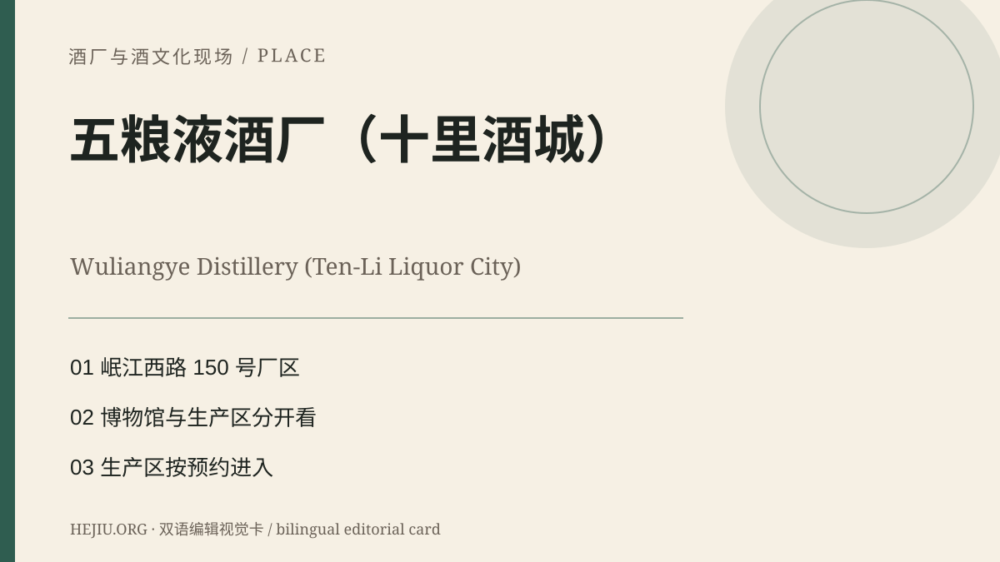

# Wuliangye Distillery (Ten-Li Liquor City)

Wuliangye in Yibin is not a single sight but a production and exhibition district spread along the Min River. Visitors often treat the plant, the Wuliangye Wine Culture Museum and “Ten-Li Liquor City” as one gate, then discover that the museum follows public opening rules while working workshops require separate booking and gate clearance. Understanding these three layers first keeps the trip from getting stuck on the question “can I go inside the factory?”.

图：Wuliangye Distillery (Ten-Li Liquor City) bilingual editorial card。Project-created bilingual editorial card for topic identification, not a documentary photograph.

> **Quick verdict**
> **Best for:** travellers who want to understand large-scale strong-aroma baijiu production and are willing to book ahead; pairs well with the wine-culture museum for a half or full day.
> **Not for:** pure photo stops or visitors who will not check booking and gate rules; the working plant is not a free-roaming industrial park.
> **One line:** museum first, plant exterior second, production areas only through official arrangements, and keep tasting separate from buying.

## Separate the three spaces first

The first layer is the Wuliangye Wine Culture Museum inside the plant at 150 Minjiang West Road. It follows the museum’s public opening rules and is the best place to build a framework for strong-aroma baijiu: grains, pits, starter culture, distillation and blending. The second layer is the plant exterior and the public roads, gates and riverfront landscape of “Ten-Li Liquor City”; they convey scale but do not grant access to workshops. The third layer is the working fermentation, packaging and storage area, entered only on official or authorised routes. Keeping “museum”, “plant view” and “workshop access” apart stops any online photo from being mistaken for a ticket.

## What the Ten-Li Liquor City shows

Yibin smells of spent grain for much of the year. The campus stretches along the Min River, with fermentation pits, starter-culture rooms, distilleries, ceramic-tank warehouses and packaging lines forming a long production chain. For an ordinary visitor, the useful question is not how many metres you walked but how continuous strong-aroma production works: old pits depend on microbial communities cultivated in the mud; grain is steamed, cooled, inoculated, put into pits and distilled; raw liquor is graded and stored in tanks. At the tank warehouse, look for capacity, numbering, temperature and humidity control and fire management rather than the sheer number of jars. At the packaging line, look for filling, labelling, cartoning and batch traceability rather than speed.

## Getting there and time needed

A taxi from Yibin West railway station to Minjiang West Road takes roughly half an hour, depending on traffic; Wuliangye Airport lies northwest of the city and the drive varies. Bus routes change, so use a live map and the stop signs. The museum plus the plant exterior fits into half a day; adding liquor history, the old town and the river confluence deserves a full day. The immediate area is industrial and residential rather than a continuous shopping street, so watch for lorries and shift-change crowds. Spent grain smells strong in summer; a mask helps sensitive visitors, and flat shoes are safer than sandals.

## Production boundaries and tasting

Working workshops contain machinery, steam, hot pipes and piled spent grain. Do not walk in on your own, climb fences or follow a lorry through a gate. Official visits are usually organised by group, time slot and route; booking, availability and photography rules depend on the company’s notice. Before tasting, ask about alcohol strength, volume and whether there is a charge. Sip from a small cup, do not start on an empty stomach, and do not treat “being able to drink” as participation. Drivers should hand the tasting to someone else or skip it; taxis and designated drivers exist in Yibin, but the plant gate gets busy at shift changes.

## What to pair nearby

A one-day loop can run museum, plant exterior, Liubei Pool Park, Guanying Old Street and Hejiangmen. Liubei Pool is associated with the Song poet Huang Tingjian’s memory in Yibin; Guanying is an old-town street; Hejiangmen is where the Jinsha and Min rivers meet to form the Yangtze. With another day, go to Lizhuang to see wartime architecture and academic history, or to the Bamboo Sea; both are far enough to need a separate half or full day. For food, try Yibin burning noodles, Lizhuang white pork, bamboo fungus and river fish, but keep the alcohol modest if you still have walking to do.

## Three ways to shape the trip

With half a day, spend the time on the museum and the plant exterior: use the museum to understand strong-aroma grains, pits, starter culture, distillation and blending, then walk the public roads to the river for a sense of scale, without chasing workshop photos. With a full day, add Liubei Pool, Guanying Old Street and Hejiangmen to connect plant, liquor history, old town and river; eat lunch in the city and return to the plant exterior in the afternoon to avoid shift traffic. With two days, give Lizhuang or the Bamboo Sea a separate day instead of squeezing the countryside into a half-day plant visit. All three versions follow the same rules: working areas only on official routes, no tasting for the driver, and liquor purchases left to the end. With only half a day, keep twenty minutes to sit by the river before returning; it conveys the scale better than one more stop. Restaurants are sparse around the plant, so lunch in the city and do not crowd tasting and a meal together. Reconfirm opening information the day before.

## Check before you go

- Check whether museum and plant are open on the same day
- Enter production areas only on official booked routes
- Wear flat shoes; bring a mask in summer
- Eat before tasting; the driver does not drink
- Leave buying to the end and keep receipts
- Watch for lorries on river and plant roads
- Do not treat “Ten-Li Liquor City” as a walking park
- Shorten the plant walk when travelling with older relatives

## Limits and next steps

The "Ten-Li Wine City" is a working estate mixed with visitor spaces, not a park you can walk freely. Open areas, tour routes and tasting points shift with production, so check the operator's or local tourism office's same-day information. Half a day is enough for the museum alone; to understand strong-aroma pits and multi-grain brewing, separate the museum, the estate display and the tasting into different blocks.

By transport, buses and taxis run from central Yibin, but walking inside the estate is long, humid in summer and windy by the river in winter. With elders or children, cut the walking and focus on the museum and indoor tasting. Do not cross the lines in production areas or film workers and pits for long.

Buying wine is separate from visiting. Prices around the estate are not necessarily lower than city supermarkets or official channels, and limited releases may need registration; confirm whether you can fly with them or ship them before deciding how much to buy. Keep the invoice and batch details for later checks.

## References

- 国家文物局博物馆年报 — 五粮液酒文化博览馆 — http://nb.ncha.gov.cn/museumdetail.html?msg=695e97ba55204e019622a4a0c22255c5&nianfen=2025 (国家文物局, checked 2026-11-25)
- 宜宾市人民政府 — 中国酒都宜宾 — https://www.yibin.gov.cn/xxgk/rdgz/202309/t20230911_1903005.html (宜宾市人民政府, checked 2026-11-25)
- Wuliangye Group — About us — https://www.wuliangye.com.cn/en/about/Introduce.html (Wuliangye Group, checked 2026-11-25)
- 四川省网上红色基地 — 五粮液酒文化博物馆 — https://hsjd.scdjw.com.cn/cover01.html?id=116 (四川省网上红色基地, checked 2026-11-25)

Related entries: [Wuliangye Wine Culture Museum](ref:museum), [Yibin Wuliangye route](ref:route), [Wuliangye](ref:brand), [Wuliangye Group](ref:producer), [strong-aroma baijiu](ref:style), [Sichuan](ref:region), [First baijiu guide](ref:guide), [History of Chinese wine](ref:history).
