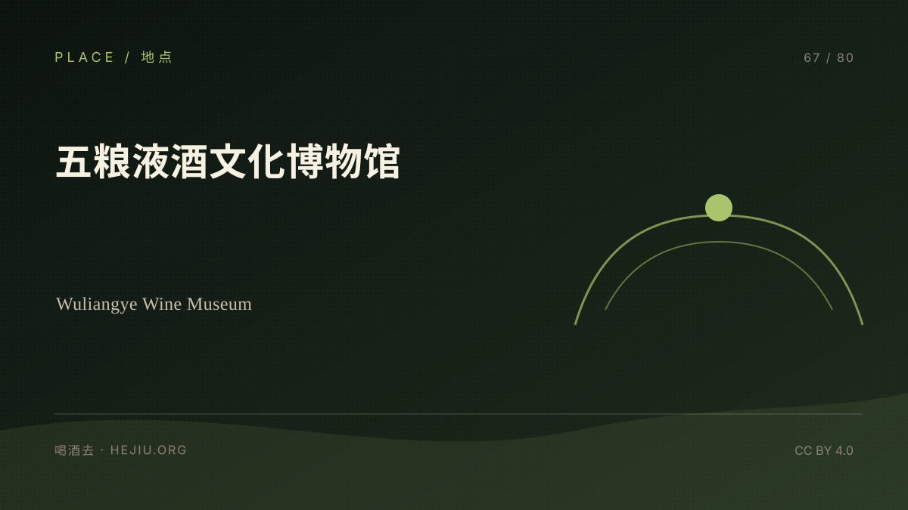
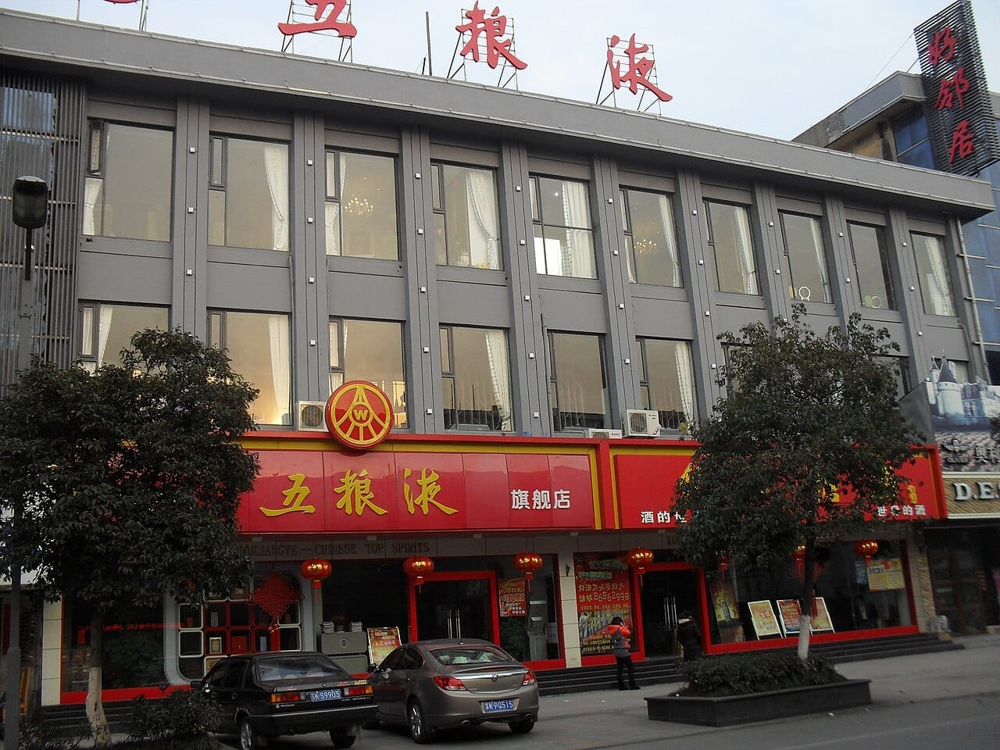

# Wuliangye Wine Museum

The Wuliangye Wine Museum stands inside the Wuliangye plant at 150 Minjiang West Road in Cuiping District, Yibin, Sichuan. Its official name is the Wuliangye Wine Culture Exhibition Hall. It was founded in March 1988, covers about 2,400 square metres, and both the company and the municipal government describe it as China's earliest liquor-culture museum. After a upgrade in July 2022 it was reorganised into five galleries — brand, craft, history, development and planning — and now serves as the first stop on the industrial-tourism route through the "ten-li liquor city".

> **Visit information**
> - Address: 150 Minjiang West Road, Cuiping District, Yibin, Sichuan, China.
> - Opening and booking: check the [official page](http://nb.ncha.gov.cn/museumdetail.html?msg=695e97ba55204e019622a4a0c22255c5&nianfen=2025) before travelling; hours, tours and booking rules change by season.
> - Getting there and cost: check the official page before booking; this entry does not promise a fixed price.
> - Status: Verified; sources checked: 2026-11-08.

Figure: Wuliangye Wine Museum. Project-generated or category illustration used for Chinese alcohol culture context; not a photograph of the subject.

> **Quick verdict**
> **In one line:** This entry helps you decide whether Wuliangye Wine Museum deserves a detour, and what to check before visiting.
>
> - **Best for:** Anyone planning a visit to Wuliangye Wine Museum who needs to decide whether it deserves a half-day or a full day.
> - **Not for:** If you want only want a must-visit list and will not check booking, transport or opening hours.
> - **Check first:**
>   - The exhibition hall was established on 3 March 1988.
>   - Allow one to one and a half hours for the museum and two to three hours for the wider site.

## Place and history

The exhibition hall was established on 3 March 1988. That is early for a Chinese distillery museum, and the claim to be "the earliest" has a specific meaning: not the oldest museum in China, but the earliest exhibition hall in the Chinese baijiu industry devoted to liquor culture. In 2006 it was designated a Sichuan provincial patriotic-education base by the provincial party committee and government, and it also serves as a social-science education centre for schools. In July 2022 the displays were upgraded from an earlier corporate exhibition into five narrative lines: brand, craft, history, development and planning.

Wuliangye's historical narrative reaches back much further. Company material says the liquor "began in the Tang, flourished in the Song, matured in the Ming and took its name in the Qing", and the group preserves a Yuan-dynasty pit complex dating from 1276, more than seven hundred years old. Wuliangye Group now has more than 35,000 fermentation pits, of which the ancient pits are the most important in heritage terms. Yibin stands where the Jinsha and Min rivers join to form the Yangtze; the confluence brings a humid climate and river transport, and the local microbial environment is part of the reason the distillery is here rather than in an abstract "liquor park".

The name Wuliangye states the recipe: sorghum, rice, glutinous rice, wheat and maize. The five-grain mash gives a fuller body than a single-grain strong-aroma spirit, with grain, qu and aged aromas; the "bao bao" qu, continuous mash recycling and pit rotation set the structure. The craft gallery breaks these steps down, but the real production continues outside the gallery, and visitors should distinguish the displayed process from the working one.

## The building and the displays

The museum sits beside the east gate of the plant, next to a direct-sales shop shaped like a Wuliangye pack. Inside, the roughly 2,400 square metres are divided into five galleries: brand, with the company's history and awards; craft, with the five-grain recipe, qu-making, fermentation, distillation and blending; history, with Yibin's distilling past and the ancient pits; development, with the plant's expansion and product range; and planning, with the future layout of the site and the industry. Objects, photographs, film and reconstructed scenes carry the story; the route is short but information-dense.

The space outside the museum is the other half of the visit. From the east gate, the museum is on one side and the direct-sales shop on the other; farther in are the Golden Cup Grove, the calligraphy corridor, the Bottle Building, Workshop 523 and the ecological wetland. Workshop 523 is described as the world's largest single brewing workshop; the Bottle Building is the plant's landmark; the grove and corridor turn corporate honours and calligraphy into landscape. Whether you can see inside a workshop, and how far into the plant you can go, depends on the day's booking and production schedule; do not assume that museum admission gives access to the whole factory.

The most useful exhibits are the chain "from a seed to a drop of liquor": grain samples, qu blocks, pit mud, a distillation model, bottles and labels from different decades, company archives and trophies. They do not rely on a single treasure object; they break strong-aroma production into understandable steps. Seen after a walk through the real pits and workshops, the information closes; seen alone, without factory access, the museum can feel like a corporate display room.

## How to visit

Allow one to one and a half hours for the museum and two to three hours for the wider site. A sensible route is east gate, museum, Golden Cup Grove and calligraphy corridor, Bottle Building, Workshop 523 if open, and the ecological wetland. If you care only about liquor culture, the museum and shop are enough; if you want to see production, confirm in advance whether the workshop is open and whether a guide accompanies visitors.

The site is free, but entry to the plant and museum normally requires a booking, and groups, school visits and media visits need separate arrangements. Booking methods and quotas follow official notices; do not turn up at the gate because admission is free. Guided tours should be booked ahead; individual visitors can read the panels and wayfinding. The displays are mainly in Chinese, and foreign-language material or guides should be requested in advance.

Tasting and buying are separate. The direct-sales shop sells Wuliangye, Wuliangchun and Wuliangchun products, and whether a tasting is available or charged depends on the day; minors are not served alcohol. In production areas, do not wear sandals, slippers or heels, do not touch equipment or pits, and do not cross safety lines. Workshops are noisy and steamy and smell of spent grain; parents should keep children close.

## Practical information

The address is 150 Minjiang West Road, Cuiping District, Yibin, Sichuan, China, beside the east gate of the Wuliangye plant. The National Cultural Heritage Administration's museum report records year-round opening, 365 days a year, from 08:30 to 17:30, with free admission; the site telephone number is 0831-3566777. Its booking-information field is recorded as "none", meaning no uniform booking requirement is registered; entry to the plant is still subject to security and production arrangements, so groups, study visits and guides should contact the site in advance.

Admission is free, with no ticket charge. Guided tours, tastings, custom activities or special exhibitions may be charged separately, so ask what is included when booking. The plant's direct-sales shop sells Wuliangye and related products; minors are not served alcohol.

Yibin is compact, and a taxi from Yibin station, Yibin West high-speed station or Wuliangye Airport to Minjiang West Road is practical; journey times depend on traffic. Bus routes and stops should be checked on live maps (not verified route by route). Drivers should use the designated car park and keep out of production and loading areas.

Page verified 2026-11-08; opening status, prices and reservations are subject to official channels.

## Etiquette and common mistakes

The first mistake is to think the "Wuliangye Wine Museum" and the "Wuliangye Wine Culture Exhibition Hall" are two places. They are two names for the same institution; the official name is the exhibition hall, and this entry uses "museum" in the title while keeping the official name in the aliases. Second, Wuliangye is a strong-aroma baijiu, not a sauce-aroma spirit; do not confuse its process with Moutai's. Third, free admission does not mean no booking; the plant still has security and production rules.

The fourth mistake is to treat the ancient pits as merely old buildings. Their value lies in the microbial community in the pit mud and the continuity of use; older pits have a more stable ecology. Do not touch the mud or throw anything into a pit. Fifth, baijiu is usually around 52% alcohol; taste in small sips, do not drink on an empty stomach, and never drive afterwards.

Inside the plant and museum, follow the rules: no smoking, no touching equipment, no entering closed areas, no photography where it is prohibited. Production areas have machinery and hot pipes, so sandals and slippers are unsafe; the smell of spent grain is strong, and sensitive visitors may prefer a mask. When buying bottles, check the rules for carrying and checking them in on your train or flight.

## Around and routes

The Wuliangye site works well in a day with Yibin's liquor culture and riverfront. The municipal government suggests Wuliangye Scenic Area, Liubei Pond Park, 501 Baijiu Culture Site, Guanying Old Street and Hejiangmen Square. Liubei Pond is associated with the poet Huang Tingjian; 501 is another liquor-culture space; Guanying is an old commercial street; Hejiangmen is where the Jinsha and Min rivers meet to form the Yangtze. Together they give a day of distillery, liquor history, old town and river.

With another day, go to Lizhuang ancient town for its wartime architecture and academic history, or to the Bamboo Sea in southern Sichuan; both are farther from the city and need half a day or more. Cuiping Mountain and Zhenwu Mountain are in the city and suit an evening walk. Yibin food is worth planning around: ranmian noodles, Lizhuang white meat, bamboo fungus and river fish, with care over how much baijiu accompanies them.

Yibin West is the high-speed rail station, and Wuliangye Airport lies northwest of the city; taxis from either to Minjiang West Road are convenient. Bus routes and times should be checked on live maps; the area around the plant is industrial and residential rather than a shopping district. With only half a day, prioritise the museum and the exterior of the plant rather than forcing Lizhuang or the Bamboo Sea into the same day.

### Key dates and figures

- 2025: the official museum page used for opening times and booking is the 2025 listing; the page was checked on 2026-11-08.

## Decision table: what to check before visiting

| Item | Verified information | Visit note |
| --- | --- | --- |
| Address | 150 Minjiang West Road, Cuiping District, Yibin, at the east gate of the Wuliangye plant | navigate to the east gate; do not drive into the production area |
| Hours | the National Cultural Heritage Administration yearbook lists 8:30–17:30, all year | check the official page for temporary changes |
| Ticket | free | guided tours, tastings or special activities may cost extra |
| Booking | the yearbook records “no” unified booking; the plant still has gate control and production schedules | groups, study visits and guides should contact the site in advance |
| Time needed | museum 1–1.5 hours; whole site 2–3 hours | museum plus shop can fit a half day |
| Production area | access depends on the day’s booking and production schedule | do not assume a museum ticket opens the whole plant |

## Related images

Image: Wuliangye. Credit: 东京村子, CC BY-SA 3.0, via Wikimedia Commons ([source page](https://commons.wikimedia.org/wiki/File:%E4%BA%94%E7%B2%AE%E6%B6%B2%E6%97%97%E8%88%B0%E5%BA%97_-_panoramio.jpg)). Related image for Wuliangye Wine Museum.

## Frequently asked questions

### Do individual visitors need to book?

The National Cultural Heritage Administration yearbook records no unified booking requirement, but the plant still has gate control and production schedules. Check the site’s official notice before leaving. Groups, study visits, media and anyone needing a guide should contact the site in advance about capacity and route.

### How long does the museum take?

The five galleries are compact; allow 1–1.5 hours. With the Golden Cup Grove, calligraphy corridor, Bottle Tower and shop, allow 2–3 hours. To link central Yibin, add Liubei Pool Park, 501 Baijiu Culture Site and Guanying Old Street, but do not force Lizhuang or the Bamboo Sea into the same day.

### Can I enter Workshop 523 or the production area?

Not guaranteed. Access depends on the day’s booking, production schedule and safety conditions. Even when open, follow a guide on the designated route, do not wear slippers, sandals or high heels, do not touch equipment or fermentation pits, and do not cross safety lines.

> **Next:** Start with [baijiu](ref:baijiu) for the category, then [strong-aroma baijiu](ref:strong) for Wuliangye’s style; for the product itself, read [Wuliangye](ref:wuliangye).

## See also

The Wuliangye museum is an entry point for understanding [baijiu](ref:baijiu) and [strong-aroma baijiu](ref:strong-aroma), and it places [Yibin](ref:sichuan) within the distilling geography of the upper Yangtze. For the product itself, see [Wuliangye](ref:wuliangye).

Further reading: [A Ginjinha](ref:c-extra-1).
