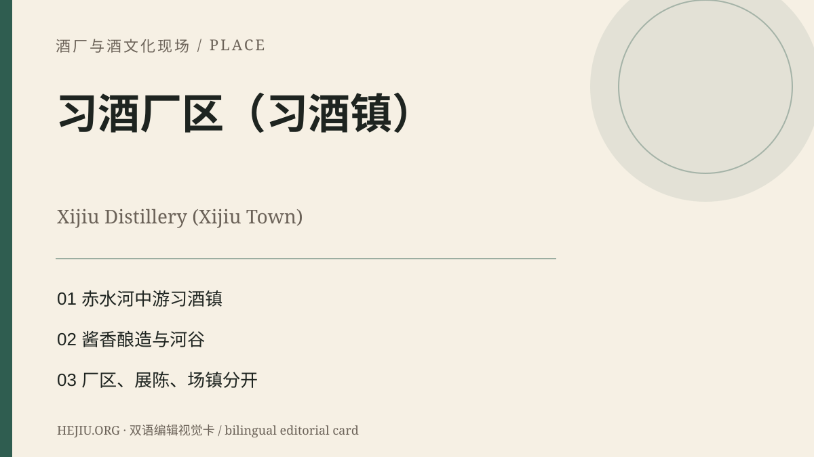

# Xijiu Distillery (Xijiu Town)

Xijiu Town sits on the middle Chishui River, with the hills of Guizhou’s Xishui and Sichuan’s Gulin on either side. Many treat it as “the next stop after Langjiu Estate”, but the Xijiu plant is itself a complete sample of sauce-aroma valley production: starter culture, grain stacking, pit fermentation, distillation and storage climb the slopes. Separate plant, exhibition and town life before deciding whether to visit specifically or fold it into a two-day Sichuan–Guizhou liquor route.

Figure: Xijiu Distillery (Xijiu Town) bilingual editorial card. Project-created bilingual editorial card for topic identification, not a documentary photograph.

> **Quick verdict**
> **Best for:** travellers on a Sichuan–Guizhou sauce-aroma route who want the middle Chishui; pairs with Tucheng and Erlang for two days.
> **Not for:** roadside photo stops or visitors who will not book; the plant has production gates.
> **One line:** book the plant visit and town lodging separately, and keep the driver out of the tasting.

## Plant, exhibition and market town

Xijiu Town is a living market town with homes, a school, a wet market, small restaurants and plant shuttles. The Guizhou Xijiu production plant is a separate industrial space with starter rooms, pits, distillation halls, ceramic warehouses and packaging logistics. Exhibition or reception space explains history, craft and brand. The three often share one slope road but not the same gates. At the visitor centre, ask what can be entered, what is view-only and what needs booking; do not follow a map straight into a workshop. The town is sloping, so flat shoes beat hard soles.

## Sauce aroma on the middle Chishui

Sauce-aroma craft revolves around high-temperature starter culture, grain feeding in autumn, repeated steaming and draw-off. The valley’s heat, humidity, wind and water affect starter cultivation and grain stacking, but raw materials, process control and long storage matter just as much. In production, look at starter-block temperature, sorghum crushing ratio, the looseness of stacked grain, pit sealing and draw-off rounds; do not just memorise numbers but see how they land in a team and a workshop. If workshops are closed, use cutaways and flow diagrams in the exhibition, then compare valley orientation and plant layout from the viewing point.

## Getting there and where to sleep

Xijiu Town lies in eastern Xishui County, usually approached from Zunyi, Luzhou or Chongqing. Roads are mountainous, fog slows traffic in rain, and self-driving needs buffer time. Buses are sparse, so check live information. A same-day return is rushed; stay one night in Xishui county town or Xijiu. Town lodging is mostly local guesthouses, while plant reception lodging is booked separately and tightens on peak weekends and reception days. Ask about hot water, parking, breakfast and checkout. Keep luggage light for slopes and narrow lanes.

## Booking and tasting boundaries

Plant visits are usually organised by group, time slot and route; availability, photography and charges follow official notices. Working workshops contain steam, machinery, forklifts and spent grain, so do not walk in or climb fences. Before tasting, ask about strength, volume and charge; sip slowly, not on an empty stomach. The driver abstains, and no one should drive mountain roads after tasting. Buy from official or authorised shops and keep receipts; do not treat “internal” or “reception” liquor as a bargain, and avoid unclear bottles in the car.

## Pairing Tucheng and Chishui

A two-day Xishui loop can run Xijiu plant and town on day one, sleep in Xishui, then Tucheng’s Four Crossings memorial and old street on day two before returning to Chishui or Zunyi. Check buses and navigation for cross-county legs, and watch for landslides and closures in the rainy season. For food, try Xishui mutton rice noodles, tofu pudding, cured meat and Chishui River fish, keeping sauce-aroma liquor modest. With only half a day, eat in town and view the plant exterior and valley; do not squeeze in both Tucheng and Chishui.

## Treat Xishui as two days in the valley

Arrive in Xijiu on the first afternoon, check in, walk the town, view the plant exterior and valley, and eat in the evening. On the second morning, enter the plant or exhibition on a booking, check out at noon for Tucheng, see the memorial and old street in the afternoon, and head to Chishui or Zunyi toward evening. This puts production visiting in the freshest hours and long transfers in the afternoon. With one day, choose the plant exterior and exhibition and skip Tucheng; with older relatives, reduce slope walking, understand the cutaways first, then compare them from the viewpoint. If you do one thing, enter the plant exhibition in the morning, follow starter culture, grain stacking, pits and distillation, then use the viewpoint to locate the workshops in the valley; leave the afternoon for Xijiu town and Tucheng, and do not add Chishui on the same day. In rain or fog, see one fewer point rather than drive mountain roads at night; after tasting, hand the keys to a non-drinker. Town restaurants mostly follow meal times and thin out after lunch, so do not delay eating past two; if sleeping in the county town, allow forty minutes back to Xijiu the next morning, and bring a light jacket for cool valley evenings. Do not buy bulk liquor at the plant gate; leave unclear bottles behind. Ask where toilets are, and do not overtake on bends.

## Check before you go

- Check whether the plant visit is open
- Decide town or county-town lodging first
- Do not drive mountain roads after tasting
- Buy only from official or authorised shops
- Check cross-county buses in advance
- Watch for landslides and closures in rain
- Keep luggage light for slopes
- Do not climb plant fences
- Plant visits follow group slots
- Slow down for oncoming traffic
- Arrive ten minutes early at the meeting point
- Confirm next-day breakfast at lodging
- Keep booking messages available offline
- Check fuel before the pass

## Limits and next steps

The Xijiu estate stretches along the Chishui river, with production, offices and visitor reception spread out; walking distances are longer than the map suggests. Visits usually need a booking or a host, and the open area for individual visitors is limited; do not enter koji-making or brewing workshops during production, and do not cross safety lines.

Buses and ride-hailing run from Xishui county town to Xijiu town, but frequency depends on the hour; coming across the river from Maotai also needs time for checks and traffic. The valley is hot and humid, so drink water in summer, and winter mornings and evenings are cold. Do not drive right after tasting.

This page does not promise a particular workshop or warehouse. Keep the estate visit separate from Tucheng old town and the Chishui scenery, and follow production rules if access changes. Buying and shipping follow the distillery and local channels.

## References

- xsx.gov.cn — official source — https://www.xsx.gov.cn/zjxs/xsgk/jj2023/202605/t20260525_90206553.html (checked 2026-11-25)
- gzxijiu.com — official source — https://www.gzxijiu.com/about/introduction?menuId=r_5uFQaERX42fDKDI7O2B (checked 2026-11-25)
- zunyi.gov.cn — official source — https://www.zunyi.gov.cn/ (checked 2026-11-25)
- Official source — official source —  (checked 2026-11-25)

Related entries: [Tucheng Old Town](ref:tucheng), [Xishui Xijiu route](ref:route), [Xijiu](ref:brand), [Guizhou Xijiu](ref:producer), [sauce-aroma baijiu](ref:style), [Guizhou](ref:region), [First baijiu guide](ref:guide), [History of Chinese wine](ref:history).

## Related images

Image: Xijiu. Credit: Lhzss8, CC BY-SA 4.0, via Wikimedia Commons ([source page](https://commons.wikimedia.org/wiki/File:%E4%B8%80%E6%AC%BE%E4%B9%A0%E9%85%92.jpg)). Related image for Xijiu Distillery (Xijiu Town).

The administrative division reference is the 2007 edition of GB/T 2260.
