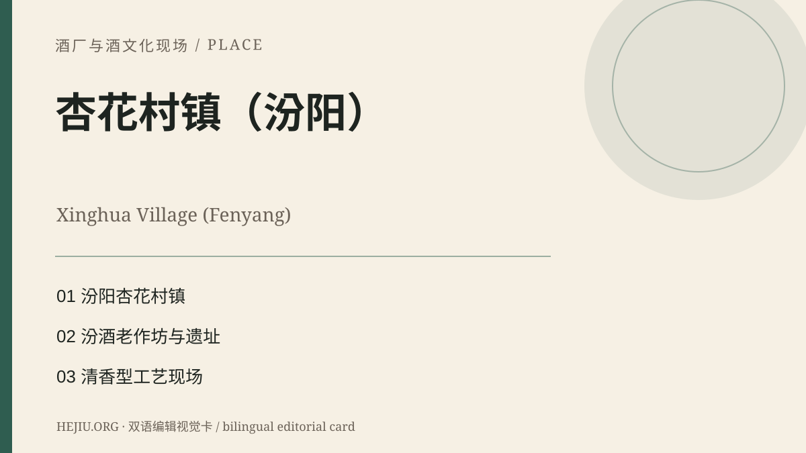

# Xinghua Village (Fenyang)

“Xinghua Village” is an image in poetry and a town in Fenyang. The Fenjiu plant, the old Fenjiu workshop, the Xinghua Village site and liquor-culture displays sit inside and around the town; many visitors see only a gate or a stone marker and think they have seen it. What matters is light-aroma starter culture, jar fermentation, distillation and storage, and how the poetry-and-liquor story lands in a real liquor town. Separate plant, heritage site and exhibition before choosing craft, history or both.

Figure: Xinghua Village (Fenyang) bilingual editorial card. Project-created bilingual editorial card for topic identification, not a documentary photograph.

> **Quick verdict**
> **Best for:** travellers who want light-aroma baijiu and the poetry-and-liquor story; pairs with Fenyang, Pingyao or Taiyuan.
> **Not for:** visitors who only want a “Xinghua Village” archway photo and will not book; plant and heritage site have boundaries.
> **One line:** old workshop and craft first, then poetry and liquor history, with tasting kept apart from buying.

## Xinghua is not one scenic spot

Xinghua has at least four layers: the Fenjiu production plant, the old Fenjiu workshop and heritage site, liquor-culture exhibition space, and the daily life of Xinghua Village. The plant has starter culture, jar fermentation, distillation, ceramic storage and packaging logistics. The old workshop and site explain history and craft lineage. Exhibition space explains brand, poetry-and-liquor culture and origin. The town has homes, restaurants, a school and roads. Visitors compress all four into “Xinghua Village” and then cannot find the entrance. Start at the visitor centre, take a map and ask what needs booking and what is view-only.

## Old workshop and heritage site

The old Fenjiu workshop is a key site for traditional light-aroma production. Focus on underground jars, starter rooms, stills and storage. Light-aroma baijiu ferments in earthen jars buried in the ground, which helps control temperature and unwanted microbes; starter culture is kept cool and clean to produce a light, elegant qu. In the old workshop, look at jar layout and depth, starter-block cultivation and storage, and how distillation connects to storage. The site and markers add history, but do not only read stone; understand the jar–starter–still–storage line, which is more useful than dates.

## Light-aroma craft and poetry

The “light” in light-aroma is not weakness but cleanliness and clarity, with little off-flavour. The craft stresses low-temperature starter, jar fermentation, clean steaming and separate distillation, and long storage; the aroma is led by ethyl acetate, elegant, sweet on entry and clean at the finish. Keep craft and poetry separate: craft lives in workshops, cutaways, tools and flow diagrams; poetry lives in inscriptions, verse and liquor-history displays. They support each other, but “the shepherd boy points to Xinghua Village” is not a process description. If a guide is available, take the craft part first, then the poetry.

## Getting there and time needed

Xinghua Village lies northeast of Fenyang city, not far from the urban area, usually reached via Taiyuan, Pingyao or Fenyang station; check live schedules. The old workshop and exhibition take about two to three hours; plant exterior, town and tasting make half a day; adding Fenyang old town or Jiazhuang fills a day. Taxis connect plant and town; walking routes are short but lorries are common. Shanxi has big day–night temperature swings, so bring a jacket; ice in winter demands non-slip shoes. From Pingyao, put Xinghua in the morning and return or visit Fenyang old town in the afternoon.

## Fenyang and Jiazhuang

Fenyang is more than Xinghua: the old town’s Confucian temple, wall remains and streets, and Jiazhuang’s rural culture and cinema-related spaces place the liquor town inside Jinzhong life. A half-day can run old workshop, exhibition and town; a full day adds Fenyang old town and Jiazhuang. For food, try Fenyang rotating noodles, knife-cut noodles, guo you rou and Fenzhou home cooking, keeping light-aroma liquor modest. Buy from official or authorised shops and keep receipts; do not treat “internal liquor” as an extension of the old workshop. With children, see craft animations or models before the plant exterior.

## Read Xinghua as craft plus poetry

Start at the old workshop with jars, starter rooms and stills, grounding the “light” of light-aroma in tools and process. Then see the poetry, inscriptions and liquor history in the exhibition to understand how Xinghua moved from place name to cultural image. Finally eat and walk in town without rushing to buy. With two hours, the old workshop plus one exhibition is enough; with children, see models and animations before the plant exterior. Before leaving, separate tasting from buying: take one small cup, then decide, rather than letting a sales rhythm at the end of a tour make the decision. If you do one thing, see jars, starter rooms and stills in the old workshop, grounding the “light” of light-aroma in tools and process; then read poetry and liquor history in the exhibition, and only then eat and buy. With two hours, the old workshop plus one exhibition is enough; from Pingyao, put Xinghua in the morning and return or visit Fenyang old town in the afternoon. Ice demands non-slip shoes in winter, and big temperature swings demand a jacket in summer. Ask where toilets are, do not overtake on bends, keep water in the car, check the weather, wear a hat, note the parking spot and keep booking codes.

## Check before you go

- Confirm old-workshop and exhibition entrances
- Do not enter working plant areas
- Do not touch fermentation jars
- Do not drive after tasting
- Buy only from official or authorised shops
- Wear non-slip shoes in winter
- Check connections from Pingyao
- Show children models before the site
- Ask talk times at the old workshop
- Do not lift jar lids
- Do not touch inscriptions in the exhibition
- Ask about opening hours before eating in town
- Check batch codes when buying liquor
- Walk slowly on ice in winter

## Limits and next steps

The heart of Xinghua village is the old Fenjiu workshop, the wine-culture museum and the town lanes, not a reconstructed commercial street. Separate the museum, the old workshop and the modern plant: each has its own hours and booking method, production areas are not open freely, and the old workshop is better for craft and space.

Buses and self-driving routes connect Fenyang or Taiyuan with Xinghua; the walkable centre is small but the exhibition sites are some distance apart. Guided slots are tight on holidays, so book ahead. Local food is mostly wheat-based, so eat before tasting.

This page does not present Xinghua as the "only home of light aroma". It works as the core of a Fenyang route, combined with nearby distilleries and Jinzhong sights; if time allows one stop, prioritise the museum and old workshop rather than squeezing in shops.

## References

- fenjiu.com.cn — official source — https://www.fenjiu.com.cn/OnlineTour/2023-01-06/296.html (checked 2026-11-25)
- fenjiu.com.cn — official source — https://www.fenjiu.com.cn/OnlineTour/2023-01-06/297.html (checked 2026-11-25)
- nb.ncha.gov.cn — official source — http://nb.ncha.gov.cn/museumdetail.html?msg=ee70a34121f3498ca08d4ddede4701e5&nianfen=2022 (checked 2026-11-25)
- fenjiu.com.cn — official source — https://www.fenjiu.com.cn/developmentHistory/index.html (checked 2026-11-25)

Related entries: [Fenjiu Museum](ref:museum), [Fenyang Xinghua route](ref:route), [Fenjiu](ref:brand), [Fenjiu Group](ref:producer), [light-aroma baijiu](ref:style), [Shanxi](ref:region), [First baijiu guide](ref:guide), [History of Chinese wine](ref:history).

## Related images

Image: Fenjiu. Credit: N509FZ, CC BY-SA 4.0, via Wikimedia Commons ([source page](https://commons.wikimedia.org/wiki/File:Fen_Jiu_and_Chu_Yeh_Ching_Chiew_at_a_supermarket_in_Beijing_(20241109164541).jpg)). Related image for Xinghua Village (Fenyang).
