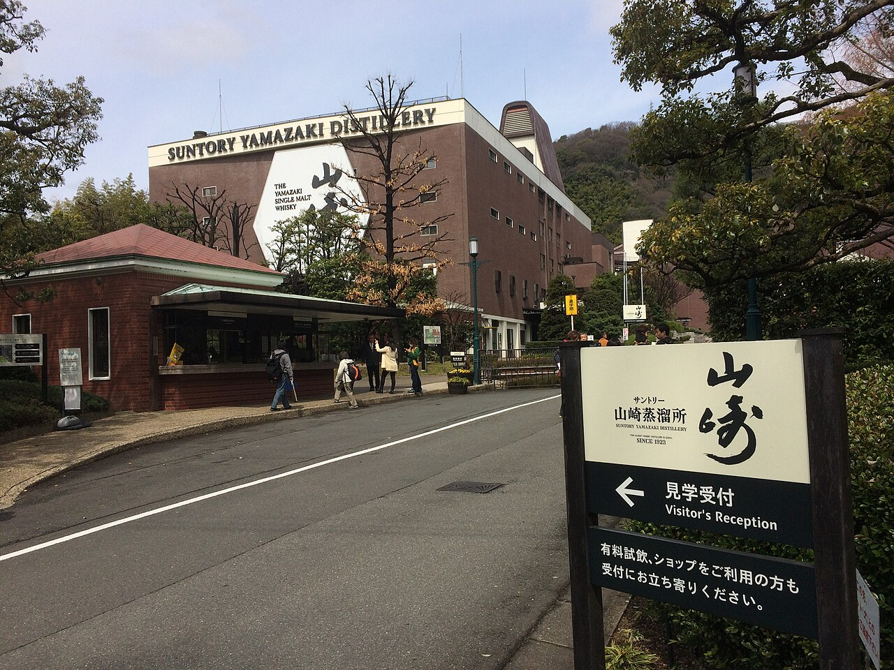
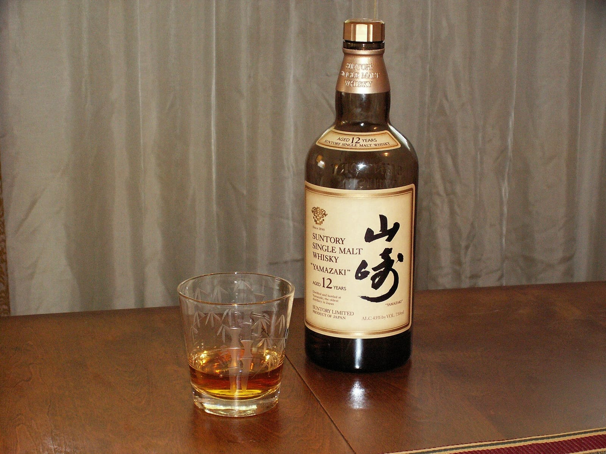

# Yamazaki Distillery

Yamazaki Distillery stands in Yamazaki, Shimamoto-cho, in Osaka Prefecture, at the foot of Mount Tennozan south-west of Kyoto. Construction began in 1923 and distillation in 1924, making it the oldest malt whisky distillery in Japan. It was driven by Shinjiro Torii, the founder of Suntory, whose aim was not to copy Scotland but to make a whisky suited to Japanese palates. The site was chosen for its water and seasonal climate, which the official introduction treats as central to maturation. The grounds cover about 110,000 m² and still include the whisky museum building from the founding era.

Figure: Yamazaki Distillery. Image: Ujigis, CC BY-SA 4.0, via Wikimedia Commons ([source page](https://commons.wikimedia.org/wiki/File:YamazakiDistillery_01.jpg)).

## Setting and history

Japanese whisky is often described as an imitation of Scotch, but Yamazaki's early aim was more specific: to use Japanese water and climate to make a whisky softer and more suited to the table than the imported whiskies of the time. Construction in 1923 and distillation in 1924 make it the first malt whisky distillery in Japan. The early years were not smooth; the team experimented with equipment, yeast and oak. The present house style, with fruit, honey, the sandalwood note of mizunara oak and a moderate smokiness, is the result of long adjustment rather than a design fixed at the start.

The site lies in the basin south-west of Kyoto, and the official introduction puts water and the four seasons at the centre of its identity. For a visitor, that means Yamazaki is not a factory assembled from copied Scottish equipment but a place where the local environment is written into the spirit. The whisky museum occupies a building that has been part of the distillery since its founding and is the most direct entry point into that history.

## Space and displays

There are two kinds of visit. The first is the paid distillery tour, which goes through mashing, fermentation, distillation and warehousing and shows the copper stills, washbacks and maturation warehouses. The second is the whisky museum, which is free and covers the collection and tasting without entering the production flow. The museum displays Yamazaki's history, raw materials, cask types and old equipment; the tasting area offers paid samples of Yamazaki and other Suntory whiskies. There is also a shop and a lounge. Tours use an earphone guide, and visitors cannot walk freely through the production areas; the scale of the washbacks, stills and warehouses is the point of the tour.

The displays can be read along four lines: raw materials, process, cask and time. The raw-material section explains malt and water; the process section covers mashing, fermentation and double distillation; the cask section compares bourbon, sherry and mizunara; the time section explains the maturation environment in the Yamazaki warehouses. Keeping those four lines in mind makes it easier to tell where sweetness, smoke and woodiness come from in the glass.

## Visiting and tasting

Every visitor must reserve, including those who only want the shop or the tasting lounge; entry without a reservation is not allowed. The distillery tour is allocated by lottery, with places released by month, and it fills quickly in high season. The whisky museum is free but still requires a reservation for the museum visit. Book on the official site, bring the confirmation and identification on the day, and note that tasting and bottle purchases require visitors to be at least 20; drivers, cyclists and minors may not drink.

For tasting, start with the basic Yamazaki expressions and then move to different cask types or older bottlings; ordering too many at once quickly overwhelms the palate, especially with cask-strength spirit. The tasting area usually provides small glasses and spittoons, so set your own pace. Bottle availability in the shop is unstable, purchases are limited and age-checked, and telephone or email reservations are not accepted; if you are coming for one particular bottle, check the official notices first to avoid a wasted trip.

## Practical information

The address is 5-2-1 Yamazaki, Shimamoto-cho, Mishima-gun, Osaka 618-0001, Japan; telephone 075-962-1423 (10:00–17:00). Opening hours are 10:00–16:45 with last entry at 16:30; the distillery closes over the New Year holiday and during maintenance shutdowns, with occasional unannounced closures.

Reservations: every visitor must book, including those who only want the shop or the tasting lounge; entry without a reservation is not allowed, and bookings are made on the official site. The distillery tour is allocated by lottery, with places released by month, and fills quickly in high season. The whisky museum is free but still requires a "whisky museum visit" reservation. Admission is free and the paid tours are priced on the official site. Tasting and bottle purchases require visitors to be at least 20 and to show identification; telephone or email holds are not offered.

It is about a ten-minute walk from JR Yamazaki Station on the Kyoto Line or Hankyu Oyamazaki Station on the Kyoto Line (the official access page lists rail access; the walking time is approximate and was not re-checked stop by stop). There is no general parking, and street parking or parking at nearby parks is prohibited, so use public transport.

Page verified 2026-11-08; opening status, prices and reservations are subject to official channels. Construction began in 1923 and distillation in 1924.

## Etiquette and misconceptions

The first misconception is that you can simply arrive and enter. Yamazaki is reservation-only, including the shop and tasting lounge, and staff will turn away visitors without a booking. The second is confusing the whisky museum with the production tour; the museum does not enter the mashing or distillation rooms, and seeing production requires the paid tour. The third is driving to the distillery and then tasting; Japan enforces drink-driving rules strictly, and both the driver and passengers may not drink. The fourth is assuming the shop will have the popular bottles, since stock fluctuates and purchases are limited and age-checked.

Arrive at the reserved time, as late arrivals may be refused. Do not touch equipment or cross the yellow lines in production areas. At a tasting, smell before sipping and use the spittoon if needed; avoid strong perfume, which interferes with other visitors. Families should follow the age and accompaniment rules, and pushchairs are difficult in some areas. Outside food and drink are not allowed on site, and pets are not permitted except assistance dogs.

## Surroundings and itineraries

Yamazaki lies between Kyoto and Osaka and works well as a half-day. See the distillery in the morning, then visit Mount Tennozan or Iwashimizu Hachimangu in the afternoon, or take the JR line into Kyoto for Fushimi Inari and Kiyomizu-dera, or back to Osaka. Anyone interested in Japanese whisky can continue to the Hakushu distillery in Yamanashi or Yoichi in Hokkaido, but each needs a separate day. For visitors based in Osaka, Yamazaki can be combined with Osaka Castle and Umeda in one day, with manageable travel time.

To build a fuller picture of Japanese whisky, pair Yamazaki with a bar evening in Osaka: use the distillery by day to fix the house's casks and styles in mind, then compare other distilleries in the city at night. The reverse order also works, but high-strength spirit dulls the palate, so leaving the distillery for the next day is the safer sequence.

With only two hours, choose the whisky museum rather than the distillery tour: the displays and tasting are concentrated and there is no production route to rush. To understand the process, the tour is worth the extra time, but allow half a day and factor in transport and the reservation slot. Weekends and autumn-leaf season are busy, so checking the official site a month ahead is prudent.

## See also

Yamazaki is where [Yamazaki single malt](ref:yamazaki) is made and a starting point for understanding [Japanese](ref:japan) whisky; to build a flavour framework first, read the [whisky introduction](ref:whisky-intro) and then return to the wider category of [whisky](ref:whisky).

Further reading: [Bar High Five](ref:c-extra-1).

Yamazaki Distillery is best read by starting with the address, moving to the current opening status, and ending with what the place is known for.

[Yamazaki Single Malt](ref:yamazaki) and [Japan](ref:japan) are the nearest useful comparisons: one clarifies address and space, the other tests operating status.

## Related images

Image: Related photograph of Yamazaki Single Malt. Credit: Gentgeen, CC BY-SA 3.0, via Wikimedia Commons ([source page](https://commons.wikimedia.org/wiki/File:Yamazake_single_malt.jpg)). Related image for Yamazaki Distillery.
