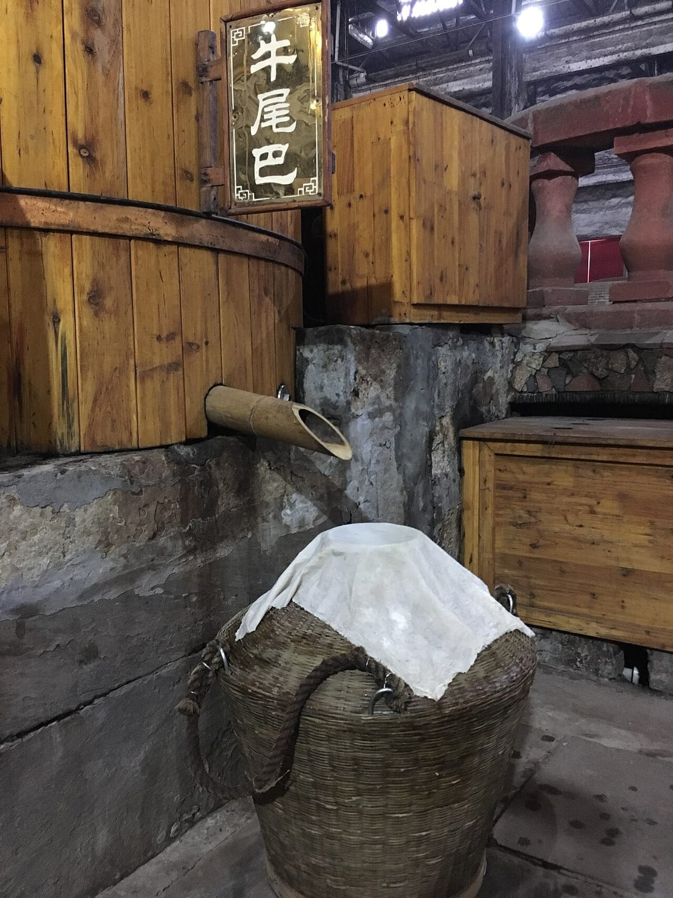

# Yanghe Distillery Cultural Tourism Area

Driving from Suqian city toward Yanghe Town, the smell of distillers’ grain arrives before the gate. This is not a “museum built by sealing off a distillery”: it is the working production site of Yanghe Distillery, where trucks, pits, pottery storage, packaging lines and visitor routes overlap. What visitors see is an unusually large sample of China’s industrial baijiu production, and a record that runs from a 2006 “industrial tourism demonstration site” to a national 4A scenic area, national industrial heritage and a national key cultural relic.

> **Visit information**
> - Address: 118 Zhongda Street, Yanghe Town, Sucheng District, Suqian, Jiangsu, China.
> - Opening and booking: check the [official page](https://ly.chinayanghe.com/) before travelling; hours, tours and booking rules change by season.
> - Getting there and cost: check the official page before booking; this entry does not promise a fixed price.
> - Status: Verified; sources checked: 2026-11-21.

Figure: Fermenting baijiu mash at Luzhou Laojiao, used as an illustrative image of solid-state fermentation; not the Yanghe site. Image: Xiaomage de, CC BY-SA 4.0, via Wikimedia Commons ([source page](https://commons.wikimedia.org/wiki/File:Baijiu_Produktion_Luzhou_Laojiao.jpg)).

> **Quick verdict**
> **In one line:** This entry helps you decide whether Yanghe Distillery Cultural Tourism Area deserves a detour, and what to check before visiting.
>
> - **Best for:** Anyone planning a visit to Yanghe Distillery Cultural Tourism Area who needs to decide whether it deserves a half-day or a full day.
> - **Not for:** If you want only want a must-visit list and will not check booking, transport or opening hours.
> - **Check first:**
>   - The official introduction gives a clear timeline: in 2006 the site was named a national industrial tourism demonstration site; in 2015 it became a national 4A scenic area.
>   - A full route usually starts at the corporate exhibition hall for Yanghe’s history, brands and production area, then enters the packaging and logistics centre.

## Location and history

The official introduction gives a clear timeline: in 2006 the site was named a national industrial tourism demonstration site; in 2015 it became a national 4A scenic area; in 2019 it entered the third batch of national industrial heritage, and in the same year the Yanghe underground cellar was approved as a national key cultural relic; in 2021 Yanghe’s baijiu brewing technique entered the fifth national intangible cultural heritage list. The area covers about 4.5 square kilometres, with Lake Luoma to the west, Lake Hongze to the east, and the old Yellow River, the Grand Canal and the Huai River around it. The official positioning is a “characteristic industrial tourism area centred on baijiu brewing and tasting.”

“Scenic area” and “distillery” need separating. The area is built around the production site of Jiangsu Yanghe Distillery Co., Ltd.; what is open includes the corporate exhibition hall, packaging and logistics centre, brewing workshop, pottery jar store, Meiren Spring, the central brewing zone and the underground cellar. Unopened production areas, warehouses and offices are not on the visitor route. Because it is a live production site, visiting hours, closed zones and safety rules change with production and maintenance; it cannot be treated like a museum that is always fully open.

## The site and its buildings

Scale is the first impact. The 31-span brewing workshop is the core: official figures give a total length of 698 metres, a width of 133 metres, about 93,000 square metres and 4,340 pits. A “span” is a special unit of baijiu brewing floors, roughly 3,000 square metres each; 31 spans joined together form an endless factory hall. Inside, white steel frames, rows of pits, overhead cranes and workers appear at once, while the sour smell of distillers’ grain and steam fills the space.

The 90,000-ton pottery jar store is another scale: 85 mu of land, 165,000 square metres of building area, capacity for 90,000 tons of high-grade base liquor. Phase one, 30,000 tons, has 69,000 square metres and 30,000 jars, each holding about one ton; phase two, 60,000 tons, has 96,000 square metres in four blocks, a 20,000-square-metre theme plaza and the “Number One Jar under Heaven,” which holds 100 tons. The stable temperature and humidity, cool in summer and warm in winter, are the spatial conditions for the mellowing of Yanghe’s “soft and smooth” base liquor; inside, the earth colour of the jars and the dark storehouse create a quiet pressure.

Meiren Spring garden is a reconstruction and expansion of an ancient site: Meiren Lake, Meiren Bridge, Meiren Island, the Spring Tasting Pavilion, the Spring Recitation Grove, the Spring Viewing Pavilion, old houses and a half-street of liquor shops form a water-and-baijiu landscape, recreating the historical scene and the old workshop brewing craft. The Dream Blue central brewing zone sits in Yanghe’s core brewing area, about 20,000 square metres, with a traditional brewing technique exhibition hall, a manual production area, an ancient brewing ruins area and ancient pits; 2020 ancient pits are distributed here, and the manual brewing technique entered the fifth national intangible heritage list. The underground cellar is the “national treasure cellar”: 3,322 square metres of land, 5,658 square metres of building, more than 3,800 pottery jars, most over a century old; it was listed as a Jiangsu provincial cultural relic in 2011 and as a national key cultural relic and national industrial heritage in 2019.

## The route and the collection

A full route usually starts at the corporate exhibition hall for Yanghe’s history, brands and production area, then enters the packaging and logistics centre. Workshop No. 1 has four zones—bottle washing, filling, boxing and palletising—with eight lines, each producing at least 6,000 bottles per hour; the intelligent automated warehouse covers 8,309 square metres and stores 850,000 cases. For visitors unfamiliar with baijiu production, this is the clearest explanation of how a bottle moves from line to warehouse.

Next come the 31-span workshop and the 90,000-ton pottery store. The workshop shows “scale and handwork” together: a huge hall and overhead cranes on one side, workers turning grain, loading steam and cooling on the other. The pottery store shows “time”: new liquor enters the jars and slowly matures in a micro-oxygen environment, turning from sharp and fiery to soft and round. Then Meiren Spring and the Dream Blue central zone for ancient pits, the manual team and the old brewing ruins; finally the underground cellar for century-old jars and the “liquid gold” storage environment. The product experience hall usually comes last, for tasting and shopping.

## How to visit

Individual visitors and groups follow different rules. The official site issued notices on adjusted individual visitor hours on 7 July and 28 October 2026, which means the individual slots are not fixed all year; commonly cited reference times are 8:00–10:30 and 13:30–16:00, but the official notice or a phone call is authoritative. Groups of 10 or 40 usually need booking, according to the scenic area’s rules; study tours, distillery open days and holidays have separate arrangements.

Allow two to three hours and follow the order: exhibition hall—packaging logistics—brewing workshop—pottery store—Meiren Spring—central zone—underground cellar—product experience. The light, temperature and smell differ greatly between workshop and cellar; wear comfortable shoes, carry water in summer and prepare for the temperature gap in winter. Taste within your limits: baijiu is strong, do not drink on an empty stomach and do not treat it as an unlimited tasting; drivers and minors should not join. The site is large, so stay with the guide and do not leave the route into production areas.

## Practical information

- Address: 118 Zhongda Street, Yanghe Town, Sucheng District, Suqian, Jiangsu.
- Coordinates: 33.789347, 118.381495.
- Phone: scenic-area enquiries 0527-84938052; Suqian tourism enquiry/complaint 0527-84338610; complaints 0527-84938894; rescue 0527-84938119.
- Hours: individual visitor slots follow the official “adjusted hours” notices; there were two changes in 2026, with reference times of 8:00–10:30 and 13:30–16:00.
- Tickets: follow official notices and on-site ticketing; some activities, such as the 2026 autumn-holiday free tickets for local schoolchildren, have separate rules.
- Transport: bus 108 to “Yanghe Distillery” stop; by car, take the Huai-Xu expressway—Yanghe exit—left at Yanghe tollgate—Jiudu Avenue—Zhongda Street—destination.
- Duration: two to three hours; groups and study tours may take longer.
- Accessibility: the site is large, and some workshops and the cellar have steps, ramps and narrow passages; call ahead to confirm wheelchair access.
- Nearby: Yanghe Town, Suqian city, Lake Luoma and Lake Hongze can extend the trip; do not treat this as a one-photo stop.

## Etiquette and common misconceptions

First, do not treat the area as a “distillery museum.” It is a working corporate site; the route is limited by production, maintenance and safety, and unopened areas are off limits. Second, do not read “4A scenic area” as “always open.” Individual hours changed twice in 2026; check the official notice or call before travelling. Third, do not treat the tasting as “free drinking.” It is a small-cup, guided, sequenced experience; drivers, minors and anyone unwell should not take part. Fourth, do not photograph only the exterior of the 31-span hall; what matters is the logic of pits, jars and the underground cellar. Fifth, do not touch equipment, cross safety lines or photograph workers close-up inside the workshop; it is a production floor, not a studio. Sixth, do not confuse “Yanghe” the distillery with “Yanghe” the town; the site is in Yanghe Town, some distance from Suqian city.

## Nearby and routes

After the visit, eat local food in Yanghe Town, then head to Suqian city for Xiang Yu’s former residence, Lake Luoma or Santai Mountain. The stop fits a long “Chinese baijiu industrial tourism” line: compare [Maotai](ref:maotai) on its river-valley site, [Wuliangye Wine Culture Museum](ref:wuliangye) in Yibin, [Gujing Wine Culture Museum](ref:gujing) in Bozhou, [Fenjiu Museum](ref:fenjiu) in Xinghua Village and the [Luzhou Laojiao pit complex](ref:luzhou) with its Ming dynasty pits. Each answers a different question: Maotai the valley and sauce aroma, Wuliangye multi-grain strong aroma, Gujing the long wine history, Fenjiu the light aroma and poetry, Luzhou the continuously used old pits.

For the Suqian section, self-driving or a taxi is easiest; bus 108 reaches the Yanghe Distillery stop, but check frequency and last service. From Nanjing or Xuzhou, take high-speed rail to Suqian and then a taxi of about an hour; do not treat “Yanghe Town” as Suqian city centre, and allow travel time.

## Further reading and see also

- Yanghe scenic-area introduction: <https://www.chinayanghe.com/culture/whzl/cqly/>, for the 4.5 square kilometres, the four designations, the 31-span workshop, the 90,000-ton pottery store, Meiren Spring, the central zone and the underground cellar figures.
- Official tourism site: <https://ly.chinayanghe.com/>, for the site entry, maximum capacity, real-time visitor numbers and notices.
- Official news list: <https://ly.chinayanghe.com/CommunityArticle/Index/27>, for the 7 July and 28 October 2026 individual-hours notices.
- Yanghe company homepage: <https://www.chinayanghe.com/>, to cross-check company background and production area.
- Baijiu industrial tourism comparisons: [Maotai](ref:maotai), [Wuliangye Wine Culture Museum](ref:wuliangye), [Gujing Wine Culture Museum](ref:gujing), [Fenjiu Museum](ref:fenjiu), [Luzhou Laojiao pit complex](ref:luzhou).
