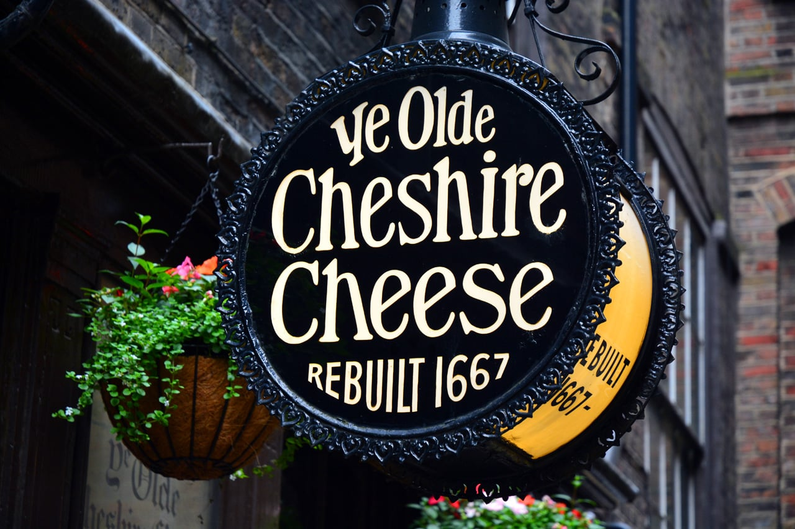

# Ye Olde Cheshire Cheese

The doorway at 145 Fleet Street is easy to miss. First-time visitors usually pass through a narrow passage before realising they are inside a multi-level pub. Ye Olde Cheshire Cheese is not fascinating because it can claim to be the oldest anything. It is fascinating because several competing layers occupy one building: a reconstruction after the Great Fire of 1666, the memory of Fleet Street's printing and newspaper trade, Samuel Smith's cask ale, and a set of rooms that still functions as a pub rather than a heritage exhibit.

Figure: The hanging sign of Ye Olde Cheshire Cheese on Fleet Street, lettered with the pub’s name and “Rebuilt 1667”. Image: Images George Rex, CC BY-SA 2.0, via [source page](https://commons.wikimedia.org/wiki/File:Ye_Olde_Cheshire_Cheese_rebuilt_1667_(14276567866).jpg).

## Place and history

The site's tavern record goes back to the fourteenth century, but the building seen today begins with the fire of 1666. The pub was rebuilt in 1667. Its yellow-brick front to Fleet Street is generally dated to the late eighteenth century, with later nineteenth-century remodelling and heightening. It was listed Grade II in 1977, which protects not only the age of the structure but also the street elevation, interior spaces and the texture of the surrounding block.

Fleet Street's printing trade began when William Caxton brought the first movable-type press to England in 1476. In 1500 his printer, Wynkyn de Worde, moved the business to Fleet Street beside St Bride's Church. For centuries the street was tied to newspapers, print works, lawyers and clergy; newspapers began leaving for Wapping in the 1980s, and the last journalists left in 2016. The pub's customer base changed with the street, from editors, printers and writers to nearby lawyers, office workers and visitors. Local histories list Samuel Johnson, Dickens, Milton, Mark Twain, P. G. Wodehouse, Tennyson and Arthur Conan Doyle as regulars. Such lists usually mix documented visits with later embellishment, so the safer reading is to treat them as a literary tradition rather than a set of individually proven appearances.

## The rooms and the list

The pub is entered through a narrow opening on Fleet Street and has a side elevation on Wine Office Court. Inside, several low rooms and staircases connect spaces with different heights, light and seating density. The best-known areas include the Snug Bar, Johnson Bar, Cheshire Bar, Cellar Bar, Chop Room and Williams Room. The front rooms suit short drinks and people-watching; the cellar has the strongest sense of old London; the Chop Room is for sitting down to eat. Steep stairs, low doorways and narrow passages are real limitations of the historic building, not stage dressing.

The drinks list is deliberately simple. The pub serves Samuel Smith's beers, all brewed at the company's Old Brewery in Tadcaster, founded in 1758. Cask Old Brewery Bitter is drawn from oak casks in the pub cellar. The menu describes the place as a chop house, with steak and kidney pudding as its signature dish, alongside pies, roasts and traditional pub food. Wine is limited to a few house options and the spirits list does not chase trends. Compared with London pubs that rotate modern craft taps, this is a pub with a locked supply chain, moderate prices and an emphasis on rooms and food rather than novelty.

## How to drink

Start with a half or a pint of Old Brewery Bitter. It is the key to understanding the place: cellar-cool, finely carbonated, with clear malt and hop lines rather than a big flavour attack. For food, steak and kidney pudding explains the "chop house" identity better than fish and chips; share one between two and add a pie or a salad.

Choosing the right room matters more than choosing the right beer. For woodwork and fireplaces, try Johnson Bar or Cheshire Bar. For quiet conversation, avoid the office lunch rush from 12:30 to 14:00 and the after-work period from 17:30 to 19:30. For the underground atmosphere, go down to the Cellar Bar. Ordering works the pub way: order at the bar, give your table number, and carry your own drinks back. There is no table service. Sunday hours are shorter, so do not plan a late Sunday evening around a weekday timetable.

## Practical information

The address is 145 Fleet Street, London EC4A 2BP, United Kingdom. The entrance is the narrow passage on Fleet Street, and the pub can also be approached from Wine Office Court. The nearest stations are Temple (District and Circle lines, about five to eight minutes on foot), Blackfriars (District and Circle lines plus National Rail, about eight to ten minutes) and Chancery Lane (Central line, about eight to ten minutes); buses 11, 15, 17, 23 and 26 stop along Fleet Street. In November 2026 the official site listed Monday to Saturday 12:00–23:00 and Sunday 12:00–22:30, with the phone number 020 7353 6170. The bar area is normally walk-in; the Chop Room and group bookings should be arranged through official channels. There is no formal dress code; ordinary pub clothing is fine. Prices are mid-range for London, and cask ale plus pudding costs far less than a comparable historic pub in the West End. The official site states plainly that the pub is "totally inaccessible for wheelchairs"; steep stairs, low doors and narrow passages are also difficult for visitors with limited mobility. Hours may be shortened on Christmas Day and bank holidays, so check the day's official notice. Opening status, prices and bookings are subject to official confirmation. This entry was verified on 2026-11-08.

## Etiquette and common mistakes

This is a working pub, not a museum you can tour freely. Do not open doors marked for staff, and do not stand in the narrow passage taking long photographs while someone behind you is carrying hot food. Ordering happens at the bar; nobody will bring you a menu at the table. Do not present "Dickens drank here" as a fact that can be checked item by item, and do not expect a wall panel explaining every room.

Another common mistake is treating a historic pub as a craft-beer bar. Its appeal is limited choice and steady supply: one cask bitter, a few bottles, a short wine list and traditional food. If you want twenty hop styles, experimental sour beers or cocktails, this is the wrong place. At peak times it is loud and the seating is uncomfortable; a quiet mid-afternoon visit feels like a different pub.

## Around and routes

From Temple station, walk to Temple Church first, then along Fleet Street to number 145. After a drink, Dr Johnson's House on Gough Square is a few minutes north, and St Bride's Church is a short walk east; its printing trade ministry connects directly to Fleet Street's history. St Paul's Cathedral is another 15 to 20 minutes east. The pub works best as a stop in the middle of that walk rather than a destination requiring a detour.

## See also

The beer served here belongs to the wider family of [beer](ref:beer) styles; [Pub and city](ref:pub-and-city) explains how such spaces receive guests.

Further reading: [London classic bar walk: three hotel bars and a Fleet Street pub](ref:c-extra-1), [A Ginjinha](ref:c-extra-2), [À la Mort Subite](ref:c-extra-3).

**Short definition:** A historic Fleet Street pub rebuilt after the Great Fire of 1666, known for its wood-panelled rooms, Samuel Smith's cask ales and traditional British food. 

For Ye Olde Cheshire Cheese, begin with the address. Then look at the current opening status, and finally ask what the place is known for. The answers point to different choices, not to a single score.

[Beer](ref:beer) and [London classic bar walk: three hotel bars and a Fleet Street pub](ref:c-extra-1) answer different questions about Ye Olde Cheshire Cheese: address and space and operating status. Read them as a pair, not as alternatives.
