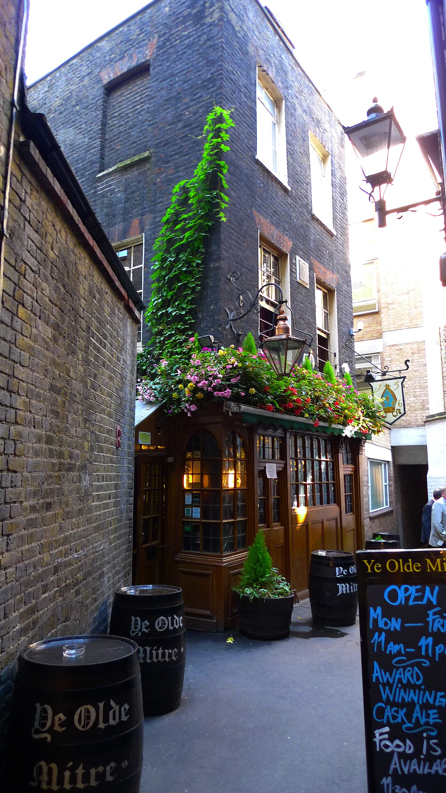

# Ye Olde Mitre

Turn off Hatton Garden between two jewellery shopfronts, follow a court barely wide enough for two people, and the traffic noise falls away within a dozen steps. A small timber-faced building and a narrow yard appear. This is Ye Olde Mitre: not on a main street, with no large sign to pull people in, and easy to walk past. Because it sits inside Ely Court, what it preserves is not only old woodwork but a particular kind of everyday life in a gap in the city.

Figure: The street frontage of Ye Olde Mitre seen from Ely Court; a tavern has stood here since 1546, while the present building is essentially 18th-century, not the original structure. Image: Ewan Munro from London, UK, CC BY-SA 2.0, via Wikimedia Commons ([source page](https://commons.wikimedia.org/wiki/File:Ye_Olde_Mitre,_Hatton_Garden,_EC1_(4140007697).jpg)).

## Location and history

The pub's official history and CAMRA both record a tavern on this site from 1546, when it served the household of the Bishops of Ely. The building you see today is essentially 18th-century, not a Tudor survival. The site once belonged to the liberty of Ely in Cambridgeshire, which meant that pub licences had to be obtained in Cambridge rather than London; that administrative enclave is still part of the pub's lore. The official story also tells of a cherry tree around which Queen Elizabeth I is said to have danced with Sir Christopher Hatton, and whose trunk later grew into the pub's frontage. The tale cannot be used to date the building, but it explains why the pub is so often described as one of London's most hidden old taverns.

The name is worth pausing over. "Mitre" means a bishop's headdress and comes directly from the arms and estate of the Bishops of Ely. That is why a pub in London EC1 has long been tied to Ely in Cambridgeshire. CAMRA lists its panelling, screens and small rooms as a historic interior of national importance, and dates the present building to the 18th century. Fuller's took over in 2009 and kept the guest-beer programme and the occasional beer-from-the-wood. The pub won the SPBW London Pub of the Year award in 2014 and 2019, and Fuller's 2020 announcement singled out manager Judith Norman and her team. Put those dates together and the place looks less like a tourist set piece and more like a carefully run real-ale pub that happens to occupy a remarkable site.

## Space and drinks

The pub is tucked between Hatton Garden and Ely Place, with the entrance on the narrow court. Inside are two small bars and a snug, with dark wood panelling, partitions and a compact counter; upstairs is a small function room used for occasional gatherings. The drinks list centres on traditional British cask ale, usually including Fuller's brands and guest beers; the pub sometimes sells beer from the wood. Food is limited to bar snacks such as toasties and sausage rolls, generally available until 5pm. This is not a gastropub serving full meals. Treat it as a place for a drink and a small bite, not a restaurant with a long menu.

## How to drink

For a first visit, start with a paler cask ale and then try a darker or more bitter one for contrast. If you are unsure, ask the bar for a small taste; that is standard practice in a British pub. The pace here suits a half pint rather than a full one to begin with. Weekday lunchtime and early afternoon are quietest. The official hours are Monday to Friday 11:00–23:00, and the pub is normally closed at weekends, though holidays and private hires can change that, so check the website before travelling. If you want beer from the wood, ask the bar whether it is available that day; do not assume it is a permanent fixture.

## Practical information

The address is 1 Ely Court, Ely Place, London EC1N 6SJ. Chancery Lane and Farringdon are the nearest stations, about two minutes on foot according to the pub. Enter from Hatton Garden, where the entrance sits between jewellery shopfronts; look for the narrow "Ely Court" passage and walk in. The rooms and passage are small, so a large group should not arrive at once, and luggage or pushchairs should not block the court. The pub does not take large group bookings; ask separately about the upstairs room. Hours, drinks and food availability change, so rely on the official site for the day of your visit.

## Etiquette and common misconceptions

The most common mistake is to read "1546" as "this building dates from 1546." More accurately, a tavern has stood on the site since 1546, while the present building is essentially 18th-century and has been altered several times. The second mistake is to treat the cherry-tree story as established fact; the pub's own account calls it a legend, and writers should keep that qualifier. Third, this is a working neighbourhood pub, not a museum: do not block the court for photographs or wander into closed upstairs areas. Fourth, cask ale is served at cellar temperature and with less carbonation than bottled beer; if it feels "not cold enough," that is not a fault. Ask the bar which beer is in good condition that day.

## Surroundings and routes

Ely Place itself is a quiet old street, with the 13th-century church of St Etheldreda's at one end; Hatton Garden's jewellery quarter lies to the south, and St Paul's is a short walk west. The pub fits neatly into a half-day walk: see Ely Place and the church, drink a half pint here, then head west along Holborn towards Covent Garden. To compare different kinds of historic London pub, continue with [The Lamb & Flag](ref:lamb-flag) and [The Spaniards Inn](ref:spaniards); for the wider role of pubs in the city, read [A city through its pubs](ref:pub-city) and [A history of taverns](ref:taverns); the full walking order is in [the classic London pub walk](ref:london-route).

## Further reading and see also

- [A city through its pubs](ref:pub-city)
- [A history of taverns: from alehouses and inns to bars](ref:taverns)
- [The classic London pub walk](ref:london-route)
- [The Lamb & Flag](ref:lamb-flag)
- [The Spaniards Inn](ref:spaniards)

**In brief:** A historic pub in Ely Court near Hatton Garden, with a tavern on the site since 1546, an essentially 18th-century building, a hidden alley entrance and traditional British cask ale.

Start with the address. From there, consider the current opening status, then what the place is known for. That is how a practical judgment about Ye Olde Mitre is built.

[Reading a city through its bars](ref:pub-city)'s address and space and [London classic bar walk: three hotel bars and a Fleet Street pub](ref:london-route)'s operating status form a useful pair: the contrast shows where one ends and the other begins.

Checked on 2026-11-21 against the Ye Olde Mitre official page. Normal hours are Monday–Friday 11:00–23:00, weekends are usually closed, and holidays or private hire can change the schedule; the entrance is inside the narrow Ely Court, so large groups should not arrive together. 1546 is the site's starting year and the surviving timber is mainly 18th-century; the cherry-tree story is presented as legend. The image looks from Ely Court at the brick exterior, not the interior.
