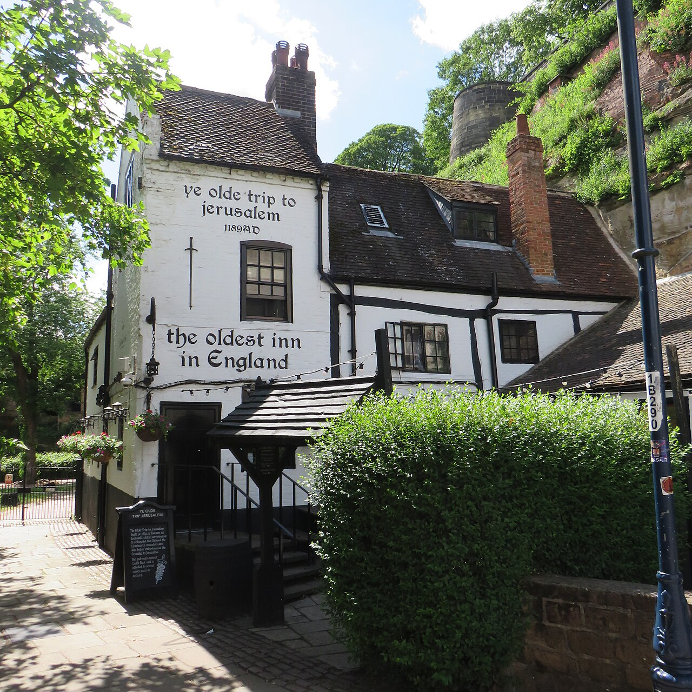

# Ye Olde Trip to Jerusalem

On the south side of Nottingham's Castle Rock, the pub frontage leans against the sandstone and some of its rooms are cut directly into the rock. Ye Olde Trip to Jerusalem's loudest claim is that it is the oldest pub in England, with an opening date of 1189. Once the legend, the datable building features and the earliest written record are separated, however, the real interest is not the verdict "oldest" but the way three timelines occupy the same caves and timber structure.

Figure: Ye Olde Trip to Jerusalem. Image: Richard Rogerson, CC BY-SA 2.0, via Wikimedia Commons ([source page](https://commons.wikimedia.org/wiki/File:Ye_Olde_Trip_to_Jerusalem,_Nottingham_-_geograph.org.uk_-_8356591.jpg)).

## Place and history

The pub's official history page accepts that concrete evidence for a 1189 foundation has been lost. It offers several separately checkable clues: the surviving timber frames were originally built in the 1670s, and the first record of the building as a public house is 1760, when landlord William Marriott held the licence. The legend pushes the opening back to the Crusades, while the fabric and the documents point to the seventeenth and eighteenth centuries. The safer wording is that the pub "claims" or "is said" to date from 1189, while the actual building has been rebuilt and altered many times.

The name is usually explained as a "trip to Jerusalem" before the Crusades. The official history reads "trip" or "Trypp" as an old word for a stop or break, and says Richard the Lionheart and his men are said to have visited before setting out on the Third Crusade. That story is closely tied to the pub's relationship with Nottingham Castle, but it belongs to the legendary layer. Another clue is that the pub may originally have been called "The Pilgrim" until it was bought by the silk merchant William Standford in the mid-to-late eighteenth century. Willoughby's Directory of Nottingham already recorded the present name in 1799. The name's evolution shows that this is not a sign preserved intact from 1189.

In 1894 landlord George Ward, known to regulars as "Yorkey," took over, and members of the Ward family continued to run the pub; reminders of his tenure are still visible. On 11 August 1952 the pub was listed Grade II, protecting fireplaces, panelling and the network of rock-cut cellars. That date is far later than 1189, but it is the most concrete official designation the building has.

## The rooms and the list

The pub leans against the sandstone of Castle Rock, and the rock-cut spaces, passages and bar areas are its least replaceable feature. The Rock Lounge is the main place to see the cave character, while the Haunted Snug is used by the official history to tell ghost stories; the "Cursed Gallon" above the bar belongs to the same narrative. There is a beer garden outside, which is better than the interior for long summer sessions. Timber frames, low doorways and irregular walls remind you that this was not designed for modern crowds.

The drinks list is a typical Greene King pub structure: cask ales, wine, spirits and a substantial low- and no-alcohol range. The menu leans on comfort food — pies, burgers and shareable pub dishes — rather than fine dining. Prices are mid-range for Nottingham, and the pub does not charge museum admission for its "oldest" claim. Compared with a specialist cask-ale pub, the choice is broader and more family-friendly; compared with a city craft bar, the tap range and experimentation are limited. What makes it distinctive is that you can carry a glass into a sandstone cave, not the menu itself.

## How to drink

On a first visit, ask what cask ales are on and order a half pint to taste. Nottingham-area ales tend to be balanced rather than aggressively hopped, so there is no need for an elaborate tasting ritual; if you are just passing through, one ale and a pie is enough. To sit in the cave area, avoid weekend evenings and match days, when tour groups and local families fill the space. In summer, move to the beer garden; the caves are better in autumn, winter or rain.

For larger groups, book a table through the official page. A table for two can often be found without a reservation, but do not assume there will be space. Children and dogs are welcome, and the pub explicitly describes itself as family- and dog-friendly; if someone in your party has limited mobility, assess the steps, low ceilings and uneven floors in the cave areas before committing. Do not treat "oldest" as a service promise: this is a chain pub, not a history-themed restaurant.

## Practical information

The address is 1 Brewhouse Yard, Nottingham NG1 6AD, United Kingdom, directly below Nottingham Castle at Brewhouse Yard. In November 2026 the official page listed opening hours of 11:00–23:00 daily, with food service around 11:00–21:00 (Sunday until 20:30). From Nottingham station it is a 15- to 20-minute walk; take the NET tram to Old Market Square and walk uphill for about eight to ten minutes, or use the buses that stop around Old Market Square and Castle Boulevard. There is paid street parking nearby, but spaces on the old-town side are tight. Hours may change on Christmas Day and match days, so check the day's official notice.

Prices are mid-range; the best value is a cask ale with a pub meal. No reservation is compulsory, but groups and dinner slots are worth booking. There is no formal dress code; ordinary pub clothing is fine. Low- and no-alcohol options make the pub usable for non-drinkers. The caves and stairs are not suitable for wheelchairs, and pushchairs will be difficult; that should be considered before making the pub the centre of an itinerary. Opening status, prices and bookings are subject to official confirmation. This page was verified on 2026-11-08.

## Etiquette and common mistakes

The first mistake is treating "the oldest pub in England" as established fact. The official history itself admits that the 1189 claim lacks conclusive evidence; the better question is why the pub tells that story, not whether it wins the title. The second is treating the caves as a climbing frame: the rock, passages and furniture are working space, so do not cross barriers or touch fragile surfaces for a photograph.

Third, the ghost stories are part of the pub's narrative, not historical conclusions; the "Cursed Gallon," the tale of Queen Isabella and the name "Haunted Snug" are good drinking conversation, not evidence. Fourth, this is a Greene King chain pub with a standardised menu and service system; do not expect a single-brewery specialist experience. Finally, the cave area is loud at peak times; the garden or an off-peak hour is better for conversation.

## Around and routes

From the pub, Nottingham Castle is immediately above, with the Museum of Nottingham Life at Brewhouse Yard beside it. A ten-minute walk downhill reaches Old Market Square, the Lace Market and the Robin Hood statue. The pub fits naturally into a walk between the castle and the old town rather than as a dedicated "oldest pub" pilgrimage. With more time, continue along the canal to Nottingham Contemporary and return through the Lace Market for dinner.

## See also

The pub serves beer and other drinks, and it is best understood within the story of [the pub and the city](ref:pub-and-city), alongside the [beer](ref:beer) style entry.

Further reading: [The Mermaid Inn](ref:c-extra-1), [A Ginjinha](ref:c-extra-2), [À la Mort Subite](ref:c-extra-3).
