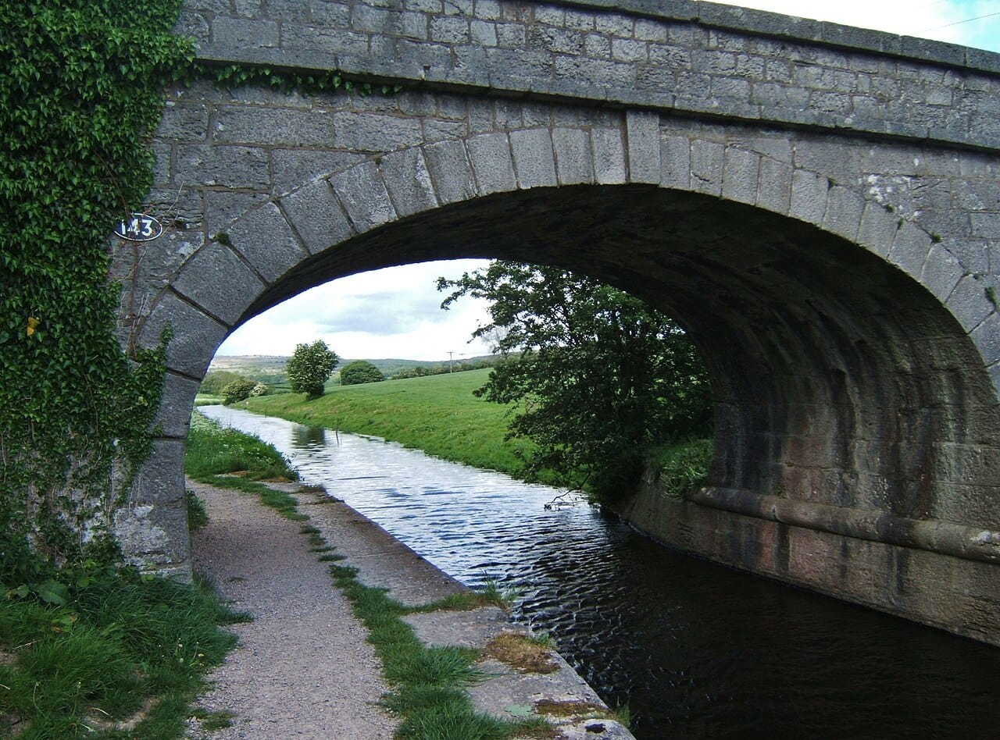

# Yealands

Yealands sits at Seddon in Marlborough, its vineyard close enough to the coast for sea mist to reach the vines. The visit is not a cellar hidden in a city street; it is a combination of coastal farm and tasting room. See the vineyard and the coast first, then return indoors for a glass. The new winery opened on 8 August 2008, and the official account puts "Toitū carbonzero certified from inception" at the centre of the brand. That sentence explains the landscape better than any photograph: sustainability is part of the visit, not a side note.

Figure: Yealands. Photograph: File:Moss Bridge, Yealands Redmayne.jpg. Credit: Barbara Carr, CC BY-SA 2.0, via Wikimedia Commons ([source](https://commons.wikimedia.org/w/index.php?curid=41189386)).

## The sea wind and vineyards of Seaview

Seddon lies in Marlborough's Awatere Valley, which the official regional description sums up as cooler, drier and windier, often with elevation and usually lower yields. Sea wind and mist lower temperatures and lengthen ripening, and can thicken grape skins; in Sauvignon Blanc this tends to mean sharper aroma and tighter acidity rather than simply "more fruit". Yealands' vineyard is close to the coast, and some vines are covered by sea mist when conditions align. The romantic image is also part of the ripening mechanism.

[Marlborough](ref:marlborough)'s three sub-regions are geographical and climatic concepts, not quality grades. Wairau gravel drains quickly and warms early; Southern Valleys soils are heavier and more clay-rich; Awatere is further south, drier and windier. Yealands stands in the last set of conditions, so its wines often feel more compact than Wairau equivalents. Keep that in mind and "Seaview" or "Awatere" on a label stops being only a scenic name.

## 2008: carbonzero from day one

8 August 2008 is the winery's opening date. Both the official account and the industry directory stress that Yealands was the first winery in the world to be Toitū carbonzero certified from inception. The emphasis is on "from inception": rather than producing first and offsetting later, building design, energy and waste handling counted from the start. For a visitor, that makes the plant part of the exhibit, not just the backdrop to a tasting room.

A certification is not the same as a list of practices. It means the winery measures and offsets operational emissions; the practices include solar power, wind turbines, use of vine prunings and homemade compost. Production volume, energy mix and supply chains change the emissions ledger from year to year, and certification is reviewed periodically. This entry does not turn one year's detail into a permanent fact; check Toitū and the estate's official pages for the current scope.

## Sustainability is not a slogan: wind, sun, prunings and compost

The industry directory groups the estate's sustainability work into checkable categories: solar generation, wind turbines, vine prunings as energy, homemade compost, land care and energy efficiency. Their common idea is to put "waste" back into the production cycle: prunings are not all burned but turned into energy or compost; site electricity is supplemented by on-site renewables; vineyard land management aims to reduce bare ground and erosion.

These choices do not directly change the taste of the wine, but they change what there is to see. You encounter wind turbines, solar panels, compost areas and native vegetation at the vineyard edge, not only stainless steel and oak barrels. For a working winery, treating infrastructure as an exhibit is unusual; it also explains why a visit here feels more like a farm walk than an indoor lecture.

## The tasting room and the White Road

The industry entry describes the tasting room as a contemporary space offering selected Seaview Estate wines, including the Single Vineyard collection, with local cheeses and cured meats to enjoy alongside a glass. A complimentary self-drive White Road tour crosses vineyard, coast and native vegetation, and works well before or after a tasting. It is not a closed racetrack or an accessible footpath; weather and farm work affect whether it is open, so ask about direction, speed and safe stopping points first.

With one hour, prioritise the tasting room and a short walk; with half a day, add the White Road. Do not use an umbrella in strong wind or stand at an unguarded coastal edge for a photograph. This is a working site: outside the tasting room, follow on-site signs and stay out of closed vine rows, equipment areas and storage.

## Three things to confirm before visiting

First, opening hours. The Yealands official site presented an age gate during verification and its current cellar door hours could not be read; the industry entry confirms a tasting room but does not give a verifiable daily timetable. This entry therefore marks operating status as unknown and does not state "open at these hours". Second, whether booking is required; rules may differ for small groups, weekends and high season, so confirm on the official site or by telephone. Third, whether the White Road and food service are open; wind, rain, harvest or maintenance can close parts of the site at short notice.

The address is 534 Seaview Road, Seddon, Marlborough 7285, New Zealand. It is about 40 minutes southeast of Blenheim; the coastal road is windy, so cycling needs care; there is no rail connection and ride-hailing is uncertain on the return. Coordinates should be taken from official channels; for navigation, use the address. To pair this stop with [Cloudy Bay](ref:cloudy-bay) in one day, confirm both timetables first and then plan the drive on the [Marlborough wine trail](ref:route).

## Common misconceptions

First, "carbonzero" does not mean "zero emissions". Certification usually involves measurement, reduction and offsetting, not the absence of all emissions from production. Second, the White Road is not a fixed attraction; weather and farm work can close it. Third, a coastal winery does not automatically taste salty. Sea mist and wind affect ripening and acidity, but "salinity" is mostly a sensory metaphor, not seawater in the wine. Fourth, Awatere and Wairau are not one style; temperature, wind and yield differences change the body directly. Fifth, do not confuse an age gate with a closed winery. An inaccessible page does not prove the estate is shut, but it also does not justify inventing opening hours. For variety background, see [Sauvignon Blanc](ref:sauvignon) and [white wine](ref:white-wine).

Read Yealands through the address, then the current opening status, and finally what the place is known for. The sequence matters.

Setting [Marlborough](ref:marlborough)'s address and space beside [White wine](ref:white-wine)'s operating status makes the boundary between them visible.

## References

This entry was checked against New Zealand Winegrowers' Yealands entry, its Toitū certification entry and Marlborough region page, plus the Yealands official site entry. Page verified 2026-11-09. The official site was age-gated, so opening hours and booking rules should be confirmed on an accessible official page or on site; operating status is marked unknown and no verified_at is given.

## Related images

Image: Related photograph of Sauvignon Blanc. Credit: Geolina163 + 1971markus, CC BY-SA 4.0, via Wikimedia Commons ([source page](https://commons.wikimedia.org/wiki/File:HBLA_Klosterneuburg_Sauvignon_Blanc_2.jpg)). Related image for Yealands.
