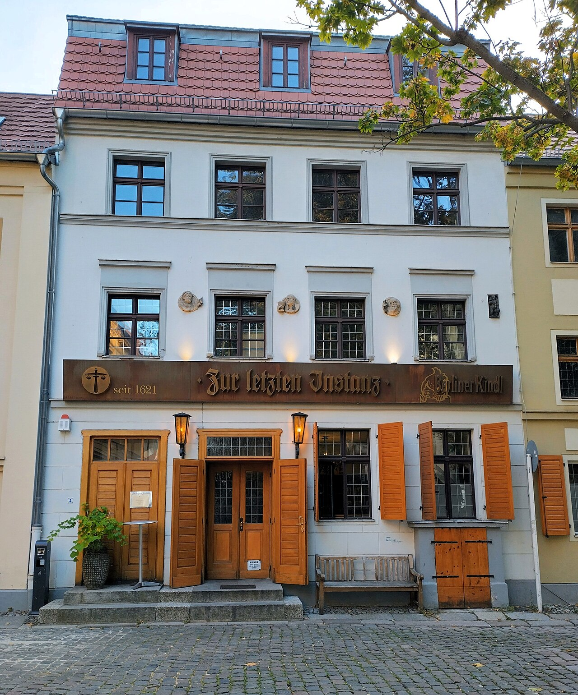
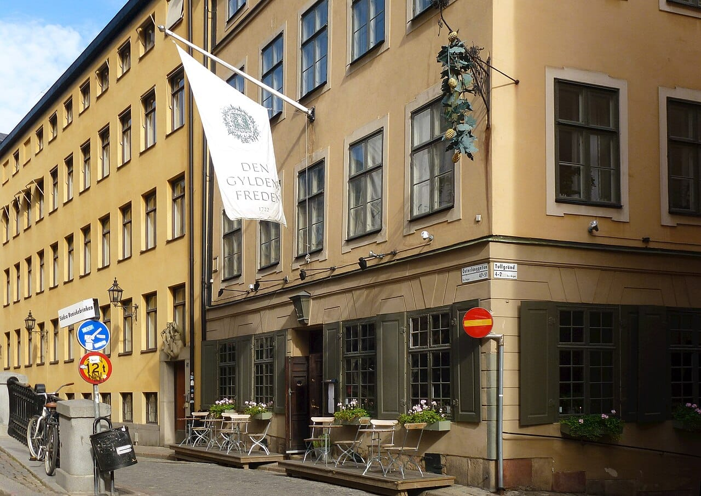

# Zur letzten Instanz

Waisenstraße in Berlin-Mitte is short: the old city wall runs along one side, low historic houses along the other. Number 14–16 carries a sign reading "Seit 1621". This is Zur letzten Instanz, literally "at the last instance", sometimes translated as "The Last Instance" or "Last Judgment". It is not a palace-restaurant; it is an old Berlin house that compresses the city's history into beams, brick floors, a spiral staircase and a tiled stove.

Figure: Zur letzten Instanz in Berlin. Image: Julia Roessing, CC0, via Wikimedia Commons ([source page](https://commons.wikimedia.org/wiki/File:Zur_letzten_Instanz_Restaurant_Berlin_2026-09-29.jpg)).

> **Quick verdict**
> **In one line:** This entry helps you decide whether Zur letzten Instanz deserves a detour, and what to check before visiting.
>
> - **Best for:** Anyone planning a visit to Zur letzten Instanz who needs to decide whether it deserves a half-day or a full day.
> - **Not for:** If you want only want a must-visit list and will not check booking, transport or opening hours.
> - **Check first:**
>   - The restaurant's official history separates three dates.
>   - Lunch and dinner differ: Friday and Saturday have a midday service from 12:00 to 15:00, while Monday to Thursday only open after 17:30; Sunday is closed.

## Setting and history

The restaurant's official history separates three dates. The terraced houses on Waisenstraße were built in the 13th century, and the building on this site first appears in a document in 1561. In 1621 a former groom of the elector opened a drinking house here, which is the beginning of the gastronomic tradition. Various taverns and restaurants followed at the same address, and since 1924 the name has been Zur letzten Instanz. So 1621 is the start of the food business, 1924 the start of the present name, and 1561 the first documentary mention of the building; the three should not be mixed.

The name has a popular origin story. Two farmers were in a heated legal dispute at the court on nearby Littenstraße, and the case was settled here, at the "last instance". This is legend rather than archive fact, but it survives because it describes the restaurant's character: law, ordinary people, beer and reconciliation at the same table. A more literal reading is "the last resort" or "the final authority", but the official account chooses the legend, and it is best read as a story rather than evidence.

In the Second World War the building was badly damaged. After the war Waisenstraße lay in East Berlin, and the restaurant reopened in 1963 after a costly reconstruction. The beams, brick floor, Baroque spiral staircase and two dining rooms seen today are the product of that rebuilding and later restoration, not an untouched seventeenth-century interior. The 200-year-old tiled stove is the most frequently mentioned object in the room; the official account half-jokingly says it "warmed Napoleon's heart". Treat that as a historical anecdote, not proof that Napoleon dined here.

In 2020 the current operators took over from their parents, becoming the second generation. That family background explains the scale: two dining rooms, a separate room seating 12, and a beer garden, about 120 seats in total. The menu is Berlin cooking with regional ingredients, not an international hotel menu. It is neither a museum nor a theme restaurant, but an old house still working as a restaurant.

## The rooms and the menu

The keywords are old, warm, narrow and wooden. Inside are brick floors, timber beams and dark wood panelling, with old photographs and paintings on the walls. The Baroque spiral staircase leads upstairs, the tiled stove stands in a corner and is lit in winter. The tables are small, the chairs are old wooden models, the separate room suits families or small groups, and the beer garden sits among old trees and the city wall, more comfortable than the interior in summer. It is not suited to large tour groups or to anyone looking for "minimalist design"; its value is the total atmosphere of an old Berlin restaurant, not a single piece of furniture.

The menu mixes Berlin and northern German dishes: Königsberger Klopse (meatballs in caper sauce), Sauerfleisch (braised beef in vinegar) with grapes and white cabbage, stuffed cabbage with crispy pork belly, grilled pork knuckle with malt syrup and red cabbage, veal liver with apple and leek, and eggs in mustard sauce with mashed potato. Starters include pickled vegetables, salted herring with yoghurt and red onions, mountain-cheese dumplings, and turnip stew with potatoes and boletus. Desserts are warm apple pie with vanilla ice cream or berry sorbet with meringue. The menu changes with the season; game, white asparagus and goose appear at the right time, so do not order from an old menu.

Drinks are German beer, wine and spirits. Berliners usually order a local or regional beer, and the restaurant may have seasonal taps. The wine list is mostly German and European, with fresh whites, dry Riesling or light reds suiting the food. For a Berlin specialty, try a Berliner Weisse with syrup, but note that it is sour and low in alcohol and not to everyone's taste. The restaurant is not a cocktail bar; order to match the food rather than asking for a complex mixed drink.

## What to order on a first visit

Lunch and dinner differ: Friday and Saturday have a midday service from 12:00 to 15:00, while Monday to Thursday only open after 17:30; Sunday is closed. For a first visit, order one starter and one main, or a main and a dessert. For Berlin flavour, choose the caper-sauce meatballs or the vinegar-braised beef. For meat, choose the pork knuckle or stuffed cabbage. For fish, ask what arrived from the Müritz lakes that day. For a vegetarian option, ask the waiter; do not assume one is always on the menu.

Two people can balance the table with one rich and one light dish: the pork knuckle is large, with red cabbage and potatoes, and is made for sharing; the vinegar-braised beef is distinctly sour, with white cabbage and mash, and suits anyone who likes acidity; the caper-sauce meatballs are Berlin home cooking and safest with mashed potato. Starters need not be one per person; pickles and cheese dumplings can be shared. If you order one dessert, apple pie with ice cream is the easiest to split.

Reservations matter. The restaurant has only about 120 seats and fills at weekends and in the evening. The separate room suits around 12 people, and the beer garden is popular in good weather. Telephone +49 (0)30 242 55 28, or book through the official site. There is no strict dress code, but evening guests dress more formally than at lunch; do not wear work clothes or swimwear. Children are welcome, but this is not a playground, and pushchairs are awkward at the narrow entrance.

Prices: starters around 10–15 euros, mains around 20–30 euros, desserts around 8–12 euros, subject to the menu. German restaurants usually add a tip of 5%–10% to the menu price, given directly to the waiter or left on the table. Cards are widely accepted, but small amounts are easier in cash. Ask about the Tagesmenü at lunch.

## Practical information

**Address**: Waisenstraße 14–16, 10179 Berlin, Germany. In Mitte, near Alexanderplatz and the Klosterviertel. About 3 minutes on foot from U2 Klosterstraße, or 10 minutes from Alexanderplatz.

**Transport**: U2 Klosterstraße, U8 Heinrich-Heine-Straße or S-Bahn Alexanderplatz, then 5–12 minutes on foot. Waisenstraße is narrow, so taxis cannot stop at the door; the nearest drop-off is on Littenstraße or at Alexanderplatz. The old city wall area has uneven cobbles, so high heels are a poor choice.

**Opening hours**: Monday to Thursday from 17:30; Friday and Saturday 12:00–15:00 and from 17:30; Sunday closed. Holidays and Christmas-market periods may alter this; check the official site. `operating_status` is `verified`, meaning the official site still showed the restaurant as trading on 20 November 2026; this does not guarantee that it opens every day.

**Reservations**: Strongly recommended, especially at weekends, in the evening and for the separate room. Online booking is available, or telephone +49 (0)30 242 55 28; office hours are Monday, Tuesday, Thursday and Friday 09:00–14:00. There is no minimum spend, but large groups may be asked for a deposit or a set menu, so confirm when booking.

**Prices**: Mid-to-upper Berlin home cooking, with mains around 20–30 euros; pork knuckle and goose cost more. Tip 5%–10%, cards accepted. The beer garden may add an outdoor seating charge in summer, subject to the menu.

Page verified 20 November 2026; opening hours, prices and menus are subject to official channels.

## Etiquette and common mistakes

First, do not treat 1621 as the year the building was built. The building is first documented in 1561; 1621 is the start of the food business. Second, do not treat the "Napoleon stove" as fact. The official account itself uses the half-joking phrase "warmed Napoleon's heart", so it is an anecdote. Third, do not read "last instance" as an official legal term; it comes from legend, not from a court.

Three more mistakes are common. One is assuming the pre-war building survived unchanged; it was badly damaged in the war and rebuilt in 1961–1963, so what you see is the rebuilt version. Another is assuming "Berlin's oldest restaurant" can be visited without booking; there are only about 120 seats and weekends are busy. The third is assuming the menu is fixed all year; game, asparagus and goose are seasonal, so read the day's menu.

The restaurant is not right for someone who wants fast food, someone unwilling to ask about a German menu, or a large tour group demanding quick turnover. It suits a proper sit-down meal of Berlin home cooking, and anyone interested in the city's history and old buildings.

## Nearby and routes

The restaurant is on Waisenstraße. West are the Klosterviertel and the TV tower, south is Alexanderplatz, east is the Spree and the direction of the East Side Gallery. Put it on an "Alexanderplatz–Klosterviertel–Waisenstraße" walk: see the district and the old wall in the afternoon, then eat in the evening; about 20 minutes on foot. For another old restaurant, compare Botín in Madrid or Den Gyldene Freden in Stockholm, though those are different cities and different stories.

By day Waisenstraße is quiet and good for photographing the facade; at night the restaurant lights are warm, and photographing the interior requires the consent of neighbouring tables. During Christmas-market season Alexanderplatz is crowded, so book ahead and allow walking time. If a group has booked the restaurant, do not force your way in; come back another day.

## See also

- [Pubs and the city](ref:pub-and-city): how old restaurants and taverns use space, menus and opening hours to organise city life.
- [Botín](ref:botin): Madrid's restaurant of 1725, a counterpart to Berlin's "oldest" claim.
- [Den Gyldene Freden](ref:freden): Stockholm's restaurant of 1722, another northern European historic table.
- [U Zlatého tygra](ref:tygra): a Prague beer hall, another combination of historic space and everyday food.
- [Café Central](ref:cafe-central): a Viennese literary café, a reminder that "old" takes more than one form.

## Related images

Image: Den Gyldene Freden in Stockholm's Old Town. Credit: Holger.Ellgaard, CC BY-SA 3.0, via Wikimedia Commons ([source page](https://commons.wikimedia.org/wiki/File:Den_Gyldene_Freden_2013a.jpg)). Related image for Zur letzten Instanz.
