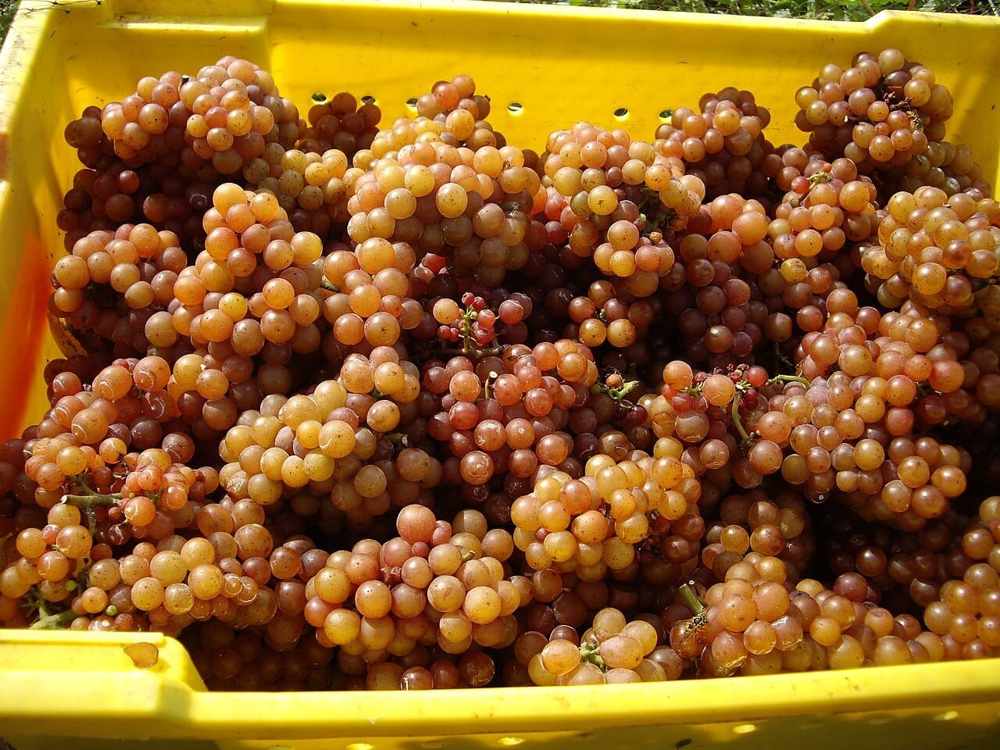
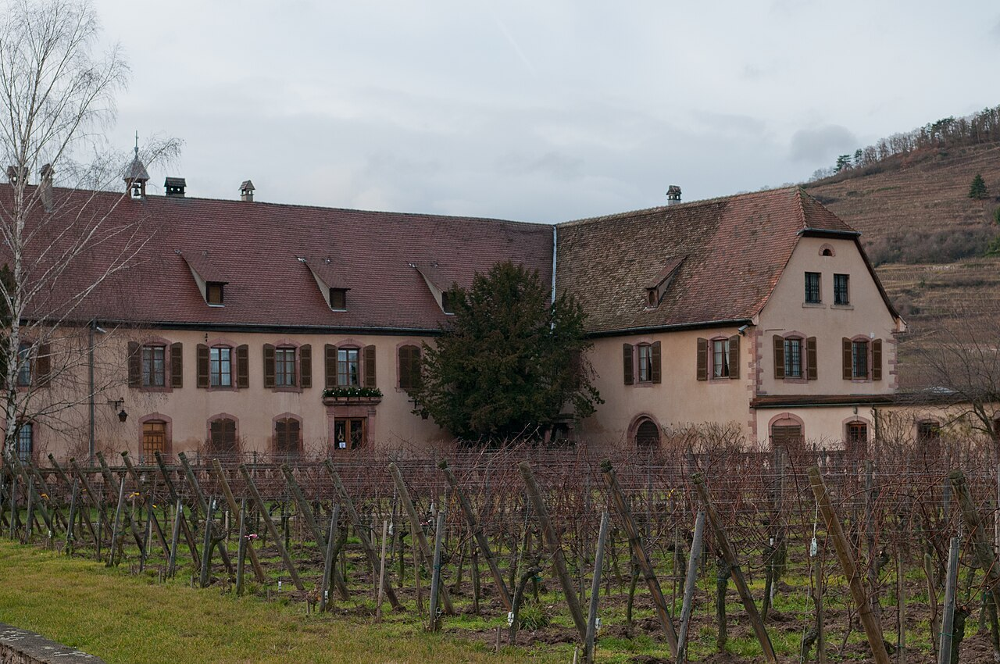

# Alsace Grand Cru trail: Kaysersberg and Riquewihr

Alsace's wine villages line the eastern foot of the Vosges, and Kaysersberg and Riquewihr are close together yet represent two estate models: one built on a monastery site, with biodynamics woven into daily work; the other inside a medieval wall, where a family, exports and regulation helped shape the label language of the whole region. This two-stop route puts the [Alsace](ref:alsace) rain shadow, its 51 Grand Cru sites and the late-harvest rules into one short drive, and makes a workable skeleton for a first visit.

Figure: "Alsace Grand Cru trail: Kaysersberg and Riquewihr". Photograph: File:Colmar (32350846618).jpg. Credit: Jorge Franganillo from Barcelona, Spain, CC BY 2.0 ([source page](https://commons.wikimedia.org/wiki/File:Colmar_(32350846618).jpg)). Category image; not a claim that it shows the exact product, site or event.

## The rain shadow behind the Vosges

Alsace is France's second-driest wine region, and the reason is topography rather than latitude. The Vosges catch Atlantic moisture on their western side, leaving the eastern foothills dry, sunny and stable in autumn; grapes ripen slowly and acidity does not collapse. The mountains also create a geological patchwork: granite, limestone, marl and sandstone alternate within short distances, while aspect and altitude cut the microclimate into small pieces.

That explains why Alsace labels lean so heavily on place names. The same variety on a granite slope and a limestone bench gives different aromas and structure; within one Grand Cru boundary, the top and the foot of the slope can become two wines. Reading the rain shadow and the geology is the precondition for reading every "Grand Cru" and "lieu-dit" that follows.

One warning: a rain shadow means less rain, not no risk. Hail, spring frost and autumn storms still cut yields, and vintage variation in Alsace is larger than many visitors expect. That is why estates keep returning to picking dates and parcel selection. Treating the climate as a stable backdrop is the easiest mistake to make here.

## Stop one: Weinbach in Kaysersberg

The first stop is [Domaine Weinbach](ref:weinbach) in Kaysersberg. The estate sits at the foot of the Schlossberg, was built in 1612 by Capuchin monks and later passed to the Faller family; Eddy Leiber-Faller now represents it. Its core holdings are the Clos des Capucins and the Schlossberg Grand Cru, and the cellar and house still wrap around the old monastery, so a short visit can walk through three layers: monastery, family, Grand Cru.

The estate moved to biodynamics in the 1990s, and its official account puts harmony between vines and environment first. The range runs from Riesling, Pinot Gris, Gewurztraminer and Muscat to Pinot Blanc and Sylvaner, with Grand Cru and non-Grand Cru cuvées side by side. Visits are by appointment: Monday to Friday 9:30–11:30 and 13:30–17:30, Saturday 9:30–11:30 and 13:30–17:00, closed Sunday; check the official page before travelling.

## Stop two: Hugel in Riquewihr

The second stop is [Hugel](ref:hugel) in Riquewihr. The family has worked in the same town since 1639, owns about 30 hectares, mostly on Riquewihr's best sites, many classed as Grand Cru, and also buys from roughly 100 hectares farmed by contract growers. Production is about 60,000 cases a year, with 90% exported to more than 100 countries; those figures explain why "Hugel" often stands for "Alsace" in distant markets.

The cellars lie under sixteenth-century buildings and still hold large oak casks over a century old, including the "S. Caterine", dated 1715 and described as one of the oldest casks still in use. The family is also a member of Primum Familiae Vini. Its yellow-label range uses only Alsace's noble varieties and avoids obvious oak or added sweetness, which connects with the family's role in drafting the late-harvest rules.

## Noble grapes: the division of four varieties

Alsace calls Riesling, Gewurztraminer, Pinot Gris and Muscat its "noble grapes", and all four enjoy higher status in labelling and Grand Cru rules. Riesling supplies acidity, citrus and mineral, and suits dry styles and long ageing; Gewurztraminer gives lychee, rose and spice with a broader body, often matched with strong food; [Pinot Gris](ref:pinot-gris) gives pear, honey and a smoky edge, and can be dry or sweet; Muscat gives the floweriness of the grape itself and is usually made light and dry.

The other varieties are not inferior, only differently placed: Pinot Blanc and Sylvaner make everyday dry whites, Auxerrois is often blended in, and Pinot Noir carries Alsace's small red production. Taste the four noble grapes first, then look at Grand Cru labels, and variety aroma will not be confused with site aroma.

## Grand Cru and Vendanges Tardives: how the labels work

Alsace has 51 Grand Cru sites. A Grand Cru label must name both the site and the variety, and only permitted varieties may be used; it is a legal boundary, not an estate's self-promotion. Many Grand Crus are further divided into lieu-dit names, and parcels within one site can differ clearly. When buying, read the Grand Cru name first, then the lieu-dit and vintage, before the estate name.

Vendanges Tardives (VT) and Sélection de Grains Nobles (SGN) follow another logic: VT requires late picking and a minimum sugar level, SGN requires berry-by-berry selection of botrytised or overripe fruit. Both must use noble varieties and cannot be achieved by chaptalisation. The 1984 rules fixed the conditions for these labels, and the Hugel family was among the driving forces. VT can be sweet or relatively dry, while SGN is almost always rich; read sugar against acidity, not sweetness alone.

Critics often flatten VT and SGN into "sweet wine", which hides the difference: VT is about ripe fruit and honey from late picking, with acidity still present; SGN is about concentration and complexity from botrytis, with tiny yields. Both can age for a long time, but one is easier young and the other needs patience. If you can add only one bottle at the estate, ask whether botrytis arrived that year before deciding.

## Driving, booking and tasting

Kaysersberg to Riquewihr is about 10 to 15 minutes on the D28 and the wine route; village streets are narrow, so park outside the walls. Both estates need advance contact: Weinbach receives visitors by appointment at fixed hours, while Hugel's tasting room is open daily from Easter to Christmas, 09:00–12:00 and 13:00–18:00, with cellar tours limited to weekdays outside harvest and to booked small groups.

At the tasting, ask whether there is a fee, whether Grand Cru wines are included and whether children may come. Alsace tasting rooms often charge through a tasting package or a purchase rather than an entrance ticket; anyone driving should spit. With half a day, take Weinbach first and Hugel second, and taste one Grand Cru and one late-harvest wine to complete the picture.

## See also

- [Domaine Weinbach](ref:weinbach): the 1612 monastery, the Schlossberg Grand Cru and biodynamics.
- [Hugel](ref:hugel): the family since 1639, the S. Caterine cask and the late-harvest rules.
- For background, read the [Alsace](ref:alsace), [Riesling](ref:riesling) and [white wine](ref:white-wine) entries.

Opening hours, bookings and transport are subject to official channels; page verified on 2026-11-09.

Alsace Grand Cru trail is best read by starting with the order of stops, moving to the distance and opening hours, and ending with whether it works as a fixed itinerary.

Start with [Domaine Weinbach](ref:weinbach) for stop order, then read [Alsace](ref:alsace) for transport. Seeing both keeps Alsace Grand Cru trail from being confused with a neighbouring idea.

## Related images

Image: Gewürztraminer grapes. Credit: Robert Pitkin, CC BY-SA 2.0, via Wikimedia Commons.. Credit: Robert Pitkin, CC BY-SA 2.0, via Wikimedia Commons ([source page](https://commons.wikimedia.org/w/index.php?curid=20125056)). Related image for Alsace Grand Cru trail: Kaysersberg and Riquewihr.

Image: Domaine Weinbach (6710808155). Credit: Michal Osmenda from Brussels, Belgium, CC BY-SA 2.0, via Wikimedia Commons.. Credit: Michal Osmenda from Brussels, Belgium, CC BY-SA 2.0, via Wikimedia Commons ([source page](https://commons.wikimedia.org/w/index.php?curid=24415979)). Related image for Alsace Grand Cru trail: Kaysersberg and Riquewihr.
