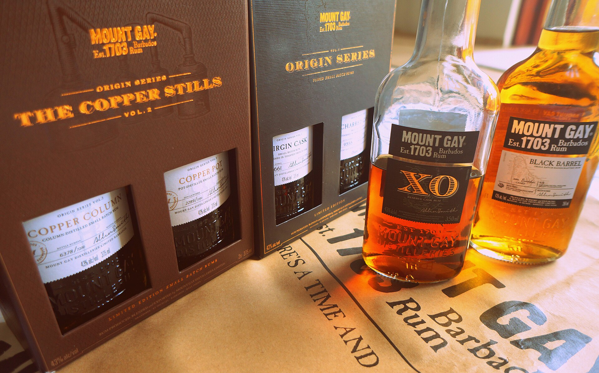

# Barbados rum trail: Saint Lucy and Saint Philip

This Barbados rum trail takes two stops: [Mount Gay](ref:mount-gay) in northern Saint Lucy and [Foursquare](ref:foursquare) in south-eastern Saint Philip. They sit at opposite ends, a little over an hour apart, and stand for two approaches: artesian well water and pot-plus-column equipment arguing continuity since 1703, against an open-house sugar factory and a no-added-sugar position arguing transparency. The question is not which tastes better, but how one coral limestone island grew two rum logics.

Figure: "Barbados rum trail: Saint Lucy and Saint Philip". Photograph: File:Mount Gay Distilleries Origin Series, Black Barrel and XO.JPG. Credit: Aneil Lutchman, CC BY-SA 2.0 ([source page](https://commons.wikimedia.org/wiki/File:Mount_Gay_Distilleries_Origin_Series,_Black_Barrel_and_XO.JPG)). Category image; not a claim that it shows the exact product, site or event.

## Two stops on a north–south drive

The first stop is Mount Gay, Saint Lucy, Barbados. There is no street number, and the southern visitor centre is a different site. The second is in Four Roads, Saint Philip. The drive south takes a little over an hour; put the north in the morning and the south-east in the afternoon.

The mode is car, but hire a driver. Traffic keeps left, lanes are narrow, and cane harvest brings tractors; whoever drives must not drink. Buses run too rarely to link both stops. Allow a full day: about two hours at Mount Gay, one to one and a half at Foursquare. With half a day, pick one.

## Why this route keeps to two distilleries

Barbados is small, but north and south-east are different directions. Mount Gay is about an hour north of Bridgetown; Foursquare puts it about 13 km and twenty minutes from the Oistins area. Both open production sites, with opposite rhythms: booked group tours versus weekday walk-ins. Two stops let you compare a narrated history with a site you read yourself.

St Nicholas Abbey and West Indies Rum Distillery also lie elsewhere; forcing a third stop shortens every visit. This route would rather drop a stop than spend the day driving.

## Saint Lucy: coral limestone water and a 1703 deed

Mount Gay dates its start to 1703, when a deed recorded rum already distilled on the site; the brand therefore calls itself the world's longest continuously running rum distillery. The claim matters less than how one style survived three centuries: water, molasses and equipment.

The artesian well was also dug in 1703 and is still used. Barbados is coral limestone: rain sinks through the rock into deep aquifers, and the well draws water from hundreds of feet down, filtered by the island itself. Water meets the mash and fermentation directly, and stable chemistry shapes fermentation pace.

The walk runs from the Great House through the well house, fermentation house, still room and ageing bonds. Fermentation uses local and ambient yeasts, with [molasses](ref:molasses) diluted and inoculated. After that walk, "Barbados" on a label reads less like an origin than a way of handling water and raw material.

## Pot and column, side by side in one still house

Mount Gay runs both copper pot stills and a column still. The pot works in batches, holding more esters and a heavier body; the column runs continuously, for a cleaner, lighter spirit. The Coffey column still was acquired in 1926 and recommissioned in 2019—column distillation was not a new invention but a tool abandoned and recovered.

The two distillates are blended to make the house style. [Pot distillation](ref:pot-still) supplies weight and aromatic layers, [column distillation](ref:column-still) supplies frame and cleanliness. Batch versus continuous explains how one distillery makes both a light everyday rum and a denser limited release.

The blend then goes into oak. Tropical warehouses are not temperature-controlled, so [oak ageing](ref:oak-ageing) runs faster: colour, vanilla and caramel arrive sooner, and the angels' share is larger. Exact losses are not always published.

## Saint Philip: a no-added-sugar position in an old sugar factory

Foursquare's site was a sugar factory. Sugar production reaches back to 1636, the factory ran until 1984, and in 1996 the R.L. Seale family built today's distillery there. The family's rum trade reaches back to 1820, and Richard Seale is the fourth generation.

The equipment pairs a copper pot still with a twin column, blended into "single blended rum"—different distillation methods within one origin. [Molasses](ref:molasses) is fermented, distilled and aged, with some lines finished in a second cask. Visiting is open-house: walk in on weekdays, no booking and no fixed tour, then finish in the tasting room; read up on [rum](ref:rum) beforehand.

The most discussed position is "no added sugar, no added colour". In 2020 Foursquare, Mount Gay and St Nicholas Abbey proposed a Barbados rum geographical indication covering local ageing, no added sugar, local water and pot and column stills only. West Indies Rum Distillery objected that this would exclude its second-ageing and sweetening traditions. "No additives" is a production claim and a market position, not island law.

## Driving, booking and tasting logistics

Mount Gay requires booking online. The standard tour lasts about two hours, listed at 60 US dollars, with a welcome drink and several rums. It is 18 and over, arms covered, shoes closed and non-slip; the route covers about a mile on foot. Hours are usually Monday to Saturday 10:00–16:30, closed Sunday and bank holidays.

Foursquare needs no booking but opens only on weekdays; there is no organised tour, and the tasting room sells by the glass. Mount Gay offers no transfers and northern taxis are scarce; Foursquare is twenty minutes from the south coast, so arrange the return.

Spitting is normal; drivers should not drink. Island roads are poorly lit, so do not put the last stop after dark.

## Drinking the two side by side

Eclipse blends pot and column spirit, ages in American whiskey casks and shows vanilla, ripe banana and dark chocolate. Doorly's or an Exceptional Cask states age more clearly with fuller cask and batch detail. This is not tradition against modernity but two ways of earning trust.

Taste neat, then add water. Watch alcohol, sweetness and wood: fast sweetness with a hollow finish may mean added sugar; dry wood may point to cask or blend proportions. These are descriptions, not verdicts.

Return to [Barbados](ref:barbados): cane, sugar factories, the port and rum form one chain. After this drive, a glass tells you whether you are tasting water, molasses, distillation, or a well-told history.

**Short definition:** From Mount Gay in the north of Saint Lucy to Foursquare in the south-east of Saint Philip, about an hour apart. One stop explains continuity through a 1703 well and pot-plus-column distillation; the other explains transparency through an open-house sugar factory and a no-added-sugar position.
