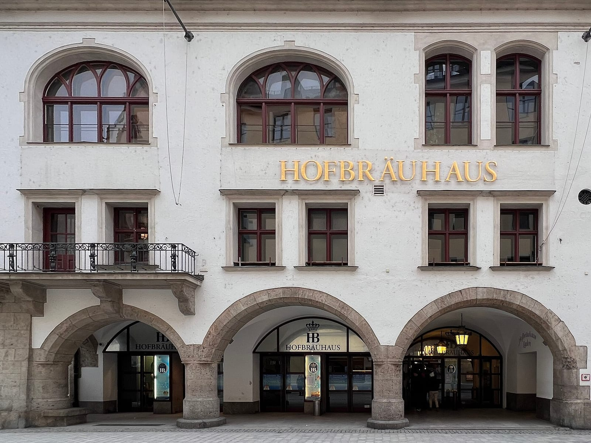
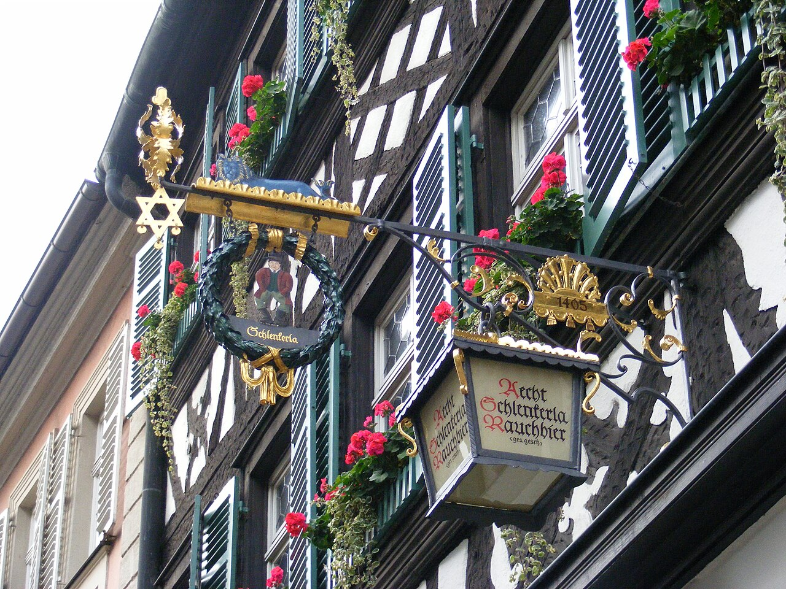

# Bavaria beer trail: Munich to Bamberg

This route places three spaces of Bavarian beer culture side by side: the state-owned beer hall in Munich's old town, the family brewery quarter in the west of the city, and the historic pub in Bamberg whose identity is built on smoked beer. Two stops are in Munich and one is in Bamberg, with a rail journey in between. It suits anyone willing to give a day and a half or two days to beer, not anyone trying to tick off three cities in half a day.

> **Quick verdict**
> **In one line:** This route helps you plan Bavaria beer trail: Munich to Bamberg, including the order, timing and stops that matter.
>
> - **Best for:** Anyone turning Bavaria beer trail: Munich to Bamberg into a one- or two-day route and needs the order and the stops that matter.
> - **Not for:** If you want only want one stop and do not intend to follow a route.
> - **Check first:**
>   - - Stop one: Hofbräuhaus, Platzl 9, 80331 München, founded in 1589 by Duke Wilhelm V of Bavaria and opened to the public in 1828.
>   - The Hofbräuhaus represents the beer hall.

## Route overview

- Stop one: [Hofbräuhaus](ref:hofbrauhaus), Platzl 9, 80331 München, founded in 1589 by Duke Wilhelm V of Bavaria and opened to the public in 1828.
- Stop two: [Augustiner-Bräu](ref:augustiner), Landsberger Straße 31–35, 80339 Munich, whose history the brand dates to 1328 and which is now run by the Wagner family.
- Stop three: [Schlenkerla](ref:schlenkerla), Dominikanerstraße 6, 96049 Bamberg, first mentioned in documents in 1405 and run by the Trum family into its sixth generation.
- Mode: walking, U-Bahn and S-Bahn in Munich; train from Munich to Bamberg; walking in Bamberg's old town.
- Suggested duration: a day and a half to two days. Put the two Munich stops on day one and Bamberg on day two; compressing everything into one day is possible but very tight.

## Why these stops

The Hofbräuhaus represents the beer hall. It began as a court brewery, sold to the public only from 1828, and the present building dates from the late 19th century and was rebuilt after serious damage in the Second World War. Long tables, wooden benches, large glasses and a band are the furniture of a place designed for many people drinking at once. It is crowded and touristy, but it shows the public side of Bavarian beer culture more directly than any quiet room could.

Augustiner-Bräu represents the family firm and the production site. Its story reaches back to brewing by the Augustinian monastery, documented in 1328; after the secularisation of 1803 it became private and has been run by the Wagner family since. The Landsberger Straße site is a working industrial complex, not a theme park, and individual visitors cannot treat it as an open museum. Its value is that it shows beer happening not only in pubs but in yards, loading bays and long-used buildings.

Schlenkerla represents taking one flavour all the way. It is first of all a historic brewery with a pub attached, brewing on site and serving from wooden casks. The smoke comes from malt smoked over beechwood before brewing, not from a flavouring added at the table. Together the three stops give three scales: the noise of the hall, the silence of the brewery yard, and the focus of the old pub.

## Stop one: Hofbräuhaus

Why go: it is the easiest of the three to reach and the clearest explanation of what a beer hall is. It stands at Platzl 9, a few minutes on foot from Marienplatz. The main hall has the band stage in the middle and long tables and benches around it; below is the vaulted Bierkeller, darker and more echoing; side rooms suit smaller groups. You find your own seat, and sitting down at a long table with a free place is normal practice.

What to order: start with a 0.5-litre Hofbräu Original to check whether you like the malt sweetness and mild bitterness of the pale lager; to compare, add a Münchner Dunkel or a Münchner Weisse and cover pale, dark and wheat in one meal. Order by glass size and name, such as “ein Halbe Original”; the server writes it on a table card and the bill is settled at the end. For food, choose roast pork with sauerkraut, white sausage with sweet mustard, or Obatzda cheese with rye bread.

How long: ninety minutes to two hours. The main hall is very loud when the band plays; choose a side room or the Bierkeller to talk. White sausage is traditionally eaten in the morning, and ordering it at midday is not “wrong”, but locals may think the timing is off.

Practical note: take the S-Bahn or the U3/U6 to Marienplatz, then walk about five minutes. As of 8 November 2026 the official homepage lists daily hours of 11:00–24:00, with changes on holidays and event days. Individual visitors do not need to book, and sharing a table is normal; large groups can ask ahead. Beer is priced by the glass, portions are large, and one main course plus two beers is usually enough for two people. Carry some cash for small bills.

## Stop two: Augustiner-Bräu

Why go: this stop is about the brewery site, not a bar. The buildings, loading areas, chimneys and offices at Landsberger Straße 31–35 form a working factory; only part of it is open to visitors, and whether tours run and how to book them must be confirmed with the brewery. Treating the site as a beer museum will disappoint; treating it as a corner of urban industrial heritage shows another side of Munich.

What to order: the site itself has no regular bar for individual visitors, so drinking this brand usually means going to a related food venue. Braustuben is in the Landsberger Straße brewery area and is the nearest option; Augustiner-Keller at Arnulfstraße 52 is a larger venue with a beer garden; Augustiner am Platzl in the city centre is the easiest to reach. For a first comparison, take one Lagerbier Hell and one Edelstoff: the first tells you what everyday Munich beer tastes like, the second what the same brewery does when it builds a fuller body. Dunkel and Maximator suit dinner or winter, and Maximator, at about 7.5% alcohol, is not a first drink.

How long: ninety to one hundred and twenty minutes. If you only walk around the exterior and drink one glass at Braustuben, two hours is enough; if you wait for a reply about a tour, set aside separate time.

Practical note: take the S-Bahn to Donnersbergerbrücke and walk about ten minutes, or take local transport to a nearby stop and continue on foot; check MVV on the day for specific routes. Tours are not a standing offer, and opening, booking and whether individuals are accepted all depend on the brewery's reply. Braustuben, Augustiner-Keller and the city-centre restaurant each have their own hours, menus and booking rules, so check each one before setting out. There is no dress code; if you are allowed into the production area, follow the safety rules, do not wear sandals and do not cross the marked lines.

## Stop three: Schlenkerla

Why go: it turns one flavour into the character of a whole establishment. Schlenkerla stands at Dominikanerstraße 6 in Bamberg's old town, in a lane below the cathedral; the property is first mentioned in 1405, and the Trum family now runs it in the sixth generation. It keeps wooden panelling, old light fittings and dark furniture, with several rooms of different sizes and tightly packed tables; this is not a museum reconstruction but an old building still in use.

What to order: begin with a small Rauchbier Lager or Märzen to see whether you accept the smoke, then decide whether to move to Weizen or a larger glass. Rauchbier Märzen is the signature: dark, medium-bodied, smoke and malt sweetness together. Rauchbier Weizen is the wheat version, with banana and clove layered over smoke and a softer texture. Rauchbier Lager is paler with lighter smoke, and Rauchbier Urbock is the seasonal strong beer with heavier smoke. For food, choose Schäuferle, roast pork shoulder with sauerkraut and bread, or Bratwurst with sauerkraut; smoke, roast meat and the acidity of sauerkraut support one another.

How long: ninety to one hundred and twenty minutes. Seats are easier to find at midday and early afternoon; locals and visitors both arrive in the evening, and weekends in high season call for extra waiting time. If a companion cannot accept smoke at all, this pub has no smoke-free alternative, so choose another venue.

Practical note: from Bamberg station, walk fifteen to twenty minutes into the old town and head towards the cathedral; buses and taxis reach the edge of the old town, but the last stretch is on foot. The Bamberg tourist office page has listed daily hours of 10:00–24:00, while the pub's own page, the season and holidays may change them. Prices in Bamberg are mid-range to tourist-area level, beer is priced by the glass and portions are generous; individual visitors find seats and share tables, while groups should ask ahead. Many old German establishments still prefer cash, so carry some.

## Order and transport

Follow the order “Hofbräuhaus → Augustiner-Bräu → Schlenkerla”, but put the first two on one day and the third on the next. Arriving at the first stop around midday works best: eat white sausage or roast pork first, then drink an Original; in the afternoon take the S-Bahn or local transport to the west of Munich, walk around the brewery quarter and finish at Braustuben or Augustiner-Keller. On day two, take the train from Munich Hauptbahnhof to Bamberg and put Schlenkerla at midday or in the evening.

The legs:

- Stop one to stop two: from Marienplatz take the S-Bahn to Donnersbergerbrücke and walk about ten minutes to Landsberger Straße 31–35; alternatively take the U-Bahn or tram from the old town to a nearby stop, with changes checked on MVV on the day. The brewery and Braustuben area is offices and industry rather than a shopping district.
- Stop two to stop three: take an ICE or IC from Munich Hauptbahnhof to Bamberg, usually direct or with one change; trains, journey times and fares are subject to Deutsche Bahn's day-of-travel information. From Bamberg station, walk fifteen to twenty minutes into the old town and head for Dominikanerstraße 6 below the cathedral.
- Inside Bamberg: the lanes are narrow and the slopes numerous, so the route is on foot; the cathedral, the old and new residence and the old town hall are all within walking distance, with no need for local transport.

If you insist on one day, the order becomes “Hofbräuhaus in the morning, Augustiner in the afternoon, train to Bamberg in the evening, Schlenkerla at night”. It looks possible on paper, but each stop gets only a short time and trains and queues eat the margin; two days is the safer arrangement that keeps beer and city separate.

## Duration and budget

A day and a half to two days is a reasonable range. Day one: ninety minutes to two hours at the Hofbräuhaus, about an hour for local transport and changing stops, then ninety minutes to two hours at the Augustiner site and its food venue. Day two: the train from Munich to Bamberg, the walk from the station into the old town, and ninety to one hundred and twenty minutes at Schlenkerla, making half a day to a full one.

On budget, none of the three is extreme: the Hofbräuhaus and Schlenkerla are mid-priced locally, and the Augustiner venues differ a little by location, with the city-centre restaurant usually one step above the brewery-area option. The real variables are the train fare and accommodation: putting Bamberg on day two means either staying overnight or making a day return and squeezing the timetable. The way to control cost is one or two drinks at each stop and one proper meal somewhere in the middle, rather than a full spread at every stop.

## Who it suits and who it does not

It suits people interested in beer styles, brewing history and urban space; anyone happy to sit at a long table and share with strangers; travellers who accept that the brewery is not a sight and are willing to check official information in advance; and anyone spending two or more days in Bavaria.

It does not suit people trying to cover three places in one day; drinkers who only like pale beer and cannot accept smoke; visitors expecting fixed guided tours, a gift shop and an “immersive experience”; anyone wanting to walk into the brewhouse and take photographs; people treating the Hofbräuhaus as a smart restaurant that should be quiet; or travellers unwilling to check trains and opening hours.

Families should note that the beer hall admits children but is loud and crowded, the brewery is not a playground and Bamberg's cobbled old town is hard on pushchairs.

## Practical tips and verification notes

First, confirm where the drinking happens. The Augustiner brewery is not a regular bar: individual visitors drink at Braustuben, Augustiner-Keller or the city-centre restaurant. Check each address and its hours separately rather than arriving at the brewery gate and looking for a bar.

Second, separate “can visit” from “can only look”. Tours are not a standing offer, and opening, booking and whether individuals are accepted all depend on the brewery's reply; do not put a tour in the schedule before it is confirmed.

Third, order by the glass and settle by the table card. Munich and Bamberg work much the same way: state the glass size and the beer, the server writes it on the card, and the bill is settled at the end. State the total including a tip, usually rounded up or 5%–10%, and do not leave cash on the table and walk away.

Fourth, ask before sharing a table. At a long table, ask “Ist hier frei?” and sit only when allowed; do not spread bags across a whole bench or move other people's glasses. When toasting, say “Prost” and, by local habit, look the other person in the eye.

Fifth, read the historical dates correctly. The Hofbräuhaus's 1589 is the founding of the court brewery, and it opened to the public only in 1828; Augustiner's 1328 is the first documentary mention of monastic brewing, not the registration of a modern company; Schlenkerla's 1405 is the first documentary mention of the property and the pub, not “six centuries of continuous brewing”.

Sixth, this route describes the structure of the route and verifiable facts only. It does not provide live opening status, trains or fares, a map or coordinates: the three venues' latitude and longitude are left empty in the content repository, and with no verifiable coordinate source the project rule is not to draw a schematic map. For precise navigation and trains, use live map and rail enquiry services and follow on-site signage.

Further reading: [Alsace Grand Cru trail: Kaysersberg and Riquewihr](ref:c-extra-1), [Armagnac trail: single estates of Bas-Armagnac](ref:c-extra-2).

## Related images

Image: Related photograph of Hofbräuhaus. Credit: Burkhard Mücke, CC BY-SA 4.0, via Wikimedia Commons ([source page](https://commons.wikimedia.org/wiki/File:2023-02-03_Hofbr%C3%A4uhaus_am_Platzl_07.jpg)). Related image for Bavaria beer trail: Munich to Bamberg.

Image: Schlenkerla. Credit: User:Mattes, Public domain, via Wikimedia Commons ([source page](https://commons.wikimedia.org/wiki/File:Schlenkerla_-_Nasenschild_in_Bamberg.JPG)). Related image for Bavaria beer trail: Munich to Bamberg.
