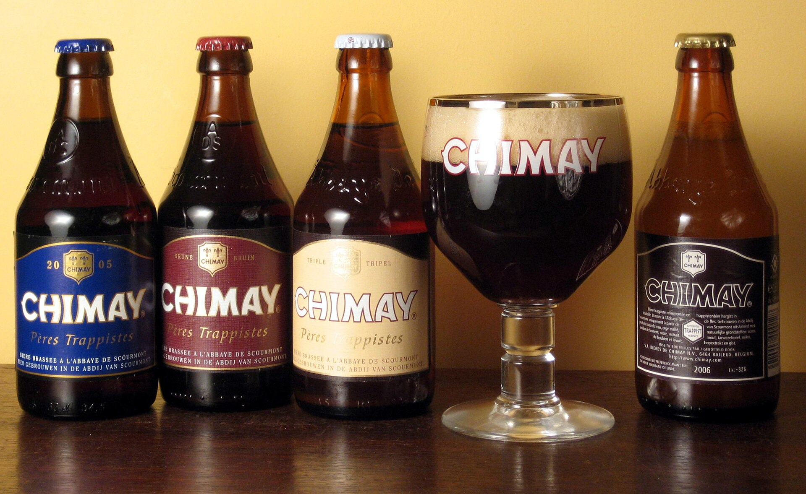

# Belgium beer trail: lambic in Brussels, city ale in Bruges

Two cities, two breweries, two fermentation logics. Cantillon in Anderlecht hands wort to wild microbes in the air; De Halve Maan in Bruges puts selected yeast into tanks. An hour by train separates them, and a full day covers both. The route suits early risers who accept sour beer and do not treat Belgian beer as one flavour.

Figure: "Belgium beer trail: lambic in Brussels, city ale in Bruges". Photograph: File:Chimays.jpg. Credit: Uploaded by photographer., CC BY-SA 3.0 ([source page](https://commons.wikimedia.org/wiki/File:Chimays.jpg)). Category image; not a claim that it shows the exact product, site or event.

## Two kinds of fermentation, one train

- Stop one: [Cantillon](ref:cantillon), Rue Gheude 56, 1070 Bruxelles, in Anderlecht near Brussels Midi.
- Stop two: [De Halve Maan](ref:halve-maan), Walplein 26, 8000 Brugge, in the centre of the old town.
- Mode: walk or metro to Brussels Midi, train to Bruges, then walk; no car.
- Duration: a full day; one to two hours at Cantillon, about an hour on the train, one to two hours at De Halve Maan.

The order cannot be reversed: Cantillon opens on weekdays, closes Wednesday and Sunday, and runs guided tours only on Saturday; De Halve Maan sells timed tours. Morning in Anderlecht, afternoon in Bruges is the only arrangement with slack; if your day is Wednesday or Sunday, move the route.

## Anderlecht: handing fermentation to the air

[Cantillon](ref:cantillon) was founded in 1900 and later run by the Van Roy family. In 1978 the brewery and friends set up the Brussels Gueuze Museum association, turning a working site into a living museum: copper mash tun, cooling tray, oak casks and stacked bottles are both exhibits and equipment.

Lambic is not inoculated with commercial yeast. Wort cools overnight in a shallow, wide tray, wild yeast and bacteria fall in, and it then spends more than a year in oak. Wood microbes, cellar temperature and that year's weather all enter the flavour; the oak is a home for microbes, not a source of wood flavour.

Start dry: young unblended lambic is sharp with little carbonation; gueuze blends years and referments in bottle, giving fine bubbles and layered acidity; fruit versions use real cherries or raspberries; Iris is a rare dry-hopped lambic. Taste light to heavy, avoid serving too cold, and wear shoes with grip for the wet cellar.

## Boarding at the Midi

Walk about ten minutes to Brussels Midi or take the metro; allow twenty minutes for tickets and platforms, and read the board on arrival.

Intercity trains to Bruges are usually direct and take about an hour; check SNCB for trains and fares. From Bruges station, walk into the old town in about fifteen minutes via 't Zand; cobbles are hard on wheeled luggage. Leave bags at Midi if travelling light.

## Bruges: putting fermentation back in the tank

At [De Halve Maan](ref:halve-maan), Walplein 26, brewing goes back more than five centuries, while the family story starts in 1856, when Leon Maes took over and brewed to his own recipe. Six generations later came Straffe Hendrik in 1981 and Brugse Zot in 2005. In 2016 a 3.3-kilometre underground pipeline linked the city-centre brewhouse to the bottling plant outside town, cutting brewery lorries from the old streets.

The standard tour lasts about forty-five minutes, includes a beer, climbs 220 steps and ends on the roof with a 360-degree view. Unfiltered Brugse Zot and Straffe Hendrik are available only here. Tours are timed and fill at weekends, so book online; the full route does not suit limited mobility.

The list covers top-fermented directions: Brugse Zot Blond is golden and balanced, Dubbel shows caramel and dark fruit, Straffe Hendrik Tripel is drier and stronger, Quadrupel fuller, Heritage cask-aged. Selected yeast works at warmer temperatures, producing esters before cold conditioning: the opposite control system from Cantillon.

## Lambic, Trappist and the boundaries of naming

Lambic and gueuze are not synonyms. Lambic is unblended spontaneously fermented wort beer; gueuze blends years and referments. EU rules protect names such as Oude Geuze and Oude Kriek as traditional specialities, with the scope set by regulation. "Oude" usually means longer ageing and sharper acidity; gueuze without it can be younger and sweeter.

Trappist beer is another line: the logo is restricted to defined monastery breweries, while Abbey beer is a looser commercial category. De Halve Maan is a family brewery, not a monastery, so its Tripel and Quadrupel are abbey-style, not Trappist. Put the three together and three sources of legitimacy emerge: wild environment, family recipe, monastic institution.

Read the entries on lambic, gueuze and Trappist beer, then fermentation for the split between inoculated and uninoculated brewing.

## Tickets, seasons and the return

Cantillon is self-guided on weekdays with no booking; Saturday is guided only and must be booked online; it closes Wednesday, Sunday and public holidays, with annual closures at year-end and in summer. Groups of ten or more must book by email. De Halve Maan's tours are best booked ahead, with weekend slots going first.

Spring and autumn are easiest; Bruges is crowded in summer and winter cellars cold, so bring warm clothing.

Lambic's acidity is hard on an empty stomach, so eat in Brussels; tastings add up, so leave an hour between stops for walking and water. Take care on the 220 steps after beer, check the last train, and do not rent a car: Belgium enforces drink-driving rules strictly.

This route covers route structure and verifiable facts only, with no live opening status, tour prices or train times; check the two breweries and the rail operator's official channels. Page verified on 2026-11-08.

Further reading: [Lambic](ref:c-extra-1).

**Short definition:** See Cantillon hand fermentation to the air in Anderlecht, then take the train to Bruges and watch De Halve Maan keep yeast in the tank. One day and two fermentation logics explain why Belgian beer resists a single sentence.

A frequent error is to treat Belgium beer trail as a single stop. Establish where it starts and ends, then how long each stop takes. Neither answer settles the question alone.

The route uses trains between Brussels and Bruges, with a tram or walk to the lambic breweries outside the centre.

**Key facts.**

| Item | Detail |
| --- | --- |
| In one line | See Cantillon hand fermentation to the air in Anderlecht, then take the train to Bruges and watch De Halve Maan keep yeast in the tank. One day and two fermentation logics explain why Belgian beer resists a single senten… |
| Stops | 2 |
| Transport | rail |
| Stop order | Cantillon Brewery、De Halve Maan Brewery |

**Sources and limits.** The key claims about Belgium beer trail: lambic in Brussels, city ale in Bruges are checked against the following sources: Brasserie Cantillon (Used to check the Rue Gheude 56 address, the 1900 founding and the 1978 museum association), Brouwerij De Halve Maan (Used to check the Maes family from 1856, Straffe Hendrik in 1981, Brugse Zot in 2005 and the 2016 pipeline), SNCB / NMBS. Prices, batches and status change; the body is project-written and does not reproduce source text.
