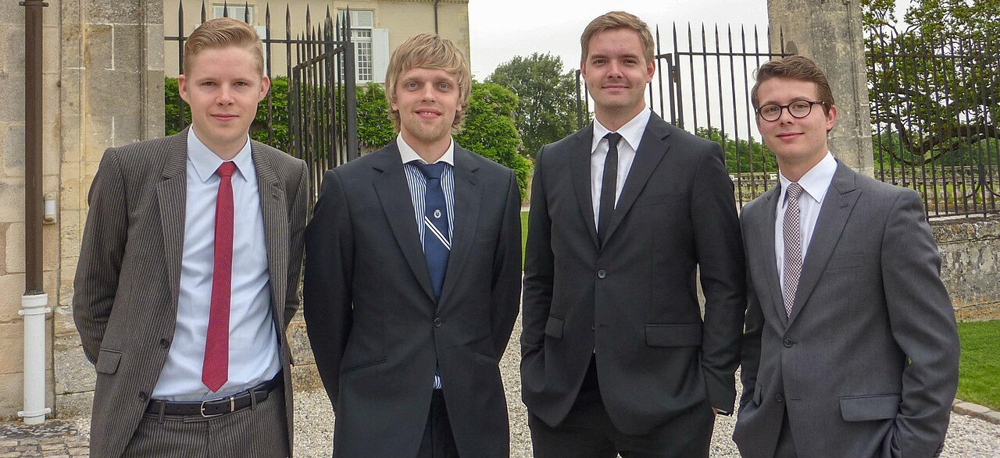

# Bordeaux left bank: from La Cité du Vin to two Pauillac first growths

This route puts three scales on one line: a city museum that explains the civilisation of wine, a first growth classified in 1855, and another first growth that began as a second. The first two sit between the river and the city; only the third really enters the gravel slopes of the Médoc. It suits anyone willing to give a full day or a day and a half to understanding what “left bank” means. It does not suit anyone treating famous estates as photo backgrounds and looking for the entrance on arrival.

Figure: Bordeaux left bank: from La Cité du Vin to two Pauillac first growths. Photograph: The CBS Wine team at the 2012 Left Bank Bordeaux Cup. Credit: Netapp Inc, CC BY-SA 3.0, via Wikimedia Commons ([source](https://commons.wikimedia.org/w/index.php?curid=21313721)).

## Route overview

- Stop one: [La Cité du Vin](ref:cite), 134 Quai de Bacalan, 33300 Bordeaux, opened in 2016, with a permanent exhibition of about 3,000 square metres.
- Stop two: [Château Lafite Rothschild](ref:lafite), 33250 Pauillac, 112 hectares of vines, a first growth in 1855 and purchased by the Rothschild family in 1868.
- Stop three: [Château Mouton Rothschild](ref:mouton), 33250 Pauillac, renamed in 1853, a second growth in 1855 and promoted to first growth in 1973.
- Mode: walking and tram B in the city; regional train from Bordeaux Saint-Jean to Pauillac; taxi or car along the D2 in the Médoc.
- Suggested duration: a day and a half. See La Cité du Vin on the first afternoon and go to Pauillac on the second morning; the order still works in one day, but each stop gets very little time.

## Why this route

The left bank is easily reduced to a handful of estate names. The harder task is putting those names back into geography and institutions. La Cité du Vin supplies the frame: it treats wine as a civilisation through geography, craft, history, the art of living and cross-regional comparison, not as a league table of châteaux. Knowing how wine is grown, traded and drunk around the world makes the gates and nameplates in Pauillac mean more.

Lafite supplies the classification. The 1855 Médoc classification was a commercial ranking tied to the Paris Exposition, ordering estates by price and reputation into five levels; Lafite was placed in the first, and the house still stresses its particular position within that group. The ranking was not an annual quality test but a historical document. Once that is clear, the 112 hectares, the deep gravel and the Cabernet Sauvignon-dominant planting read as the long work of soil, drainage, picking and barrel ageing behind the phrase “first growth”.

Mouton supplies change. It was a second growth in 1855 and became a first growth only in 1973, the only promotion of its kind in that classification. Its second thread is art: after the “V” label of 1945, the estate has invited an artist to design each vintage, and in 1962 it added the Museum of Wine in Art. Putting Lafite and Mouton on the same day shows not just two famous estates but two fates within one system: stability and movement.

## Stop one: La Cité du Vin

Why go: it turns Bordeaux from a region into an entrance. The building stands on the Bacalan quays on the left bank of the Garonne, part of the old port's redevelopment; XTU architects designed the form, with screen-printed glass and perforated aluminium that change with the light. The permanent exhibition is divided into six themes and 18 modules across five continents and takes two to three hours on average. The route is not a forced one-way line, so visitors can jump between sections.

What to see: on a first visit, take in “world vineyards”, “craft” and “history” to build coordinates of place, process, trade and consumption; leave the Bordeaux modules until the end so the local story does not swallow the global one. The displays rely on film, smell and touch, which rewards a slow pace. The belvedere on the eighth floor closes the visit; the ticket includes one glass of wine or grape juice chosen by a sommelier, with a view over the city and river. It is not an open bar but a full stop.

How long: two to three hours. If you also book a tasting workshop, set aside half a day and do not compress the workshop and the exhibition into the same hour. Families can follow the museum's junior route rather than forcing the full circuit.

## Stop two: Château Lafite Rothschild

Why go: it is the most concrete specimen of the classification. The estate lies north of Pauillac, and its name is often traced to the Gascon “La Hite”, a small hill; the 112 hectares are split into three blocks, with deep fine gravel mixed with wind-blown sand over free-draining limestone. The grand vin is Cabernet Sauvignon-dominant, uses vines of at least ten years and ages in new oak; the second wine, Carruades de Lafite, comes from another plateau with a higher share of Merlot. These details explain the first growth better than the two words alone.

What to see: this stop begins with a boundary. The estate's official visit page states that the château is closed to visitors until January 2028 for renovation and suggests Château Duhart-Milon instead; the contact page still carries an older “renovation until 2026” wording, so the two statements must be checked again before setting out. In practice, the stop is about the vineyards, lanes and outer boundary north of Pauillac and about how the D2 “wine road” organises the Médoc, not about walking into the cellar. The estate is private property: do not park at vineyard entrances or on private drives, and do not climb over fencing.

How long: thirty to sixty minutes, depending on how long you spend at the edge of the vines. If you have booked the Duhart-Milon alternative, add one to two hours. Writing Lafite as a “must enter” stop is inaccurate during the renovation; writing it as “a point in left-bank geography” holds.

## Stop three: Château Mouton Rothschild

Why go: it braids classification, art and family. In 1853 Baron Nathaniel de Rothschild bought the then Château Brane-Mouton and gave it its present name; it was a second growth in 1855 and a first growth from 1973. Since 1945 each vintage of the grand vin has carried a label by a contemporary artist, with the originals shown in the “Paintings for the Labels” gallery; the Museum of Wine in Art, created in 1962, holds objects connected with vines and wine. The visit usually includes the vat room, cellar, museum and label gallery, and whether a tasting is included must be confirmed at booking.

What to see: the new vat room, opened in 2013, deserves time: 64 vats of different sizes correspond to different parcels, and the timber, steel columns and suspended lighting put parcel-by-parcel work on display. The grand chai handles the ageing of the grand vin; the museum and label gallery lay the brand's history out by year. Do not look only at the famous painters on the labels. The real subject is how the estate separates parcels and then blends them into one wine. Mouton and Lafite belong to the same Rothschild family but to different companies, and Mouton Cadet is a separate merchant brand, not the grand vin.

How long: one to three hours, depending on the booked programme. Mouton accepts visits by reservation only, asks for at least two months' notice and pauses visits during harvest; until a booking is confirmed, do not put “going into the cellar” in the schedule.

## Transport and rhythm

The first two stops sit in the city, the third in the Médoc, so the route needs two kinds of movement. La Cité du Vin is served by tram B at the stop of the same name, about two minutes on foot; from the centre you can also walk along the Garonne. After the exhibition, return to your base or to Saint-Jean station and take a regional train north to Pauillac the next morning. Pauillac has a station, but the estates are still some distance away and need a taxi, bicycle or car; taxis in the Médoc can be scarce in high season, so arrange the return.

Walking the D2 is not a good idea. It is a wine road and an agricultural road, with narrow shoulders, fast traffic and machinery during vineyard work. Treating “Lafite to Mouton on foot” as a stroll underestimates both distance and road conditions. A better pattern is to base yourself in Pauillac, use a taxi between the two estates and keep walking for the village and short stretches at the edge of the vines.

On rhythm: see La Cité du Vin on the first afternoon and stay in Bordeaux; go north the next morning, eat in Pauillac, visit Mouton by reservation in the afternoon and stop only outside Lafite. This puts the densest information at the best energy and the appointment-dependent estate on the second day, where delays are easier to absorb.

## Seasons and booking

Bordeaux's tourist season overlaps the growing season. Vines bud in spring, summer days are long, and September to October is harvest; estates are busy then, and some visits pause or change route, as Mouton's notice about harvest indicates. Late autumn and winter are quieter, but daylight is short and some estates go into rest, so confirm each one before booking.

Booking is the premise of this route. Lafite is not receiving visitors during renovation and points to Duhart-Milon; Mouton asks for at least two months and depends on availability; La Cité du Vin sells exhibition tickets on the day but its tasting workshops are separate. Confirm three things separately: the museum's exhibition and workshop, Lafite's renovation status and alternative, and Mouton's time slot. If any one is unconfirmed, the day gains a stretch of waiting.

## Manners and limits

First, separate “estate” from “sight”. The famous houses of Pauillac are agricultural businesses before they are visitor attractions; do not push open a door without a booking, walk between vine rows, or touch barrels and equipment. Second, use the spit bucket and do not drink if you are driving; France enforces drink-driving law strictly, and “only a sip” is not a defence. Third, dress tidily and comfortably, since vineyard ground is uneven and heels are impractical; cellars are cool even in summer, so bring a light layer.

Fourth, read the dates correctly. 1855 is the classification, not the founding year; Lafite's 1868 is the family purchase; Mouton's 1853 is the renaming, and 1973 is the promotion. Fifth, distinguish grand vin, second wine and merchant brand. Carruades de Lafite, Le Petit Mouton and Mouton Cadet are not the same tier, and the names should not be used interchangeably. Sixth, do not ask staff to sell you a bottle of the grand vin at the gate; Bordeaux's top wines move mainly through en primeur and the merchant network, and the estate is not a shop.

For Bordeaux left bank: from La Cité du Vin to two Pauillac first growths, this page does not provide a map; addresses and opening status were checked against official pages on 2026-11-08, but hours and booking rules can still change, so confirm with official channels. Latitude and longitude for the three venues are left empty in the content repository, and with no verifiable coordinate source the project rule is not to draw a schematic map. For precise navigation, use a live map service and follow on-site signage.

## Alternatives and extensions

If Lafite cannot be entered during the renovation, Duhart-Milon is the direct substitute: same ownership group, same village, a clear booking route. To see the classification more fully, add one estate in Saint-Julien or Margaux, but two estates a day is already the limit; three becomes a scramble. If city and river interest you more, pair La Cité du Vin with the old merchant streets of Chartrons and the Halles de Bacalan market rather than adding another estate.

Northwards the route reaches Saint-Estèphe, southwards Saint-Julien and Margaux; each village has its own estates and lanes, but the Médoc is not a theme park to be ticked off. The more useful extension is reading: understand where the 1855 classification came from, how gravel and Cabernet Sauvignon relate, and how en primeur works. Return to the edge of the vines afterwards and the landscape reads differently.

## See also

- [La Cité du Vin](ref:cite): the framing stop, best placed at the start of the trip.
- [Château Lafite Rothschild](ref:lafite): classification, parcels and the renovation notice.
- [Château Mouton Rothschild](ref:mouton): the 1973 promotion, artist labels and booking rules.
- For background, consult the Bordeaux region, wine-grading and place-and-process entries in the content repository; this page does not register further references.

Opening status, bookings and transport are subject to official channels; page verified on 2026-11-08.
