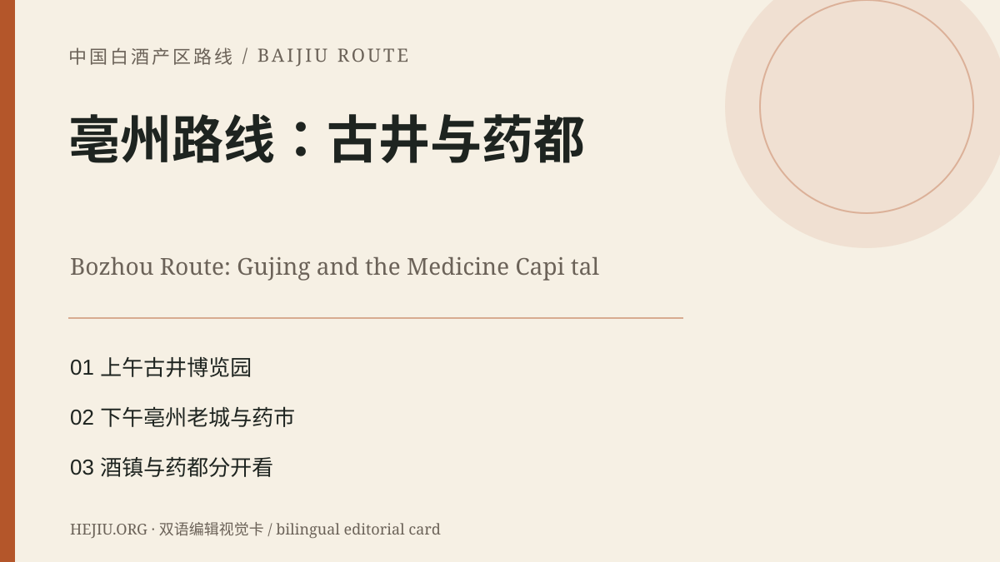
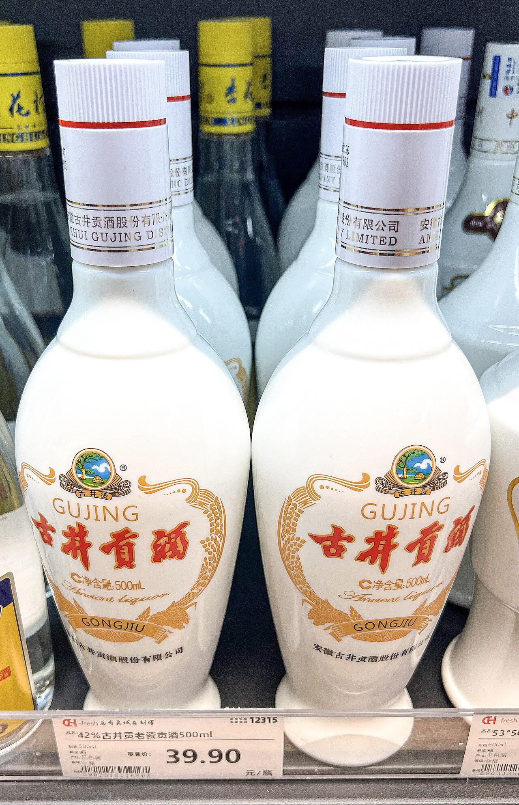
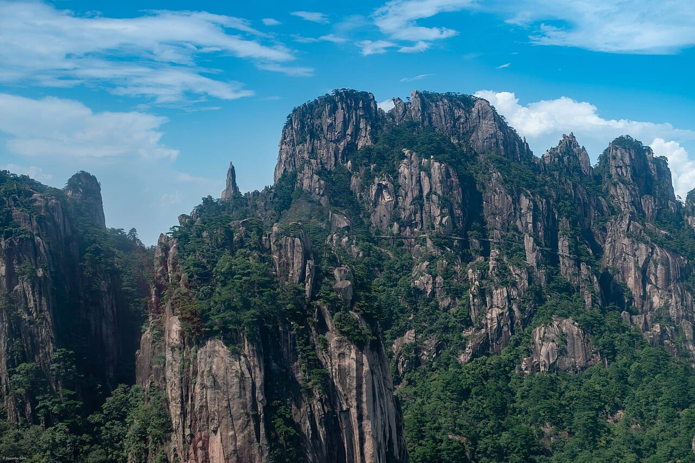

# Bozhou Route: Gujing and the Medicine Capital

Bozhou puts two long-cycle handworks in one city: strong-aroma baijiu in Gujing Town, and the medicine-capital tradition of the old town and herb market. Many treat Gujing as “one plant” or Bozhou as “one herb market” and see only surfaces. This route gives the morning to the Gujing Wine Culture Park and town, the afternoon to the old town and herb market: liquor first, medicine second, a smoother flow.

图：Bozhou route bilingual editorial card。Project-created bilingual editorial card for topic identification, not a documentary photograph.

> **Quick verdict**
> **Best for:** travellers who want both a strong-aroma liquor town and the medicine-capital old town; works from Bozhou station or airport.
> **Not for:** visitors who want one deep stop and no transfer; Gujing and the old town need a drive.
> **One line:** park and town in the morning, old town and herb market in the afternoon, and no driving after tasting.

## Why liquor town before medicine capital

Gujing Town and Bozhou’s old town are two spatial systems. Gujing grew around the plant: the culture park handles craft and brand, the town handles life and plant exterior. The old town and herb market revolve around medicine: the Flower Theatre, old streets, herb trade and processing form another line. Put Gujing in the morning because the park needs continuous time; put the old town and market in the afternoon because they suit the close of day. Eat lunch in Bozhou and do not compress both drives into lunch.

## Morning: Gujing Wine Culture Park

The park explains Gujing Gongjiu’s history, craft and brand. Follow three lines: how the Gujing water system and local grain affect brewing, how mud pits and grain work, and how finished liquor is stored and blended. Strong-aroma ferments in solid state in mud pits; longer continuous use and stable mud care produce reliable pit aroma and ethyl caproate. Do not just repeat “Gujing”; look at walls, bottom mud, starter rooms and jar warehouses. Models and cutaways carry more information than single bottles, so see them before objects. Do not enter working areas or climb fences.

## Afternoon: Bozhou old town and herb market

The old town offers the Flower Theatre, Cao Cao’s underground troop passage, Hua Tuo Temple and old streets; the herb market shows trade, grading, storage and processing. “Wild” is not automatically better: origin, grade, processing and storage all affect use. If you do not understand processing, do not buy loose herbs, and do not trust “special supply” or “wild” talk. In the market, note stall zoning, separation of samples and stock, and clear labelling; ask before photographing and do not shoot traders close up. Walk or take a taxi between old town and market, follow the on-site flow, and do not walk against freight lanes.

## Transport, booking and time

Gujing lies northwest of Qiao District, roughly half an hour from the city, usually reached via Bozhou station or airport; check live schedules. The culture park takes about two hours; town and tasting make half a day; old town and herb market fill a day. Park, plant and market opening, booking and charges are separate, so confirm each the day before. Northern Anhui is hot in summer, so bring water and a hat; winter wind demands a windproof jacket. From the old town, put Gujing in the morning and return in the afternoon to avoid a late trip.

## Tasting, buying and herbs

Ask about strength, volume and charge before tasting; sip slowly, not on an empty stomach. The driver abstains and does not drive after. Buy liquor from official or authorised shops and keep receipts; buy herbs in regulated markets and ask origin, grade and processing rather than treating “wild” or “special supply” as the only standard. For food, try Bozhou beef bun, sa soup, medicinal dishes and northern Anhui home cooking, keeping strong-aroma liquor modest. With children, see park models before the old town; with older relatives, reduce walking and choose one section of the park and one stretch of the herb-market main street.

## One-day and half-day versions

The one-day version runs culture park, Gujing town, lunch, Bozhou old town and herb market; do not spend the whole morning in galleries and leave half an hour for town. The half-day version chooses either park and town or old town and market, not both in a rush. With older relatives, reduce walking and understand the models first. From the old town, put Gujing in the morning and return in the afternoon. Buy liquor and herbs separately before returning, keep the driver out of tasting, carry water and a hat in summer, and do not trust “wild” or “special supply” claims in the herb market. From Bozhou station, start at the culture park, leave half an hour for town, eat lunch in Bozhou and spend the afternoon in the old town and herb market; from the old town, reverse the order but do not push the park to closing. With older relatives, reduce walking and understand the models first; with children, see starter and pit models before the old town. Park, plant and herb market use different booking entries, so confirm each the day before; with half a day, choose park and town and skip the market. Buy herbs in regulated markets and ask origin, grade and processing; eat at local meal times, note the parking spot and allow extra time.

## Check before you go

- Confirm park, plant and herb market separately
- Gujing in the morning, old town in the afternoon
- Do not drive after tasting
- Buy only from official or authorised shops
- Ask origin, grade and processing for herbs
- Bring water and a hat in summer
- Check drive time from the old town
- Reduce walking for older relatives

## Who this route is not for

This route links Gujing town with central Bozhou, good for travellers interested in both strong-aroma production and the medicine city's history. If you only want wine, the herb market and historic sites in Bozhou take half a day; without a car, buses between Gujing and the city are limited, so allow time for the return.

Gujing visits centre on the museum and old workshop, and whether production opens depends on the day; town food and lodging are limited, so staying in the city is steadier in peak season. Sights in Bozhou can be reached by taxi or on foot, but summer is hot and winter windy.

Alternative: see only the Gujing wine-culture museum, or only central Bozhou; to link Gujing with Shuanggou or Yanghe, allow at least two days. Compare plant, city and official channels when buying, and do not treat a gift box as the only option.

## References

- Gujing Wine Culture Museum — Bozhou Municipal People’s Government — https://www.bozhou.gov.cn/News/show/105123.html (Bozhou Municipal People’s Government, checked 2026-11-25)
- Gujing Wine Culture Museum — Bozhou Culture, Tourism and Sports Bureau — https://wlt.bozhou.gov.cn/News/show/367285.html (Bozhou Culture, Tourism and Sports Bureau, checked 2026-11-25)
- Gujing Group — Company profile — https://gujing.com/about/index.html (Anhui Gujing Group Co., Ltd., checked 2026-11-25)
- Notice on extending ticket prices at Gujing Wine Culture Park — https://fgw.bozhou.gov.cn/News/show/685103.html (Bozhou Development and Reform Commission, checked 2026-11-25)

Related entries: [Gujing Wine Culture Park](ref:park), [Gujing Town (Bozhou)](ref:town), [Gujing Gongjiu](ref:brand), [strong-aroma baijiu](ref:style), [Anhui](ref:region), [First baijiu guide](ref:guide), [History of Chinese wine](ref:history).

## Related images

Image: Gujing Gongjiu. Credit: N509FZ, CC BY-SA 4.0, via Wikimedia Commons ([source page](https://commons.wikimedia.org/wiki/File:Gujing_Gongjiu_at_a_supermarket_in_Beijing_(20241109164639).jpg)). Related image for Bozhou Route: Gujing and the Medicine Capital.

Image: Anhui. Credit: xiquinhosilva, CC BY 2.0, via Wikimedia Commons ([source page](https://commons.wikimedia.org/wiki/File:Mount-huangshan_53319732882_o.jpg)). Related image for Bozhou Route: Gujing and the Medicine Capital.
