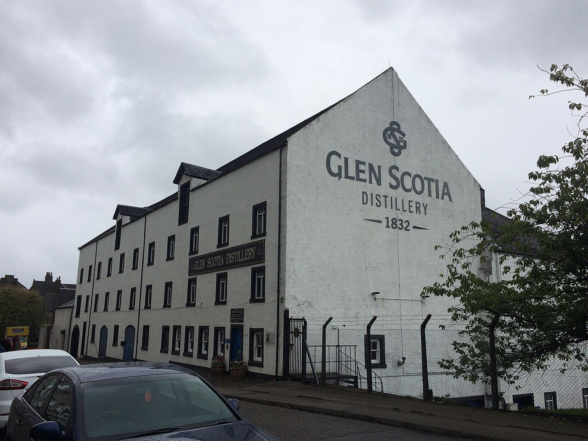

# Campbeltown: two distilleries, two streets

Campbeltown, at the end of the Kintyre peninsula, is the smallest of the five protected Scotch whisky regions. This route covers less than a kilometre in the town centre, from Springbank in Well Close to Glen Scotia on High Street. What lies between the stops is not distance but the arc of a region that boomed, contracted and only recently steadied itself.

Figure: Campbeltown: two distilleries, two streets. Photograph: Glen Scotia Distillery, Campbeltown. Credit: Lirazelf, CC BY-SA 4.0, via Wikimedia Commons ([source](https://commons.wikimedia.org/w/index.php?curid=62323489)).

## A protected region you can cross on foot

“Protected region” is not marketing: the regulations list Campbeltown among five areas, and the name on a label carries rules on origin and production. Only three distilleries remain, two in the centre and one to the north, which makes walking the natural mode. There is no car to rent and no ferry to catch: book two tours, leave time for lunch, and the day works. Walking also shows you churches, closed shops and harbour warehouses that explain how whisky once paid for this town.

## Route skeleton: from Well Close to High Street

- Stop one: [Springbank](ref:springbank), Springbank Distillery, Well Close, Campbeltown PA28 6ET; turn off Longrow and the yard is at the end.
- Stop two: [Glen Scotia](ref:glen-scotia), Glen Scotia Distillery, 12 High Street, Campbeltown PA28 6DS; the door opens onto the main street.
- Mode: on foot throughout, less than a kilometre, ten to fifteen minutes; pavements are narrow, some sections slope, and rain makes them slippery.
- Suggested duration: half a day for two tours, a full day with lunch and a harbour walk. Glengyle, home of Kilkerran, needs a separate booking and another fifteen minutes north.
- Order: Springbank first, since its tours mostly run in the morning while Glen Scotia still has afternoon slots; the reverse works if the bookings say so.

## Why these two: a town's rise and retreat

In the nineteenth century Campbeltown was briefly one of Britain's wealthiest towns per head, its harbour lined with ships loading casks and more than a dozen distilleries running. Springbank's 1828 licence made it the fourteenth legal distillery in town. Demand then moved to lighter blends, and as some plants traded quality for volume the blenders left; by 1934 only Springbank and Glen Scotia remained. Glengyle reopened in 2004, and only then did Campbeltown return to the map as a region. The day is not about two names but about a region moving from expansion to self-defence: one keeps every step on site, the other still works inside Victorian buildings after repeated changes of owner.

## Stop one: Springbank

Why go: it is one of the few Scottish distilleries that malts, mashes, distils and bottles on site. Archibald Mitchell took the licence in 1828 on ground where the family had distilled illicitly, and J&A Mitchell still owns it; in 2023, after Hedley G. Wright's death, ownership passed to three trusts.

What to see: the [floor maltings](ref:malting) are the centrepiece, with barley steeped, spread about six inches deep, turned by hand and dried over peat and hot air. The mash tun is cast iron, six wooden washbacks ferment for up to 110 hours, and one of the three copper stills is still heated by open fire. Springbank is distilled two and a half times, Longrow twice and Hazelburn three times: one set of buildings, split by malting and distillation.

What to taste: start with the house bottling for oiliness, citrus and sea salt, then Longrow, first distilled in 1973, heavily peated and distilled twice, and finish with Hazelburn, first distilled in 1997, unpeated and distilled three times. Nothing is chill-filtered or coloured, so a slight haze at low temperature is normal.

## Stop two: Glen Scotia

Why go: it keeps the other side of Campbeltown inside stone walls. Founded as Scotia in 1832 and silent between 1928 and 1933, it gained “Glen” only in 1939; Loch Lomond Distillery Company bought it in 1996, and it now belongs to Loch Lomond Group. The buildings wrap a courtyard, and thresholds, narrow doors and low warehouses remain at nineteenth-century scale.

What to see: the distillery no longer malts its own barley, but mashing, fermentation and distillation stay on site. The washbacks are small, the stills few and the warehouse next door, so the path from still to cask is short. The warehouse talk covers palletised, racked and dunnage storage, each with its own humidity, airflow and consequences for [oak ageing](ref:oak-ageing).

What to taste: Double Cask is the entry, bourbon adding vanilla and sherry adding dried fruit and spice; the 15-year-old is rounder, Victoriana leans towards the heavier Victorian style at higher strength, and the 25-year-old sits at the top. Peated runs usually last about six weeks a year, so Campbeltown is not simply “heavy peat”.

## Booking, seasons and the town's rhythm

Book both tours on the official sites; places sell out in high season and during the Campbeltown whisky festival. Confirm the time, language and meeting point: Springbank runs from a one-hour standard tour to a full process tour of four and a half hours or more, while Glen Scotia separates standard, warehouse and manager's tours.

May to September brings long daylight and more reliable transport, but accommodation and tours are tight; winter is quiet, with short days, wind and fewer slots. Lodging is limited, so book early for festivals. Arrive by coach from Glasgow, by car via the A82 to Tarbert and the A83 around Kintyre, or by a small aircraft into Campbeltown airport, where weather often interferes; do not put a distillery booking straight after arrival. Coach times change, and 2026 arrangements are subject to official channels.

## Walking, drinking and driving

Walking in town is easy but coastal: wind, rain, standing water, narrow pavements, traffic at junctions. Distillery floors are wet and warehouses cold, so bring a jacket. Drinking and driving must be kept apart; tastings contain alcohol and drivers should not drink at all. Roads around Campbeltown are often single-track, where passing means one car reversing, and one dram can affect judgement. Use a designated driver, a booked taxi or a tour with transport, and confirm the last coach back.

## How this route connects to the region and style pages

This is the practical version of the [Campbeltown](ref:campbeltown) region page: the region entry explains the legal boundary, history and style, while the route shows which two buildings make those conclusions visible. One level up is the regulatory frame of [Scotch whisky](ref:scotland); one level down are the [single malt](ref:single-malt) process details, from malting and distillation counts to cask and maturation. Read those first and the tour becomes a chain of causes rather than a list of dates.

**Key facts.**

| Item | Detail |
| --- | --- |
| In one line | A walking route through Scotland's smallest protected whisky region, linking Springbank in Well Close with Glen Scotia on High Street. Less than a kilometre apart, the two represent a distillery that keeps the whole proc… |
| Stops | 2 |
| Transport | walk |
| Stop order | Springbank Distillery、Glen Scotia Distillery |
