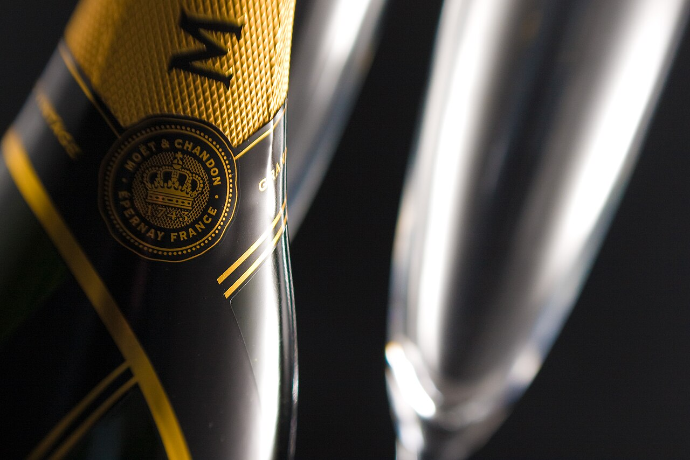
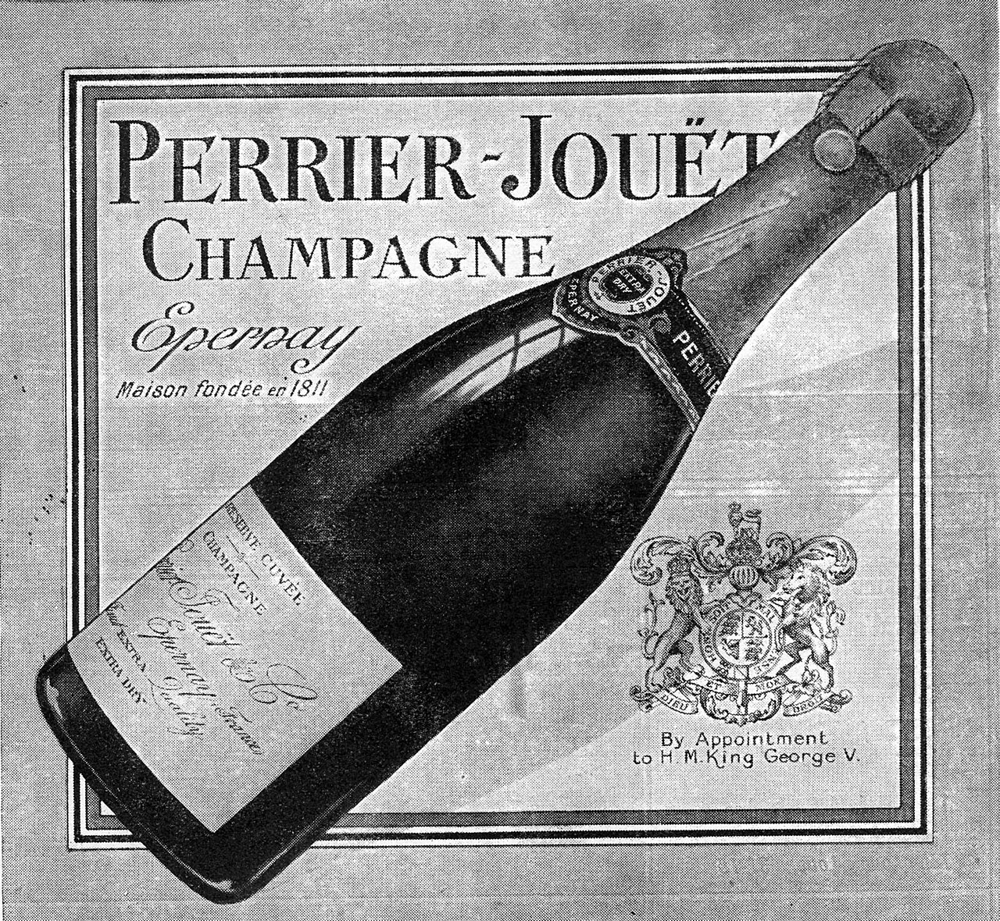

# Champagne: a walk along the Avenue de Champagne in Épernay

This route is one street, yet it needs half a day to a day. The Avenue de Champagne in Épernay runs about a kilometre and a half, lined with nineteenth-century houses, courtyards, gatehouses and cellar entrances. The surface looks quiet; below it lies a network of more than a hundred kilometres of galleries. The point is not how many glasses you taste but whether you can hold two Champagne spaces in one view: the houses above and the hills below.

Figure: "Champagne: a walk along the Avenue de Champagne in Épernay". Photograph: File:Glass of champagne.jpg. Credit: bgvjpe, CC BY 2.0 ([source page](https://commons.wikimedia.org/wiki/File:Glass_of_champagne.jpg)). Category image; not a claim that it shows the exact product, site or event.

> **Quick verdict**
> **In one line:** This route helps you plan Champagne: a walk along the Avenue de Champagne in Épernay, including the order, timing and stops that matter.
>
> - **Best for:** Anyone turning Champagne: a walk along the Avenue de Champagne in Épernay into a one- or two-day route and needs the order and the stops that matter.
> - **Not for:** If you want only want one stop and do not intend to follow a route.
> - **Check first:**
>   - - Stop one: Avenue de Champagne, central Épernay, about 1.5 kilometres, inscribed in 2015 as part of “Champagne hillsides, houses and cellars”.
>   - Champagne is often told as a celebration drink, but its spatial logic is closer to an industrial-agricultural complex.

## Route overview

- Stop one: [Avenue de Champagne](ref:avenue), central Épernay, about 1.5 kilometres, inscribed in 2015 as part of “Champagne hillsides, houses and cellars”.
- Stop two: [Moët & Chandon](ref:moet), 18 Rue de Champagne, 51200 Épernay, founded in 1743, with about 28 kilometres of underground galleries.
- Stop three: [Perrier-Jouët](ref:perrier), 26 Avenue de Champagne, 51200 Épernay, founded in 1811, with about seven kilometres of cellars and the Art Nouveau Maison Belle Époque.
- Mode: walking throughout. The avenue is flat and the houses are within walking distance of each other; Épernay station is also walkable from the avenue.
- Suggested duration: half a day to a day. In half a day, combine the avenue walk with Moët's cellar tour; Perrier-Jouët is bookable by slot through its official booking page, but on 8 November 2026 the Cellier Belle Époque and the boutique were closed for the winter, with reopening planned for spring 2027 and a special opening only during Habits de Lumière on 11–12 December.

## Why this route

Champagne is often told as a celebration drink, but its spatial logic is closer to an industrial-agricultural complex. Grapes grow on the slopes of the Montagne de Reims, the Vallée de la Marne and the Côte des Blancs; the wine ages in chalk galleries beneath Épernay and Reims; only then does it appear at the table as a brand. The Avenue de Champagne compresses the last two stages into one street: reception rooms, offices and houses above ground, temperature-stable, humid, almost lightless cellars below.

The street is also urban history. Nineteenth-century Épernay expanded through the Champagne trade, and the houses invested profits in mansions, gardens and civic buildings; the town hall, theatre, tourist office and church all sit within a short walk, producing the look of a wine-trade city. In 2015 UNESCO inscribed “Champagne hillsides, houses and cellars”, explicitly treating vineyards, production facilities and cellars as one system. Walking the avenue shows the densest stretch of that system.

Putting three addresses together also reveals two kinds of “house”. Moët is scale and network: founded in 1743, about 28 kilometres of galleries, a mature visitor operation, and a tour that takes you deep into a long underground corridor. Perrier-Jouët is another temperament: founded in 1811, Chardonnay-led, with Émile Gallé's anemone of 1902 as its symbol and the Maison Belle Époque holding Art Nouveau furniture and decorative arts. Both stand on the same street, but they do not tell the same story about Champagne.

## Stop one: Avenue de Champagne

Why go: it is free, open and always available, the only part of this route that needs no booking. Start near the tourist office and resist the urge to dive straight into a house. Walk the length once and match façades, courtyard depths, gatehouses and names. Most nineteenth-century houses do not sit directly on the pavement; they step back behind iron gates, gravel forecourts and low walls. The setback served carriages and goods, and it also expressed status.

What to see: each house has its own character. Some put offices and reception on the street elevation, some hide the winery in a rear court, and some make the entrance a ramp down to the cellars. Read the house numbers, plaques and historical panels: they tell you which building was extended in the nineteenth century and which was reworked in the twentieth. Look up at roofs and gables too. Champagne houses rarely pursue the symmetry of a château; they are more often a collage of factory, warehouse and residence.

The underground part is invisible from the street, but you can infer it from cellar entrances, ventilation shafts, loading bays and tour meeting points. The galleries beneath this street run for more than a hundred kilometres. The houses are not all connected, but they share the same chalk layer; the building above is only the entrance, while temperature, humidity and cellar management below decide the style. Walk the street first and the spatial logic of the tour becomes much clearer.

## Stop two: Moët & Chandon

Why go: it is the most direct specimen of scale. The house was founded in 1743, its official address is 18 Rue de Champagne, and its galleries run for about 28 kilometres. Visits usually begin at a meeting point, descend into the cellars and follow a route of roughly one kilometre through galleries and displays before returning to a tasting room. The pace is brisk and groups are large; book ahead in high season, because walk-in places are often gone.

What to see: the underground corridor is the main exhibit. Chalk was quarried, leaving tunnels that the house converted into temperature-stable, humid, dark cellars suitable for the second fermentation and ageing on the lees. The tour explains the “three blends” of Champagne—different parcels, different vintages and different base wines—as well as riddling, disgorgement and dosage. Do not simply memorise brand names. Try to hear the difference between non-vintage and vintage: the first relies on blending for a consistent house style, the second is made only in selected years.

What to taste: the range runs from Imperial to Grand Vintage and on to Dom Pérignon. On a first visit, focus on one non-vintage and one vintage rather than trying to cover every cuvée. Dom Pérignon takes its name from a seventeenth-century monk, but the brand is a twentieth-century construction, with the 1921 vintage often treated as its modern starting point. Listen for the line between the person and the brand narrative.

## Stop three: Perrier-Jouët

Why go: it offers another scale. Perrier-Jouët was founded in 1811 by Pierre Nicolas Perrier and Rose Adélaïde Jouët; its vineyards cover about 700 hectares across more than 100 villages, with a high share of Chardonnay, and its cellars run for about seven kilometres. The best-known visual symbol is the anemone Émile Gallé drew for Belle Époque in 1902; four white anemones later decorated the vintage cuvée. The Maison Belle Époque is the brand's reception and display space, holding Art Nouveau furniture and decorative arts.

What to see: check the official booking page before anything else. On 8 November 2026 the Perrier-Jouët site explained that the Cellier Belle Époque and the boutique closed for the winter on 31 October 2026 and are due to reopen in spring 2027; during the closure they open only for Habits de Lumière on 11–12 December (17:00–23:00). The site still lists dining at the Maison Belle Époque, 11 Avenue de Champagne, by reservation; “The Art of Chardonnay” is a one-hour guided tasting at the Cellier Belle Époque, bookable and without a cellar tour, and its resumption depends on the booking page. Whether the full house-and-cellar visit runs, and in which language, depends on the slots released that day; do not repeat older pages that say “open Tuesday to Saturday”.

What to taste: Perrier-Jouët's style is built on Chardonnay, often described through white flowers, citrus and chalk. Grand Brut is the entry point, Blason Rosé the rosé, and Belle Époque the vintage cuvée. If budget allows, compare Belle Époque with a non-vintage to understand what “vintage” means in Champagne. If you want to take bottles away, buy from merchants on the avenue or from cellars in Reims or Épernay; the house itself is primarily an experience and dining venue, and retail availability follows its official page.

## Transport and rhythm

Trains from Paris reach Épernay, and the station is walkable from the avenue; regional trains also connect Reims, with times and connections to be checked for the day. The avenue is flat with continuous pavements, and houses are five to fifteen minutes apart on foot. If you book two houses in one day, leave an hour between them for lunch and walking rather than running from one tour to the next.

The suggested order is “street first, cellar second”: walk the avenue in the morning and read façades and courtyards, eat in the centre, take the booked Moët tour in the afternoon, then walk to number 26 to confirm Perrier-Jouët's status. If Perrier-Jouët is closed, give the time to the civic buildings and tourist office on the avenue, or add a tasting at a smaller house. Do not wait at a door for a place that has not been confirmed.

The rhythm of the avenue is easy to underestimate. A cellar tour usually takes an hour to ninety minutes, and with walking, lunch and waiting, half a day disappears quickly. Fitting “walk the whole street” and “visit two houses” into half a day turns into rushing. On a first visit, enter one house and leave the other for next time.

## Seasons and booking

High season runs from late spring to early autumn, with visibly more people on the avenue at weekends and on public holidays; harvest comes around September, when houses are short-handed and some visits adjust. Winter is quiet, but some houses reduce slots and house and garden openings depend on the weather. Christmas lights and end-of-year events make the centre busier, while cellar temperature is stable all year and the underground visit is less affected by season.

Booking is the premise. Moët sells tours by slot and needs advance booking in high season; the Perrier-Jouët Cellier and boutique are closed from 31 October 2026 until spring 2027, opening only during Habits de Lumière, and normal visits will still be by timed booking after reopening; the avenue itself needs no booking, but information and maps at the tourist office are subject to what is available on the day. Confirm language, meeting point, length and whether a tasting is included. Do not schedule two houses in the same hour, and do not plan a heavy lunch before a cellar tour.

## Manners and limits

First, separate “street” from “house”. The avenue is public and free to walk; courtyards, gatehouses and cellars are private property, and you should not enter without a booking. Second, cellars are cool and the floor is damp and slippery: wear shoes with grip and bring a light layer; do not touch bottles, racks or chalk walls, and do not use flash. Third, taste slowly and in small quantities, and do not drink if you are driving; Champagne's alcohol is not low, and bubbles and sweetness can mislead.

Fourth, separate brand story from historical fact. Dom Pérignon was a seventeenth-century monk, but the Champagne brand is a modern marketing construction; the Belle Époque anemone dates from a 1902 design, not from the founding of the house; 1743 for Moët and 1811 for Perrier-Jouët are founding years, not the construction dates of the present buildings or cellars. Fifth, visits and dining at Perrier-Jouët require a booking, and whether a walk-in can be admitted depends on the day's operations; do not assume that buying wine on site is possible.

For Champagne: a walk along the Avenue de Champagne in Épernay, this route does not provide a map; addresses and opening status were checked against official pages on 2026-11-08, but hours and booking rules can still change, so confirm with official channels. Latitude and longitude for the three venues are left empty in the content repository, and with no verifiable coordinate source the project rule is not to draw a schematic map. For precise navigation, use a live map service and follow on-site signage.

## Alternatives and extensions

If Perrier-Jouët's slots are full, the direct alternative is another house on the avenue: several Champagne houses of different sizes stand along the same stretch, with different booking difficulty and tour length. Choose by “does it include the cellars” and “what language”, not by fame alone. To understand the vineyards, split Épernay from a day in the Montagne de Reims or the Côte des Blancs: see slopes and parcels in the morning, return to town for a cellar in the afternoon, and the “hills” and “houses” finally fit together.

Northwards, Reims offers the cathedral and another group of houses; southwards, Cramant, Avize and Le Mesnil-sur-Oger in the Côte des Blancs explain Chardonnay's role in Champagne. Do not compress Épernay and Reims into one day: the rail link is convenient, but both sets of house tours need booking, and rushing leaves neither clear.

## See also

- [Avenue de Champagne](ref:avenue): the spatial relationship between street, houses and cellar entrances.
- [Moët & Chandon](ref:moet): 28 kilometres of galleries, blending and vintage Champagne.
- [Perrier-Jouët](ref:perrier): Chardonnay, the anemone and visits and dining at the Maison Belle Époque.
- For background, consult the Champagne region, sparkling wine and place-and-process entries in the content repository; this route does not register further references.

Opening hours, bookings and transport are subject to official channels; page verified on 2026-11-08.

## Related images

Image: Moët & Chandon. Credit: Andreas Levers from Potsdam, Germany, CC BY 2.0, via Wikimedia Commons ([source page](https://commons.wikimedia.org/wiki/File:Mo%C3%ABt_et_Chandon.jpg)). Related image for Champagne: a walk along the Avenue de Champagne in Épernay.

Image: Perrier-Jouët. Credit: unknown (no credits), Public domain, via Wikimedia Commons ([source page](https://commons.wikimedia.org/wiki/File:Champagne_Perrier-Jou%C3%ABt-1923.jpg)). Related image for Champagne: a walk along the Avenue de Champagne in Épernay.
