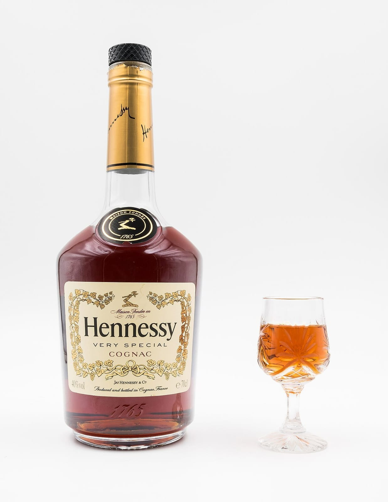

# Cognac trail: the house belt between Cognac and Jarnac

Between Cognac town and Jarnac, the Charente strings a dozen kilometres of vineyards, cellars and quays into a narrow belt of houses. This route takes two stops, both inside Cognac town and about two kilometres apart: the [Hennessy](ref:hennessy) visitor centre on Quai Richard Hennessy, and the [Rémy Martin](ref:remy) historic house on rue de la Société Vinicole. It is called a Cognac–Jarnac route because Jarnac marks the upstream end of the belt; the real subject is how two houses turn one set of appellation rules into two different visits.

Figure: "Cognac trail: the house belt between Cognac and Jarnac". Photograph: File:Cognac glass.jpg. Credit: Didier Descouens, CC BY-SA 3.0 ([source page](https://commons.wikimedia.org/wiki/File:Cognac_glass.jpg)). Category image; not a claim that it shows the exact product, site or event.

## One river, two quays

The name Cognac belonged to a port before it belonged to a drink. In the early 19th century the Charente was still the main export artery, and the town became a collecting point because of its quay, so the spirit took the place name with it. Hennessy was founded in 1765 by Richard Hennessy, an Irishman who used riverside warehouses to ship to Atlantic ports; Rémy Martin began in 1724 with a local winegrower who had grapes and distillation before he had a trading house. The starting points differ, but both left the old town and the riverbank as part of today's visit.

Hennessy's visitor centre faces the Charente on Quai Richard Hennessy; Rémy Martin's historic house is tucked into the streets at 20 rue de la Société Vinicole. The walk between them takes about twenty minutes, past stone paving, old warehouse walls and the signs of several houses. Park by the river, finish both stops on foot, then drive east for a dozen kilometres to Jarnac to see where the belt ends: the river narrows, the vines move up the slopes, and the houses give way to a quiet town.

## Order of stops: the quay first, the old house

[Hennessy](ref:hennessy) runs its visits as a matrix of ten tours. The Flash Tour, new in 2026, costs 19 euros for one hour, runs from May to October and includes a VSOP cocktail and a short boat trip; the introductory Initiation costs 25 euros for 1 hour 30 minutes and tastes VS and VSOP, with families welcome; the immersive Initiation costs 35 euros for two hours, adds VR in the historic cellars and ends with VSOP and XO. Above that, Prestige costs 60 euros and covers James Hennessy, XO and XXO; the Distillery Tour costs 85 euros in the distillation season from October to February and enters a working still house; cooperage costs 170 euros, the caviar tasting 99 euros, the Paradis private tour 330 euros and the Richard Hennessy private tour 550 euros.

[Rémy Martin](ref:remy) spreads its visits across three sites. The historic house offers the Anniversary Tour at 35 euros for two hours, covering three centuries since 1724; a cocktail workshop at 35 euros for 1 hour 15 minutes; LOUIS XIII The Introduction at 300 euros for two hours; and a lunch pairing at 110 euros for four hours. At Merpins, an electric train crosses the vast cellars for 25 euros in 1 hour 30 minutes; at Juillac-le-Coq, in the Grande Champagne vineyards, the two-hour visit costs 60 euros and can be done on foot or by e-bike. "A Day at Rémy Martin", combining the house and the production site, costs 55 euros. The house and boutique are open Monday to Saturday, 10:00–18:00, and bookings can be changed or cancelled free of charge up to 72 hours before arrival.

A sensible day starts at Hennessy at 9 or 10 a.m. with the 35-euro immersive tour, leaving around 11:30, then walks to Rémy Martin after lunch for the 35-euro Anniversary Tour. In winter, when craft matters more, put Hennessy's 85-euro distillery tour or Rémy Martin's Juillac-le-Coq visit first and keep the old house for the boutique. Prices and sessions change, so check the official site on the day.

## Six crus, read from an 1860s map

The Cognac region is divided into six crus, and the map is not a marketing device but a joint product of geology and tasting. Grande Champagne has thin topsoil over chalk, giving fine, high-acid spirits that age longest; Petite Champagne has similar soil but a stronger oceanic influence and a little more structure; Borderies has a decalcified surface and aromas of violet and iris, and matures faster; Fins Bois has Jurassic "groies" in the north and Cretaceous and Tertiary ground in the south, producing rounder, fruitier spirits; Bons Bois is geologically mixed, oceanic in the west and continental in the east, often with a marked taste of terroir; Bois Ordinaires, also called Bois à Terroirs, covers the coast and two islands and carries the strongest Atlantic influence.

The map comes from Henri Coquand (1813–1881), a geologist who studied the soils around 1860 and worked with a taster to classify them. The decree of 13 January 1938 used that work to fix the boundaries. An earlier decree, dated 1 May 1909, had already limited production to Charente, Charente-Maritime and several villages in Dordogne and Deux-Sèvres. Rémy Martin uses only Grande and Petite Champagne, and its Fine Champagne requires every eau-de-vie to come from those two crus, with at least 50% from Grande Champagne: that is law, not an adjective. Keep the [Cognac](ref:cognac) entry open beside a label and the six names stop being strange places.

## Ugni Blanc and two distillations

Ugni Blanc dominates the vineyard at over 98%. It probably came from Tuscany, has medium-sized thin-skinned berries, high acidity and low sugar, and produces a base wine of only 8%–9% vol, which suits distillation. Folle Blanche collapsed after phylloxera and is now below 1%, though it is finely floral; Colombard adds aroma and volume; Montils mostly goes to Pineau des Charentes; Folignan, admitted only in 2005, is capped at 10%.

Distillation uses a Charentais pot still twice. The first run gives a rough distillate; the second, the bonne chauffe, cuts heads, heart and tails and keeps only the middle as new spirit. This slow method is less efficient than continuous distillation but preserves the aroma and acidity of the wine. The new spirit must age in French oak for at least two years without interruption, and bottling strength cannot fall below 40% vol. Understand the cuts in [distillation](ref:distillation) and the combinations in [blending](ref:blending), and vintage matters less than the point at which the still was cut: the same year can fork into different styles.

## Reading VS, VSOP and XO in the glass

Cognac grades fix only the minimum age of the youngest component: VS at least 2 years, VSOP at least 4, XO at least 10 and XXO at least 14. In 2018 the XO minimum rose from 6 to 10 years, which turned XO from a vague word for old spirit into a clear threshold. A grade is not a quality ranking, and it does not give the average age of the bottle: an XO may contain spirit far older than 10 years.

Taste from VS to VSOP to XO. VS is direct and fruity, with grape and flowers; VSOP brings vanilla, dried fruit and spice and a rounder texture; XO shows nuts, leather and wood, while the strength is still around 40% vol, so texture rather than heat carries it. Hennessy's immersive tour pours VSOP and XO; at Rémy Martin's old house, the useful conversation is about the Grande Champagne share in Fine Champagne. One house keeps a broad sourcing net for consistency, the other narrows the variables to two crus.

## Driving, booking and a sober driver

Cognac station is about a five-minute walk from the Hennessy quay; Angoulême TGV is about 45 minutes by road; Bordeaux and La Rochelle are each about 1 hour 30 minutes by car. Rémy Martin's old house is walkable in town; Merpins and Juillac-le-Coq are outside and need a car or a transfer. Cognac to Jarnac is a dozen kilometres, about 20 minutes, past the river, vines and low warehouse buildings.

Both stops need booking, on different terms: Hennessy sells timed tours and fills quickly at weekends, while Rémy Martin assembles guests at each site, and one ticket cannot be used across the house, Merpins and Juillac-le-Coq. Confirm meeting point, length, tasting, age limits and cancellation policy. Do not drive after drinking: parking in the old town is limited, so a chauffeur or a designated driver is safest, and anyone driving should spit every sample. Opening hours, prices and transport are subject to official channels; page verified 2026-11-09.

## Related images

Image: Editorial illustration of a wine blending trial: base wines compared in beakers, with a pipette for bench trials; AI-assisted illustration, not a photograph.. Credit: Hejiu editorial team, AI-assisted with Doubao Seedream 5.5; project-generated editorial figure, not a photograph ([about](https://hejiu.org/about/)). Related image for Cognac trail: the house belt between Cognac and Jarnac.

Image: 2023 Hennessy V.S. Cognac. Credit: Jacek Halicki, CC BY-SA 4.0, via Wikimedia Commons.. Credit: Jacek Halicki, CC BY-SA 4.0, via Wikimedia Commons ([source page](https://commons.wikimedia.org/w/index.php?curid=132066502)). Related image for Cognac trail: the house belt between Cognac and Jarnac.
