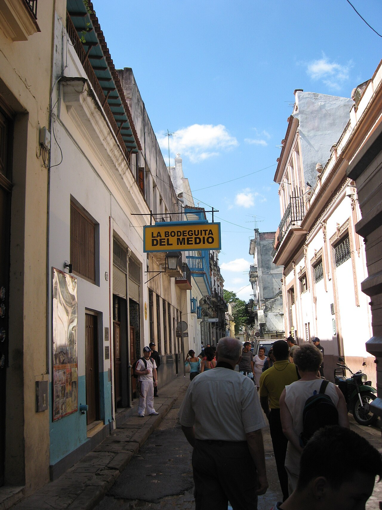
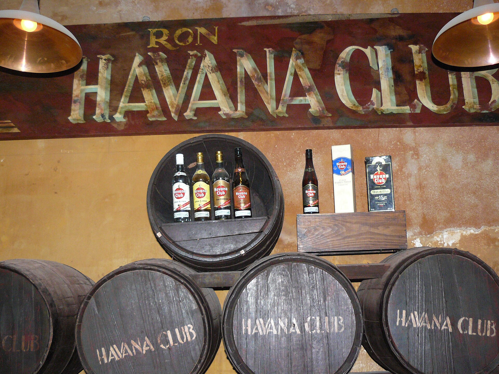
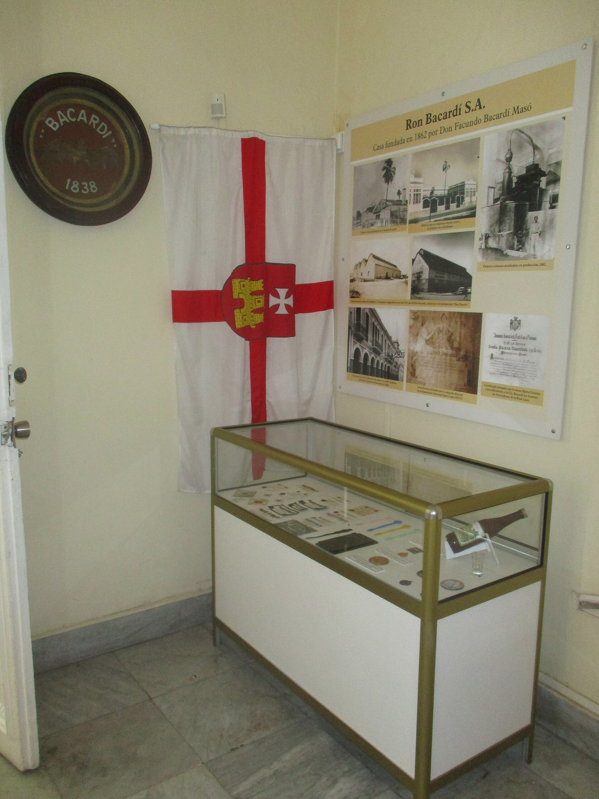

# Cuba rum trail: Havana and Santiago de Cuba

This Cuba rum trail means two museums: the [Havana Club Rum Museum](ref:havana) at Avenida del Puerto 262 in old Havana, and the [Santiago de Cuba Rum Museum](ref:santiago) at Calle San Basilio 358. More than 800 km apart, they share one thread: Spain restricted colonial distillation, a real ron industry appeared in the late 19th century, Santiago claimed the light-rum cradle after 1862, and the 1959 revolution and 1960 nationalisation rebuilt brands and exports as a state system. The point is how one history is told twice.

Image: Facade of Bodeguita del Medio in Old Havana, used as atmosphere reference for the Havana stop on the Cuba rum trail; it does not define specific stops or boundaries. Credit: Derek Blackadder from Cobourg, ON, Canada, CC BY-SA 2.0, via Wikimedia Commons ([source page](https://commons.wikimedia.org/wiki/File:Bodeguita_del_Medio,_Havana,_Cuba_9.jpg)).

## Between the western port and the eastern mountains

The first stop is north of old Havana, near the harbour, a short walk from Plaza de San Francisco; the second is in Santiago's historic centre, near Plaza de Céspedes. The road distance exceeds 800 km. The Central Highway takes a full day or more, usually split over two nights, with a stop in Santa Clara or Camagüey; domestic flights are the alternative.

The mode field says car, meaning movement within each city: old Havana works on foot plus short taxis, while Santiago's narrow one-way streets demand parking first. Driving or flying depends on schedules and rental terms; check official channels. Each museum needs two to three hours, the route at least three or four days.

## From aguardiente to ron: the turn behind the name

Spain long restricted colonial distillation to protect its own spirits; a real rum industry grew only around the independence wars of the late 19th century. Early Caribbean distillers called the spirit from cane juice or molasses aguardiente, literally "burning water": rough, sharp, not yet today's ron.

Late in the 19th century column stills reached Cuba and producers adopted them quickly. Continuous [distillation](ref:distillation) gave a cleaner, lighter spirit; white oak ageing and charcoal filtration completed Cuban light rum. The market set the direction: early 20th-century bartenders needed a base that would not drown citrus and mint.

[Sugarcane](ref:sugarcane) arrived after 1492, and by 1850 Cuba supplied a third of the world's sugar. That scale made [molasses](ref:molasses) cheap and made rum a by-product of sugar.

## Havana: brand narrative at Avenida del Puerto 262

The Havana museum occupies an 18th-century mansion at Avenida del Puerto 262, on the corner with Sol. It opened on 3/31/2000 and is run by Havana Club. The route runs from cane through a large model sugar factory, fermentation, distillation and ageing to the bar and shop. The model compresses field-to-factory into one view.

The museum tells the Havana Club story within the Cuban frame. A brand museum is not a neutral archive; its chosen years, people and products are the narrative. The basic tour runs about 45 minutes with a tasting; longer options add three-rum comparisons, cocktails or cigars, priced and scheduled on the museum's booking page.

Published addresses appear as both 262 and 162; this route follows the official site's 262.

## 1862 and the local claim of a light-rum cradle

On 4 February 1862, Facundo Bacardí Massó bought a small Santiago distillery and experimented with two bases: a heavier aguardiente and a lighter redistilled spirit. Blending, filtering and ageing produced a softer rum. The year is treated as a milestone in Cuban rum's industrialisation and, locally, as the start of the "cradle of light rum".

That cradle is a local claim, not an exclusive legal finding. Havana and Cárdenas also had important distilleries. Santiago's tourism page calls the east the cradle "since 1862" and stresses local cane, low-acidity molasses, charcoal filtration and white oak; this is regional storytelling, not the only recipe.

Cuban rum has a protected designation of origin, granted D.O.P. status in 2010; genuine bottles carry a green seal and use 100% Cuban ingredients. Knowing the system separates regional rules from brand stories.

## Santiago: industrial memory at Calle San Basilio 358

The Santiago museum stands at Calle San Basilio 358, between Pío Rosado and San Félix, in an 1889 mansion opened on 6/24/1996. Six rooms run from raw material to production, brands, ageing, bottling and local history: cane and sugar, a process diagram, contemporary bottles, coopering and casks in the courtyard, a 1930s bottling line with seven original machines, and local firms including Ron Caney and Matusalén.

Compared with Havana's brand museum, this is a city's industrial memory: older, more miscellaneous exhibits, tighter relation to the street. Tickets usually include a guide and a tasting; hours are commonly Monday to Saturday 9:00–17:00, about 2 euros, though prices and sessions change.

The courtyard barrels, bottling machinery and old photographs are the real key to the eastern industry.

## Nationalisation, the export system and two museum voices

The Arechabala family created Havana Club in 1934, originally in Cárdenas. After the 1959 revolution, the private company was nationalised in 1960 and the brand and distilleries passed to the state; from the 1970s, state exporters sold Havana Club in the Soviet Union and Eastern Europe. In 1993 Pernod Ricard and Corporación Cuba Ron S.A. formed the 50/50 Havana Club International S.A. for global sales. The Maestros del Ron Cubano's training and generational transmission entered the brand story, and in 2022 this knowledge joined UNESCO's Representative List of the Intangible Cultural Heritage of Humanity.

The museums speak differently: Havana's is brand-run and tells how a national brand went global; Santiago's starts from local memory and tells of eastern sugar factories and old brands. Nationalisation and export decide who may use "Havana Club" today, and which stories are amplified.

Keep [rum](ref:rum) categories, regional rules and trademark disputes apart, and the glass is easier to judge.

## Intercity movement, booking and pace

Between Havana and Santiago, most visitors fly or take a long-distance bus; driving the Central Highway needs a full day. Confirm schedules officially. Book both ahead: Havana fills in high season and on weekend afternoons; Santiago group visits are best arranged by phone.

Carry identification and follow photography rules; some rooms are dim and stepped, so wear non-slip shoes. Nose before sipping, and never drink if driving. Old-town afternoons are hot; water matters more than rushing.

Leave time for the cities: Havana's bars and the [daiquiri](ref:daiquiri) are rum's drinking side; Santiago's squares and music are its living side.

To read Cuba rum trail, start with the order of stops, then the distance and opening hours, then whether it works as a fixed itinerary; no single check settles it.

Put [Museo del Ron Havana Club](ref:havana)'s stop order next to [Rum](ref:rum)'s transport; the difference marks the boundary.

## Related images

Image: Related photograph of Museo del Ron Havana Club. Credit: Antonio Bermudez Chi…, CC BY 3.0, via Wikimedia Commons ([source page](https://commons.wikimedia.org/wiki/File:Museo_Havana_Club_-_panoramio.jpg)). Related image for Cuba rum trail: Havana and Santiago de Cuba.

Image: Related photograph of Museo del Ron Santiago de Cuba. Credit: Pintolin, CC BY-SA 4.0, via Wikimedia Commons ([source page](https://commons.wikimedia.org/wiki/File:Espacio_Bacard%C3%AD.jpg)). Related image for Cuba rum trail: Havana and Santiago de Cuba.
