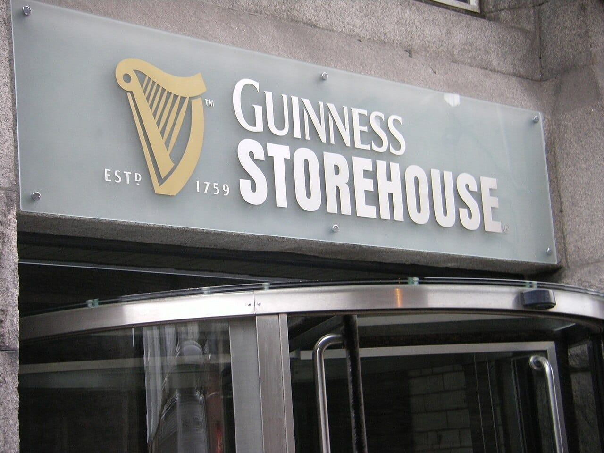
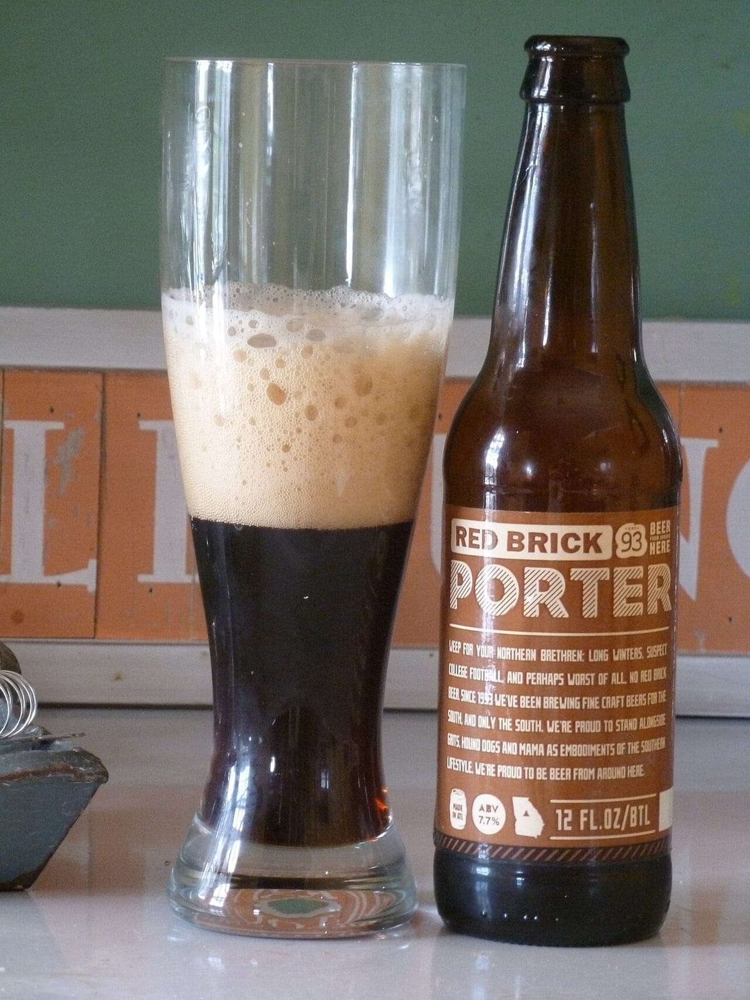

# Dublin pub trail: from Lower Bridge Street to St James's Gate

The south bank of the Liffey puts two ways of drinking Guinness on one walking line: the old pub on Lower Bridge Street and the Storehouse at St James's Gate. The pub is still a working local; the Storehouse is a visitor centre in an old fermentation building. Two kilometres and half an hour apart, they fit into half a day. They ask one question: the same dark beer, drunk and displayed, is two different things.

## Why this route works

- Stop one: [the Brazen Head](ref:brazen-head), 20 Lower Bridge St, Usher's Quay, Dublin 8, D08 WC64, south of Father Mathew Bridge.
- Stop two: [the Guinness Storehouse](ref:guinness), St. James's Gate, Dublin 8, D08 VF8H, about two kilometres west along the same bank.
- Mode: on foot via Usher's Quay and Merchant's Quay.
- Duration: three to four hours; sixty to ninety minutes at the pub, twenty to thirty walking, two to three hours at the Storehouse.

Neither stop is a place to pass through.

## The everyday pint on Lower Bridge Street

The Brazen Head traces its trade to 1198, while the building is a 1754 coaching inn. Low ceilings, stone walls and dark wood are 18th-century fabric; the claim of continuous hospitality is older than the building. The house calls itself Ireland's oldest pub, a title with no single statistical standard, so read it as a very old pub with long documentary records.

Order a normal pint. The bar pours Guinness in two stages, filling about two-thirds, letting the foam settle, then topping up; the wait is how a nitrogenated beer settles. Ask for a half pint for less, or add an Irish red ale. Food runs to stews, pies and fish and chips.

Order at the bar, then find a seat. Traditional music sessions often run in the evening, with musicians among the drinkers; weekday afternoons are quieter. The old building has uneven thresholds, so ask before bringing a pushchair or wheelchair. The pub is the baseline; the exhibition is the explanation.

## West along the south quay

Turn right and follow Usher's Quay west past the Four Courts, then Merchant's Quay to St James's Gate: about two kilometres, twenty to thirty minutes. There are crossings and cycle lanes, so use the signals.

The quays are part of the route: old docks, court buildings, then the terraces and warehouses of the Liberties. The river is exposed in rain, so a waterproof beats an umbrella. Near St James's Gate, tall fermentation tanks and the factory fence mark the arrival.

## The brand theatre at St James's Gate

The Storehouse occupies an old fermentation building, converted in 2000; the standard ticket is a self-guided exhibition, not a working brewhouse tour. The line starts with the 1759 lease signed by Arthur Guinness and moves through ingredients, roasting, fermentation, transport and advertising to the Gravity Bar. Seven floors lift visitors up, then let them walk down.

Spend time on ingredients and roasting: stout's colour comes from roasted barley, giving coffee, cocoa and toast while the finish stays dry. The tasting covers foam, aroma and palate, and the ticket includes a Guinness or the alcohol-free version. From the top bar you see roofs, church spires and distant hills.

Book a timed ticket online; summer afternoons are busiest, while the first hour or the evening is calmer. Two to three hours is usual. The bar serves only guests of legal drinking age, with ID rules set on site.

## Stout and porter: the style line between the stops

The core style is stout, a top-fermenting dark ale: roasted barley gives colour and a roasted edge, hops a mild bitterness, and alcohol is usually moderate. Modern Guinness is served with nitrogen, producing fine, soft foam and the sinking-bubble effect.

The porter-stout history is often simplified. Both grew from the 18th-century London dark-beer trade, and names and recipes borrowed from each other; "porter is lighter, stout is heavier" is not a law, since recipe and strength decide. A pint at [the Brazen Head](ref:brazen-head) beside the process displays at [the Guinness Storehouse](ref:guinness) makes the point: style names are market language, while process is what a brewery controls. To go further, try a Dublin bar with a local craft stout. Dublin's pub culture belongs to everyday life in Ireland, which is why the pub comes first.

## Timing, booking and the walk home

Start around midday: lunch at the Brazen Head, walk at about two, enter the Storehouse around three, finish on the top floor in the evening. Summer and the weeks around St Patrick's Day are crowded; winter is quieter but cold on the quays, so check the last entry time. Individuals need no booking at the pub, though large groups should call ahead; Storehouse tickets, upgrades and closures follow the official site.

A pint is a substantial measure, so leave half an hour between stops for walking and water. Nitrogenated stout goes down easily on an empty stomach, so eat first. After more than two pints, take the Luas or a taxi rather than driving; central parking is expensive and scarce. Walk home on main streets and in company at night. Families should note that the pub is loud during music sessions.

This route covers route structure and verifiable facts only, with no live opening status, prices or train times; check the venues' official channels. Page verified on 2026-11-08.

Further reading: [Stout](ref:c-extra-1).

**Short definition:** Start at the Brazen Head on the south bank of the Liffey and walk west to the Guinness Storehouse. One stop is an everyday pub pouring stout from the tap; the other is a brand exhibition in an old fermentation building. Half a day shows how Dublin sells and explains the same dark beer.

The walk passes the old distillery sites around Lower Bridge Street and ends at St James's Gate, the Guinness brewery.

**Key facts.**

| Item | Detail |
| --- | --- |
| In one line | Start at the Brazen Head on the south bank of the Liffey and walk west to the Guinness Storehouse. One stop is an everyday pub pouring stout from the tap; the other is a brand exhibition in an old fermentation building. … |
| Stops | 2 |
| Transport | walk |
| Stop order | The Brazen Head、Guinness Storehouse: Telling the Black Stuff at St. James's Gate |

**Sources and limits.** The key claims about Dublin pub trail: from Lower Bridge Street to St James's Gate are checked against the following sources: The Brazen Head (Used to check the 1198 origin claim and the 1754 building), Guinness Storehouse, Dublin Visitor Centre (Used for city context on the south quays, the Liberties and St James's Gate) and 5 sources in total. Prices, batches and status change; the body is project-written and does not reproduce source text.

## Related images

Image: Telling the Black Stuff at St. James's Gate: Guinness Storehouse. Credit: Greatal386 at English Wikipedia, CC BY 2.5, via Wikimedia Commons.. Credit: Greatal386 at English Wikipedia, CC BY 2.5, via Wikimedia Commons ([source page](https://commons.wikimedia.org/w/index.php?curid=12671330)). Related image for Dublin pub trail: from Lower Bridge Street to St James's Gate.

Image: A bottle of Red Brick Porter and a glass of dark beer with a beige head.. Credit: Erik Cleves Kristensen, CC BY 2.0, via Wikimedia Commons ([source page](https://www.flickr.com/photo.gne?id=6175146624)). Related image for Dublin pub trail: from Lower Bridge Street to St James's Gate.
