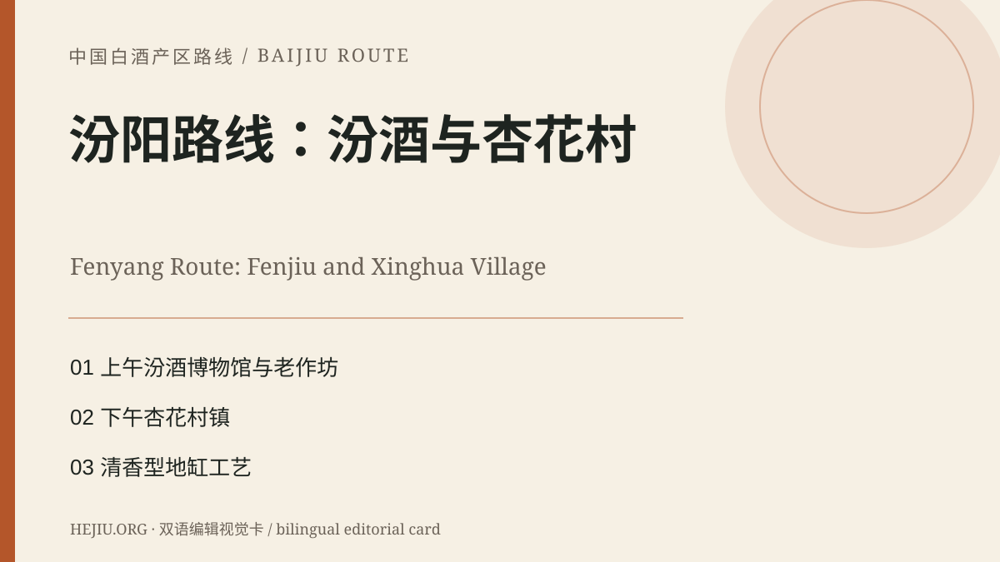

# Fenyang Route: Fenjiu and Xinghua Village

Xinghua Village is an image in poetry and a liquor town in Fenyang. Many arrive, photograph the “Xinghua Village” archway, or treat the Fenjiu plant as one big shop. This route gives the morning to the Fenjiu Museum and old workshop to understand light-aroma jars, starter culture and distillation, then the afternoon to Xinghua Village for displays, inscriptions and town, returning poetry to real space.

图：Fenyang route bilingual editorial card。Project-created bilingual editorial card for topic identification, not a documentary photograph.

> **Quick verdict**
> **Best for:** travellers who want light-aroma baijiu and Xinghua’s poetry-and-liquor culture; works from Taiyuan, Pingyao or Fenyang.
> **Not for:** archway-photo visitors who will not book; old workshop and displays have separate entrances.
> **One line:** museum and old workshop in the morning, Xinghua Village in the afternoon, craft before poetry.

## Why craft before poetry

Xinghua has two narratives: light-aroma craft and the poetry-and-liquor culture of “the shepherd boy points to Xinghua Village”. Craft comes first because jars, starter rooms and distillation need eyes and flow; poetry comes after because inscriptions, displays and town would otherwise become empty adjectives. Put museum and old workshop in the morning, displays and town in the afternoon, eat in Fenyang or Xinghua between them, and do not compress both spaces into one photo stop.

## Morning: Fenjiu Museum and old workshop

Fenjiu is mainly light-aroma; focus on jar fermentation, low-temperature starter, clean steaming and separate distillation, and long storage. In the old workshop, note jar layout and depth, starter-block cultivation and storage, and how stills connect to storage. In the museum, use cutaways, tools and flow to connect jar, starter, still and storage. The “light” is not weakness but cleanliness and few off-flavours; do not only memorise “sweet on entry”, but see how craft controls off-flavour. Do not lift jar lids or touch jars, and do not touch inscriptions or tools in displays.

## Afternoon: Xinghua Village

Displays and inscriptions carry the poetry-and-liquor narrative; the town carries real life. Do not read verse as process description, and separate brand history, origin history and liquor history in the displays. Walk the main street and see how the plant coexists with homes, restaurants, a school and shuttles; do not enter closed plant areas or booked group zones. If a guide is available, take craft first and poetry second; mixing them turns advertising into history. Shanxi has big day–night temperature swings, so bring a jacket in summer; ice in winter demands non-slip shoes.

## Transport, booking and time

Xinghua Village lies northeast of Fenyang city, not far from the urban area, usually reached via Taiyuan, Pingyao or Fenyang station; check live schedules. Museum and old workshop take about two to three hours; adding the village and a tasting makes half or a full day; adding Fenyang old town or Jiazhuang fills a day. Museum, old workshop and plant opening, booking and charges are separate, so confirm each the day before. From Pingyao, put Xinghua in the morning and return or visit Fenyang old town in the afternoon to avoid a late trip.

## Tasting, buying and Fenyang

Ask about strength, volume and charge before tasting; sip slowly, not on an empty stomach. The driver abstains and does not drive after. Buy from official or authorised shops and keep receipts; do not treat “internal liquor” as an extension of the old workshop. Fenyang is more than Xinghua: the old town’s Confucian temple, wall remains and streets, and Jiazhuang’s rural culture place the liquor town in Jinzhong life. For food, try Fenyang rotating noodles, knife-cut noodles, guo you rou and Fenzhou home cooking, keeping light-aroma liquor modest. With children, see craft models before the town.

## One-day and half-day versions

The one-day version runs museum, old workshop, lunch, Xinghua Village and Fenyang old town; do not spend the whole morning in galleries, and leave an hour for the old workshop. The half-day version chooses either museum and workshop or the village, not both in a rush. With older relatives, reduce walking and understand the models first. From Pingyao, put Xinghua in the morning and return or visit Fenyang old town in the afternoon. Buy liquor before returning, keep the driver out of tasting, wear non-slip shoes on winter ice and carry a jacket in summer. From Taiyuan, start at the Fenjiu Museum, leave an hour for the old workshop, eat lunch in Fenyang and reach Xinghua in the afternoon; from Pingyao, reverse the order but do not push the old workshop to closing. With older relatives, reduce walking and understand the models first; with children, see jar and starter animations or models before the town. Museum, old workshop and town use different booking entries, so confirm each the day before; with half a day, choose museum and old workshop and skip the village. Check batch codes, ask about opening hours before eating in town, do not overtake on bends, and allow extra time. Bring ID and booking codes, confirm museum and old workshop separately, ask about opening hours in town, walk slowly on winter ice, carry a jacket in summer, check batch codes, bring water, ask the last bus, note the parking spot and keep receipts. Allow extra time and walk slowly.

## Check before you go

- Confirm museum, old workshop and town separately
- Craft in the morning, poetry in the afternoon
- Do not lift lids or touch jars
- Do not drive after tasting
- Buy only from official or authorised shops
- Wear non-slip shoes in winter
- Check connections from Pingyao
- Show children models first

## Who this route is not for

This route centres on the Fenjiu museum, the old workshop and Xinghua town, good for travellers interested in light-aroma craft and Jinzhong local history. If you only want photo stops, the walk between sites and the guided talk will feel slow; with children, the tasting needs a separate plan.

Buses and self-driving routes connect Fenyang with Xinghua; the walkable centre is small but the sites are some distance apart, and guided slots need booking on holidays. Local food is mostly wheat-based, so eat before tasting rather than on an empty stomach.

Alternative: see only the Fenjiu museum and old workshop and book nearby distilleries separately; to add Jinzhong sights, allow two days. Compare plant shop and city prices when buying, and check carriage and shipping limits.

## References

- Fenjiu Museum — Fenjiu Group — https://www.fenjiu.com.cn/OnlineTour/2023-01-06/296.html (Shanxi Xinghuacun Fenjiu Group, checked 2026-11-25)
- Old Workshop Museum — Fenjiu Group — https://www.fenjiu.com.cn/OnlineTour/2023-01-06/297.html (Shanxi Xinghuacun Fenjiu Group, checked 2026-11-25)
- Fenjiu Museum — national museum annual report — http://nb.ncha.gov.cn/museumdetail.html?msg=ee70a34121f3498ca08d4ddede4701e5&nianfen=2022 (National Cultural Heritage Administration museum annual report system, checked 2026-11-25)
- Fenjiu Group history — Xinghua Village site and museum — https://www.fenjiu.com.cn/developmentHistory/index.html (Shanxi Xinghuacun Fenjiu Group, checked 2026-11-25)

Related entries: [Fenjiu Museum](ref:museum), [Xinghua Village (Fenyang)](ref:village), [Fenjiu](ref:brand), [light-aroma baijiu](ref:style), [Shanxi](ref:region), [First baijiu guide](ref:guide), [History of Chinese wine](ref:history).

## Related images

Image: Shanxi. Credit: Underbar dk, CC BY-SA 4.0, via Wikimedia Commons ([source page](https://commons.wikimedia.org/wiki/File:Yanmenguan3.JPG)). Related image for Fenyang Route: Fenjiu and Xinghua Village.

Image: The 1915 Panama-Pacific exposition gold medal held by the Fenjiu Museum. Credit: 汾酒集团文化中心, Public domain, via Wikimedia Commons ([source page](https://commons.wikimedia.org/wiki/File:%E5%B1%B1%E8%A5%BF%E6%B1%BE%E9%85%92%E8%8D%A3%E8%8E%B71915%E5%B9%B4%E5%B7%B4%E6%8B%BF%E9%A9%AC%E4%B8%87%E5%9B%BD%E5%8D%9A%E8%A7%88%E4%BC%9A%E7%9A%84%E2%80%9C%E4%B8%80%E7%AD%89%E9%87%91%E8%B4%A8%E5%A4%A7%E5%A5%96%E7%AB%A0%E2%80%9D_%E6%B1%BE%E9%85%92%E5%8D%9A%E7%89%A9%E9%A6%86%E8%97%8F.png)). Related image for Fenyang Route: Fenjiu and Xinghua Village.
