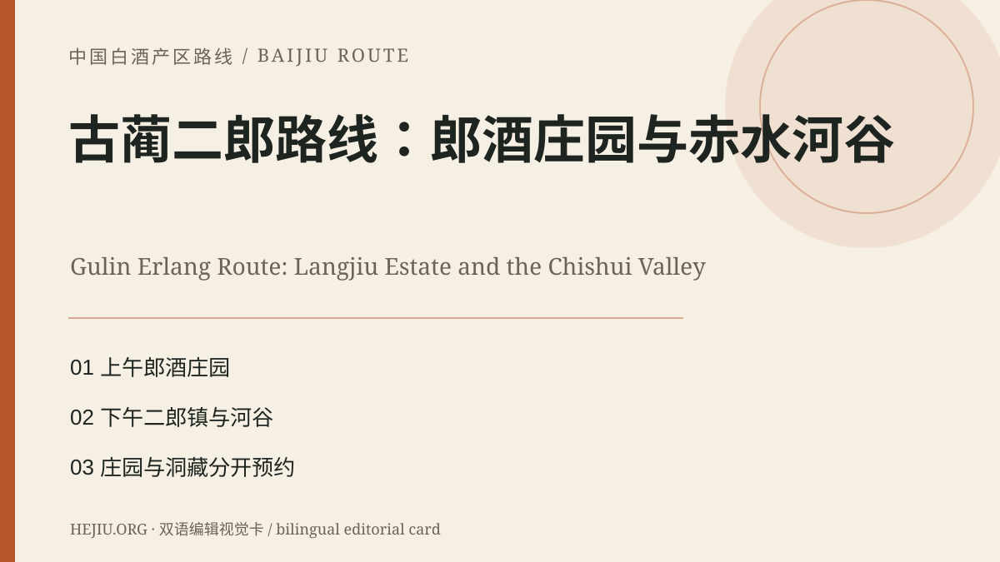

# Gulin Erlang Route: Langjiu Estate and the Chishui Valley

Erlang is not a liquor town you “see on the way”. The Chishui separates Sichuan from Guizhou, and Langjiu Estate, the working plant, cave storage such as Tianbao Cave and the market town sit in a narrow valley with different gates and bookings. This route gives the morning to estate brewing and caves, the afternoon to the town and valley, and does not try to see everything in one day; it asks why liquor grows in this valley.

图：Gulin Erlang route bilingual editorial card。Project-created bilingual editorial card for topic identification, not a documentary photograph.

> **Quick verdict**
> **Best for:** travellers who want sauce-aroma baijiu, cave storage and the left bank of the Chishui; works by car from Luzhou or Xishui.
> **Not for:** visitors who will not book or insist on a same-day return; mountain roads compress the day.
> **One line:** estate in the morning, town in the afternoon, sleep on the hill, and do not drive mountain roads after tasting.

## Why estate, town and valley

Erlang has three layers. Langjiu Estate handles reception, displays, some tastings and lodging. The working plant handles brewing, starter culture, distillation and storage. Cave storage such as Tianbao and Dibao handles long-term maturation. The market town is the living space of homes, a school, a wet market, restaurants and plant shuttles. All sit in one valley but cannot replace one another. The estate comes first in the morning because booked slots and guides are daytime; the town and valley come in the afternoon because public roads suit dusk light and plant layout.

## Morning: Langjiu Estate

Look at three things: how the brewing area climbs the slope, how caves control temperature and humidity, and how tasting is separated from sales. Sauce-aroma craft follows the seasons through starter culture, grain stacking, pit fermentation and multiple distillations. In workshops, watch starter-block cultivation, sorghum crushing, stacking and pit sealing rather than only memorising “12987”. In caves, look at rock layers, jar seals, numbering and fire passages; the cave is dark and damp, so wear non-slip shoes, stay with the guide and do not use flash directly on jars. Ask about strength, volume and charge before tasting; the driver abstains.

## Afternoon: Erlang Town and the valley

Erlang is a liquor-industry market town, not a fake antique scenic area. Walk the wet market, school, plant shuttle, river access and homes on the slope; they explain why the town grew around the plant. In the valley, note the height difference between river and road, how the plant climbs the slope, and where the cross-province bridge sits. At dusk, view plant lights from permitted public roads; do not go down to the riverbed, enter closed wharves or approach construction slopes. The river rises fast in rain, so stay away from slopes and works. The town is sloping, so wear flat shoes and avoid large cases.

## Transport, lodging and booking

Erlang is in Gulin County, Sichuan, usually approached from Luzhou, Xuyong or Xishui in Guizhou. Roads are winding, fog slows traffic in rain, and self-driving needs buffer time. Estate lodging and visits are often tied to bookings; room types, meals, shuttles and tasting packages change, so check official channels and cancellation rules. A same-day return is rushed: the drive from Luzhou alone takes hours, so stay one night on the hill. Outside the estate, Erlang and Xishui county towns have ordinary hotels, but allow time for morning and evening transfers. Keep luggage light for frequent mountain transfers.

## Tasting, buying and crossing provinces

Do not drive mountain roads after tasting; the driver abstains. Buy from official or authorised shops and keep receipts; do not treat “internal” or “reception” liquor as a bargain. If crossing to Xishui the next day, check bridges, buses and navigation for detours; check baggage and consignment rules when carrying across provinces. For food, try Gulin spicy chicken, Chishui River fish, tofu pudding and cured meat, keeping sauce-aroma liquor modest. With half a day, stay with estate displays and one stretch of valley; do not squeeze in Erlang, Xijiu and Tucheng, because mountain roads reduce each stop to ten minutes.

## One-day and two-day versions

The one-day version runs estate displays, one stretch of valley and dinner in town; do not chase caves, Xijiu and Tucheng at once. The two-day version gives day one to the estate and Erlang, sleeps on the hill, and crosses to Xishui or Tucheng on day two. In rain or fog, see one fewer cave rather than driving mountain roads at night; with older relatives, reduce slope walking and choose either estate displays or one cave. Buy liquor before returning, keep the driver out of tasting, confirm bridges and buses before crossing provinces, and keep luggage light. In rain or fog, see one fewer cave rather than driving mountain roads at night; a same-day return from Luzhou is unrealistic, and one night on the hill lets estate and town be seen separately. With older relatives, reduce slope walking and stay with the guide in caves; town restaurants follow meal times and thin out after lunch. Confirm shuttle and breakfast for estate lodging, hot water and parking for town lodging; slow down for oncoming traffic, no flash in caves, stay off riverbeds, allow extra time and walk slowly.

## Check before you go

- Book estate, caves and lodging separately
- Allow buffer time for rain and fog
- Stay with the guide in caves; do not touch jars
- Do not drive mountain roads after tasting
- Buy only from official or authorised shops
- Check bridges and buses before crossing provinces
- Keep luggage light for slopes
- Stay off riverbeds and slopes in rain

## Who this route is not for

This route centres on Erlang town and Langjiu Estate, with many mountain roads and scattered stops; it does not suit a tightly packed schedule. The estate usually needs a booking or host arrangement and individual visitors may not reach every area; if you want to "show up and see", this is where that fails.

Approaches from Gulin or Xishui are winding roads with fog and rockfall in the rainy season, and night driving is risky; town lodging and food are limited, so book in peak season. Do not drive down after tasting; arrange a driver or stay overnight.

Alternative: see Erlang town and the Chishui valley without entering the estate, or split Gulin, Xishui and Tucheng into two days. If time allows one stop, confirm the estate booking first, then decide whether to detour to Maotai.

## References

- Gulin County People’s Government — Administrative divisions and population — https://www.gulin.gov.cn/mlgl/zjgl/hzqhyrk (Gulin County People’s Government, checked 2026-11-25)
- Luzhou Municipal People’s Government — https://www.luzhou.gov.cn/ (Luzhou Municipal People’s Government, checked 2026-11-25)
- Langjiu — Langjiu Group — https://www.langjiu.cn/ (Sichuan Langjiu Group Co., Ltd., checked 2026-11-25)
- GB/T 2260-2007 Administrative division codes of the People’s Republic of China (Standardization Administration of China, checked 2026-11-25)

Related entries: [Langjiu Estate (Erlang Town)](ref:estate), [Erlang Town (Gulin)](ref:town), [Langjiu](ref:brand), [sauce-aroma baijiu](ref:style), [Guizhou](ref:region), [First baijiu guide](ref:guide), [History of Chinese wine](ref:history).
