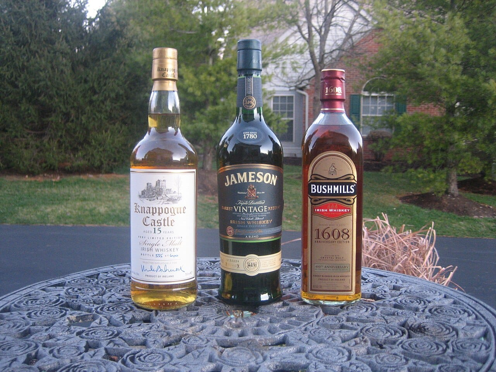
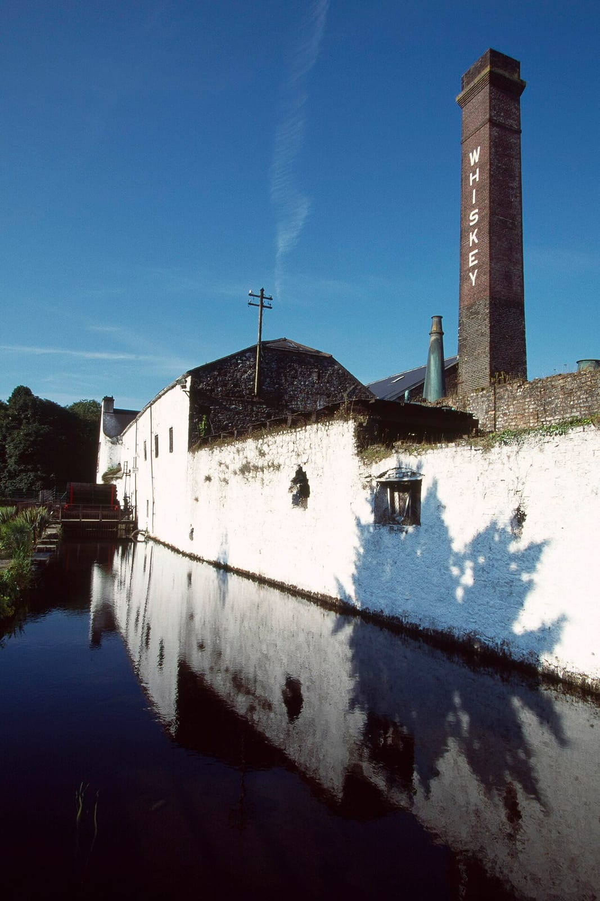

# Irish whiskey: coast, city and midlands

Whiskey travel in Ireland is easily reduced to a day trip in Dublin. This route widens the frame: from Bushmills on the north coast, south to Bow Street in Dublin, then west to Kilbeggan in County Westmeath. Between the stops lie two currencies, two sets of road signs and three different states of distillery — one still producing, one stopped and turned into a visitor centre, one revived by its own community.

Figure: "Irish whiskey: coast, city and midlands". Photograph: File:Ireland (MODIS).jpg. Credit: Jeff Schmaltz, Public domain ([source page](https://commons.wikimedia.org/wiki/File:Ireland_(MODIS).jpg)). Category image; not a claim that it shows the exact product, site or event.

## Three distilleries, three kinds of time

Bushmills stands for continuous licensing: the distillery treats its 1608 licence as the starting point, and the plant is still working. Bow Street stands for stopped time: the city distillery founded in 1780 made its last pot still run in 1970 and became a visitor centre in 1997; the equipment remains, the production line does not. Kilbeggan stands for restarting: a site licensed in 1757 closed in 1957, was repaired by local effort and distilled again in 2007. Set side by side, the theme is not three drams but how one craft was interrupted, preserved and picked up again.

## Route skeleton: coast, city and midlands

- Stop one: [Bushmills](ref:bushmills), 2 Distillery Road, Bushmills, Co Antrim BT57 8XH, Northern Ireland. About an hour by car from Belfast and two and a half hours from Dublin.
- Stop two: [Jameson Bow Street](ref:jameson), Bow St, Smithfield, Dublin 7, D07 N9VH, Ireland. Two and a half to three hours south of Bushmills.
- Stop three: [Kilbeggan](ref:kilbeggan), Lower Main Street, Kilbeggan, Co. Westmeath N91 W7YY, Ireland. About an hour from Dublin on the M6, leaving at Junction 5.
- Mode: by car. The route crosses Northern Ireland and the Republic, so expect pounds and euros, miles and kilometres, and confirm that the hire car insurance covers the border.
- Suggested duration: two days is the minimum, three is calmer. North coast first, Dublin second, the midlands third before the journey home.

## Why these three on one line

Irish whiskey was among the world's best-selling whiskey types at the end of the nineteenth century, then passed through independence, trade war, Prohibition and a shift in the American market, and the number of distilleries collapsed. Today's revival comes partly from old sites and equipment being preserved and partly from new capital rebuilding capacity; Bushmills, Bow Street and Kilbeggan map onto those three paths of continuous production, museum conversion and community revival. The geography also works: the north coast sits near the Giant's Causeway and Dunluce Castle, the Dublin leg can be done on foot and public transport, and the midlands leg is a quiet country road.

## Stop one: Bushmills

Why go: it pins the claim to be the oldest licensed distillery on a licence dated 1608 while remaining a working plant. The tour begins with the village, the River Bush and the licence, then moves through mashing, fermentation, distillation and warehouses. “Oldest” refers to a continuous licensing tradition on the same site, not to a seventeenth-century building.

What to see: the copper pot stills matter most. [Irish whiskey](ref:irish-whiskey) is commonly triple distilled, and Bushmills makes its single malt from 100% malted barley, with three distillations giving a cleaner, fruitier new spirit; this is tradition, not a legal requirement.

What to taste: Bushmills Original is the blend, light and clean; Black Bush uses a higher malt proportion and sherry casks, so dried fruit and spice come forward; the single malt range runs from 10 to 21 years. Start with Original, then compare Black Bush with one single malt.

## Stop two: Bow Street

Why go: it is a “distillery” that no longer distils. John Jameson began his whiskey business at Bow Street in 1780, and in the nineteenth century the site grew into a six-acre city distillery; after the last pot still run in 1970 production moved to Midleton in County Cork, and the old buildings became a visitor centre in 1997.

What to see: preserved copper stills, fermentation and warehouse displays, and explanations of triple distillation and the [pot still](ref:pot-still). Some sessions compare Irish, Scotch and American whiskeys. There is no working production line here, since real production is in County Cork; for running equipment, go to Bushmills or Kilbeggan.

What to taste: Jameson Original is a classic blend, the pot still whiskey adding spice and oiliness while grain whiskey adds soft sweetness; Black Barrel uses double-charred bourbon casks for more vanilla and caramel; the 18-year-old pushes ageing and cask further. A few drops of water separate the spice from the grain sweetness.

## Stop three: Kilbeggan

Why go: it makes repair visible. Matthias McManus took a distillation licence here in 1757, when the plant was called Brusna Distillery; in 1878 a warehouse fire led locals to roll casks into the street and save most of the stock; the distillery closed in 1957, a local restoration society formed in 1982, and distillation resumed in 2007 for the 250th anniversary.

What to see: a wooden waterwheel, drive shafts, old milling equipment, a steam engine and copper pot stills form a nineteenth-century production line. The distillery says one of its old pot stills has been in use for more than 180 years. The point is not modernity but that the machinery still turns.

What to taste: Kilbeggan Blended is smooth and easy; Single Pot Still mixes malted and unmalted barley for spice, grass and oiliness and is the way into [pot still](ref:pot-still) whiskey; Small Batch Rye brings pepper and a dry finish. Blended is not a synonym for cheap: in Ireland, blend and single pot still are parallel traditions.

## Driving, booking and seasons

All three distilleries need advance booking, and weekends and high season fill quickly. Bushmills offers several tour levels and asks larger groups to make contact in advance; Bow Street's session times and languages vary by season; Kilbeggan runs from a 90-minute standard experience to a 30-minute bottling session, and tastings are limited to guests of legal drinking age.

Estimate drives as real drives: the north coast to Dublin crosses the border and takes longer at peak times, and although Dublin to Kilbeggan is about an hour, the exit from the city can jam. May to September brings long daylight and full opening hours but also crowds; winter is quiet, though country roads darken early. Put tastings at the end of the day and stay overnight rather than rushing back.

## Driving, tasting and limits

This is a driving route, and the first rule is simple: whoever drinks does not drive. Ireland and Northern Ireland both take drink-driving seriously, and narrow country roads with soft shoulders leave little margin; even one dram affects judgement. There are three workable options: a driver who abstains all day, tastings concentrated into one day with public transport otherwise, or a distillery tour that includes transport.

Crossing the border adds detail. Northern Ireland uses pounds and miles per hour, the Republic uses euros and kilometres; check that the hire car insurance covers both. Bow Street sits in central Dublin, two minutes on foot from the Luas Red Line at Smithfield, so the city leg needs no car at all. A distillery is a production site: do not enter without a booking, and do not touch stills, pipes or racks.

## How this route connects to the region and style pages

This route is the itinerary version of the [Ireland](ref:ireland) region page: the region entry sets out the legal boundary of distilling and ageing on the island, the raw material rules for pot still whiskey and the triple distillation tradition, while the route lets you see those rules as past, interruption and restart in three buildings. For style, [Irish whiskey](ref:irish-whiskey) separates blend, single malt, single grain and single pot still, while [pot still](ref:pot-still) explains why one set of equipment produces a thick, oily, spicy body.

[Bushmills Distillery](ref:bushmills) explains stop order; [Kilbeggan Distillery](ref:kilbeggan) adds transport. Put Irish whiskey between them before deciding what it is.

## Related images

Image: Irish whiskey. Credit: Hammersbach, CC BY-SA 3.0, via Wikimedia Commons ([source page](https://commons.wikimedia.org/wiki/File:GoodIrishWhiskeys.jpg)). Related image for Irish whiskey: coast, city and midlands.

Image: Kilbeggan Distillery. Credit: Whisky lover, Public domain, via Wikimedia Commons ([source page](https://commons.wikimedia.org/wiki/File:Old_Kilbeggan_Distillery_-_Low_Res.jpg)). Related image for Irish whiskey: coast, city and midlands.
