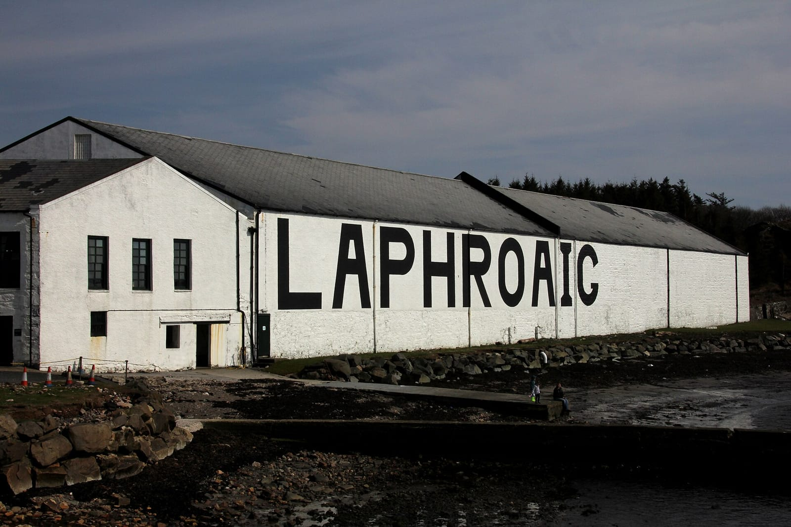

# Islay: three peat distilleries on the south coast

There is a plain route on the south coast of Islay: start at Port Ellen, head east along the shore to Lagavulin, continue to Ardbeg, and finish at Laphroaig. A footpath links the three, taking roughly three to four hours on foot; by car it is a matter of minutes. The point is not to tick off three names but to see how, within one bay, three distilleries turn different malting, distillation and warehouse conditions into three different kinds of peat.

Figure: "Islay: three peat distilleries on the south coast". Photograph: File:Laphroaig Distillery - panoramio (4).jpg. Credit: Bjarne Henning Kvaal, CC BY-SA 3.0 ([source page](https://commons.wikimedia.org/wiki/File:Laphroaig_Distillery_-_panoramio_(4).jpg)). Category image; not a claim that it shows the exact product, site or event.

> **Quick verdict**
> **In one line:** This route helps you plan Islay: three peat distilleries on the south coast, including the order, timing and stops that matter.
>
> - **Best for:** Anyone turning Islay: three peat distilleries on the south coast into a one- or two-day route and needs the order and the stops that matter.
> - **Not for:** If you want only want one stop and do not intend to follow a route.
> - **Check first:**
>   - - Stop one: Lagavulin, Port Ellen, Isle of Islay PA42 7DZ, founded in 1816 by John Johnston, on a site with earlier illicit distillation.
>   - Islay whisky is often reduced to “peat”.

> **Topic guide: Islay peat whisky**
> - [Islay whisky trail](https://atlas.hejiu.org/en/routes/islay-whisky-trail/)
> - [Islay](https://beverages.hejiu.org/en/regions/islay/)
> - [Ardbeg distillery](https://atlas.hejiu.org/en/places/ardbeg-distillery/)
> - [Laphroaig distillery](https://atlas.hejiu.org/en/places/laphroaig-distillery/)
> - [Bruichladdich distillery](https://atlas.hejiu.org/en/places/bruichladdich-distillery/)
> - [Whisky intro](https://hejiu.org/en/guides/whisky-intro/)
> - [Scotch whisky](https://beverages.hejiu.org/en/styles/scotch-whisky/)

> **Decision checklist**
> Run these three checks before you buy or go.
>
> - **Route overview:** Stop one: Lagavulin, Port Ellen, Isle of Islay PA42 7DZ, founded in 1816 by John Johnston, on a site with earlier illicit distillation.
> - **Why this route:** Islay whisky is often reduced to “peat”.
> - **Stop one: Lagavulin:** Why go: it puts heavy peat and slow distillation under one roof.

> **Topic guide: Islay peat whisky**
> - [Islay whisky trail](https://atlas.hejiu.org/en/routes/islay-whisky-trail/)
> - [Islay](https://beverages.hejiu.org/en/regions/islay/)
> - [Ardbeg distillery](https://atlas.hejiu.org/en/places/ardbeg-distillery/)
> - [Laphroaig distillery](https://atlas.hejiu.org/en/places/laphroaig-distillery/)
> - [Bruichladdich distillery](https://atlas.hejiu.org/en/places/bruichladdich-distillery/)
> - [Whisky intro](https://hejiu.org/en/guides/whisky-intro/)
> - [Scotch whisky](https://beverages.hejiu.org/en/styles/scotch-whisky/)

## Route overview

- Stop one: [Lagavulin](ref:lagavulin), Port Ellen, Isle of Islay PA42 7DZ, founded in 1816 by John Johnston, on a site with earlier illicit distillation.
- Stop two: [Ardbeg](ref:ardbeg), Port Ellen, Isle of Islay PA42 7EB, founded in 1815, closed in 1981, reopened in 1989 and now owned by LVMH.
- Stop three: [Laphroaig](ref:laphroaig), Port Ellen, Isle of Islay PA42 7DU, founded in 1815 by Donald and Alexander Johnston, with floor maltings still in use.
- Mode: ferry to Port Askaig (the Port Ellen terminal is closed from 2 June 2026 until 2029; Kennacraig–Port Askaig takes about 1 hour 55 minutes), then a bus or taxi of about forty minutes to Port Ellen; the path from Port Ellen to the three distilleries, with an island bus or booked taxi for the return.
- Suggested duration: one full day. Walk in the morning, lunch at Ardbeg's Old Kiln Café, visit Laphroaig in the afternoon, and return to Port Ellen towards evening.

## Why this route

Islay whisky is often reduced to “peat”. Peat is not a single flavour but a set of variables: how much peat smoke the malt receives, which layer the peat comes from, the shape of the stills and the speed of distillation, the distance of the warehouse from the sea, and the length of maturation. The three south-coast distilleries happen to lay these variables out in one bay, close enough to compare on foot.

Lagavulin's keyword is slowness. Its stills run slowly, with plenty of reflux, giving a thick body in which peat meets seaweed, iodine and smoke; the 16-year-old is the signature. Ardbeg's keyword is weight with sweetness: high peat intensity, but with citrus, tar and a clear sweetness, and a purifier on the stills that complicates the reflux and the flavour. Laphroaig's keyword is medicine and sea: floor maltings, shore warehouses and a strong iodine, antiseptic and seaweed character make it one of the most recognisable Islay whiskies.

The route also makes the island clear. Islay is not a convenient theme park: ferries depend on weather, island buses are infrequent, and the path crosses grazing land and shoreline, with mud, sheep dung and wind. Treating transport and weather as part of the route rather than background is the only way to avoid planning an impossible day.

## Stop one: Lagavulin

Why go: it puts heavy peat and slow distillation under one roof. The distillery lies about three kilometres (two miles) east of Port Ellen, with a row of white warehouses right on the bay, so that opening a warehouse door lets in the sea air. John Johnston established the legal distillery in 1816; before that, illicit distillation had been practised in the area since the mid-eighteenth century, when coast, fresh water and hidden coves were the key conditions.

What to see: the visit usually starts in the visitor centre and moves through mashing, fermentation and distillation to the warehouses. Watch the shape and pace of the stills: Lagavulin does not chase speed but gives the vapour more reflux, producing a thicker, oilier body. The warehouses stand by the sea, and the casks mature in damp, salty air, which lends a touch of seaweed and iodine. Do not ask only “how many ppm”: peat intensity is a starting point, while distillation and maturation decide the taste.

What to taste: the 16-year-old is the core, commonly described through sweetness, smoke, seaweed and a long finish; the Distillers Edition has a second maturation that brings more sweetness; special releases and distillery exclusives suit those who already know the base. On a first visit, taste the 16 first, then a cask-strength or special release, and compare alcohol strength with depth of flavour. Do not taste before the tour, or the smoke will fill your nose.

## Stop two: Ardbeg

Why go: it gives heavy peat sweetness and fruit. The distillery was founded in 1815, closed in 1981, reopened under Allied in 1989, passed to Glenmorangie in 1997 and has been part of LVMH since 2005. The official visit programme has several levels: a standard distillery tour, deeper tastings such as “Deconstructing the Dram”, and member events; book ahead in high season, since walk-in places are not guaranteed.

What to see: Ardbeg's stills carry a purifier, a small device that returns part of the vapour to the still, increasing reflux and changing the flavour; fermentation time, peat intensity and still shape together build the body. The Old Kiln and older buildings have been kept and converted into the café and reception, and the brick, chimney and shoreline make the site easy to recognise. Standing by the sea, you can see that “a warehouse near the water” is not romance but a matter of humidity, salt and temperature.

What to taste: the 10-year-old is the entry, Uigeadail and Corryvreckan are the common next steps, the first sweeter and oilier, the second heavier and more peppery; An Oa is softer. On a first visit, compare the 10 with Uigeadail and add Corryvreckan: three glasses cover the sweet-heavy-peppery range. Distillery exclusives vary in price and supply, so do not let “buying one” replace understanding what you are drinking.

## Stop three: Laphroaig

Why go: it pushes the medicinal and maritime side furthest. The distillery was founded in 1815 by Donald and Alexander Johnston, lies about five kilometres east of Port Ellen on the bay, and still runs its own floor maltings: about 15% of the malt is dried over peat on site, with the rest bought in. The water comes from the Kilbride stream, running over peat and granite, bringing mineral and mossy notes.

What to see: the floor maltings are the heart of this stop. Malt is spread on the floor and turned with wooden shovels while a peat fire burns slowly below, sending smoke through the layer. The process is inefficient, but it gives the distillery direct control over peat intensity and smoke. The warehouses also stand by the sea, where casks spend years in salt, wind and damp; look at the walls, racks and salt bloom on the floor, which say more than the phrase “aged by the sea”.

What to taste: the 10-year-old is the standard, Quarter Cask uses smaller casks to speed maturation and brings out coconut and sweetness, while Lore and Cairdeas are more advanced series. On a first visit, taste the 10, then Quarter Cask, and finish with a cask strength to compare cask type and alcohol. Laphroaig's medicinal side is not for everyone; there is no need to finish a glass, and the spit bucket exists for exactly that.

## Transport and rhythm

Islay is usually reached by ferry from the Scottish mainland, with CalMac operating the main routes; sailings depend on weather. From 2 June 2026 the Port Ellen ferry terminal is closed for upgrade works until 2029, so CalMac's Islay service runs to Port Askaig instead; allow extra time to reach Port Ellen by bus or taxi. Flights from Glasgow or Edinburgh also reach Islay airport. On the island, buses or taxis reach Port Ellen, but services are infrequent, so check the return before setting out. The path to the three distilleries leaves Port Ellen and follows the coast east, with gravel, mud, grass and road sections; the one-way walk takes about three to four hours, and the return can be walked, bussed or taken by booked taxi.

Suggested rhythm: leave Port Ellen in the morning for the first Lagavulin tour; walk to Ardbeg for lunch at the Old Kiln Café and an afternoon tour; continue to Laphroaig for a late tour and tasting; take a bus or taxi back to Port Ellen in the evening. With only two distilleries, keep Lagavulin and Laphroaig: one shows slow distillation, the other floor maltings, and the contrast is strongest.

Do not treat the path as a city park. Islay's weather changes quickly, with strong wind and rain, and the path can flood; it crosses grazing land, so give way to sheep and do not climb fences. Wear waterproof shoes and a windproof layer, and expect patchy mobile signal on parts of the coast. In strong wind or heavy rain, switch to car or taxi rather than forcing the walk.

## Seasons and booking

High season runs from May to September, with long daylight and more ferries, but distillery tours and island accommodation are tight; the Islay Festival, Fèis Ìle, at the end of May is the busiest time of year, with many events and few places, so plan months ahead. Winter is quiet but daylight is short and the weather less stable; some distilleries reduce slots and ferries can be cancelled by wind and swell.

Confirm three things when booking: the type of visit, the language and the meeting point. Lagavulin's warehouse tasting, Ardbeg's deeper tastings and Laphroaig's floor-malting tour are different products with different lengths and prices; “a distillery visit” is not one uniform thing. Anyone driving after a tasting should not drink; island roads are narrow and often single-track, and the risk is high.

## Manners and limits

First, a distillery is a production site, not a bar. Do not enter production areas without a booking, and do not touch stills, washbacks, racks or malt; floors are wet and slippery, so watch your step. Second, smell before tasting, sip slowly, and spit what you do not want; avoid strong perfume, which interferes with other visitors' reading of peat and sea. Third, respect island life: the path crosses grazing land and private ground, so follow signs, give way to sheep and machinery, do not climb fences, and leave nothing on the shore.

Fourth, read the dates and ownership correctly. Lagavulin's 1816 is the legal foundation, not the start of distillation in the area; Ardbeg's 1815 is the founding year, while 1981, 1989, 1997 and 2005 are closure, reopening and changes of ownership; Laphroaig's 1815 is the founding year, and its floor maltings cover only part of the malt. Fifth, do not rank whisky by peat ppm: ppm describes the phenol content of malt, not the taste in your glass.

For Islay: three peat distilleries on the south coast, this route does not provide a map; addresses and opening status were checked against official pages on 2026-11-08, but hours and booking rules can still change, so confirm with official channels. Latitude and longitude for the three venues are left empty in the content repository, and with no verifiable coordinate source the project rule is not to draw a schematic map. For precise navigation, use a live map service and follow on-site signage.

## Alternatives and extensions

If the weather rules out the path, the direct alternative is car or taxi, with ten minutes or so between distilleries; but do not drive after a tasting, and book a taxi or a distillery trip that includes transport. With time for only two, keep Lagavulin and Laphroaig and leave Ardbeg for next time; if the sweet side of heavy peat matters more, keep Ardbeg and Laphroaig.

Westwards the route reaches Port Charlotte and Bruichladdich; northwards, Bowmore, Caol Ila and Bunnahabhain. These distilleries sit on different coasts and differ widely in style, so they do not fit into one day without rushing. The better extension is to split them: one day for the south coast, another for the west and north, keeping “the smoke and sea of the south” apart from “the peat and flowers of the west”.

## See also

- [Lagavulin](ref:lagavulin): slow distillation, shore warehouses and the 16-year-old.
- [Ardbeg](ref:ardbeg): heavy peat, the purifier and Uigeadail.
- [Laphroaig](ref:laphroaig): floor maltings, shore warehouses and the medicinal note.
- For background, consult the Islay region, Scotch whisky and place-and-process entries in the content repository; this route does not register further references.

Opening hours, bookings and transport are subject to official channels; page verified on 2026-11-08.
