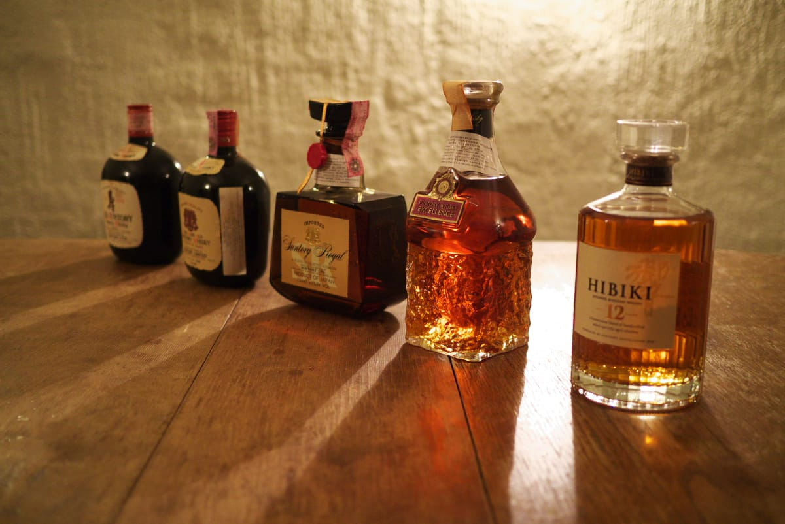

# Japan's whisky trail: from Yamazaki to Hakushu by rail

Yamazaki and Hakushu both belong to Suntory, yet they sit in Osaka Prefecture and Yamanashi Prefecture with most of Honshu between them. This route uses no car, relying on trains and a shuttle bus: first the oldest malt whisky distillery in Japan, at the foot of Mount Tenno south-west of Kyoto, then a distillery built in the forest at the foot of the Southern Alps. The distance between them is also the distance Japanese whisky travelled from its starting point to another answer.

Figure: "Japan's whisky trail: from Yamazaki to Hakushu by rail". Photograph: File:Hakushu Distillery - 32128449586.jpg. Credit: tetsuya yamamoto, CC0 ([source page](https://commons.wikimedia.org/wiki/File:Hakushu_Distillery_-_32128449586.jpg)). Category image; not a claim that it shows the exact product, site or event.

## One railway, two waters, two climates

Yamazaki lies between Kyoto and Osaka, its site pressed against the edge of the city; Hakushu sits among woods and granite in Hokuto, Yamanashi. Both belong to Suntory and both distil malt on pot stills, but their water, climate and equipment differ. Yamazaki uses a range of stills and cask types to build fruit, honey and a mizunara note; Hakushu uses soft water, wooden washbacks and stills of different neck lengths for a fresher spirit with a mineral edge. The railway puts the two environments on one line and makes a simple question concrete: why would one company need two distilleries?

## Route skeleton: Yamazaki to Hakushu

- Stop one: [Yamazaki](ref:yamazaki), 5-2-1 Yamazaki, Shimamoto-cho, Mishima-gun, Osaka 618-0001. About 10 minutes on foot from JR Yamazaki on the Kyoto Line or Hankyu Oyamazaki; there is no general car park.
- Stop two: [Hakushu](ref:hakushu), 2913-1 Hakushu, Hokuto, Yamanashi 408-0316. Take the free Suntory shuttle from JR Kobuchizawa on the Chuo Main Line, about 20 minutes.
- Mode: rail. The journey usually changes at Kyoto or Osaka, Nagoya and Shiojiri, and takes more than half a day; check times and connections with JR.
- Suggested duration: two days. Yamazaki first, then an overnight around Kofu or Kobuchizawa, then Hakushu and the return. From Tokyo the order can be reversed.

## Why rail rather than a car

Yamazaki has no general car park and officially recommends public transport; Hakushu has a large car park, but the drive from Tokyo or Kansai means mountain roads that can ice over in winter. Rail solves both: Yamazaki is a short walk from the station, and Hakushu has a shuttle from its station. The tours also include tastings, and anyone drinking should not be driving; removing the car removes the need to calculate when it is safe to leave.

Rail changes the rhythm too. The Hakushu shuttle is first come, first served, so the return needs queueing time. Packing both distilleries into one day uses up the energy in transfers and waiting, and loses the chance to spend a night in Kofu or Kobuchizawa.

## Stop one: Yamazaki

Why go: construction began in 1923 and distillation in 1924, making Yamazaki the oldest malt whisky distillery in Japan. Its importance is not only priority but the experiment of combining Scottish method with Japanese water, climate and taste. The whisky museum keeps buildings and equipment from the early years and is the most direct entry into that history.

What to see: there are two kinds of visit. The paid distillery tour goes through mashing, fermentation, distillation and warehouses; the free whisky museum covers displays and a tasting without entering production. Read the displays as raw material, process, cask and time: malt and water, double distillation, cask differences, warehouse conditions.

What to taste: begin with the core Yamazaki to set a baseline of fruit, honey and light smoke, then try other cask types or ages. The sandalwood and coconut often attributed to mizunara is only one thread; comparing mizunara with bourbon and sherry casks shows how much space it really occupies.

## Stop two: Hakushu

Why go: Hakushu opened in 1973 as Suntory's second malt distillery, built to make a different spirit rather than a copy of Yamazaki. The site is enclosed by forest, building heights are controlled, and the visitor route passes trees and grass before reaching the halls. The forest moderates temperature and humidity, which helps the warehouses.

What to see: three things. First water: natural water from the Southern Alps filters slowly through granite and carries few minerals, which suits a clean spirit. Second fermentation: wooden washbacks hold and breathe differently from stainless steel, giving more complex aroma. Third stills: Hakushu uses pot stills with different neck lengths and lyne arm angles so one batch of malt yields both light and heavy spirit.

What to taste: Distiller's Reserve is younger and easier, good in a highball; Hakushu 12 brings green apple, mint, light smoke and minerals; the 18 and 25 year olds are rounder, moving from green fruit to dried fruit, honey and spice. A lightly peated version exists too, where smoke sits beside freshness rather than over it.

## Booking: ballots, slots and age

Both distilleries are fully booked in advance, including anyone who only wants the shop or the tasting area. Yamazaki runs a ballot for its distillery tour, with places released by month and taken quickly in season; the whisky museum is free but still needs a reservation. Opening hours are 10:00 to 16:45 with last entry at 16:30. Hakushu opens 9:30 to 16:30 with last entry at 16:00; free tours close at noon the day before, paid tours at noon three days before, and some slots use a ballot.

Age and identity matter too: tasting and buying require guests to be at least 20, and minors cannot enter alone. Both sites close over the New Year period and for maintenance, with temporary closures posted on their websites. Confirm the tour and the museum separately when booking.

## Seasons, transfers and the way back

Fresh green in spring and red leaves in autumn are the best and busiest times; in winter the Hakushu mountain roads can ice over and transport can be affected. Yamazaki sits at the city edge, but autumn weekends are just as tight. Book about a month ahead, and earlier in peak season.

Leave margin for transfers. Yamazaki to Hakushu is not a direct line and usually changes at Kyoto or Osaka, Nagoya and Shiojiri; the free Hakushu shuttle is first come, first served and can be full, with a queue for the return. Keep the last leg in daylight. For 2026, check JR and Suntory official channels for times and shuttle arrangements.

## Drinking rules on the railway

Japan enforces drink-driving laws strictly, so the driver cannot drink at all; passengers can also be held responsible, which makes “I'll have one and he'll drive” no solution. This route needs no car: walk from Yamazaki station, take the shuttle at Hakushu, and ride back after tasting.

Taste with restraint. Smell first, sip slowly, and use the spittoon if you do not want to finish; avoid strong perfume, which interferes with everyone's reading of mizunara and smoke. In production areas do not touch equipment or cross the yellow lines; outside food and drink are not allowed, and pets are excluded except assistance dogs.

## How this route connects to the region and style pages

This route is the practical version of the [Japan](ref:japan) region page: the region entry sets out labelling rules, raw material and ageing requirements, and the production structure of one company with several distilleries, while the route shows how that structure lands in water, washbacks and stills at Yamazaki and Hakushu. For style, [Japanese whisky](ref:japanese-whisky) separates single malt, blended and grain whisky; [Yamanashi](ref:yamanashi) explains the setting around Hakushu; and [oak ageing](ref:oak-ageing) explains why mizunara became one of the recognisable signatures.

The comparison with [Yamazaki Distillery](ref:yamazaki) and [Japan](ref:japan) runs through stop order and transport. Each answers a different question.

## Related images

Image: Category image for Japan. Credit: OS6, CC BY-SA 3.0, via Wikimedia Commons ([source page](https://commons.wikimedia.org/wiki/File:Kamotsuru_Sake_Brewing.jpg)). Related image for Japan's whisky trail: from Yamazaki to Hakushu by rail.

Image: Japanese whisky. Credit: Mikael Leppä, CC BY 2.0, via Wikimedia Commons ([source page](https://commons.wikimedia.org/wiki/File:Vintage_Suntory_Tasting.jpg)). Related image for Japan's whisky trail: from Yamazaki to Hakushu by rail.
