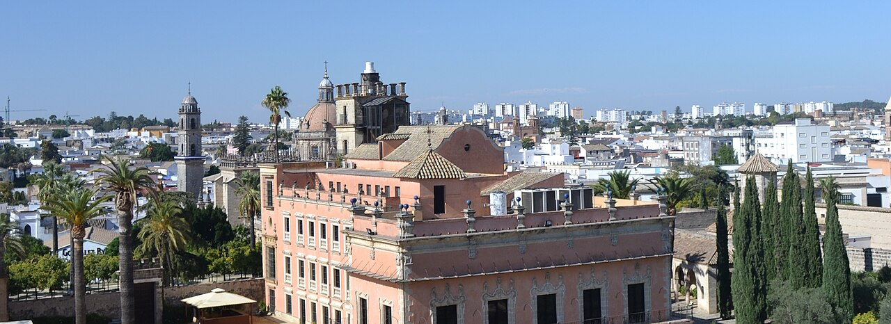
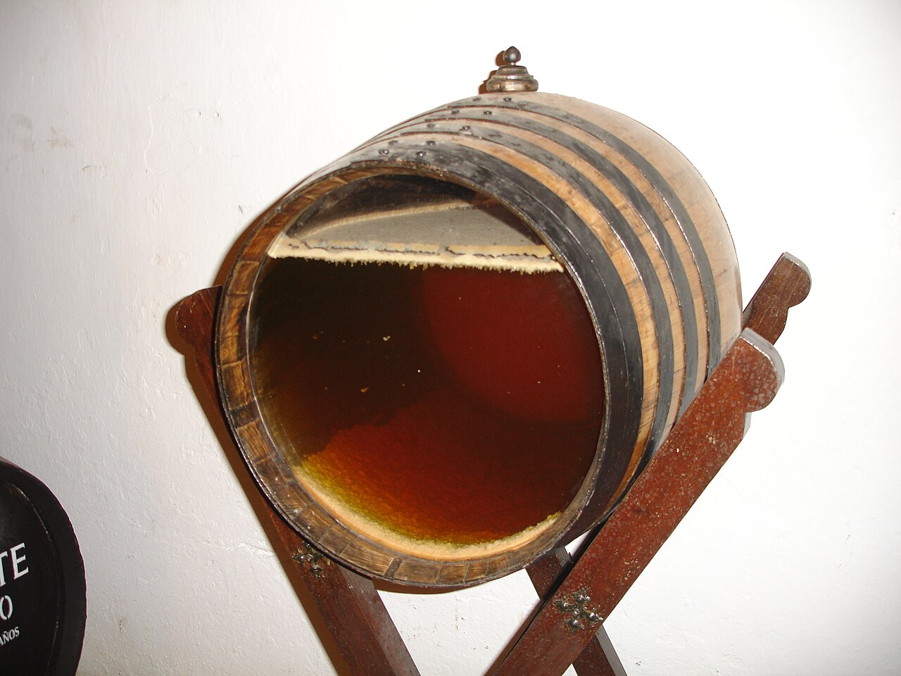

# Jerez sherry route: one city, two houses, three paths of ageing

Jerez de la Frontera is often treated as the name of a drink, but it is first of all a city. The Sherry triangle is formed by Jerez, El Puerto de Santa María and Sanlúcar de Barrameda, and this route stays inside Jerez for two houses: Lustau on Calle Arcos and González Byass on Calle Manuel María González. The two are less than a kilometre apart and can be linked on foot, yet together they show the solera stack, biological flor ageing and oxidative ageing. Doing both in one day is more useful than ticking them off separately: one grew out of an almacenista and likes to put other stock-holders' old wines on the table; the other has been the model of the urban bodega since 1835 and fixes style through brands.

Figure: "Jerez sherry route: one city, two houses, three paths of ageing". Photograph: File:(Jerez de la Frontera) DSC 0560 (6271831479) (cropped).jpg. Credit: Annie and Andrew, CC BY 2.0 ([source page](https://commons.wikimedia.org/wiki/File:(Jerez_de_la_Frontera)_DSC_0560_(6271831479)_(cropped).jpg)). Category image; not a claim that it shows the exact product, site or event.

> **Quick verdict**
> **In one line:** This route helps you plan Jerez sherry route: one city, two houses, three paths of ageing, including the order, timing and stops that matter.
>
> - **Best for:** Anyone turning Jerez sherry route: one city, two houses, three paths of ageing into a one- or two-day route and needs the order and the stops that matter.
> - **Not for:** If you want only want one stop and do not intend to follow a route.
> - **Check first:**
>   - Both houses use solera, but they present it differently.
>   - Both houses require booking and neither takes walk-in tours.

## Two stops, one city, one thread

- Stop 1: [Lustau](ref:lustau), Calle Arcos 53, 11402 Jerez de la Frontera, Cádiz, Spain. It began as an almacenista in 1896 and bought the six 19th-century cellars on Calle Arcos in 2000.
- Stop 2: [González Byass](ref:gonzalezbyass), Calle Manuel María González 12, 11403 Jerez de la Frontera, Cádiz, Spain. Founded in 1835 by Manuel María González and known for Tío Pepe and La Concha.
- Order: Lustau in the morning, González Byass in the afternoon. The reverse works, but seeing the stock-holder's old wines first and the brand system second makes the comparison easier.
- Time: 2–3 hours per stop; the walk between them takes 10–15 minutes, or 5 minutes by taxi with luggage or in the heat.
- Thread: how a solera is refreshed, how flor decides biological ageing, and how fortification to 15% or 17% pushes wine down one of two paths.

## Stop one: the six cathedrals of Lustau

Lustau is at Calle Arcos 53, close to Plaza del Arenal and the Santiago district. This is not a vineyard estate but a block of cellars inside the city: six 19th-century buildings covering about 20,000 square metres, with high ridges, side windows near the roof and floors of packed albero sand. Inside, the temperature drops at once and the air smells of old wood, flor and damp sand.

Two points carry the history. First, José Ruiz-Berdejo started in 1896 as an almacenista, selling wine on to larger merchants; in 1931 his daughter María moved the soleras to a smaller cellar closer to the centre, in the 1940s her husband Emilio Lustau Ortega moved again to the Santiago district, and only in 1945 did the house begin selling under its own labels. Second, in 2000 it bought the six 19th-century cellars on Calle Arcos and made them the main ageing and visitor site. Today's "cathedrals" are the result of those two histories stacked together.

The point of this stop is not age but tiers. The house ages wine in Jerez, El Puerto de Santa María and Sanlúcar de Barrameda at the same time, and differences in sea air, humidity and temperature make one solera logic taste different from city to city. The range makes the tiers legible: Jarana is a Fino, Escuadrilla an Amontillado, Península a Palo Cortado, Emperatriz Eugenia an Oloroso, Emilin a Moscatel and San Emilio a Pedro Ximénez; the Almacenista range bottles a single solera from a partner stock-holder, while VORS wines average over 30 years.

Three tours are offered: The Cathedrals of Wine, about 60 minutes and €26, with 5 Sherries and a vermouth; The Symbols of Sherry, about 75 minutes and €36, with 5 premium wines and 2 VORS; and The Sacristy of Lustau, about 90 minutes and €60, with 2 wines in the cellars followed by a VORS tasting. All need booking through lustau.es, by email at visitas@lustau.es or by telephone on 956 341 597.

## Stop two: the urban cellars of González Byass

From Calle Arcos, walk west through the old town and you reach Calle Manuel María González 12 in about a quarter of an hour. Manuel María González founded the house in 1835, the British partner Robert Blake Byass soon joined, and the firm took both surnames. This is again not a vineyard but a group of city cellars: courtyards, cobbled lanes, whitewashed bodegas with high windows and gardens, with the Alcázar a few hundred metres away.

The highlight is La Concha. Its plan is close to a circular arc spanning about 28 metres, the roof folds inward like a shell, and 214 barrels of Amontillado stand in rows inside. At the door, look at the roof first, then the casks, then the wine. The other cellars — La Constancia, Los Apóstoles, La Cuadrada and Lepanto — each have a different role, and together they make the complete urban-bodega sample.

Brands are the second line here. Tío Pepe is the Fino benchmark: dry, saline and yeasty. Viña AB is an Amontillado, Alfonso an Oloroso, Apostoles a sweetened old-style Palo Cortado in the VORS category, and Noé a Pedro Ximénez. For a first visit, compare Tío Pepe with Alfonso rather than memorising names. Tours are booked by time slot on the official site and usually include a tasting; the length and wines differ by package, so confirm each item when booking.

## Solera, flor and oxidation: comparing the two

Both houses use solera, but they present it differently. Lustau keeps the almacenista tradition alive: the Almacenista range bottles the single solera of one stock-holder, so what you taste is one specific history of refreshment. González Byass folds solera into a brand system, and the steady style of Tío Pepe comes from long-term, large-scale stack management. One stresses whose cask it is; the other stresses that every glass tastes like Tío Pepe.

The fork between flor and alcohol is visible in both. After fermentation, wine for biological ageing is fortified to about 15%; flor forms a film, excludes oxygen and leaves bread, almond and sea salt. Wine for oxidative ageing reaches at least 17%; flor cannot survive, the wine meets oxygen directly, darkens and develops hazelnut, caramel and old wood. Fino and Manzanilla take the first path, Oloroso the second, while Amontillado and Palo Cortado are biological first and oxidative afterwards.

Putting the two houses on one table makes the comparison concrete: Lustau's Jarana against González Byass's Tío Pepe, both Fino; Emperatriz Eugenia against Alfonso, both Oloroso; Escuadrilla against Viña AB, both Amontillado; Península against Apostoles, two expressions of Palo Cortado. Drink dry first, then oxidative, then sweet, and the boundaries appear by themselves.

## Walking and short drives: the practical line

Both stops are in the old town, so walking is the sensible way. From Calle Arcos 53 to Calle Manuel María González 12 is less than a kilometre, by way of Plaza del Arenal, and takes 10–15 minutes at normal pace. The surface is mostly stone and cobbles, so wear shoes with grip; summer afternoons are hot, so walk in the morning or evening and stay in the cellars at midday.

For a two-stop day, a workable rhythm is a Lustau tour around 10 a.m., lunch in the old town, and a González Byass tour around 3 p.m. Both need advance booking, so do not cut the times too fine; late arrival can mean a shortened visit or no entry. With luggage, older companions or bad weather, a 5-minute taxi is fine.

Arrival is simple: Jerez station is about a 15-minute walk from Lustau, the airport about 15 minutes by car, Sevilla roughly 90 km and Cádiz about 35 km. Old-town streets are narrow, so allow time to park if you drive.

## Booking, seasons and cellar etiquette

Both houses require booking and neither takes walk-in tours. Lustau books through lustau.es, visitas@lustau.es or 956 341 597, with the three routes sold by slot; González Byass books by time slot on its official site, telephone +34 956 357 016, with tiered tours whose tastings and wine counts depend on the package.

Spring and autumn are the most comfortable seasons; summer afternoons are hot, though the cellars stay cool; Holy Week, the Jerez fair and cruise calls fill the old town and tighten availability. Harvest usually runs from late August into September, the busiest and most vivid stretch, but visit schedules may be reduced, so check before travelling.

A cellar is a production site, not a bar. Arrive on time; do not touch casks, pipes or displays; check with the guide before photographing, since flash and tripods are usually unwelcome; skip strong perfume. Floors are sand or packed earth, so wear dark, practical shoes. Spitting is normal.

## Drinking, pairing and the driving limit

Serve Fino and Manzanilla at 7–10 °C and finish the bottle soon; Oloroso and Amontillado suit 12–15 °C; Pedro Ximénez can be cooler, but not so cold that aroma vanishes. Fino goes with ham, fried fish and olives; Oloroso with game, mushrooms and hard cheese; Pedro Ximénez with blue cheese and chocolate.

Walking between the two stops sounds like a cure, but alcohol does not disappear with a stroll. Spit every drop, or appoint a driver who is not drinking; Spain has clear drink-drive limits and local enforcement sets the detail. The safest plan is to stay in the old town, walk all day and leave the car parked.

## How this route connects to the region and style pages

The [Jerez](ref:jerez) region page covers albariza chalk, the Jerez and Manzanilla denominations and humidity-driven flor; the [Sherry](ref:sherry) style page runs from Fino to Pedro Ximénez; the [fortified-wine](ref:fortification) page explains fortification; the [solera](ref:solera) entry explains the stack and refreshment; the [flor](ref:flor) entry explains the veil; the [oxidation](ref:oxidation) entry explains how oxygen changes colour and aroma. Read those pages first and the rows of casks stop being "many barrels" and become a system you can read.

The route's job is to put those abstract terms into one city: one stop shows a stock-holder's single solera, the other a branded, stable style; one stresses differences between three cities, the other turns the urban bodega into a model. After both, Sherry is no longer simply a sweet or aperitif wine but an ageing regime decided by flor, alcohol and refreshment.

## Related images

Image: Sherry casks under the arcades of the Lustau bodega in Jerez.. Credit: Anual, CC BY-SA 4.0, via Wikimedia Commons ([source page](https://commons.wikimedia.org/wiki/File:Lustau_003An2019.jpg)). Related image for Jerez sherry route: one city, two houses, three paths of ageing.

Image: Flor. Credit: El Pantera, CC BY-SA 3.0, via Wikimedia Commons ([source page](https://commons.wikimedia.org/wiki/File:FLOR-ValdiviaJerez59.jpg)). Related image for Jerez sherry route: one city, two houses, three paths of ageing.
