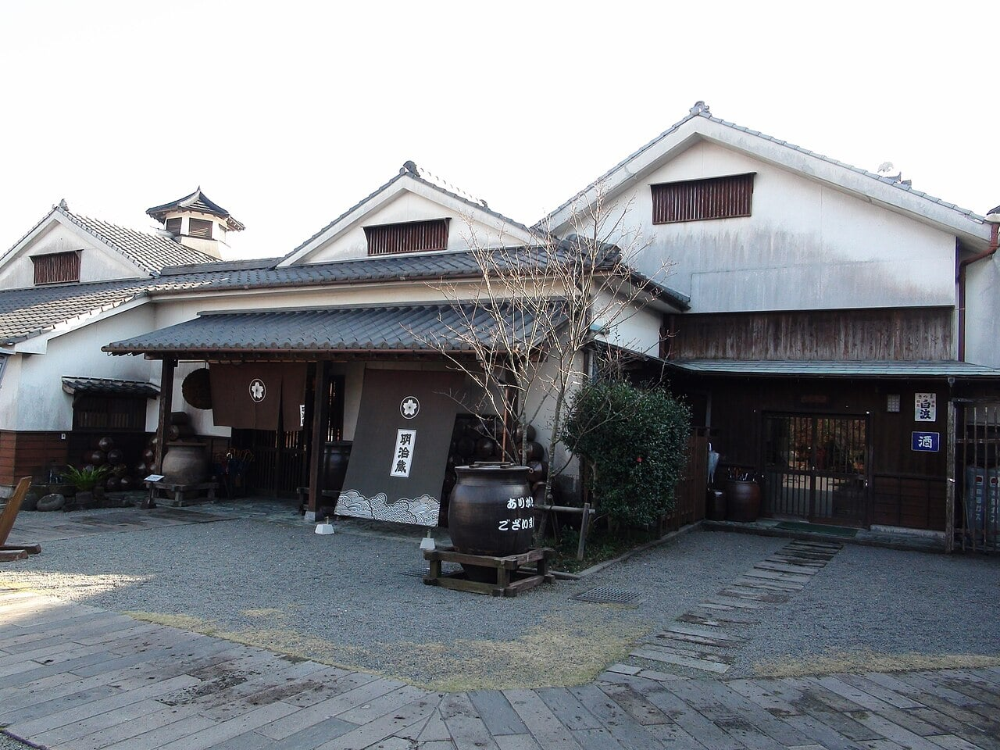
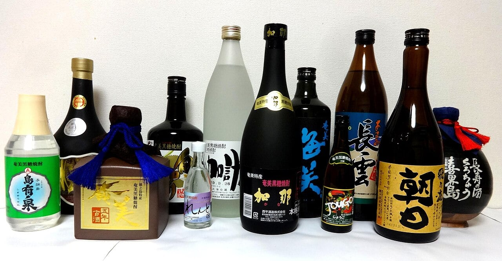

# Kagoshima shochu route: Makurazaki to Miyakonojo

This Kagoshima shochu route puts two different kinds of shochu site into one drive: the Hanatogawa Distillery Meijigura in Makurazaki, an old brewery still run on jars and labour, and Kirishima Factory Garden in Shibitacho, Miyakonojo, a designed walking factory and visitor park. Both use sweet potato, but one shows the traditional single-distillation process and the other turns scale production into an experience. Together they explain raw material, koji, distillation and strength in one line.

Figure: The Meijigura storehouse of the Hanatogawa distillery in Makurazaki, with its sign and ceramic storage jars in the courtyard. Image: Sakaori, CC BY 3.0, via [source page](https://commons.wikimedia.org/wiki/File:Satsuma_Shuzo's_Kedogawa_Shochu_factory_and_museum,_Meijigura.JPG).

> **Quick verdict**
> **In one line:** This route helps you plan Kagoshima shochu route: Makurazaki to Miyakonojo, including the order, timing and stops that matter.
>
> - **Best for:** Anyone turning Kagoshima shochu route: Makurazaki to Miyakonojo into a one- or two-day route and needs the order and the stops that matter.
> - **Not for:** If you want only want one stop and do not intend to follow a route.
> - **Check first:**
>   - - Stop one: Meijigura, 26 Tategamihonmachi, Makurazaki; 9:00–16:00, free admission, closed 30 December to 3 January.
>   - Japan's liquor tax on shochu uses 20 degrees as the base: 200,000 yen per kilolitre, plus 10,000 yen for each degree above 20.

## Route overview

- Stop one: [Meijigura](ref:meijigura), 26 Tategamihonmachi, Makurazaki; 9:00–16:00, free admission, closed 30 December to 3 January.
- Stop two: [Kirishima Factory Garden](ref:kirishima), 5480 Shibitacho, Miyakonojo, Miyazaki; five tours a day, about 45 minutes.
- Mode: car. The stops are separated by southern Satsuma and the Kirishima foothills, roughly two hours, adjusted by navigation and traffic.
- Time: one day. Meijigura in the morning, Kirishima in the afternoon; add Kagoshima city or Ibusuki and allow at least two days.
- Check first: tour times and temporary closures belong to official sites, and a telephone call before travelling is safest.

## The geography of sweet potato shochu

The "imo" in imo shochu is sweet potato, not potato. Southern Kagoshima and southern Miyazaki are the main areas in [Japan](ref:japan): Makurazaki at the tip of the Satsuma Peninsula has strong sea wind and high humidity; Miyakonojo sits in an inland basin west of the Kirishima range, with different water and fields. The two places are not far apart, yet represent two production scales: a small brewery by a harbour and a broad factory garden.

This route does not suit a tick-box sprint. Kagoshima Chuo Station to Makurazaki is about an hour, Makurazaki to Miyakonojo more than an hour, and the return to Kagoshima city another drive. A sensible plan is to stay in Kagoshima city or Makurazaki the night before, start at Meijigura in the morning, drive north along the Nansatsu expressway in the afternoon, reach Kirishima Factory Garden late in the day, then stay in Miyakonojo or go on to Kagoshima Airport. Everything is by car, rural roads are poorly lit at night, and the last stop should not fall after dark.

## Stop one: Meijigura

Meijigura is Satsuma Shuzo's Hanatogawa Distillery at 26 Tategamihonmachi in Makurazaki. It keeps brewery buildings and techniques carried on from the Meiji era, and today the head brewer and crew still make honkaku shochu by the traditional route. Visitors can see koji, fermentation and distillation up close rather than read panels behind glass. It opens 9:00–16:00, admission is free, and it closes from 30 December to 3 January; the shop sells 25-degree Shirohaku and Kurohaku and a 37-degree genshu.

The point is not that the site is old but that it is still in use. Jars, wooden tubs, steamers and a single pot still sit where the process needs them, and some areas cannot be entered for long because of safety and hygiene; the tasting space lets you compare white koji and black koji. Try Shirohaku, then Kurohaku: both 25 degrees, the first clean and the second rich, with the difference coming from koji and fermentation management rather than the growing region. Anyone driving should not taste at all.

## Stop two: Kirishima Factory Garden

The second stop is Kirishima Shuzo's Shochu-no-Sato Kirishima Factory Garden at 5480 Shibitacho in Miyakonojo, Miyazaki. It is not the head office, and not in Kirishima city in Kagoshima; it is about ten minutes west of the head office by car and about five minutes from KIRISHIMA GREENSHIP icoia on National Route 10, so navigate to the facility name directly. The site combines a walking factory, museum, restaurant, bakery and shops, and suits families and groups.

KIRISHIMA WALK FACTORY runs five sessions a day at 10:00, 11:00, 13:30, 14:30 and 15:30, each about 45 minutes and booked by telephone in advance. The route is organised around sight, sound, smell, taste and touch, moving from sweet potato and koji to steaming, fermentation and distillation; tastings are free, and visitors can sample sweet potato and Kirishima Rekkasui water. Compared with Meijigura's brewery scale, this is an industrial park with high information density and a faster rhythm, better placed in the second half of the day.

## White koji and black koji

Kagoshima shochu uses white koji and black koji. White koji originated in Kagoshima, produces citric acid strongly, suppresses wild microbes in an acidic environment, ferments reliably and gives a lighter aroma and a clean entry; black koji came earlier through the Okinawan awamori tradition, with a different enzyme profile and acidity, producing a heavier spirit with more earth and richness. Meijigura's Shirohaku and Kurohaku put the two routes side by side on one shelf; Kirishima's main products rely mostly on white koji and take the clean route that suits hot water and ice.

The choice of koji affects everything downstream: high acidity makes fermentation safer but changes the aroma direction, and different koji means different proportions, temperatures and times for steaming and the second mash. "Kagoshima flavour" is not one taste but the result of sweet potato, koji, water and distillation together. Tasting the two breweries side by side makes that clearer than memorising regional labels.

## Atmospheric and vacuum distillation

Honkaku shochu uses single [distillation](ref:distillation), usually in a [pot still](ref:potstill), unlike continuous-still shochu. Single distillation keeps more raw-material aroma and trace compounds. Atmospheric distillation runs near boiling point and gives a heavier spirit with more sweet potato and grain; vacuum distillation runs at lower temperature, with fewer off-flavours and a cleaner result. A brewery chooses pressure and cut points by product, and one raw material can become different styles.

In the classification of [shochu](ref:shochu), the continuous and single categories are not good versus bad but different equipment and aims: continuous stills pursue efficiency and purity, single stills pursue raw-material character. Sweet-potato shochu belongs mostly to the second, which is why the aroma stays close to the tuber. In the still house, watch the spirit being cut into heads, heart and tails; the cut point decides whether the bottle is more aromatic or cleaner.

## 25 degrees, 20 degrees and jar storage

Japan's liquor tax on shochu uses 20 degrees as the base: 200,000 yen per kilolitre, plus 10,000 yen for each degree above 20. 25 degrees is the long-standing standard for honkaku shochu and the main specification at most breweries; 20 degrees sits at the tax base, with a lighter body that suits food. The price gap between the two comes not only from materials and labour but from this per-degree addition. Reading the strength tells you more about tax and style than the word genshu.

Jar storage is the other shared thread. Ceramic jars breathe and conduct heat slowly, so temperature swings are gentler than in stainless steel, and the spirit ferments and begins to mature inside them; micro-oxygen exchange softens the sharp edges of new shochu and rounds the sweet-potato sweetness. Longer is not always better, because the aroma moves from fresh to matured and can lose the most appealing side of sweet-potato shochu. Both Meijigura and Kirishima Factory Garden show jars or storage, one stressing tradition and the other experience, but both point to the same cost in time.

## Driving and booking

There is no convenient rail combination between the two stops: Makurazaki has the JR Ibusuki-Makurazaki Line, but Makurazaki to Miyakonojo needs changes and a long detour, so driving or a hired car is the reliable choice. Kagoshima Airport to Makurazaki is about one hundred minutes, Makurazaki to Miyakonojo more than an hour, and Miyakonojo back to the airport more than an hour, so plan a triangle rather than a straight line. Rural roads are poorly lit at night; do not drive after dark.

Meijigura is free to enter, but groups and visits should call ahead; Kirishima Factory Garden requires advance booking by telephone on 0986-21-8111, answered 9:00–17:00. When booking, confirm the session, meeting point, whether tasting is included and how long to allow; in typhoon season or during maintenance, check the official notice. Anyone driving should not taste, handing samples to a companion or saving the tasting for the hotel.

## References

- [Hanatogawa Distillery Meijigura](https://www.meijigura.com/), Satsuma Shuzo, checked for the address, hours, free admission and product strengths.
- [Access](https://www.kirishima-fg.jp/access/), Kirishima Factory Garden, checked for the 5480 Shibitacho address and surrounding distances.
- [Opening hours and contacts](https://www.kirishima-fg.jp/contact/), Kirishima Factory Garden, checked for the five tour sessions and facility hours.
- [The kingdom of shochu](https://www.kagoshima-kankou.com/gourmet/shochu/siru), Kagoshima Prefectural Visitors Bureau, checked for sweet-potato raw material and regional background.
- [Table 5, liquor tax rates](https://www.nta.go.jp/taxes/sake/shiori-gaikyo/shiori/2026/pdf/05_01.pdf), National Tax Agency, checked for the shochu tax base at 20 degrees.

Page verified on 2026-11-09; hours, tour sessions and opening arrangements are subject to official channels.

## Related images

Image: Related photograph of Satsuma Shochu Meijigura. Credit: Sakaori ( talk ), CC BY 3.0, via Wikimedia Commons ([source page](https://commons.wikimedia.org/wiki/File:Satsuma_Shuzo%27s_Kedogawa_Shochu_factory_and_museum,_Meijigura.JPG)). Related image for Kagoshima shochu route: Makurazaki to Miyakonojo.

Image: Bottled examples of Amami kokuto shochu, a regional type of Japanese shochu.. Credit: Hhaithait, CC BY-SA 4.0, via Wikimedia Commons ([source page](https://commons.wikimedia.org/wiki/File:Bottled_amami_kokuto_shochu.jpg)). Related image for Kagoshima shochu route: Makurazaki to Miyakonojo.
