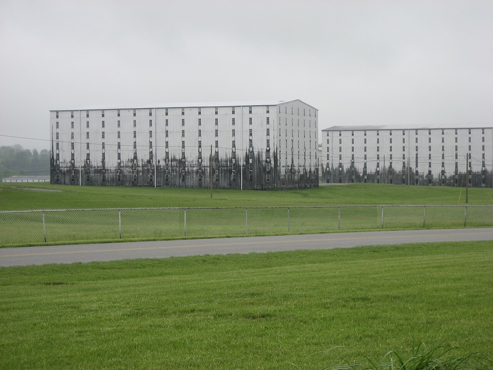

# Kentucky bourbon trail: Frankfort, Bardstown and Loretto

Kentucky's bourbon trail is not a legal boundary. The Kentucky Bourbon Trail is a promotion run by the Kentucky Distillers' Association, and its member distilleries are scattered across the state; distance, tour times and a driver decide whether a route works. This one takes three: Buffalo Trace in Frankfort, Heaven Hill in Bardstown and Maker's Mark in Loretto. They form a triangle of about an hour, half an hour and a little over an hour.

Figure: "Kentucky bourbon trail: Frankfort, Bardstown and Loretto". Photograph: Heaven Hill distillery, Bardstown, Kentucky. Credit: Shadle, CC BY-SA 3.0 ([source page](https://commons.wikimedia.org/w/index.php?curid=4136725)). Category image; not a claim that it shows the exact product, site or event.

## Route overview

- Stop one: [Buffalo Trace](ref:buffalo-trace), 113 Great Buffalo Trace, Frankfort, KY 40601; about an hour from Louisville on I-64.
- Stop two: [Heaven Hill](ref:heaven-hill), 1311 Gilkey Run Rd, Bardstown, KY 40004; about an hour from Frankfort, at the welcome centre rather than the still house.
- Stop three: [Maker's Mark](ref:makers-mark), 3350 Burks Spring Rd, Loretto, KY 40037; about half an hour from Bardstown on rural roads.
- Mode: car or chauffeur; public transport is effectively unavailable and ride-hailing in Loretto is unreliable.
- Duration: two days is comfortable; one day fits two tours and the drive back.

## Why these three

US rules are specific: at least 51% corn, new charred oak, bottling at no less than 40% alcohol by volume, and two years in wood for anything labelled straight. The rules are identical; the answers are not. Buffalo Trace, owned by Sazerac, runs rye, wheat and rye-whiskey recipes on one site and absorbs volume through several brands and experimental warehouses. Heaven Hill is family-owned and covers different recipes with several brands, turning bottled-in-bond into a product line. Maker's Mark keeps one recipe, swaps rye for red winter wheat, and makes farm, rotation and wax part of the visit. The comparison is how scale changes what you see.

## Stop one: Buffalo Trace

Frankfort comes first because it is the easiest place to build a timeline. The site starts with the Leestown settlement of 1775; in 1870 E.H. Taylor Jr. bought it and expanded it as O.F.C.; the mashing wing of 1883 and Warehouse C of 1885 still stand. It was renamed Buffalo Trace in 1999, listed as a National Historic Landmark in 2013, and gained the experimental Warehouse X the same year. Trace Tour takes about 75 minutes and is fully accessible; Hard Hat Tour takes 105 minutes and enters production. Tours, tastings and parking are free, with places released up to eight weeks ahead and more each Wednesday.

To taste: Buffalo Trace is the baseline, with caramel, vanilla, oak and citrus peel; Eagle Rare 10 is drier; Blanton's is single-barrel; W.L. Weller uses wheat. Tastings are capped at 1¾ ounces per person per day, so drivers should skip them.

## Stop two: Heaven Hill

Heaven Hill was founded in 1935 by five Shapira brothers and local investors with 12 employees, running rye, wheat and corn recipes through one warehouse and bottling system. On 7 November 1996 a fire destroyed the original distillery and seven warehouses, damaging about 100,000 barrels; distillation moved to Bernheim in Louisville, and in 2025 the Springs distillery brought production back to Bardstown.

Tours assemble at the Bourbon Experience and shuttle two miles to Springs; the address is the welcome centre, not the still house. Magic of the Mashbill takes about 45 minutes; You Do Bourbon adds blending and bottling. Bottled-in-bond is easiest to grasp here: the 1897 Act required one season, one distillery, four years in bond and bottling at 100 proof. To taste: Evan Williams, Elijah Craig, Larceny and Rittenhouse cover the range.

## Stop three: Maker's Mark

Maker's Mark was founded in 1952 by Bill Samuels Sr. at Star Hill Farm; in 1953 he burned the family recipe and switched to red winter wheat; Margie Samuels designed bottle, label and red wax; the first hand-dipped bottle appeared in 1958; and in 1980 the site was listed as a National Historic Landmark as Burks' Distillery. The story is not older but narrower.

Look for actions: barrels are rotated by hand, bottles are dipped on site, warehouses run on solar power, and spent grain feeds cattle. The classic tour takes about 1 hour 15 minutes and ends in a tasting; arrive 15 minutes early with ID, expect card payment, and wear closed-toe shoes. Parking is free, but Uber and Lyft are unreliable in Loretto. To taste, compare the classic wheat recipe with Maker's 46, Cask Strength and Private Select.

## Driving, booking and a designated driver

Frankfort to Bardstown is about an hour, Bardstown to Loretto half an hour, and Loretto back to Frankfort a little over an hour. Rural roads are unlit at night, so do not put the last tour after dark.

All three need bookings on different terms: Buffalo Trace releases free places by the week, Heaven Hill sells timed sessions from a separate welcome centre, and Maker's Mark fills quickly online at weekends. Confirm length, tasting, age limits, meeting point and cancellation policy. Do not drive after drinking: one drink can affect judgement on rural roads. Use a chauffeur or a designated driver, and spit every sample if you drive.

## Seasons, lodging and extensions

High season runs from May to September, with long days but humid heat; spring and autumn are more comfortable and busier with events. Bardstown hosts a bourbon festival each September, so check the official calendar, as lodging and tours tighten.

Stay in Bardstown, Louisville or Lexington: Bardstown is closest to Heaven Hill, while the cities offer more food and flights. With one day, keep Buffalo Trace and Maker's Mark and move Heaven Hill; or substitute Woodford Reserve, Four Roses and Wild Turkey.

## See also

- [Buffalo Trace](ref:buffalo-trace): the site since 1775, O.F.C. in 1870, the 1999 name change and the experimental warehouses.
- [Heaven Hill](ref:heaven-hill): founded in 1935, the 1996 fire, the 2025 Springs distillery and bottled-in-bond.
- [Maker's Mark](ref:makers-mark): founded in 1952, red winter wheat, hand rotation and the 1980 landmark listing.
- For background, see the Kentucky region, bourbon style and oak-ageing entries.

Opening hours, bookings and transport are subject to official channels; page verified on 2026-11-08.

**Short definition:** From Buffalo Trace in Frankfort to Heaven Hill in Bardstown and Maker's Mark in Loretto. The three stops form a triangle of about an hour, half an hour and a little over an hour, and answer three different questions about large-scale brands, a family recipe matrix and a wheat farm.

Kentucky bourbon trail is best read by starting with the order of stops, moving to the distance and opening hours, and ending with whether it works as a fixed itinerary.

Start with [Buffalo Trace Distillery](ref:buffalo-trace) for stop order, then read [Maker's Mark Distillery](ref:makers-mark) for transport. Seeing both keeps Kentucky bourbon trail from being confused with a neighbouring idea.
