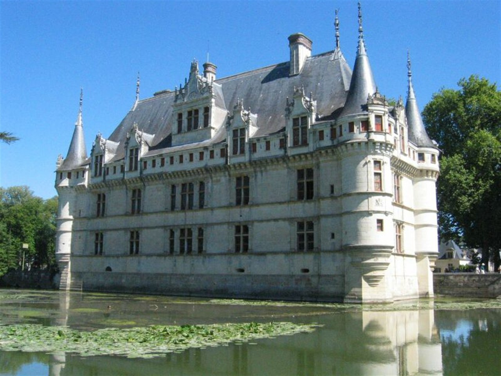

# Loire Chenin trail: Vouvray and Savennières

Chenin Blanc in the middle Loire has two very different personalities: Vouvray turns it into a full set from dry to botrytised, from still to sparkling, while Savennières narrows it into a drier, more patient frame. This two-stop route starts at Domaine Huet in Vouvray and follows the river south to La Coulée de Serrant in Savennières, using two extremes of one variety to explain why [Chenin](ref:chenin) is hard to pin down and worth a dedicated drive.

Figure: "Loire Chenin trail: Vouvray and Savennières". Photograph: File:Azay le rideau.jpg. Credit: Wikimedia Commons contributor, CC BY-SA 3.0 ([source page](https://commons.wikimedia.org/wiki/File:Azay_le_rideau.jpg)). Category image; not a claim that it shows the exact product, site or event.

## Chenin's many faces: dry, off-dry, botrytis and sparkling

Chenin's high acidity is both its foundation and the source of its range. One parcel can make a dry, sharp still wine from an early pick, or wait for botrytis in autumn and make a honeyed, apricot-scented sweet wine; picked early with acidity retained, it can also become a traditional-method [sparkling wine](ref:sparkling). In Vouvray these are not separate product lines but the natural result of variety, vintage, parcel and picking date.

The range also makes labels difficult. Vouvray's sec, demi-sec, moelleux, liquoreux and pétillant each imply different sugar and technique, and the front label may not say everything; the same estate's "Vouvray" can be dry or off-dry. The safe approach is to read the back label or ask the estate, not to infer from the name. Chenin's acidity pushes sweetness down, so the wine often tastes drier than the sugar number suggests.

## Stop one: Huet and the three parcels in Vouvray

The first stop is [Domaine Huet](ref:huet) in Vouvray. Victor Huet and his son Gaston founded it in 1928, and today it farms about 30 hectares of Chenin in three core parcels: Haut-Lieu, Le Mont and Clos du Bourg. Haut-Lieu is the historic holding, with deep brown clay and a fruitier, fresher profile; Le Mont joined in 1957, its flint and green clay giving a sharper mineral edge; Clos du Bourg, bought in 1953, has thin clay over limestone and tuffeau and gives density and ageing capacity.

The three parcels are the key to Huet: one variety, one village, different soils, clearly different wines. The estate moved to biodynamics in 1988 and its official account stresses letting the vines find balance in their environment. The range covers dry, off-dry, sweet and sparkling, and vintages vary widely; do not order a single wine, but line up the three dry wines side by side.

## Stop two: La Coulée de Serrant in Savennières

The second stop is [La Coulée de Serrant](ref:coulee) in Savennières. It covers only 7 hectares yet is an AOC in its own right, a monopole of the Joly family. Cistercian monks planted the vineyard in 1130, and the vines today are mostly 35 to 80 years old; the slope looks straight down at the Loire, and its steepness means some work can only be done by hand or horse. Few sites in the Loire can stand as a separate appellation, which explains the status.

Since 1984 the whole estate has been farmed biodynamically, and Nicolas Joly became one of the best-known advocates of the movement in France. It makes three wines: Coulée de Serrant (AOC Coulée de Serrant), Clos de la Bergerie (AOC Savennières-Roche aux Moines) and Les Vieux Clos (AOC Savennières). All three come from neighbouring slopes, separated by soil and gradient; tasted together, they show how legal boundaries inside one estate shape style.

## The legal differences between Vouvray and Savennières

The two appellations share Chenin and high acidity but differ in their legal frames. Vouvray allows dry, off-dry, sweet and sparkling, and the link between sweetness and picking season is more flexible; Savennières is mainly dry, stressing honey, nuts and wet stone after ageing, with sweet wines as an exception. Savennières also has sub-zones such as Roche aux Moines, while Coulée de Serrant is a separately named AOC.

Beyond the rules there is a stylistic gap: Vouvray's clay and limestone slopes give a rounder body, suited to early drinking or medium ageing; Savennières' steeper, river-facing slopes give a tighter, saltier wine that needs time. INAO boundaries decide what a label may say; the estate decides what the wine actually becomes. Keep the two questions apart.

Note also that sweetness in Vouvray is not always on the front label: the same "Vouvray" can move from dry to off-dry with the vintage, and the estate may adjust. Read the back label or ask for residual sugar in grams, rather than trusting a remembered wine name. Savennières is the reverse: dry is the default, and a sweet version should be confirmed, because it is usually a vintage or parcel exception.

## Biodynamics on two estates

Both estates put biodynamics at the centre, but their paths differ. Huet began in 1988, stressing ecological balance and long observation in the vineyard, with management adjusted to each soil; La Coulée de Serrant began in 1984, with more emphasis on preparations, lunar rhythms and the estate as one organism, and Nicolas Joly's books and talks made it a landmark of the movement.

Biodynamics is not a guarantee of better wine; it changes how the vineyard is worked and how decisions are made: fewer chemical inputs, closer phenological observation, more hand work. Visitors need neither treat it as mysticism nor dismiss it as marketing; looking at the cover crop, the soil and the vines tells you more than a logo on the label.

## Driving along the Loire and booking

Vouvray to Savennières is about an hour on the D952 along the Loire, with Angers as a useful stop. Huet's official site is mostly about the estate and sales, so visits and tastings should be confirmed by email first; La Coulée de Serrant's official page states that tasting is open Monday to Saturday, 09:00–12:00 and 14:00–17:30, without an appointment. Hours can still change, so check the site again before leaving.

Neither estate suits a casual "drop in and look" approach: Huet receives by appointment, and although Coulée de Serrant accepts walk-in tasting, the counter may serve several groups at once. Anyone driving should spit, and the country roads on both banks have poor visibility at dusk. With one day, take Huet in the morning and Coulée de Serrant in the afternoon, and avoid the evening rush on the return.

## See also

- [Domaine Huet](ref:huet): founded in 1928, three parcels and biodynamics from 1988.
- [La Coulée de Serrant](ref:coulee): a 7-hectare monopole AOC, planted in 1130, biodynamic from 1984.
- For background, read the [Loire](ref:loire), [Chenin Blanc](ref:chenin) and [sparkling wine](ref:sparkling) entries.

Opening hours, bookings and transport are subject to official channels; page verified on 2026-11-09.

**Short definition:** From Domaine Huet in Vouvray to La Coulée de Serrant in Savennières, the two stops run through the middle Loire. Dry, off-dry, botrytised and sparkling Chenin, plus two biodynamic estates, connect the very different expressions of Vouvray and Savennières.
