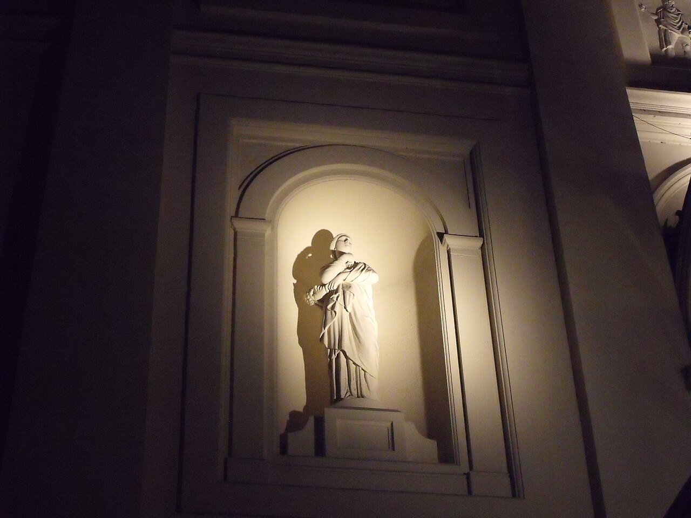

# London classic bar walk: three hotel bars and a Fleet Street pub

This route puts four London drinking places into one late-afternoon-to-night sequence: the American Bar at The Savoy first, then the Connaught Bar in Mayfair, then DUKES Bar in St James's, and finally Ye Olde Cheshire Cheese on Fleet Street. The first three are hotel bars, each representing a different style of hospitality; the last is a historic pub that still runs as a pub. The point is not to decide which drink is best but to see how London uses space, manners and menus to separate different kinds of drinking.

Figure: London classic bar walk: three hotel bars and a Fleet Street pub. Photograph: Royal Opera House - Bow Street, London - statue (6446853425). Credit: Elliott Brown from Birmingham, United Kingdom, CC BY 2.0, via Wikimedia Commons ([source](https://commons.wikimedia.org/w/index.php?curid=22459244)).

> **Quick verdict**
> **In one line:** This route helps you plan London classic bar walk: three hotel bars and a Fleet Street pub, including the order, timing and stops that matter.
>
> - **Best for:** Anyone turning London classic bar walk: three hotel bars and a Fleet Street pub into a one- or two-day route and needs the order and the stops that matter.
> - **Not for:** If you want only want one stop and do not intend to follow a route.
> - **Check first:**
>   - - Stop one: American Bar at The Savoy, The Savoy, Strand, London WC2R 0EZ, opened in 1893, in the hotel basement.
>   - The difference between the three hotel bars is not price but where each puts the ritual.

> **Topic guide: London bars and a classic cocktail**
> - [London classic bar walk](https://atlas.hejiu.org/en/routes/london-classic-bar-walk/)
> - [American Bar at the Savoy](https://atlas.hejiu.org/en/places/american-bar-savoy/)
> - [The Savoy Cocktail Book](https://culture.hejiu.org/en/books/savoy-cocktail-book/)
> - [London dry gin](https://beverages.hejiu.org/en/styles/london-dry-gin/)
> - [London gin route](https://atlas.hejiu.org/en/routes/london-gin-route/)
> - [Cocktail basics](https://hejiu.org/en/guides/cocktail-basics/)
> - [Dry Martini recipe](https://hejiu.org/en/recipes/dry-martini/)

> **Decision checklist**
> Run these three checks before you buy or go.
>
> - **Route overview:** Stop one: American Bar at The Savoy, The Savoy, Strand, London WC2R 0EZ, opened in 1893, in the hotel basement.
> - **Why these stops:** The difference between the three hotel bars is not price but where each puts the ritual.
> - **Stop one: American Bar at The Savoy:** Why go: this is the stop with the heaviest historical narrative.

> **Topic guide: London bars and a classic cocktail**
> - [London classic bar walk](https://atlas.hejiu.org/en/routes/london-classic-bar-walk/)
> - [American Bar at the Savoy](https://atlas.hejiu.org/en/places/american-bar-savoy/)
> - [The Savoy Cocktail Book](https://culture.hejiu.org/en/books/savoy-cocktail-book/)
> - [London dry gin](https://beverages.hejiu.org/en/styles/london-dry-gin/)
> - [London gin route](https://atlas.hejiu.org/en/routes/london-gin-route/)
> - [Cocktail basics](https://hejiu.org/en/guides/cocktail-basics/)
> - [Dry Martini recipe](https://hejiu.org/en/recipes/dry-martini/)

## Route overview

- Stop one: [American Bar at The Savoy](ref:american-bar), The Savoy, Strand, London WC2R 0EZ, opened in 1893, in the hotel basement.
- Stop two: [The Connaught Bar](ref:connaught), The Connaught, Carlos Place, London W1K 2AL, opened in 2008, in Mayfair.
- Stop three: [DUKES Bar](ref:dukes), 35 St James's Place, London SW1A 1NY, whose official history begins in 1908.
- Stop four: [Ye Olde Cheshire Cheese](ref:cheshire), 145 Fleet St, London EC4A 2BU, rebuilt in 1667 after the Great Fire of 1666.
- Mode: walking mixed with short taxi rides. The second-to-third leg works on foot; for the first-to-second and third-to-fourth legs, walk or take a taxi depending on time and energy.
- Suggested duration: five to six hours, starting in the late afternoon and finishing at night.

## Why these stops

The difference between the three hotel bars is not price but where each puts the ritual. At the American Bar the ritual is history and recipes: it has traded since 1893, and its menu sets classic cocktails, house drinks named after hotel guests and staff, and aged spirits side by side. At the Connaught the ritual is design and service: it opened in 2008, the room was designed by David Collins Studio, and the key action is a bartender wheeling a martini trolley to the table so that the guest chooses the base and the bitters. At DUKES the ritual is compressed into one drink: a frozen glass, frozen liquor and no ice, poured in front of you.

The fourth stop breaks that hotel rhythm. Ye Olde Cheshire Cheese is not a hotel space: there is no host at the door, no table service and no composed cocktail list. You order at the bar, carry the drink back yourself and get Samuel Smith's cask ale. Set against the first three stops, it creates the contrast the route is built on: designed quiet and formality on one side, a noisy, direct, pub-run old building on the other.

The four also share a geography. The first three sit in the West End and St James's, close enough to reach on foot; the fourth moves east to Fleet Street, joining a West End evening to an old-city finish. This is not a route arranged by tube stations but one arranged by the rhythm of drinking.

## Stop one: American Bar at The Savoy

Why go: this is the stop with the heaviest historical narrative. The bar opened with The Savoy in 1893. In the early 20th century Ada Coleman was its head bartender, and the Hanky Panky survives with her recipe and her story; her successor Harry Craddock published The Savoy Cocktail Book in 1930, fixing a large body of recipes in text. Drinking here is not only drinking but taking part in a tradition that has been continuously maintained.

What to order: the safest first move is one classic plus one seasonal house drink. Start with a Hanky Panky or a White Lady to check temperature, dilution and garnish; then ask the bartender for a house creation suited to your taste. Do not order many drinks at once: the alcohol and sugar are real, and the differences only show if you slow down. A seat at the bar lets you watch the shaking and straining; choose a table if you want to talk, since bar stools are few and especially scarce after dinner.

How long: sixty to ninety minutes is enough. Time for photographs, the menu and two drinks, with a little left for the hotel lobby and the streets towards the river.

Practical note: the address is The Savoy, Strand, London WC2R 0EZ. The nearest tube stations are Charing Cross, Embankment and Temple; from Embankment, walk along the Thames to Savoy Court, a few minutes away. The official page listed hours in November 2026 as 12:00–24:00 Monday to Saturday and 12:00–22:00 on Sunday, with a minimum age of 16 and a dress code of “elegant”; sportswear and football shirts may be refused. Book through the hotel's official channels a few days ahead for popular times.

## Stop two: The Connaught Bar

Why go: it represents the newer generation of London hotel bars. The Connaught sits on Carlos Place in Mayfair, and the bar opened in 2008 as part of the hotel's renovation; David Collins Studio designed the room, officially blending 1920s British and Irish cubist art. There is no century-old narrative here: design, service and the bartender's style share one room. The 50 list placed it at number 8 in 2026, which shows it remains part of the conversation.

What to order: the core is the martini trolley. Choose gin or vodka, then pick one of several house bitters, with common directions such as bergamot and ginseng, tonka bean, lavender, coriander seed and cardamom. The bartender throws the liquid from the mixing glass into the martini glass at the table and expresses a lemon peel. For a second drink, choose something from the “Masterpieces” section or ask about the seasonal low-alcohol and long drinks. The canapés are small and suited to sharing between two.

How long: seventy-five to ninety minutes. Trolley service takes time, and neither ordering nor making is fast; if your companion does not drink spirits, shorten this stop and give the time to the next one.

Practical note: the address is The Connaught, Carlos Place, London W1K 2AL. The nearest tube stations are Bond Street and Green Park, five to eight minutes on foot. The official page listed hours as 16:00–01:00 Monday to Saturday, closed on Sunday, with no reservations and all seating on a first-come basis. Prices are at the top end of London hotel bars, and some aged cocktails carry very high figures; ask about price and size before ordering rather than assuming every drink costs the same. The official page lists no hard dress code, but smart casual to elegant is the safer reading of hotel-bar practice.

## Stop three: DUKES Bar

Why go: it has turned doing one thing well into its identity. DUKES Bar is inside DUKES hotel near St James's Place, and the official history starts “since 1908 in St James's”. The room is small, with armchairs and sofas, carpets, dark chairs and portraits on the walls, closer to a private club than a nightclub. The link between Ian Fleming and “shaken, not stirred” is a story told repeatedly by the hotel and the press, and the official wording keeps it at the level of “legend has it”; treat it as background rather than an instruction.

What to order: one DUKES Martini is enough. Choose gin or vodka, then tell the server whether you want lemon peel or an olive; if vermouth is a concern, say “very dry” or “just a rinse”. The liquor is kept in the freezer, the glass is chilled, and the drink is poured without ice or water, so there is no dilution from shaking. It is strong and tighter than a room-temperature martini; drink it slowly and do not rush a second. Two people can order one gin and one vodka version and swap a sip to compare.

How long: sixty to seventy-five minutes. This is not a place for loud groups or fast service; sitting down, drinking one glass and talking a little is the normal rhythm.

Practical note: the address is 35 St James's Place, London SW1A 1NY. The nearest tube station is Green Park, five to seven minutes on foot; from Piccadilly Circus it is about eight to ten minutes. The official page listed hours as 15:00–22:00 Monday to Saturday, with last orders at 22:00 and closing at 22:30; no Sunday hours are listed. The bar takes walk-ins only, and there may be a wait at busy times. The dress code is smart casual: sportswear, shorts and T-shirts are not allowed, with a short-sleeved collared shirt as the exception; guests must be 18 or over. As checked on 8 November 2026 the hotel is temporarily closed for the next phase of its refurbishment, while DUKES Bar continues to welcome guests from 15:00 and the Delany Drawing Room also stays open; entrances and step-free arrangements may change, so check official notices before setting out.

## Stop four: Ye Olde Cheshire Cheese

Why go: it is the only place on this route that still runs strictly as a pub. Ye Olde Cheshire Cheese stands at 145 Fleet St; the present building was rebuilt in 1667 after the Great Fire of 1666, the street front is generally dated to the late 18th century with 19th-century alterations, and it was listed Grade II in 1977. Inside, low rooms and staircases connect Snug Bar, Johnson Bar, Cheshire Bar, Cellar Bar, the Chop Room and the Williams Room. There is no museum label; the history is in the narrow passage, the steep stairs and the worn tables.

What to order: start with a Samuel Smith's Old Brewery Bitter, in a half or a pint. It is drawn from oak casks in the pub cellar, served cellar-cool, with fine carbonation and a clear line of malt and hops. For food, steak & kidney pudding says more about the “chop house” identity than fish and chips; share one between two and add a pie or salad. Wine is limited to a small house selection, and the spirits list does not chase fashion.

How long: sixty to ninety minutes, ideally with time to eat. Choosing a room matters more than choosing a drink: for old woodwork and fireplaces, go to Johnson Bar or Cheshire Bar; for quiet conversation, avoid the office peaks of 12:30–14:00 and 17:30–19:30; for the cellar atmosphere, go down to Cellar Bar.

Practical note: the address is 145 Fleet St, London EC4A 2BU; the entrance is a narrow passage on the Fleet Street side, and you can also approach from Wine Office Court. The nearest tube stations are Temple (five to eight minutes), Blackfriars and Chancery Lane. The official site listed hours in November 2026 as 12:00–23:00 Monday to Saturday and 12:00–22:30 on Sunday. Ordering happens at the bar and there is no table service; the bar area is usually walk-in, while the Chop Room and group rooms can be discussed through official channels. The official site states plainly that the building is “completely inaccessible” to wheelchairs, and the steep stairs, low doorways and narrow passages are also difficult for guests with limited mobility.

## Order and transport

Follow the order “American Bar → Connaught → DUKES → Cheshire Cheese”, because it matches the hours and the rhythm: the American Bar opens at midday, the Connaught only at 16:00, DUKES at 15:00 with last orders at 22:00, and the pub until 23:00. Settle into the first stop in the afternoon, move west to Mayfair just as the Connaught opens, walk to St James's, and then take a taxi or walk east to Fleet Street.

The legs:

- Stop one to stop two: from Savoy Court, walk through Strand, Covent Garden and Mayfair in about twenty-five minutes, or take a short taxi. By tube, Charing Cross or Embankment to Green Park, then walk to Carlos Place.
- Stop two to stop three: from Carlos Place through Mount Street and Berkeley Square to St James's Place, about ten minutes on foot. This is a good walking leg: the streets are quiet and the difference between Mayfair and St James's is visible in the buildings.
- Stop three to stop four: from St James's Place through Piccadilly and Strand to Fleet Street, about thirty minutes on foot, or a short taxi. The evening walk passes the theatre district, which is crowded and full of junctions; take a taxi if time is short.

The tube solves arrival, not the hops between stops: there is no single best line linking these four, and forcing the tube adds stairs and changes. Walking plus short taxi rides matches the actual distances. For specific entrances, step-free routes and live conditions, use Transport for London's official journey planner and on-site signage.

## Duration and budget

Five to six hours is a reasonable range. Sixty to ninety minutes at the first stop, a walk or taxi to the second, seventy-five to ninety minutes there, ten minutes on foot to the third, sixty to seventy-five minutes there, then a taxi or walk to the fourth with sixty to ninety minutes for food and ale. If you have one drink at each stop and skip dinner, the route can compress to about four hours; a full meal at Cheshire Cheese stretches it naturally.

The budget weight sits in the first three stops. A single drink at each hotel bar is in London's top price band, with service charge on top; the fourth stop is mid-priced, and cask ale and pudding cost clearly less than a comparable historic pub in the West End. The way to control the bill is not to skip a stop but to have one drink at each and put the meal at the end, so the comparison is complete without stacking three expensive cocktails.

Sunday is not the day for this route: the Connaught is closed, the American Bar closes at 22:00 and DUKES lists no Sunday hours. A Monday-to-Saturday evening is the safest arrangement.

## Who it suits and who it does not

It suits travellers who want to compare hotel bars and a historic pub in one evening; small groups of two to four; people willing to pay for seating, service and space and to accept a dress code; and anyone interested in London cocktail history, hotel hospitality and pub culture together.

It does not suit people trying to drink as much as possible on a small budget; groups of a dozen (the DUKES room is small, the Connaught takes no bookings and the pub passages are narrow); guests who want to stand rather than sit; people opposed to jackets, collars and quiet rooms; guests with limited mobility (Cheshire Cheese is explicitly unsuitable for wheelchairs, and the other rooms are not spacious); or anyone treating the route as a photo checklist.

Families should note the age rules: the American Bar admits guests aged 16 and over, DUKES requires 18 and over, and the Connaught admits children with an adult but has no space for prams. None of the four is a good place to keep a pushchair for long.

## Practical tips and verification notes

First, check the days. The Connaught is closed on Sunday, DUKES lists no Sunday hours and the American Bar closes earlier on Sunday; a Monday-to-Saturday plan avoids finding a locked door.

Second, separate “bookable” from “walk-in”. Book the American Bar through the hotel's official channels; the Connaught and DUKES take no reservations and seat guests as they arrive. The calmest times are usually just after opening or late in the evening, and Friday or Saturday nights require patience.

Third, dress to the higher standard. The American Bar asks for “elegant”, DUKES asks for smart casual and refuses sportswear, shorts and T-shirts; the Connaught has no hard rule, but hotel-bar convention still means tidy and understated. Dressing a little more formally than for a daytime walk reduces friction at the door.

Fourth, check the service charge. London hotel bars often add service to the bill, and an extra tip is not required; the pub's rules are different, so follow the menu and the bill in front of you.

Fifth, treat the famous names as background, not a promise. The literary and cocktail history at the American Bar, the Bond legend at DUKES and the writers' list at Cheshire Cheese explain why these places are known; they say nothing about today's service and do not guarantee “the seat where so-and-so sat”.

Sixth, this route describes the structure of the route and verifiable facts only. It does not provide live opening status, a map or coordinates: the four venues' latitude and longitude are left empty in the content repository, and with no verifiable coordinate source the project rule is not to draw a schematic map. For precise navigation, use a live map service and follow on-site signage.

Further reading: [Alsace Grand Cru trail: Kaysersberg and Riquewihr](ref:c-extra-1).
