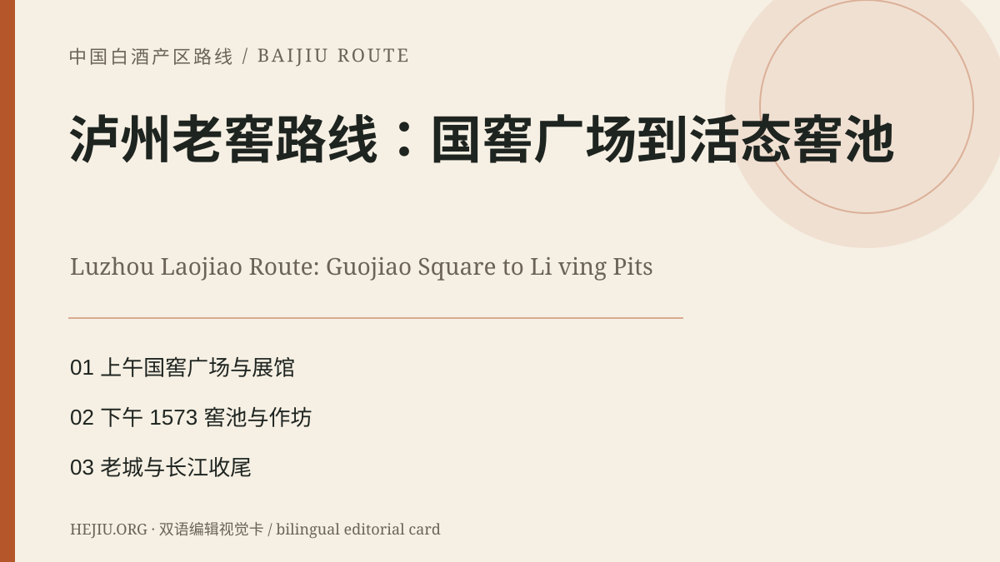

# Luzhou Laojiao Route: Guojiao Square to Living Pits

Luzhou liquor travel has two common mistakes: seeing only the Guojiao Square façade, or treating “1573” as a well you can wander into. This route splits the day into “museum framework” and “living heritage on site”: use the morning to understand pits, mud, grain and distillation, visit the national treasure pits and Ming–Qing workshops in the afternoon, then return the liquor city to the city through the old town and Yangtze.

图：Luzhou Laojiao route bilingual editorial card。Project-created bilingual editorial card for topic identification, not a documentary photograph.

> **Quick verdict**
> **Best for:** travellers who want strong-aroma pit heritage and its relation to Luzhou; works by car, taxi or bus plus walking.
> **Not for:** shopping-only visitors or those unwilling to book and walk; museum, pits and workshops have separate entrances.
> **One line:** museum and square in the morning, pits and workshops in the afternoon, and no driving after tasting.

## Why museum before pits

Luzhou Laojiao’s heritage is not an isolated “old pit” but a system of pits, workshops, city and industry. The museum builds the questions: why strong-aroma uses mud pits, why pit mud matters, how grain enters a pit and is distilled. On site, you then see how a pit is used, maintained and recorded in a workshop. Reverse the order and you see rows of pits without criteria. The morning museum is not optional; it is the manual for the afternoon.

## Morning: Guojiao Square and museum

Guojiao Square sits near Sanxing Street in Jiangyang District, and the museum and square together explain Luzhou Laojiao’s history, craft and city memory. Follow four lines: why Luzhou became a strong-aroma origin, how mud pits and pit mud work, how Ming–Qing workshops organised production and transport, and how a local distillery became today’s brand. Do not only photograph “1573”; photograph process cutaways and workshop plans for afternoon comparison. If a guide is available, take craft first and brand second; mixing them turns advertising into process fact.

## Afternoon: 1573 pits and Ming–Qing workshops

The 1573 national treasure pits and Ming–Qing workshops are living heritage; the point is not “age” but continuous use and daily maintenance. Look at three things: pit shape and layout, mud colour, thickness and care, and the rhythm of grain entering, leaving and distilling. Do not touch the mud or throw anything into a pit; follow photo signs and do not put a camera into a pit opening. In the workshops, note shopfront-and-workshop production, river transport and old-town lanes; understanding the logistics line is more useful than memorising dates.

## Transport, booking and time

Guojiao Square is in Jiangyang District; allow time from Luzhou station or Yunlong Airport, and use a live map because buses change. Museum and square take about two hours; pits, workshops and tasting make half or a full day. Museum, pits and workshops use different booking entries, and opening, tickets and photo rules change, so check official channels the day before. The pit area smells strong and can be slippery in summer; wear non-slip shoes. Do not drive after tasting; taxis are easy but slower at peak.

## Tasting, buying and the old town

Ask about strength, volume and charge before tasting; sip slowly, not on an empty stomach. The driver abstains. Buy from official or authorised shops and keep receipts; do not treat “internal” or “special supply” liquor as a bargain. After the visit, walk Guojiao Square, the old town and the Yangtze waterfront, finishing with river views at dusk. With another day, add Zhangba longan forest, Yaoba old town or Huangjing forest. For food, try Luzhou white cake, Hejiang grilled fish, pig-ear ba and river fish, keeping strong-aroma liquor modest. With older relatives, ask about rest points and avoid backtracking.

## Put the liquor city back into the city

With half a day, run museum, Guojiao Square and one stretch of old town, and do not force in pits and workshops. With a full day, museum in the morning, pits and workshops in the afternoon, Yangtze waterfront at dusk; do not reverse the order. With older relatives, reduce walking, understand the museum cutaways first, then compare on site. With children, explain pit mud as a home for microbes, which works better than dates. In every version, separate tasting from buying, keep the driver out of tasting, and buy liquor before departure. With half a day, take the museum and Guojiao Square and do not force in the pits; with older relatives, drive to the square and walk only in the museum and one stretch of old town. Follow the booked route through pits and workshops without leaving the group; finish by the Yangtze at dusk rather than staying in the pit area until closing. With another day, add Zhangba or Yaoba, each half or full. Luzhou’s liquor memory also lives in wharves, lanes and restaurants, so do not spend all the time inside the plant; buy before departure and ignore “internal channel” offers at the gate. Carry water and a hat, note the parking spot, and take a taxi back after an old-town dinner rather than walking after drinking. Arrive ten minutes before a museum talk and keep the ticket. Zhangba and Yaoba each need half a day, and Huangjing forest is farther, so plan it separately. Check batch codes when buying and allow extra time.

## Check before you go

- Confirm museum, pit and workshop bookings
- Museum in the morning, sites in the afternoon
- Do not touch pit mud or openings
- Do not drive after tasting
- Buy only from official or authorised shops
- Wear non-slip shoes in summer
- Allow walking time for old town and river
- Ask about rest points for older relatives

## Who this route is not for

This route centres on Guojiao Square and the old town, doable on foot and by short taxi rides in half a day to a day. It does not cover modern bottling lines or multiple distilleries; if you have limited mobility, ask about access and steps around the pit area in advance.

Luzhou is hot and humid in summer and the smell near the pits is strong, which some visitors find uncomfortable; walking between the museum and the old town takes energy. Guided slots and tasting seats need booking on holidays, and queuing may not get you in.

Alternative: see only the museum and the riverfront old town, and book a separate distillery visit; to compare strong and sauce aroma, split Luzhou and Yibin into two days. Compare the museum shop with city channels when buying, and do not treat the ticket as a discount coupon.

## References

- Guojiao journey — Luzhou Laojiao — https://www.lzlj.com/travel/ (Luzhou Laojiao, checked 2026-11-25)
- Luzhou Laojiao — Pit group and brewing heritage — https://www.lzlj.com/news/enterprise/13004.html (Luzhou Laojiao, checked 2026-11-25)
- Luzhou Laojiao pit group and brewing workshops — Luzhou Municipal People’s Government — https://www.luzhou.gov.cn/sq/lylz/wlmk/lswhpp/gjjwwbhdw/content_986905 (Luzhou Municipal People’s Government, checked 2026-11-25)
- Luzhou Laojiao scenic area guide — Luzhou Bendibao — http://m.luzhou.bendibao.com/tour/5894.shtm (Luzhou Bendibao, checked 2026-11-25)

Related entries: [Luzhou Laojiao Museum (Guojiao Square)](ref:museum), [Luzhou Laojiao cellars](ref:cellars), [Luzhou Laojiao](ref:brand), [strong-aroma baijiu](ref:style), [Sichuan](ref:region), [First baijiu guide](ref:guide), [History of Chinese wine](ref:history).

## Related images

Image: Luzhou Laojiao. Credit: Xiaomage de, CC BY-SA 4.0, via Wikimedia Commons ([source page](https://commons.wikimedia.org/wiki/File:Traditioneller_chinesischer_Destillationsapparat_in_der_Brennerei_Luzhou_Laojiao.jpg)). Related image for Luzhou Laojiao Route: Guojiao Square to Living Pits.

Image: Strong-aroma baijiu. Credit: Xiaomage de, CC BY-SA 4.0, via Wikimedia Commons ([source page](https://commons.wikimedia.org/wiki/File:Vertreter_der_vier_Baijiu_Kategorien.jpg)). Related image for Luzhou Laojiao Route: Guojiao Square to Living Pits.
