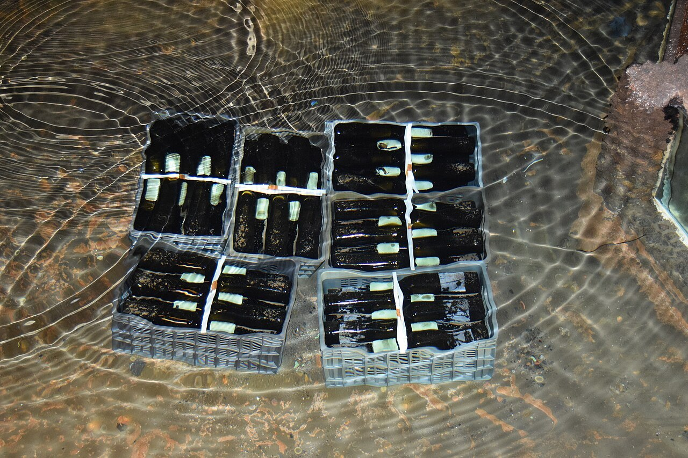
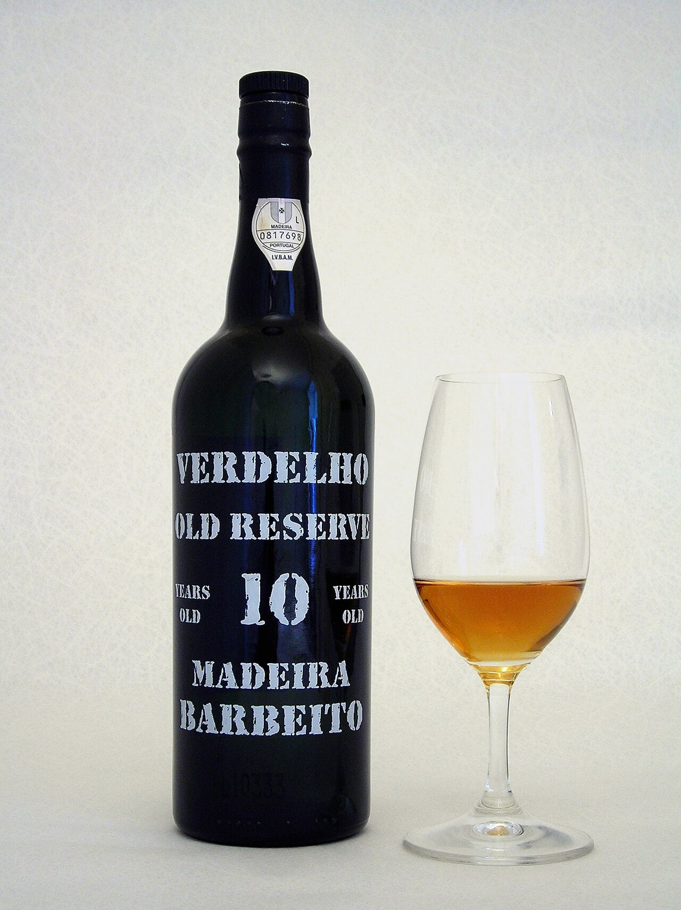

# Madeira wine route: two faces of the wine trade in central Funchal

Both stops sit in central Funchal, ten minutes apart on foot: Blandy's Wine Lodge at Avenida Arriaga 28 and Henriques & Henriques at Rua de Ferraz 28. One turned a 17th-century convent into a visitor cellar, using tours to tell a family story from 1811 and the canteiro lofts; the other, founded in 1850, still owns the Quinta Grande vineyard and speaks about control of fruit and ageing. Together they make "why does Madeira last?" a question about process, not an impression of sweet wine.

Figure: Madeira wine route: two faces of the wine trade in central Funchal. Photograph: File:Madeira 2018. The São Vicente Caves Tour. Some wines have been stored in water since 2016 the temperature is 14 C. They are experimenting to find out if it improves the wine. (30527422747).jpg. Credit: Anne and David from Kent, England UK, Public domain, via Wikimedia Commons ([source](https://commons.wikimedia.org/w/index.php?curid=93605633)).

## A walk through central Funchal

- Stop one: [Blandy's Wine Lodge](ref:blandys), Avenida Arriaga 28, 9000-064 Funchal, Madeira, Portugal.
- Stop two: [Henriques & Henriques](ref:henriques), Rua de Ferraz 28, 9050-032 Funchal, Madeira, Portugal.
- Order: from the seafront at Avenida Arriaga, then north into Rua de Ferraz — the visitor narrative first, then the shipper and its vineyard. The reverse works, though the variety and age frame helps first.
- Walking: 10–15 minutes between stops; pavements are narrow and some surfaces are stone, slippery in rain.
- Time: half a day, allowing 1–1.5 hours per stop with lunch or coffee between.

## Stop one: Blandy's in the convent

The Blandy family's Madeira trade goes back to John Blandy's arrival in 1807; the firm is usually dated from 1811, and the lodge occupies part of a 17th-century Franciscan convent near the seafront.

What to see: the canteiro lofts. Casks rest in layers under a warm roof, some racks four levels high, and the air smells of evaporated wine. The tour passes the pressing area, the ageing rooms and the tasting room, explaining fortification, heating and oxidation; canteiro and estufagem are two routes, slow and fast.

What to taste: the noble varieties from Sercial to Malvasia, plus the 3, 5, 10, 15 and 20 year labels. Sercial is dry and acidic; Verdelho off-dry with honey; Bual medium sweet with caramel and dried fruit; Malvasia sweetest. Compare Verdelho with Bual; it teaches acidity faster than starting sweet.

Note: the convent is only a container; flavour comes from fortification, heating and oxidation, not the building's age. Tours are tiered and booked by slot.

## Stop two: Henriques & Henriques on Rua de Ferraz

João Gonçalves Henriques founded the firm in 1850; after his death his sons formed a partnership in 1912, producing the name Henriques & Henriques. Unlike merchants that only blend and bottle, the house owns vineyards, and its Quinta Grande plot is one of the island's largest single vineyards, about ten hectares. From 1925 it bottled and exported its own wines.

What to see: smaller than Blandy's, and the point is the chain from fruit to bottling. The tasting room avoids stage sets; staff explain which wines came from the estate and how canteiro differs from estufagem.

What to taste: the 10, 15 and 20 year labels are the main line; single-harvest wines (Colheita or Frasqueira) are the second. Old Madeira keeps its acidity and holds long after opening.

Note: 1850 is the year the firm was founded, not the start of viticulture on the island. Planting goes back to the 15th century, and the family roots lie around Câmara de Lobos.

## Walking effort, slopes and island transport

Both stops sit at the edge of the old centre, so walking is sensible. Avenida Arriaga to Rua de Ferraz takes 10–15 minutes over stone paving and slopes, so wear shoes with grip; the midday sun is strong, and rain makes the stone slippery.

Reaching Quinta Grande needs a car, bus or taxi, and timetables change, so check locally. The cable car and hillside sights are another line; do not put a lodge and a cable car in one hour.

Suggested rhythm: Blandy's in the morning, lunch in the centre, Henriques & Henriques in the afternoon. If a cruise ship is in port, reverse the order and start on quieter Rua de Ferraz.

## Booking, cruise crowds and seasons

Both houses receive visitors by booking or time slot. Blandy's runs Lodge, Premium and Vintage tours with tastings; Premium and Vintage do not repeat each other and are usually taken in order. Henriques & Henriques is small, so book early in high season and flag groups. Confirm language, size, tasting and duration.

Cruise traffic is the main variable: from late morning to early afternoon on a call day, the centre and lodges are busy; for a quiet cellar, avoid those hours or come in the evening. Around New Year fireworks and carnival, rooms and transport are tight.

Spring and autumn are most comfortable; summer is hot; winter is wet but mild, and indoor tastings are unaffected.

## From dry to sweet: a tasting order to practise

Practise across both stops, from dry to sweet: Sercial, Verdelho, Bual, Malvasia. Let temperature follow: Sercial and Verdelho around 10–12 °C, Bual and Malvasia around 14–16 °C. Acidity is Madeira's skeleton and sweetness only its coat; too cold hides the acidity, too warm pushes the alcohol forward.

At the table, Sercial suits clear soup, seafood and olives; Verdelho grilled fish, ham and mushrooms; Bual nuts, dried fruit and medium cheeses; Malvasia chocolate and blue cheese. Madeira holds after opening, but still store it away from light, ideally around 12–15 °C.

## How this route connects to the region and style pages

The Madeira region page covers varieties, ageing routes and the 3, 5, 10, 15 and 20 year tiers; the Madeira style page explains estufagem against canteiro; the fortified-wine page explains how fortification keeps residual sugar; the oxidation and residual-sugar entries explain why Madeira can be sweet and still sharp.

The route compares two faces of the same island trade: one turns history into a public narrative, the other keeps it in the vineyard and the casks.

Further reading: [Madeira](ref:c-extra-1), [Portugal](ref:c-extra-2), [Madeira](ref:c-extra-3).

**Short definition:** A walk through central Funchal linking Blandy's Wine Lodge with Henriques & Henriques — a convent turned visitor cellar and a house founded in 1850 that still farms Quinta Grande; together they turn the question of why Madeira keeps into one about process, with booking, cruise traffic and pairing notes.

Madeira wine route is best read by starting with the order of stops, moving to the distance and opening hours, and ending with whether it works as a fixed itinerary.

**Key facts.**

| Item | Detail |
| --- | --- |
| In one line | A walk through central Funchal linking Blandy's Wine Lodge with Henriques & Henriques — a convent turned visitor cellar and a house founded in 1850 that still farms Quinta Grande; together they turn the question of why M… |
| Stops | 2 |
| Transport | walk |
| Stop order | Blandy's Wine Lodge、Henriques & Henriques |

## Related images

Image: Category image for Portugal. Credit: John Hayes from San Antonio, Texas, USA, CC BY-SA 2.0, via Wikimedia Commons ([source page](https://commons.wikimedia.org/w/index.php?curid=151531010)). Related image for Madeira wine route: two faces of the wine trade in central Funchal.

Image: A bottle of Barbeito Verdelho 10-year-old Madeira and a glass of amber wine.. Credit: Origenes.Adamantius, CC BY-SA 4.0, via Wikimedia Commons ([source page](https://commons.wikimedia.org/wiki/File:Madeira_Barbeito_Verdelho_Old_Reserva_-_Bottle_Glass.jpg)). Related image for Madeira wine route: two faces of the wine trade in central Funchal.
