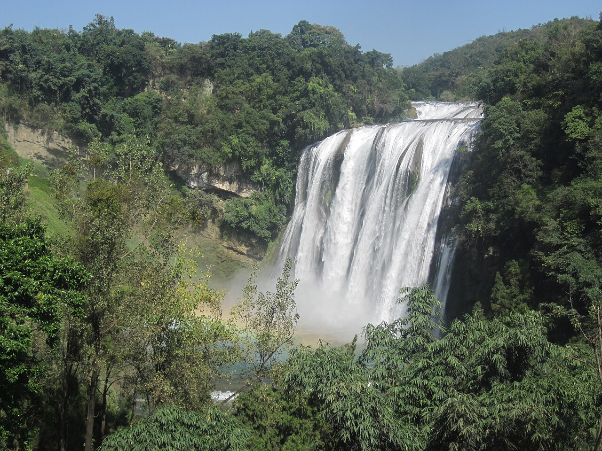

# Maotai Town baijiu route: from the Culture City to the distillery

Maotai Town is small, but visitors often stop at two extremes: the China Liquor Culture City's exhibition halls, or a photograph at the plant gate followed by offers of "internal" bottles. The more rewarding day begins by learning why sauce-aroma baijiu is made as it is, then moves to the Chishui River to see the production area and its annual rhythm, and finally separates tasting from buying. Preparation matters: bookings, transport, tasting and buying boundaries can distort the day.

Figure: "Maotai Town baijiu route: from the Culture City to the distillery". Photograph: File:Huangguoshu Waterfall in October 2020, Picture12.jpg. Credit: Huangdan2060, CC BY 3.0 ([source page](https://commons.wikimedia.org/wiki/File:Huangguoshu_Waterfall_in_October_2020,_Picture12.jpg)). Category image; not a claim that it shows the exact product, site or event.

## Route overview

- Stop one: [China Liquor Culture City](ref:culture-city), Maotai Town, Renhuai, Zunyi, Guizhou, inside the Maotai distillery compound; built by Moutai Group between 1993 and 1997 and rated a national 4A scenic site.
- Stop two: [Maotai Distillery (Kweichow Moutai)](ref:maotai), Maotai Town, Renhuai, Zunyi, Guizhou, on the Chishui River; the core production area covers 15.03 square kilometres.
- Mode: walking, taxi or car; a tourist shuttle links the airport and the town.
- Duration: a full day — two to two and a half hours at the Culture City, lunch in town, one and a half to two hours at the plant or a designated visiting point.
- Key warning: the production area cannot be entered independently; do not drive after tasting, and use a taxi or designated driver on the mountain roads.

## Why this route in Maotai Town

Maotai Town sits in the Chishui River valley, with an average elevation given by the official profile as 423 metres. The Chishui is a first-order right-bank tributary of the upper Yangtze; a Guizhou Provincial Development and Reform Commission planning document states that its main stream is 436.5 kilometres long, its basin covers 20,440 square kilometres and the Guizhou section is 299 kilometres. The valley is enclosed and humid, and the water filters through purple sandy shale. These conditions are bound to local raw materials, qu-making, fermentation, distillation and storage, forming the base of sauce-aroma baijiu.

"Sauce aroma" is not a single smell but a composite: sauce, caramel, toasted grain, flowers and fruit, qu and ageing. The Culture City's galleries separate origins, technique, customs, vessels and Moutai, letting you build the chain from raw material to qu, fermentation, distillation, storage and blending; the plant then puts that chain back into the valley's terrain and climate.

## Stop one: China Liquor Culture City

The China Liquor Culture City is inside the Maotai distillery compound, not a separate museum outside town. Moutai Group built it between 1993 and 1997; the official description calls it the largest liquor-culture museum in the world. It covers about 30,000 square metres and seven galleries: origins, technique, culture, drinking customs, drinking vessels, the Moutai gallery and the Moutai·Famous Liquor World gallery. The collection runs to 5,000 items or sets, including 15 cultural relics. It was rated a national 4A scenic site in 2014 and approved as the Guizhou Moutai Liquor Museum in 2017.

Suggested order: origins, technique, customs, then Moutai. The origins gallery puts grain fermentation, ritual and early vessels together. The technique gallery covers qu-making, fermentation, distillation and storage and is the core for understanding sauce aroma. The customs gallery covers festivals, banquets and drinking etiquette, closest to daily life. The Moutai gallery concentrates the brand's history, the 1915 Panama narrative, the plant's development and the product range.

Opening hours run in two seasons: May–October 9:00–21:00, November–April 9:00–17:00. Tickets and booking methods are subject to official channels. Tastings are paid separately; Moutai Tourism has listed 53% Flying Moutai at 49 yuan per 10 ml and fifteen-year Moutai at 199 yuan per 10 ml, but prices change. A tasting is around 10 millilitres: the point is aroma and first impression, not a full glass.

## Stop two: Maotai Distillery

Walking towards the Chishui River brings you to the Maotai distillery. Moutai Group's headquarters are at Maotai Town, with more than 40,000 employees; its predecessor was the Chengyi, Ronghe and Hengxing distilleries. In the early 1950s the local government took over the three, integrating them into a state-owned distillery; Kweichow Moutai Co., Ltd. was established in 1999 and listed in 2001.

Individual tourists cannot enter the core production area on their own. The reliable visit is the Culture City and a few designated stops inside the compound. To enter a distillation or packaging workshop, you normally join a consumer experience, industrial-tourism programme or media activity organised by Moutai or an authorised channel. Moutai's official site has reported a "beautiful Moutai" itinerary covering the Culture City, the workshops, the Source of Moutai and the Tianniang Theatre, a four-day trip that moves consumers from looking to taking part. Opening dates and quotas change, so check official notices.

From outside you can see workshops, warehouses and security gates along the river, but not the full process. Qu-making, fermentation, distillation and storage have strict requirements for temperature, humidity, hygiene and fire safety, and casual visitors would interfere. Treat "you cannot enter the workshop" as a normal industrial boundary, not a missing contact.

## Sauce-aroma craft: one year, one cycle

Moutai's process is often summarised as "12987": one production cycle a year, two rounds of grain feeding, nine steamings, eight fermentations and seven rounds of distillation. The mnemonic is easy to remember, but it is a summary, not the complete specification. The official formulation more often runs: qu-making at the Dragon Boat Festival, grain feeding at the Double Ninth, nine steamings, eight fermentations and seven rounds of distillation; the cycle lasts a year, followed by more than three years of storage and careful blending before release.

The official company profile gives more concrete figures: a bottle takes about five years from raw material to dispatch, passing through five major processes — qu-making, distillation, storage, blending and packaging — with 30 operations and 165 process steps. Production insists on high-temperature qu-making, stacking and distillation, one cycle a year, long-term storage in clay jars and blending wine with wine. Beside these figures, "12987" is an entrance: flavour is shaped by qu temperature, stacked fermentation, distillation cuts, clay-jar storage and blending.

Dragon Boat qu and Double Ninth grain are tied to climate and farming: around the festival temperatures rise and suit qu-making; around the Double Ninth the sorghum ripens and temperatures cool, suiting the first feeding. The sorghum is local red-bristle glutinous sorghum, small-grained, thick-skinned and tolerant of repeated steaming and fermentation. "Xia sha" does not mean sand: it refers to feeding grain, with "sha" the local word for sorghum.

## Getting to Maotai Town

By air, Zunyi Maotai Airport has routes to about thirty cities, including Beijing, Shanghai, Guangzhou, Shenzhen, Chengdu and Guiyang. According to the Guizhou Provincial Department of Transport, a tourist shuttle between the airport and Maotai Town began trial operation on 7 November 2025, with a flat fare of 5 yuan per person and stops including 1915 Square, the China Liquor Culture City and the Moutai Group. Schedules and fares change; check a real-time tool.

By rail, reach Zunyi or Zunyi high-speed railway station and transfer by bus, taxi or tourist coach. From Renhuai city to Maotai Town is about a dozen kilometres, half an hour by taxi or car; from Zunyi about 1.5 hours, and from Guiyang about 3 hours.

## Booking, tasting and the limits of buying

Bookings fall into three categories: the Culture City ticket, bought through official channels or on site; a plant visit, which individual tourists cannot make independently and which runs through Moutai or authorised activities with quotas set by the current notice; and tasting and dining, separate products that one ticket does not cover.

Control the amount you taste. Sauce-aroma baijiu is usually 53% ABV; 10 millilitres of Flying Moutai or fifteen-year Moutai is enough to read the aroma and palate. Do not pressure others to drink or compete over quantities, and spit what you do not want. Do not drive after tasting: Maotai Town's roads are steep and winding, so a taxi or designated driver is safer.

Buy through recognised channels. Moutai Group and Kweichow Moutai have repeatedly issued purchase notices telling consumers to use official channels; offline there are self-operated and specialist stores, online there are official channels. Do not buy "internal supply" or "employee wine" from people at the gate, and do not believe anyone who says they can get you into the plant. Prices vary by product, vintage and channel; this page gives no prices.

## Etiquette, seasons and safety

The plant is a production site, not a theme park. Cooperate with security and staff, do not climb fences, enter closed areas, smoke in no-smoking zones or use open flames; drones, tripods and commercial photography usually require advance permission. In the museum, do not touch exhibits, drinking vessels or jars, and check on-site rules before photographing; some galleries ban flash.

Spring and autumn are the most comfortable seasons. Summer in the valley is hot and humid, with a lot of walking, so bring water and a hat. Winter is damp and cold, and the temperature difference between cellars and exhibition halls is noticeable, so bring a light layer. Holidays and summer are busy, so book ahead; mountain roads are slippery in the rain.

This page was verified on 2026-11-08; opening hours, tickets, tastings, sales channels, transport schedules and prices are subject to official channels, and no map is provided here. Placed in the context of the [China Liquor Culture City](ref:culture-city) and the [Maotai distillery](ref:maotai), the route shows how the Chishui valley binds climate, raw materials, craft and time: understand the process chain in the museum first, then read the production area and its boundaries in the valley.

Further reading: [Guizhou](ref:c-extra-1).
