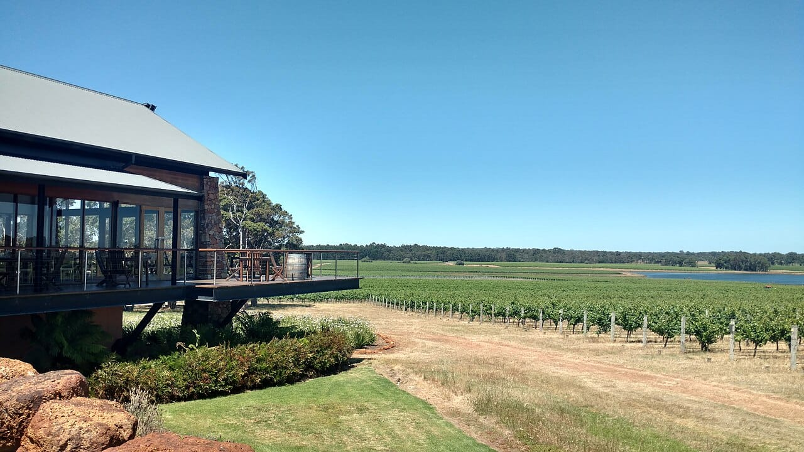

# Margaret River Wine Route

A route anchored on two 1970s pioneers, Vasse Felix and Leeuwin Estate, about three hours south of Perth, putting maritime climate, gravel soils, Art Series labels and open-air concerts into one day. The loop is roughly 80 kilometres and works best from a base in Margaret River town rather than as a Perth day trip.

Figure: Margaret River Wine Route: 2016 Margaret River Australia. Watershed vineyard (Wikimedia Commons). Image: Lasthib, CC BY-SA 4.0, via Wikimedia Commons ([source page](https://commons.wikimedia.org/wiki/File:2016_Margaret_River_Australia._Watershed_vineyard.jpg)).

## Route overview

Stay the night before in Margaret River town or Cowaramup. Leave at 9:30, drive north on Bussell Highway for about fifteen minutes to Vasse Felix, and spend the morning between cellar, art gallery and vines, focusing on Chardonnay and Cabernet; lunch at the estate or back in town at 12:00. At 14:00 head south on Bussell Highway for about twenty minutes to Leeuwin, taste Art Series and Prelude and see the gallery; after 16:00 continue to Cape Leeuwin lighthouse or Prevelly beach, and return to town by 18:00.

As a Perth day trip, six hours are spent driving and only one estate fits; this route does not recommend it. The point of Margaret River is not two cellar doors but wine in the morning, sea in the afternoon and eucalyptus light in the evening — three things that need time.

## Regional background

Margaret River sits in the southwest corner of Western Australia, sea on three sides, and is one of Australia’s most maritime regions: summers are not too hot, winters not too cold, the growing season is long and ripening slow. The region runs along the Leeuwin-Naturaliste ridge, with gravelly laterite, sand and clay soils that drain well and hold little nutrients, pushing roots deep and restraining yields.

Modern winegrowing only began in the late 1960s; in the 1970s a group of doctors, lawyers and agronomists brought Bordeaux and Burgundy varieties, and Vasse Felix and Leeuwin were among those pioneers. Today the region is known for Chardonnay, Cabernet and Shiraz, with white acidity and texture and red structure and ageing potential closer to Europe than to most of Australia.

## Stop one: Vasse Felix

Vasse Felix is at 4357 Bussell Highway, south of Cowaramup, about fifteen minutes north of Margaret River town. In 1967 Tom Cullity planted the first vines at Home, and the first vintage came in 1972; awards in 1973, 1979 and 1985 made Vasse Felix one of the first Western Australian estates noticed internationally. In 1987 the Holmes à Court family took over and later expanded Home and Adams Road into today’s estate.

The list centres on Chardonnay, Cabernet and Shiraz: Premier is the entry, Filius the middle, Héritage and TOM CULLITY the flagships. Start with Premier Chardonnay as a baseline, then Héritage Chardonnay to see oak and lees; for Cabernet, move from Filius to TOM CULLITY to feel structure, tannin and ageing potential climb.

The art gallery and restaurant deserve time: the gallery holds Australian contemporary art, the restaurant cooks with local produce and needs booking in peak season. With one experience, choose cellar tasting plus gallery; if vines interest you, ask whether an estate walk is available rather than spending everything in the shop.

## Stop two: Leeuwin Estate

Leeuwin is at 1379 Bussell Highway, about twenty minutes south of Vasse Felix. In 1969 the Horgan family bought the farm, established the estate in 1973, built a nursery in 1974 and planted vines in 1975; the first commercial vintage was 1979 and the first Art Series release 1980. Block 20, planted with the Gin Gin clone, is one of Australia’s most famous Chardonnay sites; in 1985 the London Philharmonic Orchestra played on the lawn, and the Leeuwin Concert became the estate’s second calling card.

The range has three tiers: Art Series at the top, Prelude as the readier version, Siblings as the everyday wine. Art Series Chardonnay shows lemon, white peach, hazelnut and wet stone with clear acidity and restrained oak; Art Series Cabernet is structural, with cassis, cedar and fine tannin. Start with Siblings or Prelude, then Art Series, to see concentration, texture and ageing potential rise.

The gallery and sculpture park are worth a look, and the concert stage sits on the lawn; in concert season, avoid afternoon rehearsals and traffic control. Restaurant and tasting need bookings and peak slots go early; without a concert, the lawn is a better photograph than the cellar.

## Lunch and a third stop

Lunch has three options: Vasse Felix, Leeuwin, or Margaret River town. Both estate restaurants need booking, while town has more choice and less formality; if you are driving afterwards, do not drink much. The town also has bakeries, cafés and small food shops for a quick meal.

For a third stop, choose by interest: for the sea, drive to Prevelly or Gracetown, park at the beach and walk a section of the Cape-to-Cape Track; for the lighthouse, go to Cape Leeuwin, the southwestern tip of Australia, windy but wide-open; for another estate, stay around Cowaramup or Margaret River town rather than pushing to Augusta.

With children, swap the third stop for beach or lighthouse rather than more wine; the galleries and lawns are child-friendly, but tasting rooms usually ask for quiet. Peak-season beaches are windy, so bring a jacket and sunscreen.

## Seasons and roads

Margaret River is Mediterranean maritime: warm, dry summers and wet winters; harvest usually runs from February to April. Summer afternoons bring strong sea breezes, pleasant on a lawn but fierce on a beach; winter is quieter and easier to book, but roads are wet and driving should be slower.

Allow about three hours and 280 kilometres from Perth, fifteen minutes from town to Vasse Felix, twenty minutes from Vasse Felix to Leeuwin, and forty minutes from Leeuwin to Cape Leeuwin. Bussell Highway is a two-lane road, busy at weekends and holidays, so overtake carefully; kangaroos and wildlife are on the road at night, and long night drives should be avoided.

## Booking and etiquette

Book tastings, restaurants and experiences at both estates; peak season and concert season fill a week or more ahead. Neither handles large walk-in groups well; for more than six people, email ahead. Spit into the spit bucket and keep driving tastings to one or two; do not touch art in the galleries or walk into the concert set.

This route does not draw a map or provide live prices; roads, hours and booking rules change, so check both estate websites and Margaret River Wine before leaving. If an estate closes unexpectedly, do not force it — put a town winery or the beach in the plan and the day still works.

## Further reading and see also

- Related entries: [vasse-felix](ref:vasse), [leeuwin-estate](ref:leeuwin), [margaret-river](ref:margaret), [white-wine](ref:white), [chardonnay](ref:chardonnay).
- To go deeper, compare this route with Barossa Valley: both have Shiraz, but Margaret River is cooler and more coastal, Barossa hotter and denser.
- With half a day, choose Vasse Felix plus town and skip Leeuwin; with only two hours, choose one estate rather than trying both.

[Vasse Felix](ref:vasse) and [Margaret River](ref:margaret) are the nearest useful comparisons: one clarifies stop order, the other tests transport.
