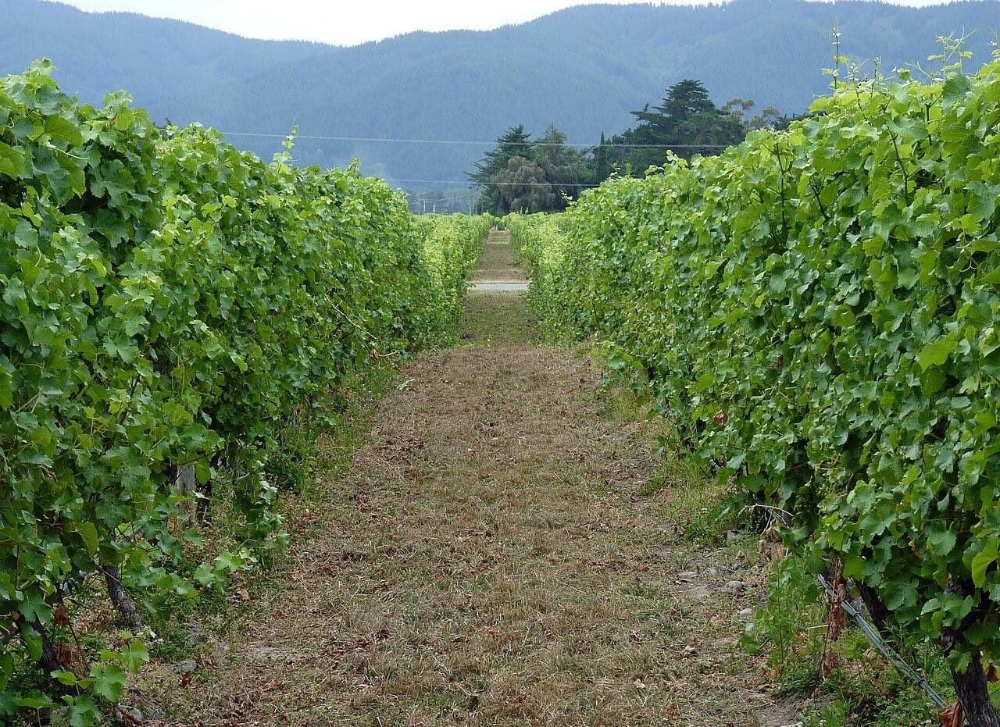

# Marlborough wine trail: Wairau gravel to Awatere sea wind

Marlborough's wine trail is not a single signposted highway. It is a way of linking wineries, river valleys and sea wind. This route takes two stops: Cloudy Bay near Blenheim and Yealands by the coast at Seddon. Both sit inside Marlborough, yet one belongs to the old riverbed gravels of the Wairau Valley and the other to the windier Awatere Valley. Driven in one day, they show that a single region does not ripen at a single speed, and that Marlborough Sauvignon Blanc cannot be reduced to one flavour.

Figure: Vineyard rows at Cloudy Bay in Blenheim, with the Wairau Valley hills beyond. Image: Matt Boulton, CC BY-SA 2.0, via [source page](https://commons.wikimedia.org/wiki/File:Cloudy_Bay_Vineyard.jpg).

## Route overview

- Stop one: [Cloudy Bay](ref:cloudy-bay), 230 Jacksons Road, Blenheim; cellar door open seven days, 10:00–17:00, with bookings recommended.
- Stop two: [Yealands](ref:yealands), 534 Seaview Road, Seddon; about 40 minutes southeast of Blenheim, with hours and booking rules to be confirmed on the official site.
- Mode: car. Public transport does not connect the two stops reliably, and ride-hailing is uncertain on the return.
- Duration: one day is possible if tastings, lunch and driving are kept separate; stay overnight if you want vineyard walks or longer experiences.
- Order: Wairau first, Awatere second. Build a reference inland in the morning, then see what coastal wind does to the wine in the afternoon.

## From Wairau gravel to Awatere sea wind

[Marlborough](ref:marlborough) is not a uniform carpet of vines. The Wairau Valley is dominated by old riverbed gravels that drain quickly and warm early, so grapes can reach ripeness while keeping clear acidity. The valley also contains different aspects and rainfall zones: coastal sites are moderated by sea breeze, inland sites are drier and earlier. The Southern Valleys wrap around the surrounding hills, with heavier soils and more clay, becoming cooler and drier further south; Pinot Noir and aromatics do particularly well there. The Awatere Valley is further south, drier, windier and often higher, with lower yields and sharper Sauvignon Blanc aromatics.

This route takes the Wairau and the Awatere and skips the Southern Valleys. That is not a judgement about clay; it is a practical contrast. One end offers gravel-driven weight and early ripening, the other wind-driven tension and lower yields. Tasting the difference is more useful than collecting adjectives from a label.

## Sauvignon Blanc's start: 1973 and 1979

Marlborough's modern wine industry began in the 1970s. In 1973 Montana Wines, later Brancott Estate, planted the first large-scale vines in the Wairau Valley. New Zealand vineyards were then concentrated in warmer Gisborne, Hawke's Bay and Auckland, and Marlborough was considered too dry and too cold. Sauvignon Blanc went into that experimental vineyard in 1975, and in 1979 the first Marlborough Sauvignon Blanc was released; its aroma and acidity made the South Island potential visible to export markets. In 1985 Cloudy Bay made its first vintage, pushing the style further into international recognition.

The point is not who planted first, but how a variety and a place were recombined. [Sauvignon Blanc](ref:sauvignon) found a meeting point between cool nights, high sunshine and free-draining soil in Marlborough; the herbaceous, lime and passionfruit notes were amplified by ripeness without losing acidity. Read the two estates with that history in mind, and "Marlborough Sauvignon Blanc" stops sounding like a single recipe.

## The 2020s production reset

The 2020s have been about adjustment rather than endless expansion. New Zealand Winegrowers' 2026 report records a 2024 harvest of 395,000 tonnes, well below the two previous years, and a 2026 harvest of approximately 440,000 tonnes, down 15% on the previous year. The report frames this as bringing production closer to current demand, not as a simple decline. At the same time Marlborough still holds 73% of the national vineyard area, so the adjustment is happening inside the largest region rather than shifting the region's rank.

For a visitor the consequences are practical: some blocks may be rested, replanted or cropped lower, and the wines released for tasting change with the vintage. Do not arrive with an old wine list; check the vintages currently offered and accept that a favourite may be missing. For the [white wine](ref:white-wine) market, the contraction also encourages estates to concentrate on fewer wines that express site differences clearly.

## Stop one: Cloudy Bay

Cloudy Bay sits on Jacksons Road in Blenheim, among Wairau Valley vines and the ridges of the Richmond Ranges. The estate made its first vintage in 1985; today its range runs from core Sauvignon Blanc, Chardonnay and Pinot Noir to Te Koko, Te Wāhi and Pelorus sparkling wine. The visit is not a full production-line tour; it is a relaxed combination of cellar door, restaurant and vineyard views.

The cellar door is open seven days, 10:00–17:00, closed on Christmas Day and Good Friday, and the official advice is to book, especially at weekends and in summer. Saku restaurant serves lunch daily from 11:00 to 15:00, with dinner on Thursday and Friday from 16:00 to 20:00. Choose a guided tasting if you want to compare, or simply book a table with a vineyard view. Check the official page for current details; coordinates should be taken from official channels.

## Stop two: Yealands

Yealands stands on Seaview Road at Seddon, where the vineyard is close enough to the coast for sea mist to reach the vines. The winery opened on 8 August 2008 and its official account describes it as the first winery in the world to be Toitū carbonzero certified from inception; measures include solar power, wind turbines, vine prunings and homemade compost. The tasting room offers local cheeses and cured meats, and a complimentary self-drive White Road tour leads through the vineyard, coast and native vegetation.

The visit feels more like a coastal farm than a city cellar: wind, bright light and grass or gravel paths make sturdy shoes and a windproof layer more useful than formal clothes. The official site may show an age gate in some regions, so opening hours and tasting formats should be confirmed on an accessible official page or by contacting the winery directly; this route does not turn an unverified timetable into fact. The address is 534 Seaview Road, Seddon, Marlborough 7285; coordinates should be taken from official channels.

## Driving, booking and tasting

Blenheim to Seddon takes about 40 minutes, and the coastal road is windy enough that cycling is not for everyone; neither stop has a rail connection. The safest arrangement is a rental car with a designated driver, or a small tour that includes transport. If you drive, spit every sample rather than relying on "just one sip".

Book the two stops separately: Cloudy Bay recommends booking its cellar door, and the restaurant runs on its own schedule; Yealands' tasting room and White Road rules should be checked on the official site or on arrival. Do not crowd the day. The drive from Wairau to Awatere plus two tastings needs at least four to five hours. High season is the southern summer, with Christmas and weekends the busiest; spring and autumn are quieter but colder, so bring a windproof jacket.

## References

This route was checked against Cloudy Bay's official visit page, New Zealand Winegrowers' Marlborough region page and 2026 release, the Yealands entry in the New Zealand Winegrowers directory, and Brancott's official brand page. Page verified 2026-11-09. Opening hours, booking rules, wines and prices change, so check each official channel.
