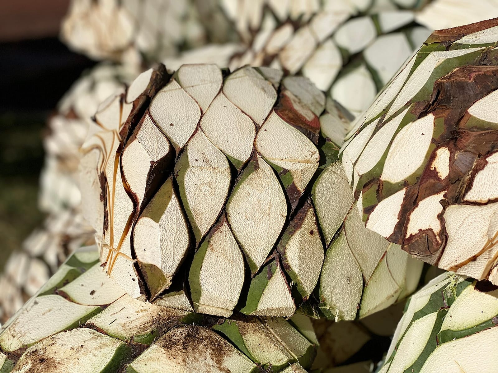
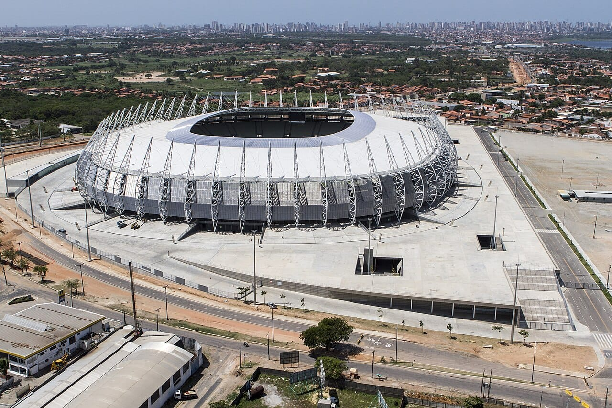

# Mexico Tequila Trail

This route has only two stops, but together they cover the central questions of tequila: [Casa Herradura](ref:herradura) at Amatitlán and [Fortaleza](ref:fortaleza) in Tequila town. Both sit close together in Jalisco's volcanic lowlands, yet pull in opposite directions: estate scale, modern milling and standardised visits on one side; a tahona, wooden vats and two old copper stills on the other. A car or hired driver is practical, with tour slots and a sober driver settled first.

Figure: Mexico Tequila Trail. Photograph: File:La base del tequila agave azul tequilana Weber.jpg. Credit: Alfonso Jiménez, CC BY-SA 4.0 ([source page](https://commons.wikimedia.org/wiki/File:La_base_del_tequila_agave_azul_tequilana_Weber.jpg)). Category image; not a claim that it shows the exact product, site or event.

## From Guadalajara to Amatitlán: the first stop on the volcanic lowlands

Amatitlán lies on the road between Guadalajara and Tequila town and is an official cradle of tequila. It is about an hour by car from Guadalajara and twenty minutes from Tequila town, with parking outside the estate; public transport is limited, so a car or a transfer tour is safer. The address is Ex-Hacienda San José del Refugio, Doña Gabriela Peña Lozada 405, 45380 Amatitlán; visitors must be at least 18 and book online.

The land is volcanic lowland. The distillery describes its [Blue Weber agave](ref:agave) as carrying clearer earthy and herbal notes; plants are harvested after six to eight years, when a jimador uses a coa to strip the leaves and leave the piña. It comes first because it walks the whole chain and sets a baseline.

## Brick ovens and wild yeast in Amatitlán

Casa Herradura dates its start to 1870 at the Hacienda San José del Refugio; in 1928 the horseshoe, herradura, became the brand name. Visitors see a working old distillery: nineteenth-century walls, then stainless-steel tanks and a bottling line.

The process never fully stopped modernising. Piñas are still layered into hand-built brick dome ovens and steamed for about 26 hours, drawing out cooked-agave caramel and nut notes; but the mill is modern, replacing the donkey-driven tahona. Fermentation is open and wild, driven by yeast from more than sixteen species of fruit trees, and takes about three days. Copper pot stills perform a double distillation.

The range spreads ageing widely: Blanco is unoaked, Silver about 45 days, Reposado 11 months, Añejo at least 25 months, Selección Suprema appeared in 1994, and Aniversario was aged 100 months to mark 150 years. In 2001 Teresa Lara López became the first woman to head production in the industry. If you taste only one, take Blanco: it shows whether the agave and the distillation are clean.

## Tequila town: from La Perseverancia to La Fortaleza

Tequila town's centre is small but hilly, so drivers should park outside and walk in. Fortaleza stands at Calle Tabasco 153 in the Centro, postcode 46400; the site is a sloping old house and workshop, with fermentation, still house and cellars following the terrain.

The family story starts with Cenobio Sauza. In 1873 he founded La Perseverancia in Tequila town. Later Francisco Javier built a distillery on the highest plot with a brick oven, a tahona pit, wooden vats and two small copper stills, naming it La Fortaleza. The equipment ran until 1968, when it was stopped as too inefficient; in 1976 the family sold the company but kept the site; in 1999 the grandson Guillermo began restoring it, and in 2005 the brand returned.

The process follows the nineteenth-century sequence: agave is cooked in a brick oven, crushed in the tahona pit, fermented in wooden vats, and given a [second distillation](ref:distillation) in the two old copper stills. The cost is low volume and high labour; the reward is thicker fibre and a clearer mineral finish.

## CRT and NOM-006: what counts as tequila

[Tequila](ref:tequila) is governed by NOM-006-SCFI-2012 and certified by the Tequila Regulatory Council (CRT). Only Blue Weber spirit made inside the protected area by the prescribed process may be called tequila; the core is Jalisco and neighbouring states.

The two most useful label facts are raw-material category and strength. A bottle marked "100% de agave" must take all its sugar from Blue Weber agave; an unmarked mixed tequila must take at least 51% from it. Bottled strength must fall between 35% and 55% alcohol by volume. Reposado ages at least two months, Añejo at least one year and Extra Añejo at least three years. Herradura ages far beyond those floors, which is a brand choice, not a legal requirement.

## How to taste the two distilleries side by side

The useful method is to set a baseline, then add one variable at a time. Start with the two Blancos: Herradura's modern mill, wild yeast and copper stills give a cleaner body; Fortaleza's tahona and wooden vats give a rougher fibre and a mineral finish. Move to Reposado and ask how much vanilla Herradura's 11 months in wood add, while Fortaleza keeps the oak in check. Then compare Añejo for toasted nut and old-wood layers.

Both distilleries require visitors to be at least 18 and may check ID; Herradura's estate experience runs about 2.5 hours, while Fortaleza's Vive Abuelo takes about 90 minutes and Vive Bisabuelo about 150 minutes.

## Driving, booking and a designated driver

Guadalajara to Amatitlán is about an hour, Amatitlán to Tequila town twenty to thirty minutes, and Tequila town back to Guadalajara a little over an hour; rural roads are unlit at night, so do not put the last tour after dark. Both stops need bookings: Herradura charges by experience, Fortaleza by route and language.

Do not drive after drinking. One drink can affect judgement, and these roads leave little margin. Use a hired car, a designated driver or a tour with transfers; if you drive, spit every sample. Drink-driving enforcement varies by state, so follow local law. Page verified on 2026-11-09.

**At a glance:** From Casa Herradura at Amatitlán to Fortaleza in Tequila town, two stops in the volcanic lowlands and their Blue Weber agave core. The first combines estate scale, brick dome ovens, wild yeast and modern milling; the second keeps a tahona, wooden vats and two old copper stills for small batches. The route also frames the CRT and NOM-006 rules.

**Key facts.**

| Item | Detail |
| --- | --- |
| In one line | From Casa Herradura at Amatitlán to Fortaleza in Tequila town, two stops in the volcanic lowlands and their Blue Weber agave core. The first combines estate scale, brick dome ovens, wild yeast and modern milling; the sec… |
| Stops | 2 |
| Transport | car |
| Stop order | Casa Herradura: The Horseshoe Hacienda of Amatitán、Fortaleza: Relighting the 1873 Workshop |

**Sources and limits.** The key claims about Mexico Tequila Trail are checked against the following sources: Consejo Regulador del Tequila, Tequila Herradura (Used to check the estate address, visit types, duration, prices, the 18-year age limit and online booking), Tequila Fortaleza. Prices, batches and status change; the body is project-written and does not reproduce source text.

## Related images

Image: Agave. Credit: Marc Ryckaert ( MJJR ), CC BY-SA 3.0, via Wikimedia Commons ([source page](https://commons.wikimedia.org/wiki/File:Agave_americana_R01.jpg)). Related image for Mexico Tequila Trail.

Image: Relighting the 1873 Workshop: Fortaleza Arena. Credit: Fábio Lima/Portal da Copa/Março de 2013, CC BY 3.0, via Wikimedia Commons.. Credit: Fábio Lima/Portal da Copa/Março de 2013, CC BY 3.0, via Wikimedia Commons ([source page](https://commons.wikimedia.org/w/index.php?curid=25894204)). Related image for Mexico Tequila Trail.
