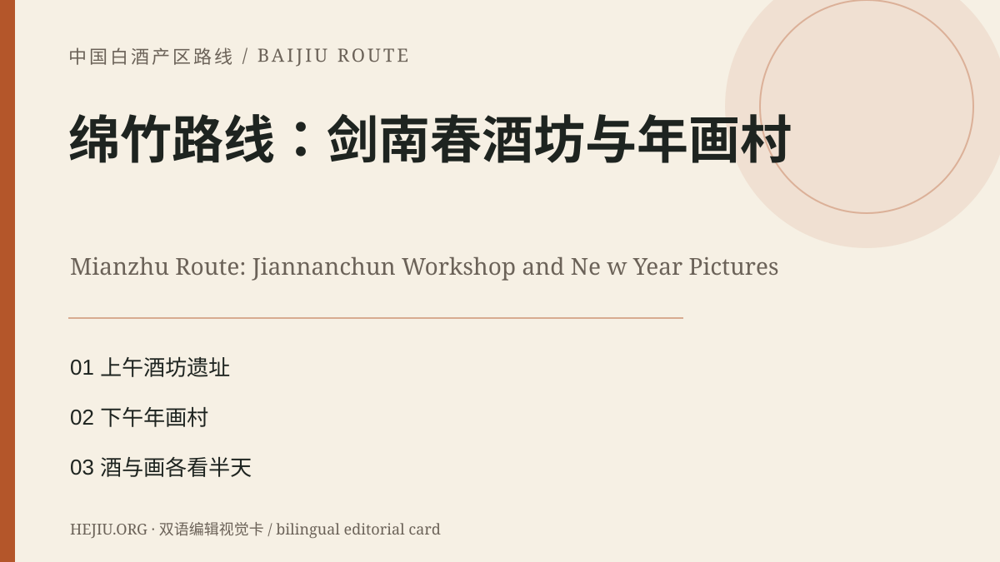
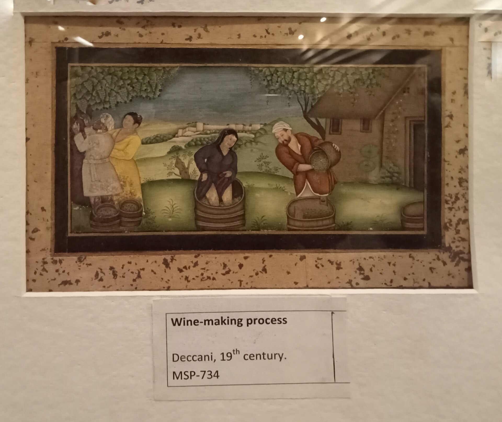

# Mianzhu Route: Jiannanchun Workshop and New Year Pictures

Mianzhu is a one-day study of two kinds of handwork: strong-aroma pits, starter culture and distillation on one side, and Mianzhu woodblock carving, printing and painting on the other. Many compress them into “distillery plus old town”, waiting at a gate in the morning and rushing the village in the afternoon. This route puts the workshop in the morning, the village in the afternoon, and lunch in the city between them, leaving time to understand both.

图：Mianzhu route bilingual editorial card。Project-created bilingual editorial card for topic identification, not a documentary photograph.

> **Quick verdict**
> **Best for:** travellers who want both strong-aroma workshops and folk prints; works from Chengdu, Deyang or central Mianzhu.
> **Not for:** visitors who want one deep stop and no transfer; the two sites need a drive.
> **One line:** workshop in the morning, prints in the afternoon, lunch in the city, and keep tasting, liquor and print purchases separate.

## Why liquor and prints each take half a day

The workshop and the village are different visits. The workshop is about production space, pits and craft: dense but not necessarily long. The village is about process, galleries and hands-on sessions, and shops can stretch the time. Put the workshop in the morning, when attention is better for markers, pits, workshops and flow; put the village in the afternoon, when experience and shopping can close the day flexibly. Eat lunch in central Mianzhu to avoid sparse restaurants around the plant and to split the two drives.

## Morning: Jiannanchun workshop site

Start with the national heritage marker and site extent, then Tianyi Laohao’s pits and workshop. Strong-aroma baijiu ferments in solid state in mud pits; longer continuous use and stable mud care produce more reliable pit aroma and ethyl caproate. Look at wall thickness and bottom mud, workshop ventilation and drainage, and the distance between stills and pits. Do not touch mud or put a camera into a pit opening; keep clear when workers are present. If the exhibition is open, see models and cutaways first, then compare on site. If restricted to the exterior, connect marker, boundary and plant view rather than chasing workshop photos.

## Afternoon: New Year Picture Village

The village is a production and display space for Mianzhu woodblock prints, not one continuous shopping street. Read the map and separate public galleries, paid experiences, workshops and shops; do not enter every open gate, as some are private workrooms or booked group areas. In the process, follow drafting, carving, colour mixing, registration printing and hand-painted faces; watch block alignment, pigment workability, paper laying and finishing rather than “bright colours”. For an experience, ask whether you print an existing block or start from carving, whether the piece goes home, and whether materials cost extra. When buying, check registration, paper and author information; if a price is implausibly low, ask whether it is machine-printed.

## Transport, booking and time

Mianzhu lies northwest of the Chengdu Plain, roughly an hour and more from Chengdu and closer to Deyang; connections via Chengdu East or Deyang stations work, but check live schedules. The workshop site and exhibition take about two hours; the village gallery and one workshop take about two hours, with an experience and lunch making half a day. The two are roughly twenty minutes apart by taxi or car; buses are sparse, so ask the last departure. Workshop and village opening, booking and charges are separate, so confirm both the day before. The workshop smells strong and the village drying yards are hot in summer; bring a mask, water, a hat and non-slip shoes.

## Tasting, prints and return

At the workshop, ask about strength, volume and charge before tasting; sip slowly, not on an empty stomach. The driver abstains and does not drive after. Buy liquor from official or authorised shops and keep receipts; do not treat “internal liquor” as an extension of the heritage site. For prints, check registration, paper and pigment stability and author or workshop information; small prints and postcards travel easily, while large originals need rolling, moisture protection and transport planning. Return to the city for dinner and try Mianzhu rice noodles, preserved duck and Sichuan home cooking. If adding Jiulong Mountain or Lutang hot springs, give it a separate half-day rather than squeezing it into the workshop morning.

## One-day and half-day versions

The one-day version runs workshop site, lunch in the city, village, dinner in the city; do not let the morning run into noon or push the afternoon experience to closing time. The half-day version chooses either the workshop or the village, not both in a rush. With older relatives, see the marker, pits and one workshop section at the site, and only a gallery plus one workshop in the village. With children, keep the morning workshop to an hour and give the afternoon to rubbing or colouring, rather than letting them lose patience outside a workshop. Buy liquor and prints separately before returning, keep the driver out of tasting, and switch the village experience to galleries in rain. On a Chengdu day trip, start at the workshop around nine, visit the village after lunch and return before the evening peak. With one stop, see the site and one workshop, or one gallery and one workshop. Pack prints, keep liquor receipts, bring water and a hat, ask the last bus and allow extra time.

## Check before you go

- Confirm workshop and village opening separately
- Workshop in the morning, village in the afternoon
- Do not touch pit mud or openings
- Ask price and materials before an experience
- Check registration and author information when buying prints
- The driver skips tasting
- Mask, water and hat in summer
- Ask about return buses in advance

## Who this route is not for

This route pairs the workshop site with the New Year picture village in one day, good for travellers interested in both craft and local art. If you only want wine, the village takes half a day; with very young children, the talk and tasting pace at the workshop may run long.

Both stops need a drive from central Mianzhu, buses are limited and taxis are more flexible; village parking is tight on holidays. The workshop site has a limited open area and protected production zones are closed.

Alternative: see only the Jiannanchun workshop site and return to Mianzhu old town in the afternoon, or see only the village and its hands-on sessions. A day trip from Chengdu works, but do not add Mianyang or another sight on top.

## References

- Mianzhu Municipal People’s Government — Beautiful Mianzhu — https://www.mz.gov.cn/meilimianzhu.htm (Mianzhu Municipal People’s Government, checked 2026-11-25)
- Jiannanchun — About Jiannanchun — https://www.jnc.cn/about (Sichuan Jiannanchun (Group) Co., Ltd., checked 2026-11-25)
- Deyang Municipal People’s Government — https://www.deyang.gov.cn/ (Deyang Municipal People’s Government, checked 2026-11-25)
- GB/T 2260-2007 Administrative division codes of the People’s Republic of China (Standardization Administration of China, checked 2026-11-25)

Related entries: [Jiannanchun workshop site](ref:cellars), [Mianzhu New Year Picture Village](ref:village), [Jiannanchun](ref:brand), [strong-aroma baijiu](ref:style), [Sichuan](ref:region), [Wine and painting](ref:art), [First baijiu guide](ref:guide), [History of Chinese wine](ref:history).

## Related images

Image: Related photograph of Wine and painting: four ways to look at a drinking scene. Credit: Natasha Khaitan, CC BY-SA 4.0, via Wikimedia Commons ([source page](https://commons.wikimedia.org/wiki/File:Wine_making_process_-_Deccan_Painting_-19th_Century.jpg)). Related image for Mianzhu Route: Jiannanchun Workshop and New Year Pictures.

Image: 剑南春酒坊遗址国保碑. Credit: Nekitarc, CC BY-SA 4.0, via Wikimedia Commons.. Credit: Nekitarc, CC BY-SA 4.0, via Wikimedia Commons ([source page](https://commons.wikimedia.org/w/index.php?curid=44292018)). Related image for Mianzhu Route: Jiannanchun Workshop and New Year Pictures.
