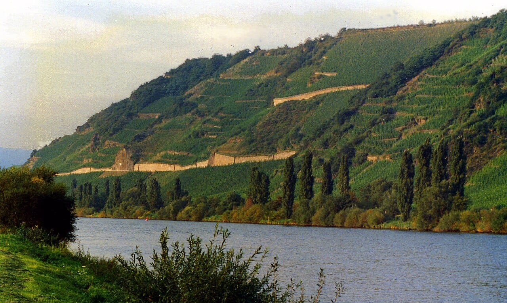
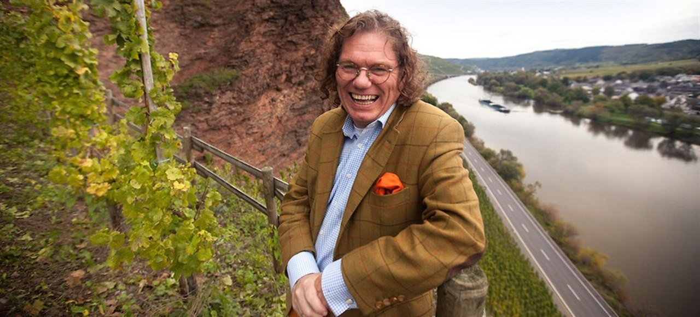
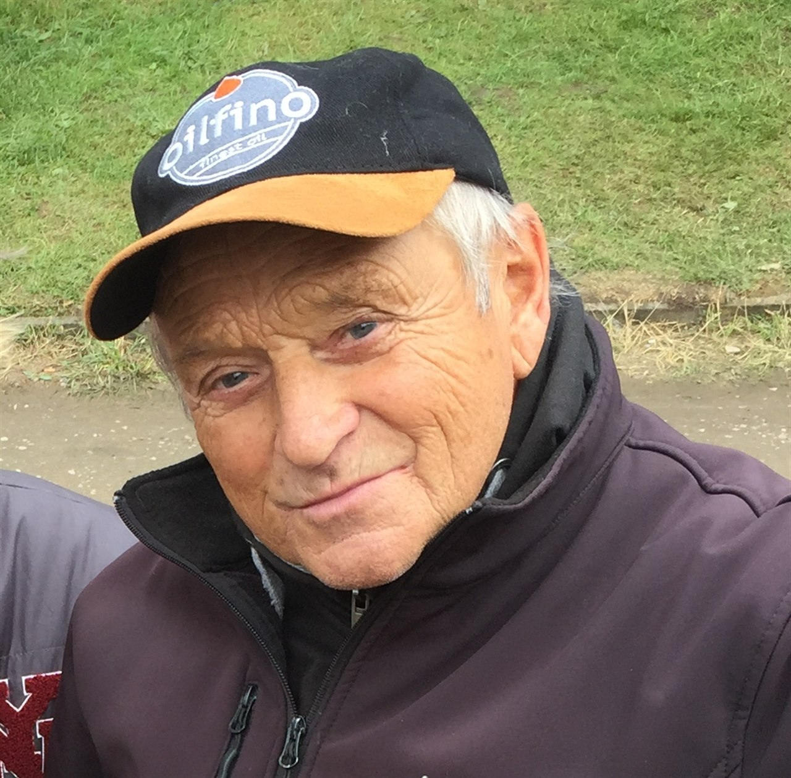

# Mosel Riesling trail: two steep-slope estates on the Mittelmosel and Saar

The Mosel's wine map follows the river, and what shapes a route is not the administrative district but the aspect, the slate and the bend. This two-stop drive links Bernkastel-Kues on the Mittelmosel with Wiltingen in the upper Saar valley: the first shows how a slate-slope estate puts parcels on the label, the second how a family estate held since 1797 turns one hill into one name. Both stops are built on [Riesling](ref:riesling) and both combine [oak](ref:oak-ageing) with stainless steel, yet they give two different answers to the question of steepness.

Figure: "Mosel Riesling trail: two steep-slope estates on the Mittelmosel and Saar". Photograph: Mosel vineyard in Tittenheim. Credit: Phillip Capper, CC BY 2.0 ([source page](https://commons.wikimedia.org/w/index.php?curid=4168277)). Category image; not a claim that it shows the exact product, site or event.

## Why Bernkastel and Wiltingen belong on one line

The Mittelmosel packs its vineyards into tight river bends, often right at the water; the Saar is narrower and cooler, ripening later and keeping the wine tighter. Both share German wine law and the VDP vocabulary, but they differ at the scale of the site: the Mittelmosel emphasises combinations of slate types and historic vineyards, while the Saar treats a whole hill as a single name.

Put together, they show a "river-bend" Riesling and a "tributary" Riesling side by side. The first is broader in fruit and body, the second sharper in acidity and more closed in aroma. A car is the only reliable way to do it: Bernkastel to Wiltingen is under an hour on the B51 and the Saar valley, while public transport requires changes and leaves long walks from village to slope. Keep the day loose rather than pretending the timetable is friendly.

## Stop one: Dr. Loosen in Bernkastel

The first stop is [Dr. Loosen](ref:dr-loosen) at St. Johannishof in Bernkastel-Kues. The estate has been in one family for more than two centuries; Ernst F. Loosen took over in 1988 and the estate joined the VDP in 1993. The official account puts "Mosel tradition" and "steep slate" first: ungrafted old vines, historic sites and a style close to the way wines were made around 1900 are what separate it from a large-volume producer.

The range uses slate colour as its entry signal: blue, red and grey slate point to different parcels and textures, with Großes Gewächs (GG) and RÉSERVE above them. The GG wines come from sites such as Erdener Treppchen and Bernkasteler Lay; RÉSERVE trades long barrel ageing for a drier texture. For a visitor this is the best place to build a "one variety, several parcels" reference: taste the three slates, then compare a GG with an entry wine, and the estate's insistence on putting the site first becomes clear.

## Stop two: Egon Müller and the Scharzhofberg

The second stop is [Egon Müller](ref:egon-muller) at the Scharzhof in Wiltingen. The family has run it since 1797, and the estate is inseparable from the Scharzhofberg: a south-facing slope of blue slate and old vines, with tiny yields, whose Kabinett and Auslese are often treated as textbook examples. The official page offers only "Scharzhof, Wiltingen/Saar" and an email; the restraint carries into the labels, where place and vintage come first and adjectives are rare.

These wines do not chase breadth. They use acidity to hold sweetness in place: the light Kabinett, the riper Spätlese and the botrytis-edged Auslese all keep a high-acid skeleton. The TBA from the same hill follows another logic, relying on botrytis and berry-by-berry selection for concentration, so sweetness is not added sugar but condensed fruit. Do the two stops in one day and start with parcel combinations, then move to the single-hill extreme.

## Slate slopes, steepness and hand work

"Steep" on the Mosel is not a figure of speech. The slopes are mostly broken slate, poor at holding water and quick to warm, so roots must go down; that is why old vines and deep roots are repeated so often. Slate colour and weathering change the wine: blue slate usually gives tighter acidity and a mineral edge, red slate leans towards spice and fruit, grey slate is rounder. "Schiefer" on a label is not decoration but a description of the site.

Machinery has limited reach on these slopes. Picking, pruning and carrying still depend heavily on hand labour, and some parcels can only be worked with small crawlers or cable systems. The high cost is exactly why estates keep yields low and put the differences into a few wines. A visit that remembers only "steep" misses the other half: the cellar at the foot of the slope, the old village buildings and the family house are where the slope becomes wine.

## From Kabinett to Trockenbeerenauslese: reading the ripeness scale

The traditional German scale measures ripeness at harvest, not sweetness in the finished wine. Kabinett is the lightest, Spätlese riper, Auslese starts selecting fruit, Beerenauslese (BA) requires botrytis berry by berry, and Trockenbeerenauslese (TBA) requires botrytised fruit close to raisin state. Higher ripeness means more potential alcohol, but the estate can stop fermentation early and leave sugar behind; a Kabinett from one parcel can be dry, and an Auslese can be dry too, so the label must be read together with "trocken", "feinherb" or "süß".

This scale also explains why Mosel alcohol is often low: ripeness is measured by sugar, but whether fermentation finishes is the estate's decision. Read that way, sweetness is not a rank and dryness is not a lack of concentration. At Dr. Loosen the dry wines from three slates are the entry point; at Egon Müller the sweet Kabinett and Auslese are the reference. Together they make the complete Mosel.

## Driving, booking and tasting arrangements

Bernkastel to Wiltingen is under an hour on the B51 and the Saar valley, on narrow, winding roads that can ice over in winter and have no lighting at night. Both estates receive visitors by appointment, with sessions and fees changing by season. Dr. Loosen's official page gives only an address and contact details, so visits and tastings must be confirmed by email first; Egon Müller's page is also contact-led, and nobody should assume the cellar is open on arrival.

Before tasting, ask four things: whether there is a fee, whether the cellar is included, whether children may come, and whether there is a spittoon. Anyone driving should spit or taste only a little; country roads here leave little margin, and one glass can affect judgement. With one day, put Dr. Loosen in the morning and Egon Müller in the afternoon, and keep the return drive in daylight.

## See also

- [Dr. Loosen](ref:dr-loosen): St. Johannishof, the slate entry range and the GG wines.
- [Egon Müller](ref:egon-muller): one family since 1797 and the Scharzhofberg.
- For background, read the [Mosel](ref:mosel), [Riesling](ref:riesling) and [white wine](ref:white-wine) entries.

Opening hours, bookings and transport are subject to official channels; page verified on 2026-11-09. Loosen in Bernkastel-Kues to Egon Müller in Wiltingen, the two stops follow the Mosel and Saar valleys.

[Dr. Loosen](ref:dr-loosen) explains stop order; [Mosel](ref:mosel) adds transport. Put Mosel Riesling trail between them before deciding what it is.

## Related images

Image: Dr. Loosen. Credit: Weingut Dr Loosen, CC BY-SA 4.0, via Wikimedia Commons ([source page](https://commons.wikimedia.org/wiki/File:Ernst_Loosen.jpg)). Related image for Mosel Riesling trail: two steep-slope estates on the Mittelmosel and Saar.

Image: Egon Müller. Credit: KarleHorn, CC BY 3.0, via Wikimedia Commons ([source page](https://commons.wikimedia.org/wiki/File:Egon_Mueller_2018.jpg)). Related image for Mosel Riesling trail: two steep-slope estates on the Mittelmosel and Saar.
