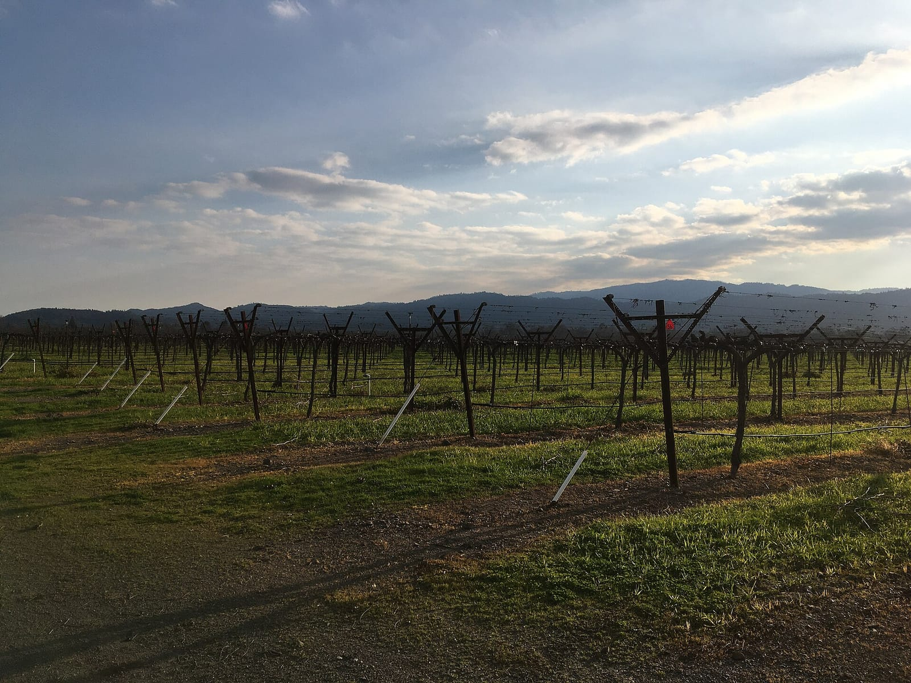

# Napa Valley: the modern winery belt after the 1976 Judgment of Paris

A Napa itinerary easily becomes “five wineries in a day”. This route keeps three because they answer one question: after the 1976 Judgment of Paris, how did Napa move from “a wine region in America” to “a name on the world wine map”? Mondavi was the promoter, Opus One the transatlantic joint venture, and Beringer the old winery that the modern narrative tends to cover up. All three sit along St Helena Highway, minutes apart by car, yet they span more than a century.

Figure: Related photograph of Napa Valley: the modern winery belt after the 1976 Judgment of Paris. Image: GIANTPAPAYA, CC BY-SA 4.0, via Wikimedia Commons ([source page](https://commons.wikimedia.org/wiki/File:Napa_Valley,_Late_Afternoon.jpg)).

> **Quick verdict**
> **In one line:** This route helps you plan Napa Valley: the modern winery belt after the 1976 Judgment of Paris, including the order, timing and stops that matter.
>
> - **Best for:** Anyone turning Napa Valley: the modern winery belt after the 1976 Judgment of Paris into a one- or two-day route and needs the order and the stops that matter.
> - **Not for:** If you want only want one stop and do not intend to follow a route.
> - **Check first:**
>   - - Stop one: Robert Mondavi Winery, 7801 St Helena Highway, Oakville, CA 94562, founded in 1966, with the To Kalon vineyard at heart.
>   - The 1976 Judgment of Paris was a blind tasting: the British merchant Steven Spurrier organised French judges to compare California and French whites and reds.

## Route overview

- Stop one: [Robert Mondavi Winery](ref:mondavi), 7801 St Helena Highway, Oakville, CA 94562, founded in 1966, with the To Kalon vineyard at heart.
- Stop two: [Opus One Winery](ref:opus), 7900 St Helena Highway, Oakville, CA 94562, a 1979 joint venture between Robert Mondavi and Baron Philippe de Rothschild, with 1979 as its first vintage.
- Stop three: [Beringer Vineyards](ref:beringer), 2000 Main Street, St Helena, CA 94574, founded in 1876 by Jacob and Frederick Beringer, with the Rhine House built in 1884.
- Mode: car is the practical base; VINE buses serve Napa Valley, but transfers between wineries are awkward, and no one should drive after tasting.
- Suggested duration: one day. Mondavi in the morning, lunch around Oakville, Opus One and Beringer in the afternoon; leave at least an hour between bookings.

## Why this route

The 1976 Judgment of Paris was a blind tasting: the British merchant Steven Spurrier organised French judges to compare California and French whites and reds, and California won both categories. The point was not that California was “better than France” but that Napa entered international discussion and proved the New World could make wine with ageing potential. Investment, technique, vineyard expansion and brand-building accelerated afterwards, and both Mondavi and Opus One belong to that wave.

Mondavi supplies the starting point of modern Napa. In 1966 Robert Mondavi founded the winery in Oakville. Born into an Italian immigrant family and trained at the Charles Krug family winery before going independent, he argued for French oak, cool fermentation and vineyard designation, pushing Napa from bulk wine toward fine wine. The To Kalon vineyard is the geographic core of this route, on the western side of Oakville, with gravel and alluvial soils that give Cabernet Sauvignon ripeness and structure.

Opus One supplies the joint venture. In 1979 Mondavi and Baron Philippe de Rothschild agreed to build a winery together, combining Bordeaux blending with Napa fruit; the first vintage, 1979, was released in 1984, and the winery building was completed in 1991. It is not a copy of Bordeaux in Napa but a negotiation over varieties, oak and ageing. Beringer supplies the longer time. Founded in 1876, it is one of Napa's longest continuously operating wineries, and the Rhine House and old cellars survived Prohibition, depression and industrial change. Placing it last is a reminder that Napa did not begin in 1976.

## Stop one: Robert Mondavi Winery

Why go: it puts several elements of modern Napa in one compound—vineyard, winery, tasting room and art collection. In 1966 Robert Mondavi built the winery on St Helena Highway in Oakville, one of the first new Napa wineries after Prohibition; his aim was to make world-class wine in Napa, and he brought French oak and winemaking ideas while pushing vineyard designation and contract growing.

What to see: the To Kalon vineyard is the main subject. It lies on the western side of Oakville near the foot of the Mayacamas, with gravel, sand and alluvial soils, good drainage and ample sun, giving Cabernet Sauvignon ripe blackcurrant flavour with enough acidity. Cliff May designed the winery in a California mission style, with arcades, courtyards and an axis into the vineyard; the sculptures and art collection reflect Mondavi's idea of putting wine, food and art together.

What to taste: the range is broad, from Napa Valley Cabernet Sauvignon and Chardonnay to To Kalon single-vineyard and reserve wines. On a first visit, taste a Napa Valley Cabernet, then a To Kalon or reserve wine, and compare fruit, oak and tannin. Do not fixate on the most expensive bottle; the value of the visit is understanding the tiers. If you book a “winery tour”, confirm whether it includes a vineyard walk and a tasting.

## Stop two: Opus One Winery

Why go: it is a transatlantic experiment and a model of Napa branding. In 1979 Robert Mondavi and Baron Philippe de Rothschild agreed to make a wine together, combining Bordeaux blending with Napa ripeness; the first vintage, 1979, was released in 1984, and the winery was completed in 1991, with a name meaning “work number one”. It is neither a Bordeaux copy nor a Mondavi second wine, but an independent winery company.

What to see: Scott Johnson designed the building, with a curved roof and a low profile set into the vineyard; the visit usually includes the fermentation room, cellar and tasting room. Watch the relationship between “single site” and “blend”: Opus One's fruit comes from four Oakville parcels, led by Cabernet Sauvignon with Cabernet Franc, Merlot, Petit Verdot and Malbec; fermentation and ageing take place in French oak, with the proportion of new oak and the time in barrel adjusted by vintage. Do not equate “Bordeaux varieties” with “Bordeaux style”: Napa sun and ripeness change the texture.

What to taste: Opus One is the core wine, with Overture as a second label; vintages differ visibly, cooler years tighter and warmer years fuller. On a first visit, taste the current vintage, then an older one, and compare tannin, acidity and aged aroma. Visits normally require a reservation and have an age policy; do not bring young children into the tasting space or expect a walk-in seat.

## Stop three: Beringer Vineyards

Why go: it puts “old Napa” back into the route. In 1876 Jacob and Frederick Beringer founded the winery in St Helena, and it is one of Napa's longest continuously operating wineries; the Rhine House was built in 1884 by craftsmen Jacob brought from the German Rhineland, and its stone walls, tower and garden are a St Helena landmark. During Prohibition the winery kept going through sacramental wine and church permits; from the 1970s onwards, acquisitions and brand expansion made Beringer a major Napa house.

What to see: the Rhine House is the centrepiece, importing a European winery-mansion image to Napa and reflecting the relationship between nineteenth-century immigrants and wine culture; the old cellars were cut into the hillside, and the stone walls and vaults survive for ageing and visits. The vineyards spread across several Napa sub-appellations, from St Helena to Rutherford and Calistoga. Do not look only at the mansion: ask whether the tour includes the cellars and vineyards, or it may become “drinking in a garden”.

What to taste: the range runs from Private Reserve Cabernet Sauvignon to Knights Valley and Napa Valley series. On a first visit, taste a Napa Valley Cabernet, then Private Reserve, and compare fruit, oak and tannin. Beringer's history is long, but do not read “1876” as “every wine comes from old vines”; fruit sources and tiers vary widely, so read the appellation and series on the label before tasting.

## Transport and rhythm

All three sit along St Helena Highway (CA-29), with Oakville and St Helena linked by a short drive on the same valley road; a car is easiest, but no one should drive after tasting. VINE buses connect the main towns, but transfers between wineries are awkward, and schedules and routes must be checked for the day; alternatively book a winery tour with transport or a designated driver. CA-29 clogs in high season and at weekends, and Silverado Trail can serve as an alternative, but do not speed to make an appointment.

Suggested rhythm: reach Mondavi in the morning, walk the vineyard and winery, then taste; lunch in Oakville or Rutherford; Opus One in the early afternoon for the booked tour and tasting; Beringer later in the afternoon for the Rhine House and cellars. Leave at least an hour between the three, and do not pack tastings too tightly; palate fatigue turns the third stop into “everything tastes the same”.

Most Napa wineries need bookings, especially Opus One and Mondavi's tours; Beringer's classic house visit may sell on the day, but high season fills up. Confirm language, length, whether a vineyard walk and tasting are included, and whether there is an age policy. Do not schedule more than three or four in a day, and do not plan a long drive after tasting.

## Seasons and booking

High season runs from May to October, dry and hot, with vineyards and wineries busy; September and October are harvest, when wineries may offer harvest experiences but transport and lodging are tight. Winter is quiet, with shorter hours and fewer tours; spring brings mustard bloom and good vineyard views, but more rain. Whatever the season, the California sun is strong: bring a hat, sunglasses and sunscreen, and drink water, since many tastings are outdoors or semi-outdoors.

Booking is the premise. Opus One is reservation-only and has an age policy; Mondavi's tours and tastings run by slot; Beringer's Rhine House visit is best booked ahead in high season. Do not treat “we'll turn up” as a plan, especially at weekends and during harvest. If Opus One is full, give the time to Mondavi's To Kalon vineyard walk or Beringer's cellar tour rather than waiting at a door.

## Manners and limits

First, a winery is an agricultural and production site, not a theme park. Do not enter production areas without a booking, touch equipment, barrels or exhibits; in the vineyard, do not pick grapes, walk through vine rows or climb fences. Second, use the spit bucket, and do not drink if you are driving; California enforces drink-driving law strictly, and a designated driver must stay dry all day. Third, dress comfortably and tidily, since vineyard ground is uneven and heels are impractical; cellars are cool, so bring a light layer.

Fourth, read the history correctly. The 1976 Judgment of Paris was a blind tasting, not the creation of the Napa AVA; Mondavi's 1966 is the winery's founding year, not the first planting of To Kalon; Opus One's 1979 is the first vintage, 1984 the release and 1991 the completion of the winery; Beringer's 1876 is the founding year and 1884 the Rhine House. Fifth, distinguish “winery”, “brand” and “vineyard”: To Kalon is a vineyard name, Opus One a winery and brand, and Beringer's ownership and wine series have changed repeatedly; do not merge the three.

For Napa Valley: the modern winery belt after the 1976 Judgment of Paris, this route does not provide a map; addresses and opening status were checked against official pages on 2026-11-08, but hours and booking rules can still change, so confirm with official channels. Latitude and longitude for the three venues are left empty in the content repository, and with no verifiable coordinate source the project rule is not to draw a schematic map.

## Alternatives and extensions

If Opus One is full, the direct alternatives are Mondavi's To Kalon single-vineyard tasting or Beringer's Private Reserve comparison; do not fill the time with “any winery”, since Napa is dense but styles differ and need choosing. To see the 1976 Judgment of Paris more fully, set aside another day for Chateau Montelena and Stag's Leap Wine Cellars, the winners of that blind tasting, which complement this route's “modern belt”.

Northwards the route reaches Calistoga and Knights Valley, southwards Yountville and Carneros; these sub-appellations differ in climate and varieties and do not fit into one day without rushing. The better extension is to split them: one day for the modern wineries of Oakville and St Helena, another for Calistoga or Carneros, keeping “the Cabernet core” apart from “the cool-climate Chardonnay and Pinot Noir”.

## See also

- [Robert Mondavi Winery](ref:mondavi): 1966, To Kalon and the start of modern Napa.
- [Opus One Winery](ref:opus): the 1979 joint venture, Bordeaux blending and Napa fruit.
- [Beringer Vineyards](ref:beringer): 1876, the Rhine House and Napa before and after Prohibition.
- For background, consult the Napa Valley region, wine and place-and-process entries in the content repository; this route does not register further references.

Opening hours, bookings and transport are subject to official channels; page verified on 2026-11-08.
