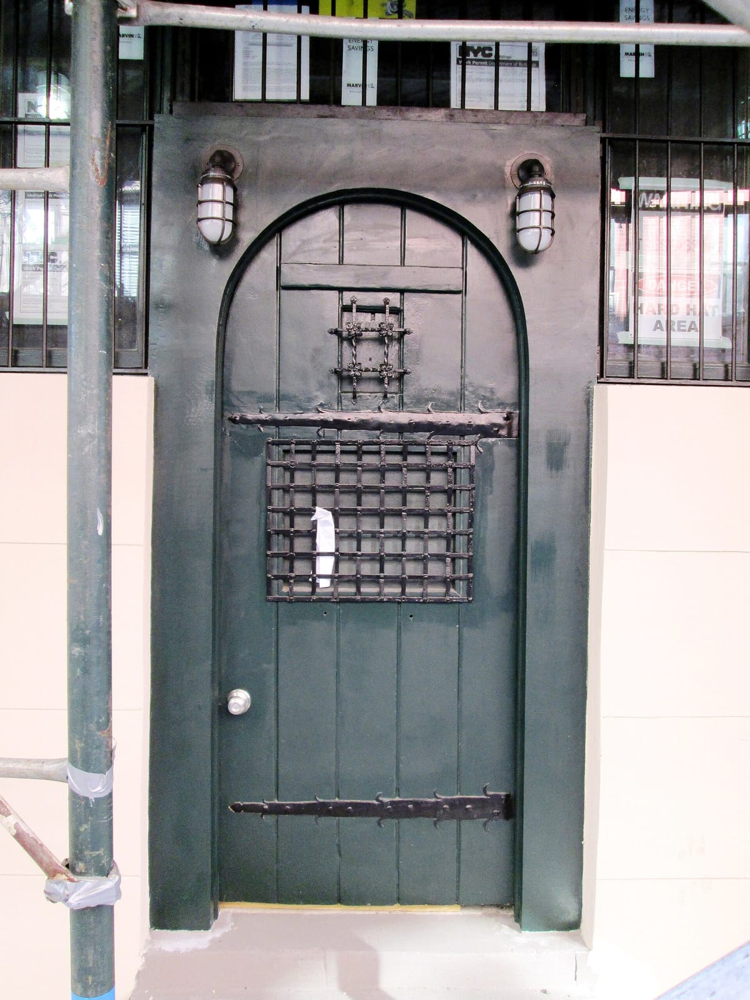
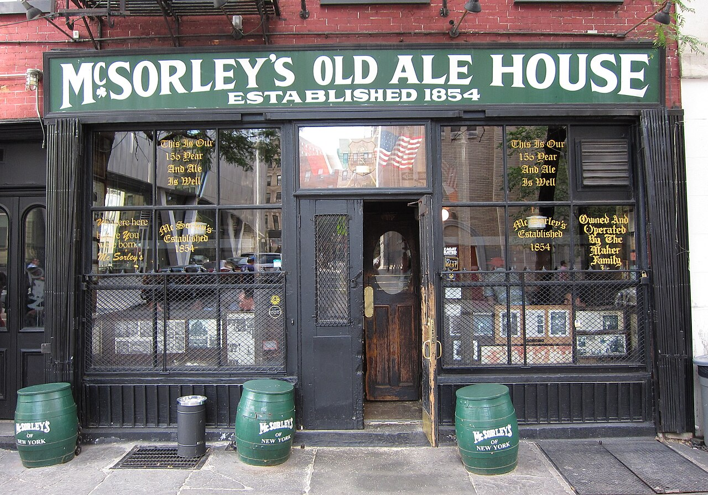
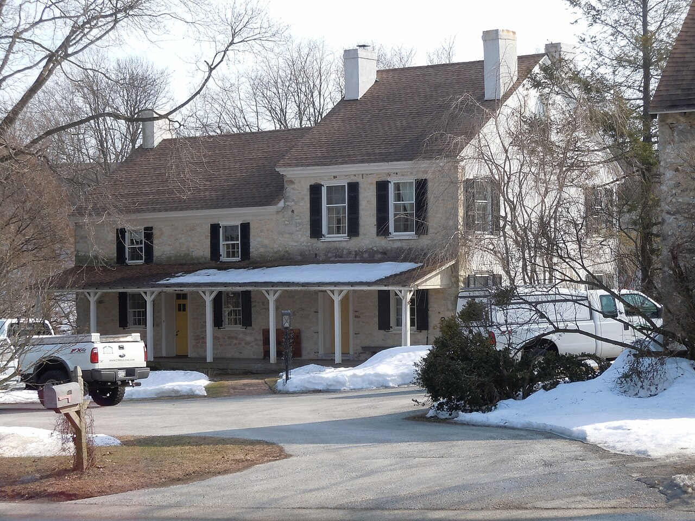

# New York historic pubs: East Village to Gramercy

This route links three old pubs in lower Manhattan: McSorley's Old Ale House in the East Village, the White Horse Tavern in the West Village and Pete's Tavern by Gramercy Park. Their “old” is not the same kind of old: one has turned an ale-only menu into an institution, one carries a literary myth, and one combines restaurant and pub. Seeing them in a single afternoon and evening shows how New York manages the idea of history far better than visiting each in isolation.

Figure: Related photograph of New York historic pubs: East Village to Gramercy. Image: Beyond My Ken, CC BY-SA 4.0, via Wikimedia Commons ([source page](https://commons.wikimedia.org/wiki/File:86_Bedford_Street_door_to_Chumley%27s.jpg)).

> **Quick verdict**
> **In one line:** This route helps you plan New York historic pubs: East Village to Gramercy, including the order, timing and stops that matter.
>
> - **Best for:** Anyone turning New York historic pubs: East Village to Gramercy into a one- or two-day route and needs the order and the stops that matter.
> - **Not for:** If you want only want one stop and do not intend to follow a route.
> - **Check first:**
>   - - Stop one: McSorley's Old Ale House, 15 E 7th St, New York, NY 10003, opened in 1854 by the Irish immigrant John McSorley.
>   - Why go: this is the most single-minded stop on the route.

## Route overview

- Stop one: [McSorley's Old Ale House](ref:mcsorleys), 15 E 7th St, New York, NY 10003, opened in 1854 by the Irish immigrant John McSorley.
- Stop two: [White Horse Tavern](ref:white-horse), 567 Hudson St, New York, NY 10014, opened in 1880 and originally serving dock workers on the Hudson.
- Stop three: [Pete's Tavern](ref:petes), 129 East 18th Street, New York, NY 10003, in a building from 1851 whose ground-floor drinking business began in 1864.
- Mode: subway and walking. Take the subway between the East Village, the West Village and Gramercy, then walk from the stations; in good weather some legs can be done entirely on foot.
- Suggested duration: four to six hours, starting in the afternoon and ending after dinner.

## Why these stops

McSorley's represents the extremely narrow menu. It opened in 1854 and for more than a century has sold only ale, in just two forms, light and dark; there is no wine, cocktail or spirits list. The interior keeps wooden tables, old posters, hanging lamps and objects left by generations of customers, and the line at the door, “Be Good or Be Gone”, is both a house rule and a character description. The choice is deliberately removed: you only decide between light and dark.

The White Horse represents the literary narrative. It opened in 1880 as a neighbourhood bar for dock workers and sailors, and in the 1950s became a gathering place for writers, artists and musicians. Dylan Thomas's visit in 1953 turned it into a coordinate on the literary map. The pub keeps its original woodwork, tin ceiling, long bar and old photographs, and its drinks list is wider than McSorley's: beer, whiskey and simple cocktails.

Pete's represents the restaurant-pub combination. The building went up in 1851 as the Portman Hotel, and the ground floor opened in 1864 as a grocery and grog store; it was renamed Healy's Café in 1899, and the name Pete's Tavern was fixed when Peter D'Belles took over in 1922. Inside are a long rosewood bar, a pressed tin ceiling and old tiled floors; the drinks list runs from its own beer and draft beers to a long whiskey list and classic cocktails, with American and Italian food.

The distances also make a slice of the city: the narrow streets of the East Village, the literary West Village and the restaurant edge of Gramercy. All are in lower Manhattan but not within one walking radius, so the subway is needed to keep the rhythm.

## Stop one: McSorley's Old Ale House

Why go: this is the most single-minded stop on the route. The shop is narrow and deep, with a small front room and back room, wooden tables and chairs, and walls covered with old newspapers and photographs; objects left by customers over the years hang from the light fittings. It is a working pub, not a museum: bar seats are for drinkers, not for long photo sessions.

What to order: find a place first, then tell the server “Light or dark”. Choose light for a cleaner drink, dark for more malt and roast; if unsure, order one of each and compare. The pub often serves two glasses at a time, so say if you want only one. Do not ask for cocktails or wine; that is not how it works. The food menu is light, with cheese, crackers and onions enough to put something in your stomach.

How long: forty-five to sixty minutes. A weekday afternoon is best for a first visit: fewer people, better light and a clearer view of the interior; a weekend night is more like a standing social experiment.

Practical note: the address is 15 E 7th St, New York, NY 10003, near Cooper Union and Astor Place. The 6 train stops at Astor Place, a few minutes on foot; the F train at 2 Av also works. Check opening hours, payment methods and prices through official channels; cash has long been the norm here, so carry some and confirm on site. There are no ordinary reservations, and high season means a wait; there is no dress code beyond casual. The space is narrow, so guests with limited mobility or pushchairs should call ahead about the layout.

## Stop two: White Horse Tavern

Why go: it layers a neighbourhood bar and a literary landmark in one building. When it opened in 1880 it served the stevedores and sailors of the nearby Hudson docks; in the 1950s West Village rents still allowed writers, painters and musicians to gather, and Dylan Thomas, Jack Kerouac, Allen Ginsberg and James Baldwin all came to be associated with the place. The pub keeps its original woodwork, tin ceiling, long bar and old photographs, and the room is a little wider than McSorley's.

What to order: look over the bar first, then decide between a stool and a table against the wall. Sit at the bar for the old-pub atmosphere, in a corner to talk. Start with a draft beer; for whiskey, name a brand or a style rather than ordering “like Dylan Thomas”. If hungry, a simple bar dish with the drink is safer than drink alone.

How long: sixty to seventy-five minutes. A weekday evening is the most comfortable time: regulars are still there and tourists have not filled the room; weekend nights are very crowded and poor for a first date or a quiet conversation.

Practical note: the address is 567 Hudson St, New York, NY 10014, near Hudson Street and West 11th Street. The 1 train stops at Christopher Street–Stonewall, a few minutes away; from Washington Square Park it is about fifteen minutes on foot. Check opening hours, the menu and prices through official channels. Advance bookings are usually not accepted and high season means waiting; the dress code is casual. Expect West Village bar prices, and carry a card plus a little cash. The historic building has low ceilings and narrow passages, so guests with mobility needs should check first.

## Stop three: Pete's Tavern

Why go: it makes a good finish because you can both drink and eat. Pete's stands at the corner of East 18th Street and Irving Place, in the Gramercy Park area. It calls itself “New York's longest continuously operating restaurant and bar”: the building dates from 1851 and the ground-floor drinking business began in 1864. The centrepiece is a rosewood bar about forty feet long, and the back bar, tin ceiling, tiled floor and booths are, by the owner's account, original to 1864.

What to order: a glass of 1864 House Ale explains the place best; for spirits, let the server recommend within your budget. The whiskey list is long, from Buffalo Trace and Eagle Rare to different years of Pappy Van Winkle, with a wide price range; state your budget and preference rather than staring at the age figures. Cocktails are classics and suit a second drink; do not expect complex molecular mixing. For a proper meal, the American and Italian dishes show the restaurant side better than a single drink.

How long: seventy-five to ninety minutes, ideally with time to eat. The best window is weekday afternoon into early evening, when the light falls on the old wood, the room is quiet and the staff have time to talk. The official page lists a happy hour from 16:00–18:00 Monday to Friday, with the drinks and prices confirmed on site.

Practical note: the address is 129 East 18th Street, New York, NY 10003, less than five minutes on foot from Union Square and the subway. The 4, 5, 6, L, N, Q, R and W lines all stop at Union Square; 14th Street or 23rd Street is also close. The official page lists daily hours of 12:00–02:00, with the kitchen stopping at 23:00 Sunday to Thursday and at midnight on Friday and Saturday. Full meals can be booked through the official link; whether the bar area is walk-in depends on the day. Prices are mid-range for Manhattan, with rare whiskey in a different category; there is no dress code beyond casual. Entrances and passages in a historic building vary, so guests with mobility needs should call ahead.

## Order and transport

Follow the order “McSorley's → White Horse → Pete's”: enter the East Village in the afternoon before the weekend standing crowd, move west to the West Village and sit down before evening, then reach Gramercy for dinner. Pete's stays open until 02:00, and the kitchen stops at 23:00 Sunday to Thursday, so putting the meal last makes sense.

The legs:

- Stop one to stop two: walk from McSorley's to Astor Place, take the 6 train to Union Square, change to the L train to 8th Avenue and walk about ten minutes to Hudson Street; a short taxi is also an option. On foot the two are about two miles apart and take more than half an hour, which does not suit a tight schedule.
- Stop two to stop three: walk from the White Horse to Christopher Street–Stonewall, take the 1 train to 18th Street and walk to East 18th Street; or take the 1 train to 14th Street, change to the L train to 3rd Avenue and walk a few blocks. You can also walk across Greenwich Village to Gramercy in about twenty-five minutes.
- There is no door-to-door subway line between the East Village and the West Village, so a change is normal; do not cut the timings too fine, especially at night and at weekends.

The subway handles the long distances, but the last stretch is always on foot. For specific entrances, step-free routes and live service conditions, use the MTA's official information and on-site signage.

## Duration and budget

Four to six hours is a reasonable range. Forty-five to sixty minutes at the first stop, about half an hour for walking and changing trains, sixty to seventy-five minutes at the second, another half hour to Gramercy, and seventy-five to ninety minutes at the third. If you have one drink at each and skip a full meal, the route can compress to about four hours; a full dinner at Pete's stretches it naturally.

Budgets are similar across the three and all sit at New York mid-range pub level: McSorley's has a very narrow, lower-priced list; the White Horse is at West Village level; Pete's is mid-range for Manhattan, though rare whiskey can lift the bill. Control the cost by limiting each stop to one or two drinks and putting the meal at Pete's, rather than ordering a full spread three times.

## Who it suits and who it does not

It suits anyone wanting to see three kinds of old New York pub in one afternoon and evening; small groups of two to four; beer, whiskey and simple bar-food people; anyone interested in city history, literary narrative and pub space; and travellers willing to change trains rather than demand door-to-door convenience.

It does not suit people looking for wine, cocktails or a wide range of craft beer (McSorley's has only light and dark ale); anyone wanting quiet conversation, comfortable seating or a refined dinner; groups of a dozen (all three rooms are narrow); families with children at night; guests with accessibility needs (entrances and interiors vary and should be checked); or anyone tired of crowds and the “old New York” nostalgia narrative.

## Practical tips and verification notes

First, check opening hours and kitchen times. Hours and menus at all three are set by official channels, and Pete's kitchen stops at 23:00 Sunday to Thursday; if the meal is last, do not arrive just before the kitchen closes.

Second, ask about payment. McSorley's has historically been cash-first, and the White Horse and Pete's have their own rules; a card plus a little cash is safer than looking for an ATM at the bill.

Third, tip by American bar practice. Watch the tip line on the card slip; large parties may already have a service charge, so read the bill before adding more.

Fourth, treat the famous names as background, not a promise. Dylan Thomas's “last stop”, O. Henry's writing booth and the Lincoln and John Lennon visit stories are oral tradition or house narrative; they explain why these places are known, not what today's service is like, and they do not guarantee sitting where someone once sat.

Fifth, keep the different claims of “oldest” apart. McSorley's calls itself the longest continuously operating pub in New York, the White Horse calls itself the second-oldest bar in New York, and Pete's calls itself the longest continuously operating restaurant and bar; each uses a different measure, so do not treat one as the only conclusion.

Sixth, this route describes the structure of the route and verifiable facts only. It does not provide live opening status, a map or coordinates: the three venues' latitude and longitude are left empty in the content repository, and with no verifiable coordinate source the project rule is not to draw a schematic map. For precise navigation, use a live map service and follow on-site signage.

Further reading: [Alsace Grand Cru trail: Kaysersberg and Riquewihr](ref:c-extra-1), [Armagnac trail: single estates of Bas-Armagnac](ref:c-extra-2).

Checked on 2026-11-08. This route describes route structure and verifiable facts only; it does not provide live opening status, a map or coordinates. The three venues' latitude and longitude remain empty in the content repository because no verifiable coordinate source was found, so the project rule is not to draw a schematic map. The East Village to Gramercy order is a reading order; use a live map and on-site signs for navigation.

## Related images

Image: McSorley’s Old Ale House. Credit: Leonard J. DeFrancisci, CC BY-SA 3.0, via Wikimedia Commons ([source page](https://commons.wikimedia.org/wiki/File:McSorley%27s_Old_Ale_House_001_crop.jpg)). Related image for New York historic pubs: East Village to Gramercy.

Image: White Horse Tavern PA. Credit: Smallbones, CC0, via Wikimedia Commons.. Credit: Smallbones, CC0, via Wikimedia Commons ([source page](https://commons.wikimedia.org/w/index.php?curid=13351900)). Related image for New York historic pubs: East Village to Gramercy.
