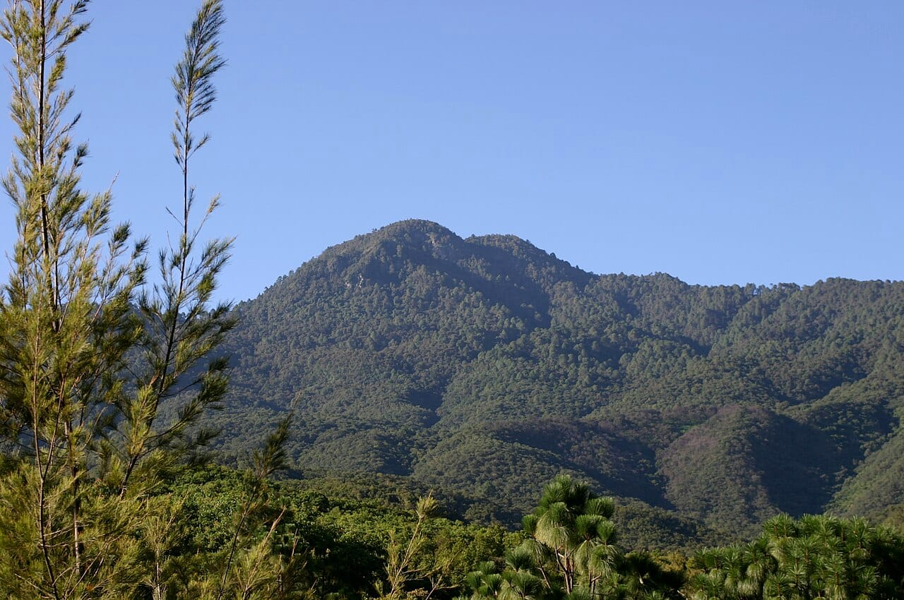
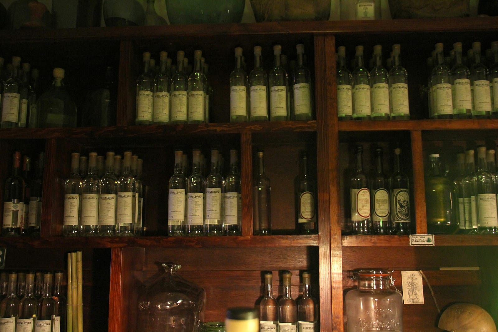

# Oaxaca Mezcal Trail

This route has only two stops, yet it connects the two ends of mezcal: first [Mezcaloteca](ref:mezcaloteca) in central Oaxaca city, to build coordinates of variety and village; then [Real Minero](ref:real-minero) in Santa Catarina Minas, to see earthen pits, wooden mallets and clay pots. The first does not distil; the second still does. Between them lie the Espadín fields of the central valleys, the palenques of Santiago Matatlán and the floor set by NOM-070.

Figure: Oaxaca Mezcal Trail. Photograph: File:Oaxaqa (41).jpg. Credit: Prsjl, CC BY-SA 4.0 ([source page](https://commons.wikimedia.org/wiki/File:Oaxaqa_(41).jpg)). Category image; not a claim that it shows the exact product, site or event.

## Oaxaca city: start with coordinates on Reforma street

Mezcaloteca stands at Reforma 506 in the historic centre, postcode 68000, ten minutes on foot from the zócalo. It opened in 2010 as a tasting room rather than a palenque: no field, no pit and no still, only a table and a collection indexed by state, village, variety, producer and batch. Bookings are the norm.

Do not chase the rarest bottle first. Build coordinates: start with a light Espadín, then compare another producer in the same village, or the same variety from another village; ask about raw material, place, roasting, [fermentation](ref:fermentation) and still. For a first arrival in [Oaxaca](ref:oaxaca), it is a better start than any drinks list.

## From the central valleys to Santiago Matatlán

Oaxaca city sits in the central valleys, ringed by mountains and dry slopes. South-east on Route 190 pass Teotitlán del Valle, Tlacolula and Santiago Matatlán; the last is often called the capital of mezcal, with agave fields, palenques and roadside yards. Espadín is the most planted variety because it adapts well and matures reliably, usually needing more than eight years. Treat Matatlán as background for Espadín, not as a third stop.

The real second stop lies south on Route 131, thirty to forty minutes to Santa Catarina Minas; the village hangs on a slope, the road is narrow, and the palenque sits on Iturbide street with an unremarkable entrance. A car is easiest, or hire one in the city.

## Earthen pits, wooden mallets and clay pots: Real Minero's slow work

Real Minero starts in 1978, when Lorenzo Ángeles Mendoza and Nicolás Arellanes bought the family's first palenque, today's La Concepción. Until 2002 the spirit had no brand, going out in reused bottles with a handwritten scrap of paper. The first label appeared in 2004; in 2005 the distillery dropped the old name "Minero" for Mezcal Joven; in 2009 it first exported to Germany, and in 2015 it entered the United States.

The process begins underground: agave stripped to the piña goes into a conical earthen pit heated with wood and volcanic stone, then covered with earth and fibre and left to roast for days. The softened piña is crushed in a wooden canoa with a mallet, never a roller mill. Spontaneous fermentation follows, then a second distillation in clay pots. The garden holds seventeen agave species, fourteen propagated by seed. Since 2006 the visit has been part of this project.

## Espadín as the everyday agave, and the diversity around it

Espadín is the most common cultivated variety in Oaxaca and the workhorse of many distilleries: maturity is manageable, yield is stable, and flavours run from green herb and citrus to ripe fruit. It is not inferior, only common; making Espadín well is harder than telling a story about a rare variety. Tobalá and Arroqueño are rarer and dearer, while an ensamble puts different varieties into one fermentation.

Mezcaloteca does not treat rare as automatically good; it lets you taste difference within one session. Only then can you tell whether it comes from terroir, process or batch. Small batch also means variation: bottles from the same distillery may differ with agave ripeness, yeast and fire. That is not a defect but the normal condition of this production.

## NOM-070: compliance is only the floor

[Mezcal](ref:mezcal) received a designation of origin in 1994, and the current standard is NOM-070-SCFI-2016: raw material must be 100% [agave](ref:agave), produced inside the protected area. The designation covers Oaxaca, Guerrero, San Luis Potosí, Zacatecas and Durango, plus parts of Puebla, Michoacán, Tamaulipas and Guanajuato. Age classes are Joven, Reposado and Añejo; methods are artesanal and ancestral.

Meeting the standard proves lawful mezcal, not good mezcal, and not fair pay. Read the label in this order: NOM number and "100% agave", then variety, village and producer, and only then ageing and packaging. Real Minero has long used Mezcal Joven because the liquid never sees oak; its process is closer to ancestral pits, hand crushing, wild fermentation and clay distillation, but the label follows the facts.

## Tasting order, booking and the drive back

Mezcaloteca works mainly by reservation, so confirm a session a day or several days ahead, stating group size, language needs and budget; sessions usually run from afternoon into evening. Real Minero's tour lasts about three hours: the ethnobotanical garden first, then the palenque with its pit, canoa, fermentation and clay stills, and finally four pours. Adults pay 750 Mexican pesos and ages 5 to 17 pay 500; slots are 10:00 and 15:00 Monday to Friday, 10:00 on Saturday with at least 48 hours' notice, closed Sunday; groups run from 1 to 25 and guiding is in Spanish only.

Oaxaca city to Santa Catarina Minas takes about thirty to forty minutes; village roads are narrow, so park without blocking them. Without a car, hire one in the city. Do not drive after tasting: Oaxaca state has clear drink-driving limits and enforcement is local. Page verified on 2026-11-09.

**At a glance:** Start at Mezcaloteca in central Oaxaca city to build coordinates of variety and village, then head south to Real Minero in Santa Catarina Minas for earthen pits, wooden mallets and clay pots. Between them lie the Espadín fields of the central valleys, the palenques of Santiago Matatlán and the floor set by NOM-070. 

To read Oaxaca Mezcal Trail, start with the order of stops, then the distance and opening hours, then whether it works as a fixed itinerary; no single check settles it.

**Key facts.**

| Item | Detail |
| --- | --- |
| In one line | Start at Mezcaloteca in central Oaxaca city to build coordinates of variety and village, then head south to Real Minero in Santa Catarina Minas for earthen pits, wooden mallets and clay pots. Between them lie the Espadín… |
| Stops | 2 |
| Transport | car |
| Stop order | Mezcaloteca: A Tasting Archive in Central Oaxaca、Real Minero: Clay Pots and Seeds in Santa Catarina Minas |

**Sources and limits.** The key claims about Oaxaca Mezcal Trail are checked against the following sources: Mezcaloteca, Real Minero, Consejo Mexicano Regulador de la Calidad del Mezcal and 5 sources in total. Prices, batches and status change; the body is project-written and does not reproduce source text.

## Related images

Image: Clay Pots and Seeds in Santa Catarina Minas: File:Abraham Minero, Edu Oriol, Juan Carlos Pérez y David Mateos.JPG. Credit: Campeones 2008, CC0, via Wikimedia Commons.. Credit: Campeones 2008, CC0, via Wikimedia Commons ([source page](https://commons.wikimedia.org/w/index.php?curid=15773790)). Related image for Oaxaca Mezcal Trail.

Image: Related photograph of Mezcaloteca: A Tasting Archive in Central Oaxaca. Credit: https://www.flickr.com/photos/bexwalton/, CC BY 2.0, via Wikimedia Commons ([source page](https://commons.wikimedia.org/wiki/File:Mezcaloteca.jpg)). Related image for Oaxaca Mezcal Trail.
