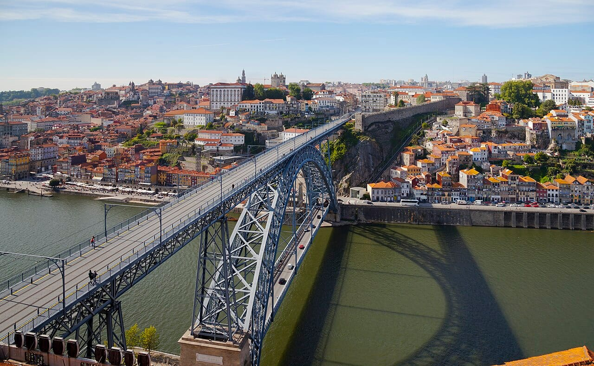
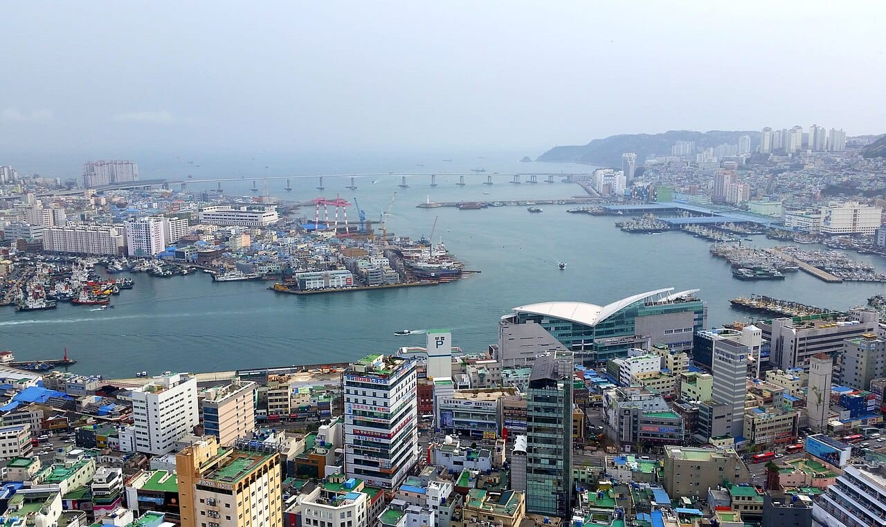

# Porto and Douro route: old vines at Sabrosa, the Nacional block at Pinhão

This route follows the Douro's right bank from Quinta do Crasto at Gouvinhas in Sabrosa to Quinta do Noval near Pinhão, usually 30 minutes to an hour by car. Both work schist slopes and make Port and dry Douro DOC, yet they explain continuity differently: Crasto speaks of mixed old vines and a family relay, Noval of a small ungrafted block and the terrace rebuilding of the 20th century. Put both in one day and schist, terraces and field blends become comparable.

Figure: Porto and Douro route: old vines at Sabrosa, the Nacional block at Pinhão. Photograph: Porto-Matosinhos,, June 2 (53870205083). Credit: John Hayes from San Antonio, Texas, USA, CC BY-SA 2.0, via Wikimedia Commons ([source](https://commons.wikimedia.org/w/index.php?curid=151531010)).

## The geography behind the route: schist, river and banks

The Douro flows east from Spain and reaches the sea at Porto; the region cuts steep slopes along the river, where schist (xisto) is brittle and holds little water, so roots go deep. Traditional socalcos are stone-walled terraces; from the first half of the 20th century wider patamares appeared, workable by machine. Both survive and shape each estate's story.

Both stops are on the right bank: Crasto at Gouvinhas, Noval near Pinhão.

Why these two: one is a family estate with a full wine-tourism product, lunch, tasting and vineyard walk; the other a historic estate with an international group, its story resting on one block. See the whole estate first, then a single plot.

## Stop one: old vines and lunch at Crasto

Address: [Quinta do Crasto](ref:crasto), Gouvinhas, 5060-063 Sabrosa, Portugal.

The name comes from the Latin castrum, a Roman fort; wine production is first documented in 1615. In 1758 the Marquis of Pombal ordered 335 granite markers across the Douro, defining the world's first demarcated wine region; one still stands by the old farmhouse. In 1918 the Porto merchant Constantino de Almeida bought the property; in 1981 Leonor and Jorge Roquette took over and made dry Douro DOC the main line rather than Port alone.

What to see: the grape reception, fermentation hall and barrel cellar. Vineyards are on schist, with stone-walled terraces and some old field-blend plots; reds are Touriga Nacional, Touriga Franca, Tinta Roriz and Tinta Barroca, whites Viosinho and Rabigato. Single-plot and old-vine wines (Vinha Maria Teresa, Vinha da Ponte) open up site differences.

The visit with food usually runs about three hours: see the winemaking, eat, then return to the vineyard.

A common misreading: 1615 is the documentary starting point, not the founding year; the family arrived in 1918 and the modern structure begins in 1981.

## Stop two: Nacional and the terraces at Noval

Address: [Quinta do Noval](ref:noval), 5085-034 Pinhão, Portugal.

The name Quinta do Noval first appears in records in 1715. In 1894 the Porto merchant António José da Silva bought the estate while phylloxera was still devastating it, and replanted; his son-in-law Luiz Vasconcelos Porto turned the wide stone terraces into narrower platforms, changing drainage and sun exposure. In 1993 the Van Zeller family sold to AXA Millésimes.

Nacional is the core of this stop: about two hectares of ungrafted vines beside the buildings, roots straight into schist with no American rootstock in between. The 1931 Nacional bottling made the block famous. Be precise: Nacional is not a market tier, nor a wine made every year; it is the name of a plot, and the estate decides by vintage whether it is harvested and bottled.

What to see: the Nacional plot, the line of the terraces, the old fermentation space and the barrel cellar. Compare a Vintage and an LBV from the same year for bottle age against cask age, then an older Tawny for oxidation.

## Driving from Sabrosa to Pinhão

Porto to the Douro takes about 1.5–2 hours, and Vila Real to Sabrosa about 30 minutes; between the stops you follow the river south with many bends, so drive in daylight. Parking in Pinhão is tight.

Public transport is awkward: the Douro line reaches Pinhão with fine views but few services, and Noval still needs a taxi or an uphill walk; Crasto usually needs a taxi.

A full day: Crasto in the morning with a three-hour lunch visit, Noval in the afternoon for about two hours, and 40 minutes of driving between them. For an easier pace, stay in Pinhão overnight.

## Booking windows and harvest

Both estates receive visitors by appointment only. Crasto separates tasting, lunch and dinner by length and group size; Noval books by site or email. State group size, language, meal and driving.

September and October are harvest, the busiest weeks, when some areas may close and walk-ins are impossible. Spring brings flowering, autumn colour; summer afternoons are hot; winter is quiet but some programmes shrink.

Arrive on time; do not touch casks or displays; check before photographing; spitting is fine.

## Tasting order, spitting and sober driving

Order: white before red, dry before sweet — Douro DOC white, entry red, single-plot red, LBV, Vintage, then Tawny or Colheita. Vintage is tannic and suits hard cheese and nuts; Tawny brings caramel and belongs after the meal; chilled White Port works as an aperitif.

Driving is the decision to make before you book. Douro roads bend and narrow, so spit everything, or taste at one estate and only tour the other. A non-drinking driver, or a bed near the estate, is safest; local law governs limits.

## Read on: region and style entries

The Douro region page covers schist, terraces and varieties; the Port style page covers Ruby, LBV, Vintage and Tawny; the fortified-wine page explains how fortification stops fermentation; the oak-ageing and oxidation entries explain why one Port relies on bottle age and another on cask.

Port does not begin in the Gaia lodges; its logic starts in the vineyard. See the Nacional block, then taste a Vintage, and the sweetness has a geography behind it.

Further reading: [Douro](ref:c-extra-1), [Porto](ref:c-extra-2), [Portugal](ref:c-extra-3).

**Key facts.**

| Item | Detail |
| --- | --- |
| In one line | A drive along the Douro's right bank from Quinta do Crasto at Gouvinhas in Sabrosa to Quinta do Noval near Pinhão; both estates work schist slopes and make Douro DOC and Port, but one tells a story of estate-wide family … |
| Stops | 2 |
| Transport | car |
| Stop order | Quinta do Crasto、Quinta do Noval |

**Sources and limits.** The key claims about Porto and Douro route: old vines at Sabrosa, the Nacional block at Pinhão are checked against the following sources: Quinta do Crasto, Quinta do Noval (Used to check 1715, 1894, 1931 and 1993 and the terrace rebuilding; no text copied), IVDP (Used to check the Douro and Port denomination framework and categories; no text copied) and 6 sources in total. Prices, batches and status change; the body is project-written and does not reproduce source text.

## Related images

Image: Porto. Credit: Diego Delso, CC BY-SA 3.0, via Wikimedia Commons ([source page](https://commons.wikimedia.org/wiki/File:Puente_Don_Luis_I,_Oporto,_Portugal,_2012-05-09,_DD_13.JPG)). Related image for Porto and Douro route: old vines at Sabrosa, the Nacional block at Pinhão.

Image: Port. Credit: cezzie901, CC BY 2.0, via Wikimedia Commons ([source page](https://commons.wikimedia.org/wiki/File:View_of_Nam_Harbor_from_Busan_Tower.jpg)). Related image for Porto and Douro route: old vines at Sabrosa, the Nacional block at Pinhão.
