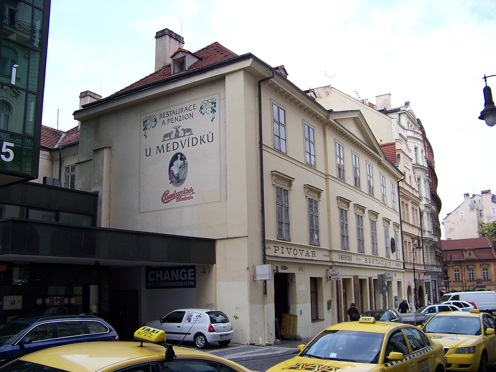
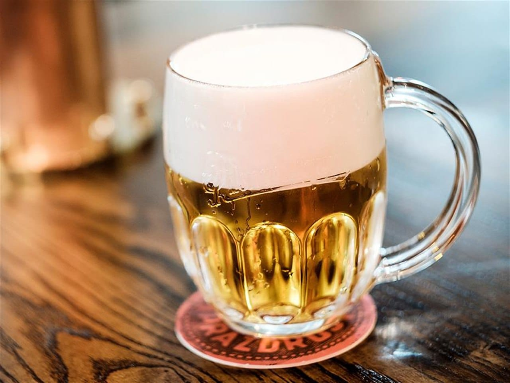

# Prague beer trail: from U Fleků to U Medvídků

Two Prague New Town houses, less than a kilometre apart, hold opposite attitudes to beer. U Fleků brews one dark lager and has done so for centuries; U Medvídků packs a microbrewery, restaurant, hotel and beer shop into one old building. Fifteen to twenty minutes on foot connects them, and an afternoon is enough. This route suits anyone who has had a few Czech beers and wants to understand why lager is taken so seriously here.

Figure: "Prague beer trail: from U Fleků to U Medvídků". Photograph: File:Plzeň - Sady 5. května - View East over Mlýnská strouha towards Plzeňský Prazdroj (Pilsner Urquell Brewery).jpg. Credit: Txllxt TxllxT, CC BY-SA 4.0 ([source page](https://commons.wikimedia.org/wiki/File:Plze%C5%88_-_Sady_5._kv%C4%9Btna_-_View_East_over_Ml%C3%BDnsk%C3%A1_strouha_towards_Plze%C5%88sk%C3%BD_Prazdroj_(Pilsner_Urquell_Brewery).jpg)). Category image; not a claim that it shows the exact product, site or event.

## One house, one beer; another house, one brewery

- Stop one: [U Fleků](ref:ufleku), Křemencova 11, 110 00 Praha 1, near Charles Square.
- Stop two: [U Medvídků](ref:umedvidku), Na Perštýně 7, 110 00 Praha 1, between Národní třída and Bethlehem Square.
- Mode: on foot, about fifteen to twenty minutes; one stop on metro line B also works.
- Duration: three to four hours. Ninety to one hundred and twenty minutes at U Fleků, ninety to one hundred and fifty at U Medvídků.

Start with U Fleků because its list is narrow: learn the malt sweetness and low bitterness, then compare a wider range at U Medvídků. The reverse order works, but the second stop can become "many beers, no memory of the first".

## U Fleků: the confidence of a single beer

In 1499 Vít Skřemenec bought the property, the first record of brewing on the site. Today the list is almost one beer: Flekovský tmavý ležák 13°, a dark, unfiltered lager. The 13 is the Czech way of stating original gravity, not alcohol; check the menu or label for strength. Expect malt sweetness, caramel and toasted bread, low bitterness, fine foam and a serving temperature warmer than ice-cold.

Brewing one beer fixes recipe, mashing, fermentation and service, so the same glass tastes the same at every table. Beer comes from the brewery on site, and waiters carry trays between tables, sometimes setting a glass down unasked; say no clearly, or the bill will include glasses you never ordered. Staff record each glass on the table card, and checking it before paying is the most useful habit here.

The building is a set of halls and a courtyard with wooden panelling and vaults; inner halls are quieter, those by the courtyard louder. An accordion often plays in the evening, and tour groups can fill a hall, so look around before choosing a table.

## From Charles Square to Národní

Leave U Fleků, follow Křemencova to Charles Square, cross its south-eastern corner, take Spálená north-east, then Národní, and turn into Na Perštýně. The walk is about a kilometre, fifteen to twenty minutes, mostly flat, though old-town cobbles are hard on thin soles and wheeled luggage.

You pass the New Town Hall and the National Theatre end of Národní; stay on main streets if time is short. Metro line B stops at Národní třída near the second stop, and trams serve Národní divadlo and Karlovo náměstí. Central Prague is walkable, but use the crossings.

## U Medvídků: a brewery packed into the old town

Brewing on this site goes back to 1466, when Jan Nedvídek opened a brewery; the small plant closed in 1898, and after a full renovation completed in 2005 the old malt house became a "beer house" holding the shop, meeting rooms and microbrewery. The entrance leads to the restaurant and bar, the hotel is upstairs, the shop is to one side, and the brewhouse sits at the back and below.

The point is visible old craft: a 250-litre mash tun, open fermentation vessels, 500-litre oak casks, natural cooling and hand bottling, with an annual ceiling of 300 hectolitres. The list is therefore wider than at U Fleků: semi-dark, pale specials, double-hopped lagers, wheat beer and dark specials, with X-BEER 33 as the strong house flagship, best shared slowly rather than drunk on an empty stomach.

The brewery tour is arranged by phone or email, with date, language and group size agreed ahead. Drinking and eating need no booking; groups and tasting packages should ask ahead.

## Original gravity and Czech lager

Czech menus state beer by original gravity, written as a number of degrees. It describes fermentable material in the wort before fermentation, not alcohol; a 13-degree dark lager usually has more body than a 10 or 12-degree pale lager, but strength still depends on how far fermentation goes. Mistaking the degree for alcohol is the common visitor error.

The tmavý ležák at [U Fleků](ref:ufleku) and the světlý ležák of Pilsen are two ends of the same lager method: cool fermentation, long lagering, an emphasis on cleanliness and consistency. The difference is malt and roasting, with dark beer using more caramel malt and pale beer relying on Pilsen malt and herbal hop bitterness. Pale and semi-dark beers at [U Medvídků](ref:umedvidku) exaggerate the small-brewery traits of unfiltered beer and cask maturation, giving more body and a shorter shelf life.

## Booking, seasons and pace

U Fleků charges no entrance fee; you pay for what you order. The brewery museum and cabaret require booking. At U Medvídků the microbrewery tour is booked ahead, while walk-in diners are fine; groups and tasting packages should make contact first. Both fill in summer and at weekends, so choose the afternoon; winter is emptier but colder.

Czech pubs refill quickly, so say "no more" clearly when done, and check the table card before paying. Tipping is optional, usually rounded up or 5%–10%. The cobbles are uneven, so walk slowly after two beers; take the metro or tram back rather than driving.

This route covers route structure and verifiable facts only, with no live opening status, prices or performance schedules; check the two venues' official channels. Page verified on 2026-11-08.

Further reading: [Pilsner Urquell Brewery: Where the Golden Lager Was Born](ref:c-extra-1).

Put [U Fleků](ref:ufleku)'s stop order next to [Pilsner Urquell Brewery: Where the Golden Lager Was Born](ref:c-extra-1)'s transport; the difference marks the boundary.

**Key facts.**

| Item | Detail |
| --- | --- |
| In one line | Walk from U Fleků, which brews a single dark lager, to U Medvídků, which packs a microbrewery into an old town house. Less than a kilometre apart, the two stops put two Prague attitudes to beer into one afternoon: one be… |
| Stops | 2 |
| Transport | walk |
| Stop order | U Fleků、U Medvídků |

## Related images

Image: U Medvídků. Credit: ŠJů ( cs:ŠJů ), CC BY-SA 3.0, via Wikimedia Commons ([source page](https://commons.wikimedia.org/wiki/File:Na_Per%C5%A1t%C3%BDn%C4%9B_5,_U_Medv%C3%ADdk%C5%AF.jpg)). Related image for Prague beer trail: from U Fleků to U Medvídků.

Image: Pilsner. Credit: Steven Walling, CC BY-SA 4.0, via Wikimedia Commons ([source page](https://commons.wikimedia.org/wiki/File:Pilsner_urquell_mug.jpg)). Related image for Prague beer trail: from U Fleků to U Medvídků.
