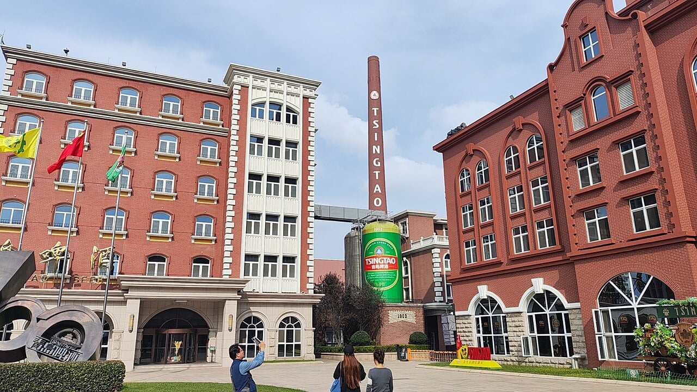
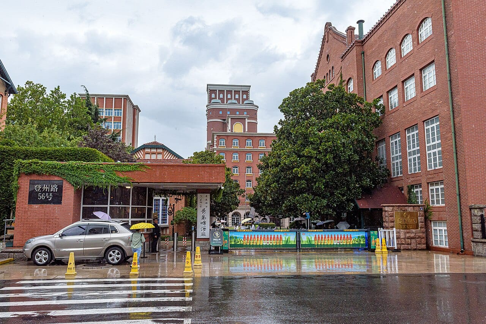

# Qingdao Beer Trail: museum, old brewery and Dengzhou Road

Qingdao's beer visit has a very short geography: enter the museum for history, walk the glass corridor to see production, then step outside onto the beer street. All three stops sit around 56 Dengzhou Road and can be linked on foot, yet they answer different questions. The museum explains where Tsingtao beer came from; the old plant shows how it is still made; the street shows how it enters the city's nights. Keep those layers apart and half a day becomes more than a single glass.

Figure: "Qingdao Beer Trail: museum, old brewery and Dengzhou Road". Photograph: File:PenglaiPavilion.jpg. Credit: Chrishcn, CC BY 2.0 ([source page](https://commons.wikimedia.org/wiki/File:PenglaiPavilion.jpg)). Category image; not a claim that it shows the exact product, site or event.

> **Quick verdict**
> **In one line:** This route helps you plan Qingdao Beer Trail: museum, old brewery and Dengzhou Road, including the order, timing and stops that matter.
>
> - **Best for:** Anyone turning Qingdao Beer Trail: museum, old brewery and Dengzhou Road into a one- or two-day route and needs the order and the stops that matter.
> - **Not for:** If you want only want one stop and do not intend to follow a route.
> - **Check first:**
>   - - Stop 1: the Tsingtao Beer Museum, 56 Dengzhou Road, Shibei District.
>   - The museum opened on 15 August 2003, the centenary of Tsingtao beer, on the site of the 1903 German brewery.

## Route at a glance

- Stop 1: the [Tsingtao Beer Museum](ref:museum), 56 Dengzhou Road, Shibei District. It opened in 2003 on the site of the 1903 German brewery; allow 1.5–2 hours.
- Stop 2: the [Tsingtao Brewery Dengzhou Road plant](ref:brewery), the same address. It is a working old plant, visited through the museum's route and Hall B's glass corridor; allow 30–45 minutes.
- Stop 3: [Dengzhou Road Beer Street](ref:beer-street), running from Yan'an 2nd Road to Shouguang Road, about 710 metres long; allow 1–2 hours around a meal.
- Movement: all on foot; the museum and street share a block, so metro plus walking beats driving.
- Rhythm: enter the museum after opening, leave around midday, eat on the street, and return in the evening for a drink if you want the night atmosphere. For a half-day, museum plus lunch is enough.

## Why the three stops share one block

Most cities put the museum, the factory and the bar street in three different places. Dengzhou Road is an exception. The Tsingtao Beer Museum stands inside the still-operating plant at 56 Dengzhou Road, and Hall B sits next to the production floor, so visitors look through glass at brewing and packaging. The beer street grew around the same plant, running east from Yan'an 2nd Road to Shouguang Road, about 710 metres, with dozens of hotels, beer bars and restaurants. The three stops are not three directions but three layers of one block.

That also creates a common mistake: treating "Tsingtao Brewery" and "Tsingtao Beer Museum" as two separately ticketed attractions. The museum is the visitor interface; the plant is production. Without the museum's route and booking, visitors cannot walk into the workshops. The second stop is listed separately not for another ticket, but to make you linger at the glass corridor and notice that the old plant is still working.

## Stop 1: Tsingtao Beer Museum

The museum opened on 15 August 2003, the centenary of Tsingtao beer, on the site of the 1903 German brewery. The buildings are red-brick workshops with pitched roofs and old industrial fittings. The visit is usually described as two halls: Hall A covers the century of history and old equipment, including an old electric motor, brewing vessels and early archives; Hall B sits beside the production floor, where a glass corridor overlooks the modern brewhouse and filling line. The official introduction puts the collection at more than 30,000 objects.

Take Hall A before Hall B. Hall A lays out the timeline from the German leasehold and the founding of the brewery through later brand development, old equipment and in-situ heritage. Hall B connects history to the present: the old vessels are copper and cast iron, the new line is stainless steel and automation. Standing at the glass, you see that "traditional craft" and "modern industry" are not opposites but stages of the same technical route.

Tickets are usually booked in real name through the museum's WeChat account; the standard ticket includes Halls A and B plus one glass each of draft and pure-draft beer, while tasting, combined and VIP tickets differ. Opening hours change with the season: July–August 07:30–19:30 with last entry at 18:30; November–December 08:30–17:30 with last entry at 16:30. Holidays follow notices. Arrive early or after three to avoid tour groups.

## Stop 2: Tsingtao Brewery Dengzhou Road plant

Walking from the museum into Hall B, you are already inside the Dengzhou Road plant. A 2026 report from the Qingdao municipal SASAC states that the museum stands inside the still-operating old plant at 56 Dengzhou Road, and that Hall B's glass corridor overlooks the whole brewing and dispatch process. That sentence is the key: the "old plant" is not a stopped relic but a production unit that still ships beer.

So the second stop is not another attraction; it is the point where the history in the museum is put back into a working site. Look at the sequence from saccharification and boiling to fermentation, filtration and filling; at how the old buildings have been kept while new equipment is fitted inside; at how workers, pipes, valves and vehicles share a compact space. Do not push open production doors, touch equipment or pipes, or step past the glass corridor.

This is why Qingdao's industrial tourism is more than an exhibition. The museum preserves the old equipment, archives and brand history; the plant preserves the fact that beer is still made here. Together they make a living industrial heritage. See only Hall A and you might think this is a history museum; see only the beer street and you might think Tsingtao is just a consumer symbol. The second stop holds the story together.

## Stop 3: Dengzhou Road Beer Street

Outside the plant is Dengzhou Road Beer Street. Qingdao Government describes it as running east from Yan'an 2nd Road to Shouguang Road, about 710 metres long, a commercial street defined by beer, with roughly 50 businesses including more than 20 hotels, beer bars and restaurants. The Qingdao culture and tourism bureau calls its nights "a beer festival that never ends". By day it is an ordinary old street; in the evening the lights come on, seafood stalls and beer houses put tables outside, and the atmosphere arrives.

Drinking here is different from the museum: the tasting compares two glasses, while the street is about pairing a jug of draft with spicy clams, grilled seafood, sea intestine or mackerel dumplings, eaten slowly. Draft retains more yeast and suspended solids, giving a fuller body and malt aroma, and needs refrigeration and a short shelf life; pure draft is cleaner and more stable; draught is sold by the glass or jug. Qingdao also has a local habit of taking loose beer home in a plastic bag, but on Beer Street the jug is the norm.

Ask about the unit and the price before ordering: by jug, glass, bottle or weight; seafood by portion or market price. The street promotes transparent pricing and scan-to-check supervision, but menus differ from shop to shop, so confirm before you order. Read the menu, look at the fridge and see whether locals are eating there.

## German lager and Qingdao beer

Tsingtao's underlying style is German lager. Lager uses bottom-fermenting yeast at a relatively low temperature and then a period of cold storage, which gives a cleaner body and a more stable aroma. The German-funded brewery of 1903 brought German equipment, red-brick workshops and a brewing tradition into Qingdao; local water, malt, hops and yeast later developed their own expression. Visitors do not need the recipe ratios. Three keywords — bottom fermentation, cold storage, clean finish — are enough to separate lager from ale.

The museum's display of old equipment beside a modern line is the most rewarding part of the visit. It does not seal tradition away; it shows tradition still in use. The old motor, copper vessels and early archives are industrial heritage, while the stainless tanks and filling line behind the glass are the present. The two are not a break but an iteration. After that circuit, a glass of fresh draft makes the word "freshness" in Tsingtao's marketing easier to understand.

## Transport, seasons and consumption boundaries

By metro, lines 1 and 2 stop at Taidong, a short walk from the museum and the street; buses also serve the beer museum stop. Dengzhou Road is narrow and parking is limited, so metro plus walking is best; a taxi can drop you at either end of the street. The museum and the street are about ten minutes apart on foot.

July and August are the busiest and hottest months; the museum opens early and closes late, so use the edges of the day. May–June and September–October are more comfortable and less crowded. In winter the museum stops entry at 16:30, so move the schedule earlier. The Qingdao International Beer Festival's main venue is in the Golden Sand Beach area of West Coast New Area, not on Dengzhou Road; do not treat the festival and the street as the same event.

Set consumption boundaries. The museum and plant are for visiting, not for opening bottles; the street is a commercial dining area, not an extension of the exhibition. Do not drive after tasting: the old city has steep slopes and many one-way streets. Minors must not drink; families can focus on the old equipment, the glass corridor and the interactive displays.

## See also

This route puts industrial history, production and nightlife on one street: the museum for where it came from, the old plant for how it is made now, the beer street for how it is consumed. For background, read the [Tsingtao Beer Museum](ref:museum), [Tsingtao Brewery](ref:brewery) and [Dengzhou Road Beer Street](ref:beer-street) entries. With half a day, keep the museum and one meal.

Opening hours, tickets, menus and bookings follow official channels; pages verified 2026-11-08.

## Related images

Image: The red-brick courtyard at the Tsingtao Brewery site on Dengzhou Road, with TSINGTAO lettering on the chimney and the green can-shaped installation.. Credit: Suginami, CC0 1.0, via Wikimedia Commons ([source page](https://commons.wikimedia.org/wiki/File:Tsingtao_Brewery_Museum_inside_2024.jpg)). Related image for Qingdao Beer Trail: museum, old brewery and Dengzhou Road.

Image: Tsingtao Brewery Company Limited. Credit: N509FZ, CC BY-SA 4.0, via Wikimedia Commons ([source page](https://commons.wikimedia.org/wiki/File:Tsingtao_Brewery_No._1_Factory_(20250919130654).jpg)). Related image for Qingdao Beer Trail: museum, old brewery and Dengzhou Road.
