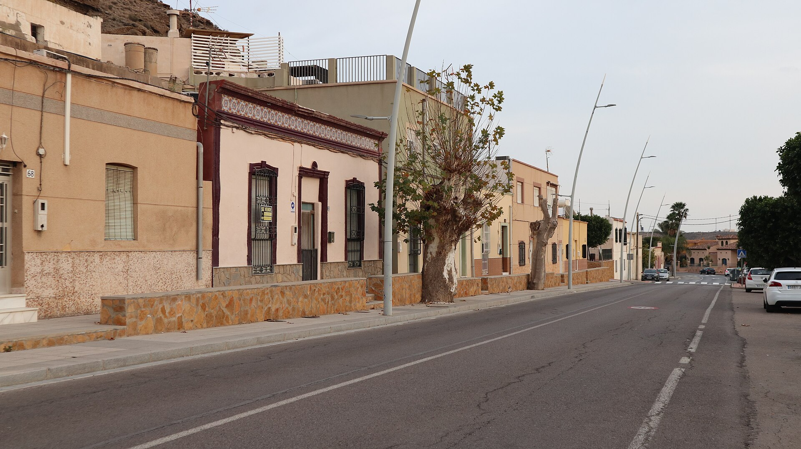

# Rioja: three century-old bodegas by Haro station

Haro's Barrio de la Estación is easy to underestimate. Step off the platform and within minutes you pass the old walls of López de Heredia, La Rioja Alta and CVNE; all three were founded in the second half of the nineteenth century, all three used the railway to send wine to France, and each took a different path. This route uses three stops to explain American oak, long ageing and appointment-only visits, and it can be walked end to end.

Figure: Related photograph of Rioja: three century-old bodegas by Haro station. Image: Schumi4ever, CC BY-SA 4.0, via Wikimedia Commons ([source page](https://commons.wikimedia.org/wiki/File:N-340a_Rioja.jpg)).

## Route overview

- Stop one: [Bodegas López de Heredia](ref:lopez), Avenida de Vizcaya 3, 26200 Haro; founded in 1877 by Rafael López de Heredia, known for underground cellars, its own cooperage and long-aged Reserva and Gran Reserva.
- Stop two: [La Rioja Alta, S.A.](ref:riojalta), Avenida de Vizcaya 8, 26200 Haro; founded in 1890 by five Riojan and Basque families, known for American oak, regular racking and Viña Ardanza, 904 and 890.
- Stop three: [CVNE](ref:cvne), Calle Barrio de la Estación 2, 26200 Haro; founded in 1879 by the Real de Asúa brothers and home to Cune, Viña Real and Imperial.
- Mode: train to Haro, then walking; the wineries are five to ten minutes apart. A car is possible, but do not drive after tasting.
- Suggested duration: a full day. First stop in the morning, lunch in Haro's old town, the second and third in the afternoon; leave an hour between bookings and check the return train.

## Why this route

The station district was a spatial reorganisation of Rioja wine in the second half of the nineteenth century. The railway replaced horse-drawn carts and let barrels reach France faster and more cheaply. At the same time, French vineyards were hit by oidium around 1863 and then phylloxera, and merchants crossed the Pyrenees to buy Rioja. Demand, railway and capital pulled wineries towards Haro station. Local tourism calls it the world's densest concentration of century-old wineries; the claim is promotional, but the three houses are minutes apart.

The route turns American oak and long ageing into a comparable line. Traditional Rioja reds age in American oak, which brings vanilla, coconut, dill and sweet spice; barrel and bottle ageing give dried fruit, leather and tobacco rather than raw fruit. López de Heredia pushes time to an extreme, releasing Reserva and Gran Reserva long after the legal minimum. La Rioja Alta uses American oak and regular racking, with Viña Ardanza earlier and 904 and 890 slower. CVNE covers a wider range, from everyday Cune to Imperial.

## Stop one: López de Heredia

Why first: it takes tradition to its limit. Rafael López de Heredia y Landeta founded it beside Haro station in 1877, when French vineyards were suffering from phylloxera and Rioja gained the French market. Its tradition is not a refusal of modern equipment but a slow timetable: reds spend years in oak, Gran Reserva far beyond the legal minimum, with annual racking, egg-white fining and bottle age.

What to see: the underground cellars, cut into sandstone, with passages more than ten metres below ground, cold and damp, with black mould on the walls. They hold rows of Bordeaux-style oak barrels, and the winery still keeps its own cooperage.

What to taste: Viña Tondonia is the flagship, with Tempranillo-led reds plus small amounts of Garnacha, Graciano and Mazuelo; the white is mostly Viura, aged in oak for years and golden, with nuts, honey and oxidative notes; rosé is scarce. Viña Bosconia is rounder, Viña Cubillo earlier to drink and Viña Gravonia another white line. Compare a Reserva with a Gran Reserva, or a red with a white; do not serve the white too cold.

Confirm the rules in advance. The winery takes bookings only, with no walk-in tours or tastings; contacts are visitas@tondonia.com and +34 941 310 244, usually Monday to Saturday, and it closes during harvest. Some sources say visits are aimed mainly at trade and groups, so whether a private visitor can book, and whether a tasting is included, must be confirmed by email.

## Stop two: La Rioja Alta

Why go: it turns American oak and long ageing into a stable style. In 1890 five Riojan and Basque families founded the Sociedad Vinícola de La Rioja Alta in Haro's station district; the first president was Doña Saturnina García Cid y Gárate and the first winemaker Monsieur Vigier. The house treats its 1890 Reserva as the ancestor of today's Gran Reserva 890, while 904 points to 1904.

What to see: the barrel cellar, where rows of American-oak casks, low light, mould and damp floors create a concrete sense of time. Its own cooperage at Labastida controls toasting and cask use, uncommon in Rioja. Racking is the other detail: traditional Rioja moves wine from cask to cask, separating sediment and giving brief contact with oxygen.

What to taste: Viña Alberdi is the younger Crianza, Viña Arana a Reserva, and Viña Ardanza the flagship Reserva, where Tempranillo and Garnacha add roundness and spice. Gran Reserva 904 and 890 are the long-aged top wines, arriving with dried fruit, leather, tobacco and vanilla. American oak gives vanilla, coconut, dill and sweet spice; long ageing folds those notes into fruit and acidity. Compare Viña Ardanza with 904.

Visits are by appointment, usually on weekdays, and the harvest in September and October reduces reception. Packages differ in length, tasting content and language. Cellars are cold and damp, so wear flat shoes and a thin jacket; the shop's hours are irregular.

## Stop three: CVNE

Why go: it shows an old site still in production and a family brand with several tiers. In 1879 Eusebio and Raimundo Real de Asúa founded CVNE in Haro's station district under the full name Compañía Vinícola del Norte de España; it is still run by the founders' descendants in the fifth generation. Inside, the Aldea del Vino is a courtyard enclosed by stone buildings with tiled roofs. The oldest hall is often called Nave Eiffel, linked by tours to the Eiffel workshop; the attribution carries storytelling, so confirm it with the winery.

What to see: the route from the Aldea del Vino through the old halls, fermentation, the barrel cellar and the bottle cellar. Timber beams, brick walls and ironwork survive, and walking through gives a sense of nineteenth-century scale: tall, narrow, side-lit, with rows of casks running into the dark. American oak dominates the ageing, and the house often ages longer than the legal minimums.

What to taste: Cune runs from Crianza and Reserva to Gran Reserva in a classic Rioja style of red fruit, vanilla, leather and tobacco, good with roast lamb, ham and stews. Imperial focuses on ageing and complexity and is often treated as the flagship; Viña Real from Rioja Alavesa is fresher and more fruit-forward; Monopole is the classic white, mostly Viura, oak-fermented and aged, with nuts, honey and citrus. Compare Cune Reserva with Imperial Reserva.

Visits must be booked in advance, usually on weekdays, and the harvest reduces reception. Packages differ in length, tasting content and language. The shop's hours are irregular and some periods are open only to booked visitors.

## Transport and booking

The easiest way to reach Haro is by train. Haro station sits beside the district: three to five minutes on foot to CVNE, five to ten to López de Heredia and La Rioja Alta. Renfe regional trains stop at Haro, with Logroño forty minutes to an hour away and Bilbao about two hours, but services are infrequent; check the return. By car, Logroño is about 45 km and Bilbao about 120 km; town-centre parking is limited.

Booking is the precondition. All three take bookings only; López de Heredia works by email and phone, while La Rioja Alta and CVNE use their official sites. Confirm date, time, language, group size, whether a tasting is included and the price. The harvest closes or reduces visits, and Sundays and holidays are usually unavailable. A visit lasts one to two hours; cellars are cold, so bring a jacket.

Do not crowd three tastings together. Palate fatigue turns the third visit into an exercise in not tasting the difference; the value here is comparison: one district, similar varieties, three wines. Lunch belongs in Haro's old town around Plaza de la Paz. If you are driving later, spit every drop.

## Seasons, etiquette and alternatives

High season runs from May to October; September and October bring the harvest, when some wineries close or reduce visits. The Haro Wine Festival on 29 June, the Batalla del Vino, makes the town extremely busy. Winter is quiet, with shorter hours and fewer tours.

A winery is a production site, not a bar. Arrive at the booked time; lateness may shorten the visit or lead to refusal. Do not touch casks, pipes, old photographs or displays. Check before photographing; flash and tripods are usually unwelcome. Avoid strong perfume and loud conversation, and use the spittoon without embarrassment.

With time for only two, keep López de Heredia and La Rioja Alta for tradition and long ageing; if brand tiers matter more, keep La Rioja Alta and CVNE. The district also holds Muga, Gómez Cruzado, Bilbaínas and Roda. Haro's old town, the Vivanco museum at Briones, Laguardia and Rioja Alavesa deserve separate days.

## See also

- [Bodegas López de Heredia](ref:lopez): 1877, underground cellars and long barrel ageing.
- [La Rioja Alta, S.A.](ref:riojalta): 1890, American oak, Viña Ardanza and 904/890.
- [CVNE](ref:cvne): 1879, the Aldea del Vino, Cune and Imperial.

Opening hours, bookings and transport are subject to official channels; page verified on 2026-11-08.
