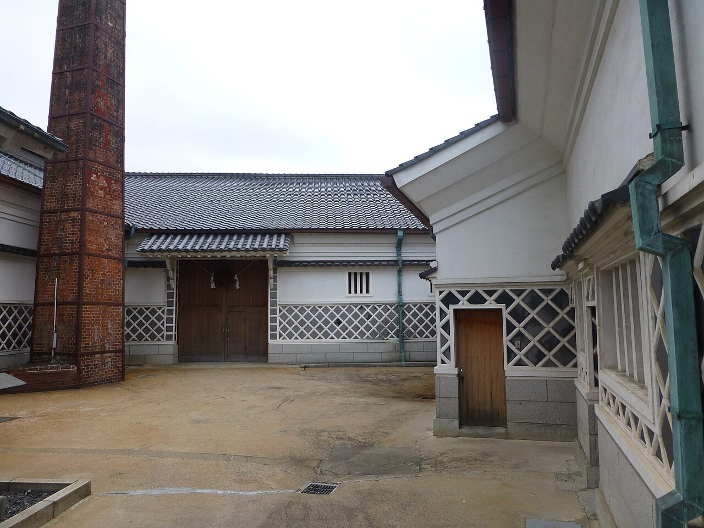

# Saijo sake route: Kamotsuru to Kamoizumi on foot

The Saijo sake route is not a long cross-prefecture drive. It is a district walk: start at Kamotsuru's No. 1 Brewery, follow Sakagura-dori to Kamoizumi's Enju warehouse, and both stops sit within walking distance of JR Saijo Station. The route works not because there are many attractions but because seven brewing companies stand within about 1.5 km, an unusually dense industrial cluster. One walk shows a working plant, a converted warehouse open to visitors and a weekend tasting room in the same morning.

Figure: A brewery courtyard in the Saijo sake district, with a brick chimney beside white-walled storehouses. Image: Max Nossin, CC BY 3.0, via [source page](https://commons.wikimedia.org/wiki/File:Sake_factory_-_panoramio_(1).jpg).

> **Quick verdict**
> **In one line:** This route helps you plan Saijo sake route: Kamotsuru to Kamoizumi on foot, including the order, timing and stops that matter.
>
> - **Best for:** Anyone turning Saijo sake route: Kamotsuru to Kamoizumi on foot into a one- or two-day route and needs the order and the stops that matter.
> - **Not for:** If you want only want one stop and do not intend to follow a route.
> - **Check first:**
>   - - Stop one: Kamotsuru, 9-7 Saijo Honmachi, the No.
>   - Spring is the season of kurabiraki, the opening of the brewery.

## Route overview

- Stop one: [Kamotsuru](ref:kamotsuru), 9-7 Saijo Honmachi, the No. 1 Brewery shop; about three minutes on foot from JR Saijo Station, 10:00–18:00, free admission.
- Stop two: [Kamoizumi](ref:kamoizumi), 2-4 Saijo Kamiiichi-machi, the Enju warehouse; booked weekday visits, with Shusenkan receiving guests at weekends and on holidays.
- Mode: walk. The two stops are about ten minutes apart, past other breweries' warehouses and chimneys.
- Time: half a day. Add a brewing-hall tour or a kurabiraki event and it becomes a full day.
- Check first: Kamoizumi's official site says tour bookings are suspended, so call ahead; Kamotsuru's No. 1 Brewery needs no booking.

## Why Saijo: seven breweries within a kilometre

In [Japan](ref:japan), Saijo is often grouped with Fushimi in Kyoto and Nada in Hyogo as one of Japan's three great sake places, but its layout is different. Fushimi is a city district woven through with waterways and breweries; Nada is a coastal belt of large capacity. Saijo packs seven brewing companies into the land in front of the station. Sea-cucumber walls, red-brick chimneys and red-tiled roofs form a continuous urban texture rather than a single sight. In 2017 the brewery buildings were chosen by ICOMOS for its twenty Japanese 20th-century heritage sites; in February 2024 the No. 1 Brewery and others were listed as a national historic site as the Saijo Sake Brewery Group.

Density makes comparison easy. In one morning you can see a daiginjo-led shop, a junmai-focused tasting room and a working brewery without driving between towns or setting aside half a day for each. The cost is that every address opens differently: some are self-guided, some booking-only, some weekend-only. The first rule of the route is not to see everything but to confirm who is open that day.

## Stop one: Kamotsuru

Kamotsuru comes first because it builds the timeline. The No. 1 Brewery occupies a warehouse built in 1872, reopened in 2019 as an exhibition room and shop, and listed in 2024 as a national historic site with the Saijo group. Displays cover brewing tools and documents, the film is in Japanese with English subtitles, and QR codes give more languages. The tasting bar takes cash only, with common sets of three or four 30 ml glasses for 500 yen. The shop sells brewery-only and seasonal sake and arranges delivery.

The No. 1 Brewery is self-guided and needs no booking; only groups of twenty or more must give notice. The working brewery is normally closed and entered only on irregular booked tours, at 2000 yen per person for about an hour, led by the head brewer, with no tasting and a small daiginjo bottle to take away. With time for one stop, take the No. 1 Brewery; to enter production, check the official notice and book.

## Stop two: Kamoizumi

The second stop heads toward Kamiiichi-machi. Kamoizumi's entry is the Enju warehouse, and the visit is arranged around the guest's time: a sake film of about twenty-five minutes, an indoor introduction of about ten minutes, a brewing-hall walk of about thirty minutes, then ten to fifteen minutes on sake and the brewery and ten to fifteen minutes of tasting. Weekday slots are 8:30–12:00 and 13:30–16:00, with weekends and holidays generally refused. Book one week ahead; parties of forty or more are refused, and groups of twenty or more may be split.

At weekends the alternative is Shusenkan, open Saturdays, Sundays and holidays 10:00–17:00, with more than twenty Kamoizumi sakes available in small glasses, plus sake buns, sake fruit cake and coffee made with brewing water. The sake library upstairs is open for reading, and the shop sells the full range and limited bottles. The warning again: the official site currently says brewery tour bookings are suspended with no restart date, so check the site and telephone before travelling. If tours are still suspended, treat this stop as a tasting and buying window rather than a hall visit.

## Soft water, Yamada Nishiki and winter brewing

Saijo's brewing water comes from the foothills of the Kamo range. It is clear and on the soft side, so fermentation runs slower and the body tends to be gentle with a clean finish. Breweries still draw from wells, with the source only a few lanes from the street. Soft water means fewer off-flavours and a rounder texture, but it depends more on temperature and yeast health than harder water, which builds a heavier frame more easily. Yamada Nishiki, large-grained with a visible white core, is a common choice for ginjo-style sake; Hiroshima is itself an important producing prefecture, and Kamoizumi's flagship junmai daiginjo is labelled 100% Hiroshima-grown Yamada Nishiki.

Brewing is concentrated in winter. Rice is polished and koji made in autumn; as winter arrives, [kimoto and yamahai](ref:kimoto) or other starter methods begin, with low temperatures limiting wild microbes and keeping fermentation controllable. Pressing, pasteurisation and bottling follow in spring, and the brewery rests in summer. "Winter brewing" is not copywriting but the rhythm left by the era before refrigeration, and it still sets the schedule for the head brewer and crew. If the warehouse doors are shut and the equipment still on a route, it is often seasonal rest, not closure.

## Ginjo and junmai ginjo on the label

On Saijo shelves, ginjo and junmai ginjo often appear side by side at different prices and aromas. Under the labelling rules of the Japan Sake and Shochu Makers Association and the National Tax Agency, both require a polishing ratio of 60% or less; daiginjo and junmai daiginjo require 50% or less. The difference is the ingredient list: junmai ginjo may use only rice, rice koji and water, while ginjo allows a small addition of brewer's alcohol. Honjozo requires 70% or less, and junmai has no polishing ceiling but still forbids added alcohol. [Sake](ref:sake) itself is defined as rice, rice koji and water fermented and pressed, below 22 degrees alcohol.

Read the label in this order: junmai or not, then polishing ratio, then rice and yeast. Junmai ginjo usually has a more inward aroma, with clearer rice umami and acidity; ginjo is more outgoing and lighter in body. Neither is a synonym for better. They are two design routes, one built on rice and water, the other using a small addition to adjust the frame. Tasting two from the same brewery side by side makes the point faster than reading a single bottle.

## Kurabiraki and walking the route

Spring is the season of kurabiraki, the opening of the brewery. Kamotsuru announced its 2026 opening for 18 April 2026, 10:00–16:00, at the main brewery at 4-31 Saijo Honmachi, with free entry and no booking, limited sake and lucky bags, and parts of the hall open. Dates and contents change each year and may move for rain or maintenance, so check the official site. Other breweries hold similar events in spring, but the dates are not coordinated, so do not assume that all open on one day.

A walking plan: start at JR Saijo Station in the morning, see the displays and taste at Kamotsuru's No. 1 Brewery, then walk Sakagura-dori to Kamoizumi. Eat near the station at midday; in the afternoon, compare more at Shusenkan if it is open, or visit other brewery shops. The whole route is on foot, so wear good shoes; floors can be wet, and do not rush for a train after tasting. The train is easier than driving, especially when kurabiraki crowds tighten parking.

## References

- [No. 1 Brewery (brewery shop)](https://www.kamotsuru.jp/tour/), Kamotsuru, checked for the address, hours, tasting and tour fee.
- [The brewery](https://kamoizumi.co.jp/kura/index.html), Kamoizumi, checked for the Enju tour slots and suspension notice.
- [The Saijo sake town, Hiroshima](http://www.saijosake.com/japanese/town/), Saijo Sake Brewers Association, checked for the seven-brewery layout.
- [Sakagura-dori](https://dive-hiroshima.com/explore/1199/), Dive! Hiroshima, checked for the national historic site and 20th-century heritage.
- [Classification of Japanese sake](https://japansake.or.jp/sake/about-sake/classification-of-sake/), Japan Sake and Shochu Makers Association, checked for ginjo and junmai ginjo labelling rules.

Page verified on 2026-11-09; hours, tour arrangements and event dates are subject to official channels.
