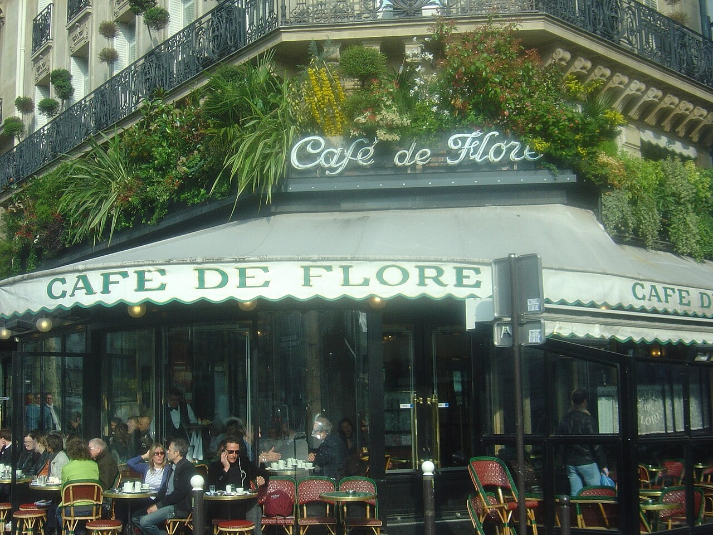
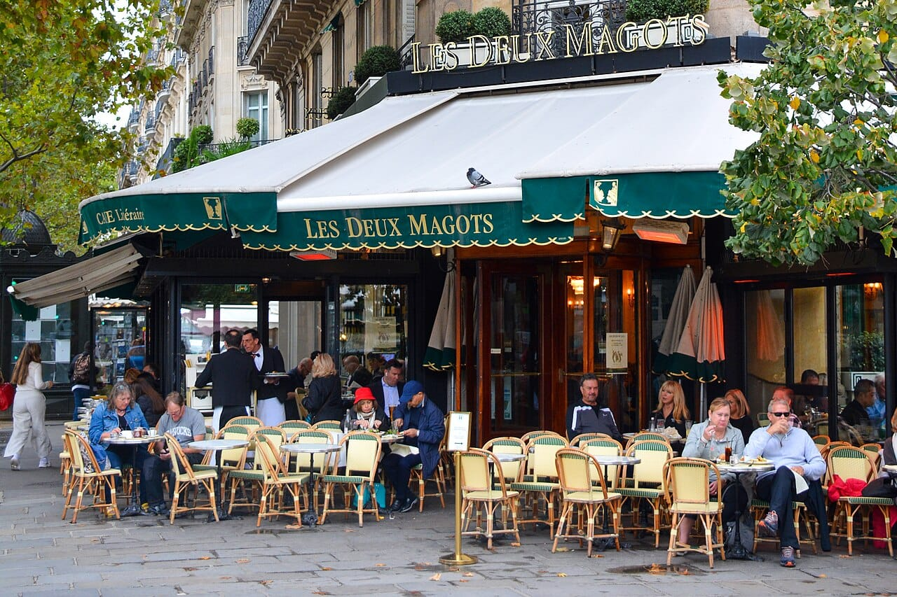
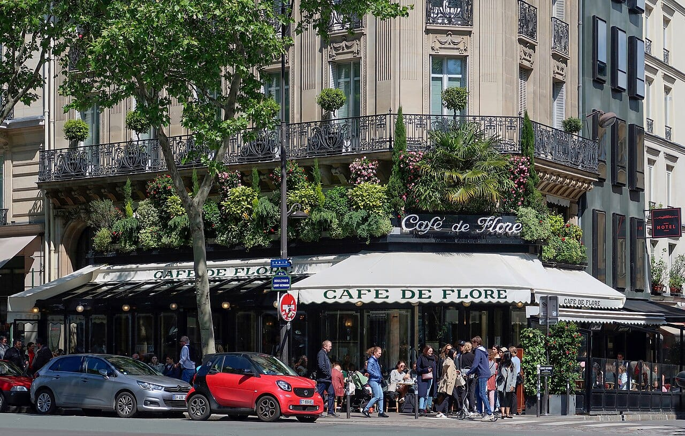

# Saint-Germain-des-Prés literary cafés: a half-day walk

This route has only two stops, both in the 6th arrondissement of Paris: Les Deux Magots first, then Café de Flore. The two are very close together, almost on opposite sides of the same street corner, so it is not a box-ticking dash but a half-day in which you can sit down, watch the quarter and read a few pages.

Figure: Café de Flore in Saint-Germain-des-Prés, Paris, its green awning and terrace facing the corner. Image: DIMSFIKAS, CC BY-SA 3.0, via [source page](https://commons.wikimedia.org/wiki/File:Cafe_de_Flore,_Paris_-_2011.JPG).

## Route overview

- Stop one: [Les Deux Magots](ref:deux-magots), 6 Place Saint-Germain-des-Prés, opened in 1885, on one side of the square.
- Stop two: [Café de Flore](ref:flore), 172 Boulevard Saint-Germain, opened in the late 19th century, on the other side of the same street corner.
- Mode: walking. No transport is needed between the stops, and changing stops takes only a few minutes.
- Suggested duration: half a day. Allow at least forty minutes at each café, and leave the rest for the square and nearby streets.

## Why these two stops

Saint-Germain-des-Prés was a gathering place for writers, philosophers and artists in the 20th century, and its cafés served as their drawing rooms and offices. Both Les Deux Magots and Café de Flore appear in that history: the former is associated with visits by Hemingway, Sartre and Beauvoir, while the latter is likewise known for its intellectual clientele. Putting the two on one route is not about which is more famous but about two slightly different café atmospheres in the same quarter.

Their closeness also lets you compare by walking: seating orientation, terrace versus interior, pace of service, price level. That comparison shows more about the literary café as urban space than sitting in a single café all afternoon.

## Stop one: Les Deux Magots

Les Deux Magots is on one side of the Place Saint-Germain-des-Prés. It opened in 1885 and takes its name from two statues of Chinese merchants inside. Its position makes it a good starting point: the square has a church, bookshops and foot traffic, and a seat on the terrace or by the window lets you read the quarter's basic layout first.

The atmosphere is a little quieter than at Flore, with mirrors, wooden seating and a traditional layout. Order a coffee or hot chocolate with a simple pastry; there are also light dishes if you want a proper meal. Prices are at the level of the Saint-Germain-des-Prés tourist quarter, and it is worth confirming before ordering whether terrace seating carries a supplement.

## Stop two: Café de Flore

Coming out of Les Deux Magots, cross the street corner and you are at Café de Flore. It opened in the late 19th century and keeps red seating, mirrors and a traditional café layout inside, with a terrace good for watching the street. Compared with the first stop, Flore has a stronger sense of stagecraft: more striking decoration, more visitors and a slower pace of service.

This is a good place for hot chocolate, coffee or a French breakfast. If you want a quiet conversation, avoid weekend afternoons; if you only want the atmosphere, come outside main meal times and stay half an hour. As at the first stop, confirm the terrace service charge before ordering so that an extra line on the bill is not a surprise.

## How to walk it

The route needs no complicated turns: use the Place Saint-Germain-des-Prés as the landmark, find Les Deux Magots on one side of the square, and after sitting there cross the street corner and walk along Boulevard Saint-Germain to Café de Flore. Both are near the same street corner, a few minutes on foot, with no metro or bus needed.

Schedule this walk in the morning or afternoon, avoiding the lunch peak and the early evening rush. From the Saint-Germain-des-Prés metro station, it is smoother to reach the square first; for specific exits and step-free routes, follow the on-site guidance of Paris public transport.

## Cost, booking and timing

Neither café needs to be booked far ahead, but terrace seats may involve a wait in high season. Cost depends mainly on the type of seat: terraces, street-facing positions and interior seats may follow different pricing rules at different venues, and music, performance or service supplements may appear. Both are in the tourist quarter, so do not treat “a coffee” as a cheap option.

Half a day is enough: forty to sixty minutes at the first stop, a few minutes' walk, forty to sixty minutes at the second, with the remaining time for the square, bookshops and nearby streets. If you only want photographs, the route can be compressed into an hour, but that loses the pace it was designed for.

## Boundaries

Opening hours, menus, prices, seating rules and temporary closures are set by the two venues' official channels; this route describes the structure of the route and does not guarantee any particular day's opening. Literary visits are historical narrative, not a statement about current quality, and there is no guarantee of sitting in “the seat where so-and-so sat”.

For Saint-Germain-des-Prés literary cafés: a half-day walk, this route provides neither a map nor coordinates: the two venues' latitude and longitude are left empty in the content repository, and with no verifiable coordinate source the project rule is not to draw a schematic map, only to describe the walking relationship in words. For precise navigation, use a live map service and follow on-site signage.

Further reading: [Reading a city through its bars](ref:c-extra-1), [Beyond the bar: following a drink to where it is made](ref:c-extra-2), [France](ref:c-extra-3).

[Les Deux Magots](ref:deux-magots) and [Reading a city through its bars](ref:c-extra-1) are the two useful reference points for Saint-Germain-des-Prés literary cafés. [Les Deux Magots](ref:deux-magots) sets out stop order; [Reading a city through its bars](ref:c-extra-1) brings in transport. Read them together.

**Short definition:** A two-stop walking route around the Place Saint-Germain-des-Prés in Paris: sit first at Les Deux Magots looking onto the square, then cross the street corner to Café de Flore. The two are very close together, so this suits half a day of slow walking rather than sightseeing on a schedule.

**Key facts.**

| Item | Detail |
| --- | --- |
| In one line | A two-stop walking route around the Place Saint-Germain-des-Prés in Paris: sit first at Les Deux Magots looking onto the square, then cross the street corner to Café de Flore. The two are very close together, so this sui… |
| Stops | 2 |
| Transport | walk |
| Stop order | Les Deux Magots、Café de Flore |

**Sources and limits.** The key claims about Saint-Germain-des-Prés literary cafés: a half-day walk are checked against the following sources: Les Deux Magots (Used to check the address, opening year and visiting information; Used to check the 1884 founding and the 140th-anniversary page; no source text reproduced), Café de Flore (Used to check the address and visiting information; Used to check the Prix de Flore, founded in 1994, and recent winners; no source text reproduced), Office de Tourisme de Paris (Used to check the background of the Saint-Germain-des-Prés quarter and its café culture). Prices, batches and status change; the body is project-written and does not reproduce source text.

## Related images

Image: Les Deux Magots. Credit: Cheng-en Cheng from Taichung City, Taiwan, CC BY-SA 2.0, via Wikimedia Commons ([source page](https://commons.wikimedia.org/wiki/File:Les_Deux_Magots,_25_September_2019.jpg)). Related image for Saint-Germain-des-Prés literary cafés: a half-day walk.

Image: Café de Flore. Credit: Celette, CC BY-SA 4.0, via Wikimedia Commons ([source page](https://commons.wikimedia.org/wiki/File:Caf%C3%A9_de_Flore,_172_boulevard_Saint-Germain,_Paris_6e.jpg)). Related image for Saint-Germain-des-Prés literary cafés: a half-day walk.
