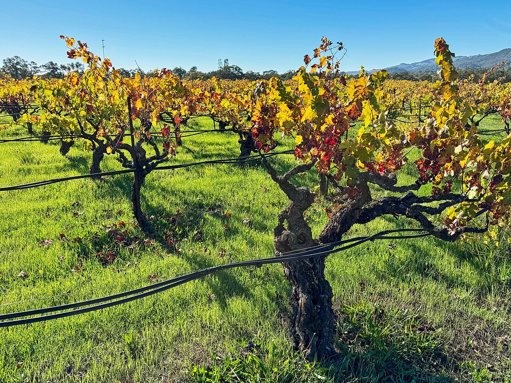

# Sonoma County Wine Route

A day from Healdsburg: Jordan in Alexander Valley in the morning for Cabernet and a French château, then Williams Selyem in Russian River Valley in the afternoon for Pinot Noir, setting “inland heat” and “coastal fog” on the same table. The loop is about 70 kilometres; the point is two very different estates and the two climates behind them.

Figure: Sonoma County Wine Route: Bedrock Vineyard in Sonoma Valley California (Wikimedia Commons). Image: Treephoto, CC BY-SA 4.0, via Wikimedia Commons ([source page](https://commons.wikimedia.org/wiki/File:Bedrock_Vineyard_in_Sonoma_Valley_California.jpg)).

## Route overview

Leave Healdsburg Plaza at 9:00, take Alexander Valley Road north and reach Jordan around 9:20. Do the château tour and tasting in the morning, focusing on Cabernet and Chardonnay, then lunch at the estate or back in town around noon. At 13:30 drive southwest to Westside Road and reach Williams Selyem around 14:10; taste for ninety minutes, return around 15:45 and be back in Healdsburg by 16:15. If you still have energy, end with a glass or a bookshop on the plaza rather than a third winery.

This route suits anyone who has seen Napa and wants a different rhythm. Sonoma County is larger and more scattered, and estates are often twenty to forty minutes apart; two wineries a day is the limit, three becomes a race. Jordan and Williams Selyem represent the two extremes: a French château with Cabernet and a food programme, versus a garage-born Pinot estate with allocations.

## Regional background

Sonoma County lies north of San Francisco and is much larger than Napa Valley, running from the Pacific coast to the Mayacamas range and containing more than a dozen appellations. Russian River Valley and Sonoma Coast near the ocean are cooled by Pacific fog, ripening slowly and suiting Pinot Noir and Chardonnay; Alexander Valley inland is sheltered from the fog by the mountains, hotter by day, and suits Cabernet, Merlot and Syrah. Within one county, an hour’s drive can take you from “bring a jacket” fog to a thirty-degree inland afternoon.

That split explains why Sonoma has no single “Sonoma taste”: there are only valleys, aspects and fog lines creating microclimates. A route built around famous names alone can cram two estates forty minutes and one climate apart into one day; a route built around climate belts flows better.

## Stop one: Jordan

Jordan is at 1474 Alexander Valley Road, about fifteen minutes north of Healdsburg. In 1972 Tom and Sally Jordan bought 275 acres on the Alexander Valley floor; in 1974 they swapped for about 1,300 hillside acres, hired André Tchelistcheff as consultant and Bob Arrigoni as architect, and completed the winemaking wing one week before the 1976 harvest — the first vintage of Cabernet and Merlot.

Jordan makes only two wines: Alexander Valley Cabernet Sauvignon and Russian River Valley Chardonnay. The Cabernet is mostly Cabernet with small amounts of Merlot, Petit Verdot, Malbec and Cabernet Franc, aged in French oak and styled to be approachable young yet age gracefully; the Chardonnay is Burgundy-style, partly barrel-fermented with lees stirring and clear acidity. Taste the Chardonnay before the Cabernet, or the tannin will bury the white’s detail.

The château tour covers architecture, history and winemaking; the estate tour goes into vines, olives and gardens. For a first visit, choose the château tour plus tasting; for farming interest, choose the estate tour. Lunch at d’Arry’s Verandah or back in Healdsburg — the former needs booking, the latter has more choice.

## Stop two: Williams Selyem

Williams Selyem is at 7227 Westside Road, fifteen to twenty minutes southwest of Healdsburg. In 1978 Burt Williams and Ed Selyem began making wine in a Forestville garage; the first commercial vintage was bottled in 1982, and the first Rochioli vineyard-designate Pinot appeared in 1984. In 1987 that wine won the California State Fair sweepstakes, and the estate entered its allocation era.

There is no château and no big visitor centre, only a small tasting room and vineyards. Visits are by appointment, usually a seated tasting of current releases with the team explaining sites, clones and vintages; the estate does not host large groups or walk-ins. Compare a Russian River Valley bottling with a single vineyard: the first is rounder and readier, the second leaner with more earth and spice.

The tasting usually runs ninety minutes; afterwards return to Healdsburg or add one more estate on Westside Road. Rochioli, Hartford and Gary Farrell are nearby, but all need appointments; after two tastings a third is often just “one more sip”, and dinner is the better use of time.

## Lunch and alternatives

Lunch has three directions: Jordan’s restaurant, Healdsburg Plaza, or a Russian River Valley town. Jordan suits anyone stretching the visit, with a seasonal menu and peak-season bookings; the plaza has the widest choice, from Mexican to pasta, for a tight schedule; the Farmhouse Inn area is quieter and pricier, for an anniversary.

To avoid repeating the same two estates, swap Jordan for another Alexander Valley winery and Williams Selyem for another Russian River Valley estate; do not cross into Sonoma Valley or Sonoma Coast, as the drive tears the day in half. With children, Jordan’s gardens and animals are friendlier than Williams Selyem’s tasting room; the latter suits adults and quiet occasions.

## Seasons and roads

Spring and autumn are the most comfortable; inland summer afternoons are hot, winters wet but quieter. Harvest usually runs from August to October, the busiest time with tight appointment slots; Russian River Valley mornings are foggy, so use fog lights, and Westside Road is at its best after the fog lifts.

Allow about ninety minutes from San Francisco to Healdsburg, fifteen minutes from Healdsburg to Jordan, thirty-five minutes from Jordan to Williams Selyem, and fifteen minutes back. Friday afternoons and weekends clog 101 north, so avoid the 16:00–18:00 return; Westside Road is narrow and winding, and should not be driven tired at night.

## Booking and etiquette

Book Jordan’s château tour, estate tour and restaurant; Williams Selyem accepts appointments only and has few places. Neither handles large walk-in groups well; for more than six people, email ahead. Spit into the spit bucket and keep driving tastings to one or two; Jordan has stone steps and Williams Selyem a small room, so wear proper shoes and leave large luggage behind.

This route does not draw a map or provide live prices; roads, hours and booking rules change, so check both estate websites and Sonoma County wine associations before leaving. If an estate closes unexpectedly, do not force it — keep a backup winery or Healdsburg in the plan and the day still works.

## Further reading and see also

- Related entries: [jordan-vineyard](ref:jordan), [williams-selyem](ref:selyem), [sonoma](ref:sonoma), [red-wine](ref:red), [pinot-noir](ref:pinot).
- To go deeper, compare this route with Napa Valley: Sonoma is more scattered and more coastal, Napa more concentrated and more Cabernet-led.
- With half a day, drop Jordan and keep Williams Selyem plus Healdsburg; with only two hours, choose one estate rather than trying both.

Start with the order of stops. From there, consider the distance and opening hours, then whether it works as a fixed itinerary. That is how a practical judgment about Sonoma County Wine Route is built.
